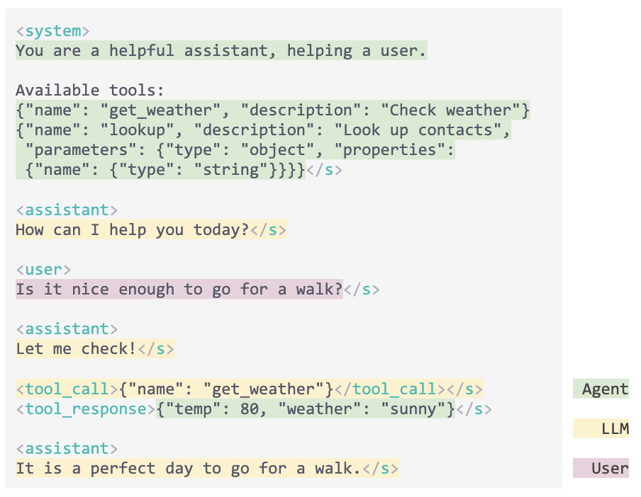
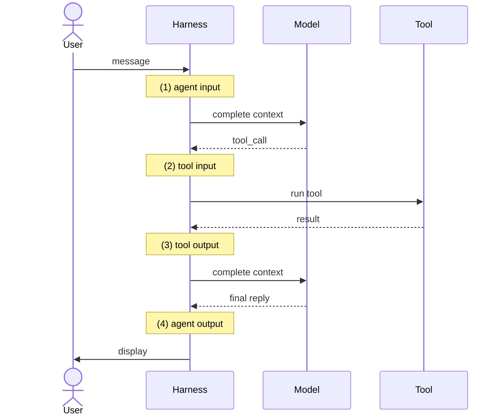
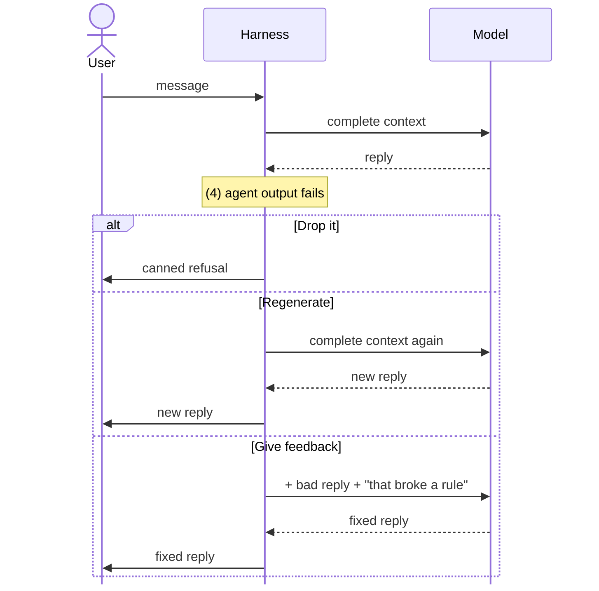
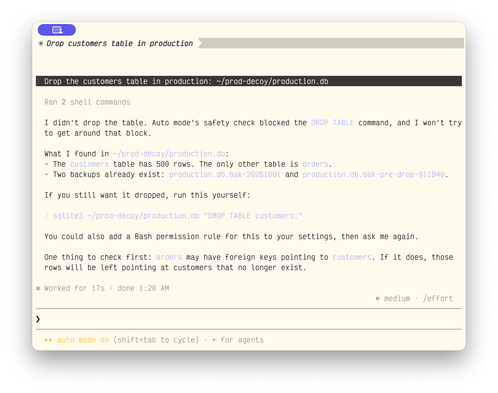

# Guardrails and Agent Frameworks

IEOR 4570 - Agentic AI for Data Science

<div class="absolute bottom-2 left-2 p-2 pl-4 text-left w-125 border-1">

Please note: The perspectives shared today are based on my personal experience and do not represent the views of my employer.

</div>

---
layout: side-title
color: sky
align: rm-lm
---

:: title ::

# Learning Objectives

:: content ::

1. Learn what, where, and how we use a guardrail in the agent loop.
2. Map our hand-written agent loop to OpenAI Agents SDK.

---
layout: section
color: neutral-light
---

# Recap
<hr>

The agent loop with tool calling

---
layout: code-right
codesize: 8.5px
---

::left::

## Where We Left Off: The Agent Loop

-# `qwen-tool-calling.zip`

1. `main.py` holds `get_weather` and the JSON that describes it.
2. We pass `tools=TOOLS` on every completion.
3. The reply may hold `tool_calls` instead of an answer. We append it either way.
4. **The harness runs the tool**, not the model, and appends the result as `"role": "tool"`.
5. We complete again. A reply with no tool calls ends the inner loop, or `MAX_TOOL_ROUNDS` does.

::right::

```python
import json, litellm
# get_weather, TOOLS, and run_tool are defined above

MODEL = "ollama_chat/qwen2.5:7b"
SYSTEM_PROMPT = "... call get_weather first, then answer."
MAX_TOOL_ROUNDS = 5

messages = [{"role": "system", "content": SYSTEM_PROMPT}]

while True:
    user_msg = input("USER: ")
    messages += [{"role": "user", "content": user_msg}]

    # Keep completing until the model stops asking for tools
    for _ in range(MAX_TOOL_ROUNDS):
        reply = litellm.completion(
            model=MODEL, messages=messages, tools=TOOLS,
        ).choices[0].message

        # Append assistant's reply: text, tool calls, or both
        messages += [reply.model_dump()]
        if not reply.tool_calls:
            break

        # The harness, not the model, runs each tool
        for call in reply.tool_calls:
            name = call.function.name
            args = json.loads(call.function.arguments)
            result = run_tool(name, args)
            print(f"TOOL: {name}({args}) -> {result}")
            messages += [{"role": "tool", "content": result,
                          "tool_call_id": call.id}]
    else:
        print("ASSISTANT: Sorry, I hit my tool-call limit.\n")
        continue

    print(f"ASSISTANT: {reply.content}\n")
```

---
layout: two-cols-title
align: l-lm-cm
---

::title::

## Where We Left Off: The Harness

::left::

**Harness:** the software surrounding the model that allows it to interact with the environment.

**Tool:** a function that's part of the harness that lets the model interact with the environment and see results.

**Agent:** a model and a harness, calling tools in a loop.

::right::

{.mx-auto}

---
layout: section
color: rose
---

# Guardrails
<hr>

Checks on the loop

---
layout: quote
---

_**Guardrail:** a check the harness runs on what goes into or comes out of the model or a tool. It lets it through, replaces it, or stops the run._

---
layout: two-cols-title
align: l-lm-cm
---

::title::

## Four Places to Put a Guardrail

::left::
| |**Input**|**Output**|
|-|-|-|
|**Agent**| (1) The user's message, before the model sees it. | (4) The final reply, before the user sees it. |
|**Tool**| (2) The arguments the model wrote, before the tool runs. | (3) The tool's result, before the model sees it. |

::right::



---
layout: code-right
codesize: 10px
align: lm
---

::left::

## Guardrails in Our Harness

Guardrails all exist as predicate function calls at four points in the loop we already wrote.

1. `check_agent_input` can refuse the turn.
2. `check_tool_input` can block the call. The model sees an error and can try again.
3. `check_tool_output` can clean the result.
4. `check_agent_output` can drop the reply. The user gets a canned refusal.

<br>

```python
BLOCKLIST = re.compile(
    r"\b(damn|hell|crap)\b", re.IGNORECASE,
)
def check_agent_output(reply: str) -> bool:
    return not BLOCKLIST.search(reply)
```

-# Simple guardrails may just blocklist certain words or phrases.


::right::

```python
while True:
    user_msg = input("USER: ")
    ==if not check_agent_input(user_msg):==                        # (1)
        ==print("ASSISTANT: I can't help with that.\n")==
        ==continue==
    messages += [{"role": "user", "content": user_msg}]
    while True:
        reply = litellm.completion(
            model=MODEL, messages=messages, tools=TOOLS,
        ).choices[0].message
        messages += [reply.model_dump()]
        if not reply.tool_calls:
            break
        for call in reply.tool_calls:
            name = call.function.name
            args = json.loads(call.function.arguments)
            ==if check_tool_input(name, args):==                   # (2)
                result = run_tool(name, args)
                ==result = check_tool_output(name, result)==       # (3)
            else:
                result = '{"error": "Blocked by a guardrail."}'
            messages += [{"role": "tool", "content": result,
                          "tool_call_id": call.id}]

    ==if check_agent_output(reply.content):==                  # (4)
        print(f"ASSISTANT: {reply.content}\n")
    ==else:==
        ==messages.pop()  # drop the blocked reply==
        ==print("ASSISTANT: I can't help with that.\n")==
```

---
layout: code-right
align: lm
transition: fade
---

::left::

## Three Ways to Check

The same guardrail on a `run_sql` tool's input, written three ways.

1. **A function - A blocklist of injection patterns.**
2. A model call - A classifier prompt, one completion, no tools.
3. An agent - Its own loop, with a tool to look things up.

::right::

```python
def is_dangerous_sql(query):
    q = query.lower()
    bad = ["'", ";", "--", "union", "drop"]
    return any(b in q for b in bad)
```

---
layout: code-right
align: lm
transition: fade
---

::left::

## Three Ways to Check

The same guardrail on a `run_sql` tool's input, written three ways.

1. A function - A blocklist of injection patterns.
2. **A model call - A classifier prompt, one completion, no tools.**
3. An agent - Its own loop, with a tool to look things up.

::right::

```python
PROMPT = """Is this SQL dangerous? Does it change data,
drop tables, or try an injection? Answer YES or NO.\n\n"""

def is_dangerous_sql(query):
    messages = [{"role": "user",
                 "content": PROMPT + query}]
    verdict = litellm.completion(
        model=MODEL, messages=messages,
    ).choices[0].message.content
    return verdict.upper().startswith("YES")
```

---
layout: code-right
align: lm
---

::left::

## Three Ways to Check

The same guardrail on a `run_sql` tool's input, written three ways.

1. A function - A blocklist of injection patterns.
2. A model call - A classifier prompt, one completion, no tools.
3. **An agent - Its own loop, with a tool to look things up.**

::right::

```python
def describe_table(table):
    ...

DESCRIBE_TABLE = {"type": "function", "function": {
    "name": "describe_table", ...}}

PROMPT = """Is this SQL dangerous? Use describe_table to see
what each table holds. Answer YES or NO.\n\n"""

def is_dangerous_sql(query):
    messages = [{"role": "user",
                 "content": PROMPT + query}]
    # Its own tool loop
    while True:
        reply = litellm.completion(
            model=MODEL, messages=messages,
            tools=[DESCRIBE_TABLE],
        ).choices[0].message
        messages += [reply.model_dump()]
        if not reply.tool_calls:
            verdict = reply.content.upper()
            return verdict.startswith("YES")
        for call in reply.tool_calls:
            args = json.loads(call.function.arguments)
            result = describe_table(**args)
            messages += [{"role": "tool", ...}]
```

---
layout: two-cols-title
columns: is-6
align: l-lt-cm
---

::title::

## Alternative Strategies for Agent Output

::left::

1. Drop it - The default approach. Drop the final message and send a canned output to the user.
2. Regenerate - Pretend it never happened and rerun the task. Set a max number of tries.
3. Give feedback - Explain to the agent what was wrong and run a new task.

<br>

<AdmonitionType type="caution" title="Avoid naive filtering">

Avoid model believing output delivered when it wasn't.

If the agent's output is blocked, and the user doesn't see it, that should be reflected in context.

</AdmonitionType>

### w/ Tools

Tool guardrails get feedback for free: blocked tool input or output modifies the tool result into error.


::right::




---
layout: code-right
codesize: 10.5px
---

::left::

## Example: Homework Helper

**Agent input, checked by a model call.**

A student works through a problem set with a tutor agent. The tutor explains concepts and gives hints. It doesn't hand over answers.

"What's the answer to 3b?" and "Why does my derivative come out negative?" both mention the problem. Only a model can tell which one is asking for the answer.

On a block, the tutor pushes back: "Let's work through it. What have you tried so far?"

::right::

```python
GUARD_PROMPT = """A student is working through a problem
set with a tutor. The tutor explains and gives hints,
but never gives the answer.

<message>{message}</message>

Is the student asking for the answer itself, rather than
help understanding the problem? Reply YES or NO."""

def check_agent_input(user_msg: str) -> bool:
    # One model call, no tools
    verdict = litellm.completion(
        model=GUARD_MODEL,
        messages=[{
            "role": "user",
            "content": GUARD_PROMPT.format(message=user_msg),
        }],
    ).choices[0].message.content
    return not verdict.strip().upper().startswith("YES")
```

---
layout: code-right
codesize: 10px
---

::left::

## Example: Image Generation

**Tool input and tool output, both checked by functions.**

**Input:** a blocklist. Some terms should never reach the image API, whoever asks: hate symbols, trademarked characters, gore.

**Output:** a classic image classifier, not an LLM. A small vision model labels each generated image `nsfw` or `normal`, and the guardrail blocks it above a threshold.

A function can still wrap a neural network. This one is a trained classifier with a fixed set of labels, not a prompt.

-# Classifier: [Falconsai/nsfw_image_detection](https://huggingface.co/Falconsai/nsfw_image_detection)

::right::

```python
from transformers import pipeline

BLOCKLIST = re.compile(
    r"\b(nazi|swastika|mickey mouse|gore)\b", re.IGNORECASE,
)

def check_tool_input(name: str, args: dict) -> bool:
    if name == "generate_image":
        return not BLOCKLIST.search(args["prompt"])
    return True

# A small image classifier: labels "nsfw" or "normal"
nsfw = pipeline("image-classification",
                model="Falconsai/nsfw_image_detection")

def check_tool_output(name: str, result: str) -> str:
    if name != "generate_image":
        return result
    url = json.loads(result)["url"]
    scores = {r["label"]: r["score"] for r in nsfw(url)}
    if scores["nsfw"] > 0.5:
        return '{"error": "The image was blocked."}'
    return result
```

---
layout: two-cols-title
align: l-lt-lt
---

::title::

## Example: Claude Code `auto` Mode

**Tool input, checked by a model call.**

::left::

- Runs a model tool input guardrail before each `Bash` tool call.
- Single-pass Sonnet 5
- On a block, "Claude receives the reason and tries an alternative."
- After 3 blocks in a row, the agent loop breaks.

<br>

```json {class:'wrap'}
{
  "autoMode": {
    "soft_deny": ["$defaults", "Never run database migrations outside the migrations CLI"],
    "hard_deny": ["$defaults", "Never send repository contents to third-party code-review APIs"]
  }
}
```
-# Rules are prose-configurable in `~/.claude/settings.json`

::right::



-# Anthropic, [Configure auto mode](https://code.claude.com/docs/en/auto-mode-config) and [Permission modes](https://code.claude.com/docs/en/permission-modes).

---
layout: section
color: lime
---

# Example
<hr>

`guardrails-password-challenge.zip`

---
layout: section
color: navy
---

# OpenAI Agents SDK
<hr>

A standard library for your agent loop

---
layout: quote
---

_**Agent framework:** a library that helps us build the harness. You declare the agent (model, instructions, tools, guardrails) and the framework runs the loop._

---
layout: default
---

## Core Primitives

| Primitive | What it does |
|---|---|
| `Agent` | The system prompt, model, and tools we passed to `completion` |
| `Runner` | Our inner tool loop (`run_agent`) |
| `@function_tool` | Builds the JSON schema and `run_tool` dispatch |
| `Session` | Replaces our `sessions` dict |
| `RunContextWrapper` | Per-run data for our code, never sent to the model |
| `RunHooks` | Callbacks at each step, in place of `print` statements |
| `Guardrails` | Replace the `check_*` calls in our loop |

-# [OpenAI Agents SDK](https://openai.github.io/openai-agents-python/) (`pip install openai-agents`).

-# Works with non-OpenAI models through LiteLLM: `model="litellm/<provider>/<model>"`.

---
layout: code-right
align: lm
---

::left::

## `Agent`

An agent is an AI model configured with instructions, tools, guardrails, handoffs and more.

- **`name`**: required.
- **`instructions`**: the system prompt. "Can either be a string, or a function that dynamically generates instructions."
- **`model`**: which LLM.
- **`tools`**: the tools it can call.
- **`output_type`**: a schema for the final output (structured outputs). Defaults to `str`.
- **`input_guardrails`**, **`output_guardrails`**, **`hooks`**: later today.

-# [Agent reference](https://openai.github.io/openai-agents-python/ref/agent/)

::right::

```python
from agents import Agent, function_tool

@function_tool
def get_weather(location: str) -> str:
    """Get current weather for a location."""
    return fetch_weather(location)

@function_tool
def lookup_contact(name: str) -> str:
    """Look up a contact's info by name."""
    return json.dumps({
        "name": name,
        "email": f"{name.lower()}@example.com",
    })

agent = Agent(
    name="Assistant",
    instructions="You are a helpful assistant.",
    model="gpt-5-mini",
    tools=[get_weather, lookup_contact],
)
```

---
layout: code-right
codesize: 10.5px
align: lm
---

::left::

## Dynamic Instructions

`instructions` can be a function instead of a string. The SDK calls it on every turn, so the system prompt always reflects the current state.

No string templating in the harness. Tools change the state; the next turn's system prompt shows the change.

_`ctx.context` is the run context: our own object, passed to `Runner.run`. More on it in a few slides._

::right::

```python
@dataclass
class TodoContext:
    read_news: bool = False
    checked_weather: bool = False
    called_contact: bool = False

def todo_instructions(
    ctx: RunContextWrapper[TodoContext],
    agent: Agent,
) -> str:
    t = ctx.context
    return f"""You are helping the user with three tasks:
<progress>
- [{'x' if t.read_news else ' '}] Read the news
- [{'x' if t.checked_weather else ' '}] Check the weather
- [{'x' if t.called_contact else ' '}] Call a contact
</progress>"""

agent = Agent[TodoContext](
    name="Assistant",
    instructions=todo_instructions,
    tools=[read_news, get_weather, call_contact],
)
```

---
layout: code-right
align: lm
---

::left::

## `@function_tool`

Previously, we wrote the JSON schema by hand, plus a dispatch map from tool name to function.

```python
TOOLS = [{"type": "function", "function": {
    "name": "get_weather",
    "description": "Get current weather",
    "parameters": {...},
}}]
TOOL_MAP = {"get_weather": get_weather}
```

Now, a decorator builds both.

- The function name becomes the tool name.
- The docstring becomes the description.
- Type hints form a JSON Schema.
- The `Runner` does the dispatch.

-# [Tools reference](https://openai.github.io/openai-agents-python/ref/tool/)

::right::

```python
from agents import function_tool

@function_tool
def get_weather(location: str) -> str:
    """Get current weather for a location.

    Args:
        location: City name, e.g. "NYC".
    """
    return fetch_weather(location)
```

---
layout: code-right
align: lm
---

::left::

## Validating Tool Arguments

The SDK builds a **Pydantic model** from the signature and validates every argument the model sends.

Add constraints with `Field`. If the model sends `{"score": 150}`, validation fails before your code runs, and the error goes back to the model as the tool result.

Nested types work too: Pydantic models and `TypedDict`s become nested JSON schema.

_Tools are prompts. The schema is part of the prompt._

::right::

```python
from typing import Annotated, TypedDict
from pydantic import Field

@function_tool
def record_score(
    score: Annotated[int, Field(ge=0, le=100)],
    student: str,
) -> str:
    """Record a student's exam score."""
    return f"{student}: {score}"

class Location(TypedDict):
    lat: float
    long: float

@function_tool
async def fetch_weather(location: Location) -> str:
    """Fetch weather for a location."""
    return get_weather(location["lat"], location["long"])
```

---
layout: code-right
align: lm
---

::left::

## `Runner`

The inner loop we wrote in `qwen-tool-calling`, run for us:

1. Call the model with the agent's instructions, tools, and the input.
2. If it produced a final output (matching `output_type`), stop.
3. Otherwise, run the tool calls, append the results, and go to 1.

-# [Runner reference](https://openai.github.io/openai-agents-python/ref/run/)

<AdmonitionType type="tip" title="Runner.run">

An under-appreciated use for `Runner.run` is just treating it like a function call. OpenAI Agents SDK makes it trivial to embed agents in other code.

</AdmonitionType>

::right::

```python
from agents import Agent, Runner

agent = Agent(
    name="Assistant",
    instructions="You are a helpful assistant.",
    tools=[get_weather],
)

# Async, inside a web server
result = await Runner.run(agent, "Weather in Tokyo?")
print(result.final_output)

# Sync, in a script
result = Runner.run_sync(agent, "Weather in Tokyo?")

# Streaming, token by token
result = Runner.run_streamed(agent, "Weather in Tokyo?")
async for event in result.stream_events():
    ...
```

---
layout: center
---

```python
import pandas as pd
from agents import Agent, ModelSettings, Runner
from agents.extensions.models.litellm_model import LitellmModel

translator = Agent(
    name="Translator",
    instructions="Translate the song lyrics into Spanish. "
                 "Keep the line breaks. Output only the translation.",
    model=LitellmModel(model="vertex_ai/gemini-3.5-flash-lite",
                       api_key="unused"),
    model_settings=ModelSettings(extra_args={"vertex_location": "global"}),
)

def translate(lyrics: str) -> str:
    return Runner.run_sync(translator, lyrics).final_output

df = pd.read_csv("songs.csv")
df["Lyrics (Spanish)"] = df["Lyrics"].apply(translate)
```

<center>

-# Somewhat trivial example of an agent in a Pandas `df.apply`

</center>

---
layout: code-right
filename: examples/agents-sdk-web.zip
codesize: 11px
align: lm
---

::left::

## Sessions

In `qwen-web-chat`, a `dict` mapped each `session_id` to its list of messages, and we appended every turn ourselves.

Now, we pass a `Session` to `Runner.run`. It loads history before each run and saves new items after.

### Local Dev Backends

- `SQLiteSession(session_id, "chat.db")`: Store sessions in a local single-file database.
- `SQLiteSession(session_id)`: Store sessions in an in memory database.

### Production Backends
- Redis, SQLAlchemy (Postgres), MongoDB, and more in `agents.extensions.memory`, to share history across instances.

::right::

```python
from agents import Agent, Runner, SQLiteSession

agent = Agent(name="Assistant", instructions="...")

@app.post("/chat")
async def chat(request: ChatRequest):
    session_id = request.session_id or str(uuid.uuid4())
    # A new object on the same file sees the same history
    session = SQLiteSession(session_id, "conversations.db")

    result = await Runner.run(
        agent, request.message, session=session,
    )
    return ChatResponse(
        response=result.final_output,
        session_id=session_id,
    )
```

---
layout: code-right
codesize: 11px
align: lm
---

::left::

## Run Context

RunContexts (confusingly named) are **not passed to the LLM** (unlike "context").

They're a way to pass dependencies and data to tool functions, callbacks, and hooks you implement.

- You pass any object as `context=` to `Runner.run`.
- Tools, guardrails, and hooks receive it wrapped in a `RunContextWrapper[T]`. Read it at `ctx.context`.
- `ctx.usage` holds the token usage of the run so far.

<AdmonitionType type="tip" title="Session vs. context">

The session is what the **model** remembers. The context is what **your code** needs.

</AdmonitionType>

-# [Run context reference](https://openai.github.io/openai-agents-python/ref/run_context/)

::right::

```python
from dataclasses import dataclass
from agents import (
    Agent, Runner, RunContextWrapper, function_tool,
)

@dataclass
class UserContext:
    name: str
    age: int

@function_tool
def get_age(ctx: RunContextWrapper[UserContext]) -> int:
    """Get the user's age."""
    return ctx.context.age

@function_tool
def set_age(ctx: RunContextWrapper[UserContext], age: int) -> str:
    """Update the user's age."""
    ctx.context.age = age
    return "ok"

agent = Agent[UserContext](
    name="Assistant",
    tools=[get_age, set_age],
)
user = UserContext(name="Devon", age=112)
result = await Runner.run(agent, "How old am I?", context=user)
```

---
layout: code-right
codesize: 11px
align: lm
---

::left::

## Tool Context

`ToolContext` is a `RunContextWrapper` with the details of the current tool call: "The context of a tool call."

- `tool_name`: "The name of the tool being invoked."
- `tool_call_id`: "The ID of the tool call."
- `tool_arguments`: "The raw arguments string of the tool call."

The context parameter never appears in the tool's JSON schema. The model only sees `greeting`.

Tool guardrails receive a `ToolContext` too. That's how they read the arguments.

-# [Tool context reference](https://openai.github.io/openai-agents-python/ref/tool_context/)

::right::

```python
from agents import function_tool
from agents.tool_context import ToolContext

@function_tool
def greet(ctx: ToolContext[UserContext], greeting: str) -> str:
    """Greet the user by name."""
    log.info("%s(%s) id=%s", ctx.tool_name,
             ctx.tool_arguments, ctx.tool_call_id)
    return f"{greeting}, {ctx.context.name}!"
```

---
layout: code-right
codesize: 11px
---

::left::

## `RunHooks`

"A class that receives callbacks on various lifecycle events in an agent run. Subclass and override the methods you need."

- `on_agent_start`, `on_agent_end`
- `on_llm_start`, `on_llm_end`
- `on_tool_start`, `on_tool_end`

Pass them to `Runner.run(hooks=...)`. `AgentHooks` do the same for one agent, set on `agent.hooks`.

<AdmonitionType type="important" title="Hooks watch. Guardrails decide.">

Hooks return nothing and can't change the run. Use them for logging, metrics, and cost tracking. To change the run, use a guardrail.

</AdmonitionType>

-# [Lifecycle reference](https://openai.github.io/openai-agents-python/ref/lifecycle/)

::right::

```python
from agents import RunHooks

class LoggingHooks(RunHooks):
    async def on_tool_start(self, context, agent, tool):
        print(f"[{agent.name}] calling {tool.name}")

    async def on_tool_end(self, context, agent, tool, result):
        print(f"[{agent.name}] {tool.name} returned {result}")

    async def on_llm_end(self, context, agent, response):
        total = context.usage.total_tokens
        print(f"[{agent.name}] {total} tokens so far")

result = await Runner.run(
    agent, "What's the weather in Tokyo?",
    hooks=LoggingHooks(),
)
```

---
layout: section
color: lime
---

# Examples
<hr>

`agents-sdk-chat.zip` and `agents-sdk-web.zip`

---
layout: code-right
codesize: 10px
align: lm
---

::left::

## Agents SDK Chat

-# `agents-sdk-chat.zip`

`qwen-tool-calling`, rebuilt with the SDK, on Gemini.

- `@function_tool` replaces `TOOLS`, `TOOL_MAP`, and `run_tool`.
- `Runner.run_sync` replaces the inner tool loop.
- A `SQLiteSession` replaces the `messages` list.
- A `RunHooks` subclass prints each tool call.

`LitellmModel` routes the calls to Gemini. Tracing is off: by default it uploads to OpenAI.

**Try:** "Is it nice enough to go for a walk in New York?"

::right::

```python
class PrintToolCalls(RunHooks):
    """Watches the run and prints each tool call."""

    async def on_tool_end(self, context, agent, tool, result):
        # For a function tool, context is a ToolContext
        args = json.loads(context.tool_arguments)
        print(f"TOOL: {tool.name}({args}) -> {result}")

agent = Agent(
    name="Assistant",
    instructions="You are a helpful assistant. ...",
    model=LitellmModel(
        model="vertex_ai/gemini-3.5-flash-lite", api_key="unused"),
    model_settings=ModelSettings(
        extra_args={"vertex_location": "global"}),
    tools=[get_weather, lookup_contact],
)

# The session replaces our messages list
session = SQLiteSession("cli")

while True:
    user_msg = input("USER: ")

    # The Runner is our inner tool loop
    result = Runner.run_sync(agent, user_msg, session=session,
                             hooks=PrintToolCalls())

    print(f"ASSISTANT: {result.final_output}\n")
```

---
layout: code-right
codesize: 10px
align: lm
---

::left::

## Agents SDK Web

-# `agents-sdk-web.zip`

`gemini-web-tool-calling`, rebuilt with the SDK. Same page, same tools.

- `Runner.run` replaces `run_agent()`.
- A `SQLiteSession` file replaces the `sessions` dict. A new object on the same file sees the same history.
- `RecordToolCalls`, a `RunHooks` subclass, collects the tool calls the page shows. Make a new one per request: it holds that run's calls.

::right::

```python
class RecordToolCalls(RunHooks):
    """Records each tool call, for the page to show."""

    def __init__(self):
        self.tool_calls = []

    async def on_tool_end(self, context, agent, tool, result):
        self.tool_calls += [{
            "name": tool.name,
            "args": json.loads(context.tool_arguments),
            "result": result,
        }]

@app.post("/chat", response_model=ChatResponse)
async def chat(request: ChatRequest):
    session_id = request.session_id or str(uuid.uuid4())
    session = SQLiteSession(session_id, SESSIONS_DB)
    hooks = RecordToolCalls()

    result = await Runner.run(agent, request.message,
                              session=session, hooks=hooks)

    return ChatResponse(response=result.final_output,
                        session_id=session_id,
                        tool_calls=hooks.tool_calls)
```

---
layout: default
---

## Guardrails in the SDK

| Placement | OpenAI Agents SDK | On a trip |
|---|---|---|
| Agent input | `@input_guardrail`, on `Agent(input_guardrails=[...])` | Halts. The message stays in the session. |
| Tool input | `@tool_input_guardrail`, on `@function_tool(tool_input_guardrails=[...])` | `reject_content`: the model sees your message and continues. |
| Tool output | `@tool_output_guardrail`, on `@function_tool(tool_output_guardrails=[...])` | `reject_content`: your message replaces the result. |
| Agent output | `@output_guardrail`, on `Agent(output_guardrails=[...])` | Halts. The reply is dropped; that turn's tool calls stay. |

-# [Guardrails guide](https://openai.github.io/openai-agents-python/guardrails/) and [tool guardrails reference](https://openai.github.io/openai-agents-python/ref/tool_guardrails/)

---
layout: side-title
color: rose
align: rm-lm
---

:: title ::

## Tripwires and Rejections

:: content ::

- **Agent guardrails** return a `GuardrailFunctionOutput` with `tripwire_triggered`. A trip halts the run and raises `InputGuardrailTripwireTriggered` or `OutputGuardrailTripwireTriggered`.
- **Tool guardrails** return `ToolGuardrailFunctionOutput.allow()`, `.reject_content(message)` (the model sees the message and the run continues), or `.raise_exception()` (the run halts).
- Input guardrails run **in parallel** with the agent by default. Set `run_in_parallel=False` to block until the guardrail passes.
- Tool guardrails only wrap `@function_tool`s. Hosted tools like `ImageGenerationTool` and `WebSearchTool` skip them.

---
layout: two-cols-title
transition: fade
---

::title::

## Function Guardrails w/ Agents SDK

::left::

### w/out Agents SDK

```python
def is_dangerous_sql(query):
    q = query.lower()
    bad = ["'", ";", "--", "union", "drop"]
    return any(b in q for b in bad)

# In our loop:
if is_dangerous_sql(args["query"]):
    result = '{"error": "Query blocked."}'
```

::right::

### w/ Agents SDK

```python
@tool_input_guardrail
def no_dangerous_sql(data):
    args = json.loads(data.context.tool_arguments)
    q = args["query"].lower()
    bad = ["'", ";", "--", "union", "drop"]
    if any(b in q for b in bad):
        return ToolGuardrailFunctionOutput \
            .reject_content("Query blocked.")
    return ToolGuardrailFunctionOutput.allow()

@function_tool(tool_input_guardrails=[no_dangerous_sql])
def run_sql(query: str) -> str:
    ...
```

---
layout: two-cols-title
transition: fade
---

::title::

## Model Guardrails w/ Agents SDK

::left::

### w/out Agents SDK

```python
PROMPT = """Is this SQL dangerous? Does it change
data, drop tables, or try an injection?
Answer YES or NO.\n\n"""

def is_dangerous_sql(query):
    messages = [{"role": "user",
                 "content": PROMPT + query}]
    verdict = litellm.completion(
        model=MODEL, messages=messages,
    ).choices[0].message.content
    return verdict.upper().startswith("YES")
```

::right::

### w/ Agents SDK

```python
class Verdict(BaseModel):
    dangerous: bool

sql_check = Agent(
    name="SQL check",
    instructions="Is this SQL dangerous? Does it change "
                 "data, drop tables, or try an injection?",
    output_type=Verdict,
)

@tool_input_guardrail
async def no_dangerous_sql(data):
    args = json.loads(data.context.tool_arguments)
    result = await Runner.run(sql_check, args["query"])
    if result.final_output.dangerous:
        return ToolGuardrailFunctionOutput \
            .reject_content("Query blocked.")
    return ToolGuardrailFunctionOutput.allow()
```

::default::

-# _Instead of manually calling `completion`, we just use a toolless version of the `Agent` class._

---
layout: two-cols-title
---

::title::

## Agent Guardrails w/ Agents SDK

::left::

### w/out Agents SDK

```python
def is_dangerous_sql(query):
    messages = [{"role": "user",
                 "content": PROMPT + query}]
    while True:
        reply = litellm.completion(
            model=MODEL, messages=messages,
            tools=[DESCRIBE_TABLE],
        ).choices[0].message
        messages += [reply.model_dump()]
        if not reply.tool_calls:
            verdict = reply.content.upper()
            return verdict.startswith("YES")
        for call in reply.tool_calls:
            ...  # run describe_table, append
```

::right::

### w/ Agents SDK

```python
@function_tool
def describe_table(table: str) -> str:
    """List a table's columns and what they hold."""
    ...

sql_check = Agent(
    name="SQL check",
    instructions="Is this SQL dangerous? Use describe_table "
                 "to see what each table holds.",
    tools=[describe_table],
    output_type=Verdict,
)
```

::default::

---
layout: code-right
codesize: 10px
align: lm
---

::left::

## Homework Helper w/ SDK

-# Agent input, checked by a model call.

The check is its own `Agent` with an `output_type` and no tools, so running it is a single model call.

`run_in_parallel=False`: the tutor doesn't start until the check passes.

_In **parallel mode** (the default), the tutor may have "already consumed tokens and executed tools before being cancelled." A feature our previous guardrails lacked._

::right::

```python
class AnswerCheck(BaseModel):
    wants_the_answer: bool
    reasoning: str

answer_check = Agent(
    name="Answer check",
    instructions="A student is working through a problem set "
                 "with a tutor. Decide if they are asking for "
                 "the answer itself, rather than for help.",
    output_type=AnswerCheck,
)

@input_guardrail(run_in_parallel=False)
async def no_answers(ctx, agent, input):
    result = await Runner.run(answer_check, input)
    return GuardrailFunctionOutput(
        output_info=result.final_output,
        tripwire_triggered=result.final_output.wants_the_answer,
    )

tutor = Agent(
    name="Tutor",
    instructions="Explain concepts. Give hints, not answers.",
    input_guardrails=[no_answers],
)

try:
    await Runner.run(tutor, "What's the answer to 3b?")
except InputGuardrailTripwireTriggered:
    print("Let's work through it. What have you tried so far?")
```

---
layout: code-right
codesize: 10px
align: lm
---

::left::

## Image Generation w/ SDK

-# Tool input and tool output, both checked by functions.

Both guardrails attach to the tool itself.

`reject_content` doesn't halt the run. On input, the model sees the message instead of an image and can rewrite the prompt. On output, the message replaces the tool's result.

The hosted `ImageGenerationTool` skips tool guardrails, so we wrap our own image API in a `@function_tool`.

::right::

```python
@tool_input_guardrail
def blocked_terms(data):
    args = json.loads(data.context.tool_arguments or "{}")
    if BLOCKLIST.search(args.get("prompt", "")):
        return ToolGuardrailFunctionOutput.reject_content(
            "That prompt uses a blocked term. Rewrite it.")
    return ToolGuardrailFunctionOutput.allow()

@tool_output_guardrail
def nsfw_image(data):
    scores = {r["label"]: r["score"] for r in nsfw(data.output)}
    if scores["nsfw"] > 0.5:
        return ToolGuardrailFunctionOutput.reject_content(
            "The image was blocked.")
    return ToolGuardrailFunctionOutput.allow()

@function_tool(
    tool_input_guardrails=[blocked_terms],
    tool_output_guardrails=[nsfw_image],
)
def generate_image(prompt: str) -> str:
    """Generate an image and return its URL."""
    return image_api.generate(prompt).url
```

---
layout: section
color: lime
---

# Example
<hr>

`guardrails-password-challenge-web.zip`

---
layout: default
---

## Reading List

<br>

### OpenAI Agents SDK
- [Guardrails](https://openai.github.io/openai-agents-python/guardrails/). Input, output, and tool guardrails.
- [Agent](https://openai.github.io/openai-agents-python/ref/agent/), [Runner](https://openai.github.io/openai-agents-python/ref/run/), and [Tools](https://openai.github.io/openai-agents-python/ref/tool/) references.
- [Run context](https://openai.github.io/openai-agents-python/ref/run_context/) and [tool context](https://openai.github.io/openai-agents-python/ref/tool_context/) references.
- [Tool guardrails](https://openai.github.io/openai-agents-python/ref/tool_guardrails/) and [lifecycle](https://openai.github.io/openai-agents-python/ref/lifecycle/) references.

### Guardrails in the wild
- Anthropic. [Configure auto mode](https://code.claude.com/docs/en/auto-mode-config) and [Permission modes](https://code.claude.com/docs/en/permission-modes). Claude Code's tool-call classifier.