# Chatbots

IEOR 4570 - Agentic AI for Data Science


<div class="absolute bottom-2 left-2 p-2 pl-4 text-left w-125 border-1">

Please note: The perspectives shared today are based on my personal experience and do not represent the views of my employer.

</div>

---
layout: side-title
color: sky
align: rm-lm
---

:: title ::

# Learning Objectives

:: content ::

1. Recap on the agent being a loop
2. Understand client-server architecture
3. Combine these concepts to form a web-based dialogue agent (or "chatbot")

---
layout: two-cols
align: lt-cm
---

:: left ::

## Where We Left Off

Last class we finished by performing completions and a basic chat loop with `TinyLlama-1.1B`, a very small and outdated (2023) local model.

```python
conversation = f"{SYSTEM_PROMPT}</s>\n<|user|>\n"

while True:
    user_input = input("User: ")
    conversation += user_input
    conversation += "</s>\n<|assistant|>\n"

    raw_output = generate_text(conversation)
    reply = raw_output.split("</s>")[0]
    print(f"Assistant: {reply.strip()}")

    conversation += reply + "</s>\n<|user|>\n"
```

The model (an auto-complete engine) is simply completing a dialogue between two parties.

:: right ::

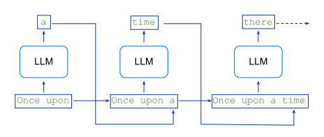

-# Shanahan, McDonell, Reynolds (2023), Fig. 1. [arXiv:2305.16367](https://arxiv.org/abs/2305.16367)

---

## Two Steps to a Dialogue Agent

{.mx-auto}

-# Shanahan, McDonell, Reynolds. "Role-Play with Large Language Models" (2023), Fig. 2. [arXiv:2305.16367](https://arxiv.org/abs/2305.16367)

---
layout: code-right
wrap: true
---

::left::

## Three Roles

-# (Most of the time)

<br>

### system

Set behavior, tone, and boundaries

## user

Real-world questions or inputs

## assistant

Model's generated response

::right::

```json
[
  {
    "role": "system",
    "content": "You are a polite and knowledgeable AI assistant."
  },
  {
    "role": "user",
    "content": "What is quantum computing in simple words?"
  },
  {
    "role": "assistant",
    "content": "Quantum computing uses the principles of quantum mechanics to perform calculations. Unlike regular computers that use bits (0 or 1), quantum computers use qubits, which can be both at once, allowing them to solve certain problems faster."
  }
]
```

---
layout: section
color: indigo
---

# External Models
<hr>

How to talk to an external model

---
layout: side-title
align: rm-lm
---

:: title ::

## The Options

:: content ::

There are basically three ways to run LLMs:

1. **Locally** - on your laptop (e.g., MacBook M4 Max, Mac Studio M5 Max/Ultra, NVIDIA DGX Spark, NVIDIA 4090)
2. **Rented GPU** - a specialized GPU you buy or rent
3. **Hosted API** - via a cloud provider (OpenAI, Anthropic, Gemini, Google Model Garden, Amazon Bedrock, Azure AI Foundry)

Each has different trade-offs in cost, speed, privacy, and capability.

_We'll revisit this topic later when we talk about token cost._

---
layout: two-cols
---

::left::

## Different APIs

Each provider has its own API format. Different request formats, different response structures, different error handling.

### OpenAI

```python
from openai import OpenAI
r = OpenAI().chat.completions.create(
    model="gpt-4o", messages=[...])
r.choices[0].message.content
```

### Anthropic

```python
import anthropic
m = anthropic.Anthropic().messages.create(
    model="claude-sonnet-4-5", max_tokens=1024,
    messages=[...])
m.content[0].text
```

### Google

```python
from google import genai
r = genai.Client().models.generate_content(
    model="gemini-2.5-flash", contents="...")
r.text
```

::right::

## LiteLLM

[LiteLLM](https://github.com/BerriAI/litellm) provides a single, OpenAI-compatible interface to 100+ models as both a library and proxy.

```python
from litellm import completion

# OpenAI
response = completion(
    model="gpt-4o", 
    messages=[...]
)

# Anthropic
response = completion(
    model="claude-3-5-sonnet-20241022", 
    messages=[...]
)

# Google
response = completion(
    model="vertex_ai/gemini-1.5-pro", 
    messages=[...]
)
```

---
layout: two-cols-title
---

::title::

## Completions API vs Responses API

::left::

**OpenAI's** `/completions/` API was the first widely accepted standard ([famously a weekend project](https://x.com/athyuttamre/status/1899541474297180664)).

Completions mirrored how models work: <u>Every generation requires the entire context.</u>

In late 2024, OpenAI released their [`/responses/` API](https://developers.openai.com/blog/responses-api) which preserves context across turns. [Adoption has been slow.](https://x.com/prashantmital/status/1963801236391772372)

**Google** followed suite with the [interactions API](https://ai.google.dev/gemini-api/docs/interactions-overview).

**Anthropic's** [messages API](https://platform.claude.com/docs/en/build-with-claude/working-with-messages) remains stateless (this is what Claude Code hits) but they offer a managed [Agents API](https://platform.claude.com/docs/en/managed-agents/overview).

**LiteLLM** supports a `/responses/` API and will maintain state for you to bridge the gap when the model doesn't support it.

::right::

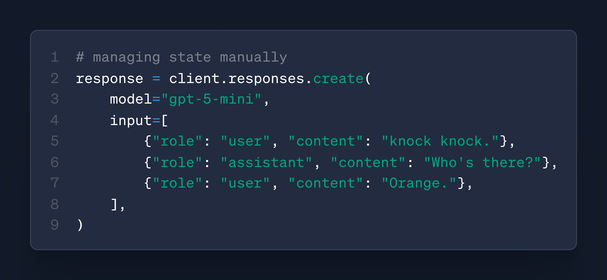

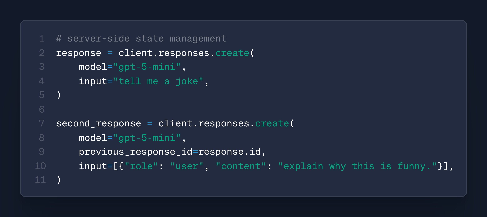

---
layout: section
color: orange
---

# Knobs
<hr>

You have a lot of them

---
layout: two-cols-title
align: l-lm-lm
---

:: title ::

## Temperature Scaling

:: left ::

To control the trade-off between determinism and randomness, we modify the **Softmax** function with a hyperparameter $T$ (Temperature).

$$
P(w_i) = \frac{\exp(z_i / T)}{\sum_j \exp(z_j / T)}
$$

Where $z$ is the logit and $T$ is the temperature.

- **As $T \to 0$:** Distribution sharpens (deterministic)
- **As $T \to 1$:** Distribution unchanged
- **As $T \to \infty$:** Distribution flattens (random)

:: right ::

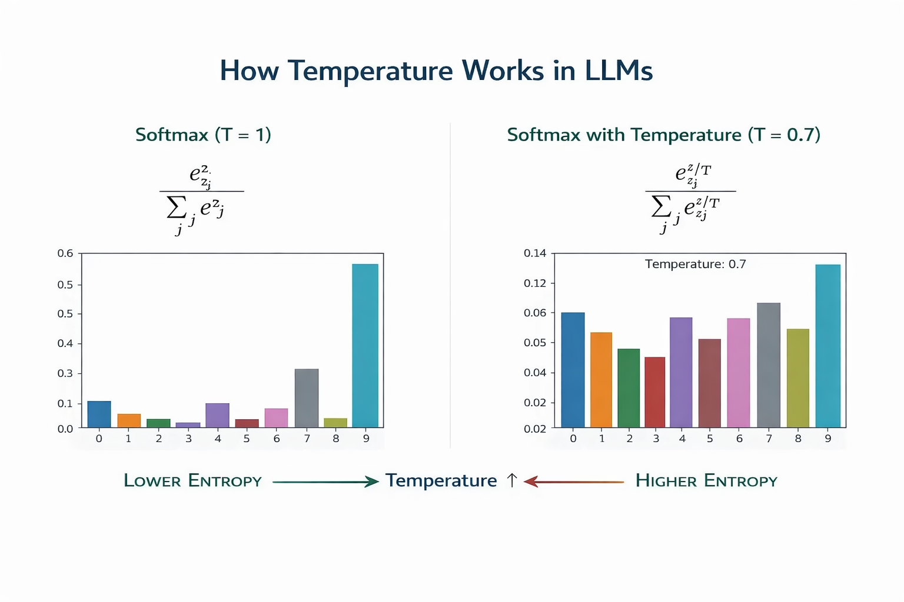

---
layout: code-right
filename: litellm
codesize: 11px
---

:: left ::

## Temperature Is Not the Only Knob

Every hosted API exposes the sampling step, and the names are near-universal.

The model returns a distribution. These parameters decide how you pick from it, and when you stop.

**Shape the distribution:** `temperature`, `top_p`, `top_k`, `logit_bias`, the two penalties.

**Control the run:** `n`, `stop`, `max_tokens`, `seed`, `stream`.

Everything after `messages` is the sampling loop from class 1, exposed as parameters.

-# [LiteLLM: completion() input parameters](https://docs.litellm.ai/docs/completion/input). Same names across OpenAI, Anthropic, Google, and local models.

:: right ::

```python
response = completion(
    model="gpt-4o-mini",
    messages=[
        {"role": "system", "content": "You are terse."},
        {"role": "user", "content": "Name a planet."},
    ],
    temperature=0.7,        # reshape the distribution
    top_p=0.9,              # keep tokens summing to p
    top_k=40,               # keep k likeliest (not OpenAI)
    logit_bias={},          # nudge specific tokens
    frequency_penalty=0.0,  # penalize repeats
    presence_penalty=0.0,   # penalize any seen token
    n=1,                    # completions to sample
    stop=["\n"],            # sequences that end output
    max_tokens=20,          # hard cap on length
    seed=42,                # best-effort determinism
    stream=False,           # tokens as produced
)
```

---
layout: code-right
---

:: left ::

<br><br>

## Temp in Markov Chains

<br>

We can demonstrate temperature on our simple Markov model.

**The process:**
1. Convert probabilities to log-space
2. Scale by $1/T$: `log_probs / temperature`
3. Apply softmax to get new probabilities

:: right ::

```python
def apply_temperature(probs, temperature):
    if temperature == 1.0:
        return probs
    log_probs = [math.log(p) / temperature 
                 for p in probs]
    # Compute softmax
    max_log_prob = max(log_probs)
    exp_probs = [math.exp(lp - max_log_prob) 
                 for lp in log_probs]
    sum_exp = sum(exp_probs)
    return [p / sum_exp for p in exp_probs]
```

---
layout: four-cell-title
align: l-lt-lt-lt-lt
---

:: title ::

## Temperature Examples on Frankenstein

:: top-left ::

### $T = 0.1$ (Nearly Deterministic)

###### The sun had been the same time I was the most of the most beautiful and I had been the same time I had been the same time I was a few moments...

:: top-right ::

### $T = 0.7$ (Balanced - Common Default)

###### The person had been towards the murderer of my retreat I saw the United States and I was the United States, we hurried away from my thoughts...

:: bottom-left ::

### $T = 2.0$ (High Diversity)

###### The light became scarce, and apparent lifelessness. I now came its recesses. Their pronunciation was shut up much recovered my pride and yet brought a wreck...

:: bottom-right ::

### The tradeoff

- **Low $T$:** Repetitive but coherent
- **Medium $T$ (0.7):** Balanced
- **High $T$:** Creative but can be incoherent

---
layout: four-cell-title
align: l-lt-lt-lt-lt
---

:: title ::

## Temperature Examples on TinyLlama

:: top-left ::

### $T = 0.1$ (Nearly Deterministic)

###### The scientific method is a systematic approach to understanding the world through observation, experimentation, and reasoning. It is based on the principle that new knowledge can be gained by testing hypotheses and gathering evidence...

:: top-right ::

### $T = 0.7$ (Balanced - Common Default)

###### The scientific method is a set of steps that scientists use to collect, analyze, and interpret evidence to make new discoveries. The method is based on observation, experimentation, and critical thinking...

:: bottom-left ::

### $T = 2.0$ (High Diversity)

###### The scientific method is a fundamental concept at core sciences by developing a plan or hypothesis which under these ideas on chemism? What I did not say enough.

:: bottom-right ::

### Same pattern as Markov chains

- **Low $T$:** Coherent but formulaic
- **Medium $T$:** Natural variety
- **High $T$:** Nonsensical

---
layout: code-right
filename: main.py
align: lm
codesize: 11px
---

:: left ::

## Recap: TinyLama

-# **Goal:** run a real Transformer locally.

1. Download [`tiny-llama-completions.zip`](https://courseworks2.columbia.edu/courses/252703/files/folder/examples)
2. Unzip, open the folder, `uv run main.py`
3. Watch it complete "The scientific method is"

<br>

### Expected

```{class:'wrap'}
The scientific method is a process that is used to test hypotheses and theories. It is a systematic approach to gathering and...
```

**Challenge:** change `temperature` and run it three times at each setting.

:: right ::

```python
import torch
from transformers import AutoModelForCausalLM, AutoTokenizer

# 1. Load model
model_id = "TinyLlama/TinyLlama-1.1B-Chat-v1.0"
tokenizer = AutoTokenizer.from_pretrained(model_id)
model = AutoModelForCausalLM.from_pretrained(
    model_id,
    dtype=torch.float32,
)

# 2. Tokenize the input
text = "The scientific method is"
inputs = tokenizer(text, return_tensors="pt")

# 3. Generate: next-token prediction in a loop
output_tokens = model.generate(
    **inputs,
    max_new_tokens=50,
    do_sample=True,
    temperature=0.7,
    pad_token_id=tokenizer.eos_token_id,
)

# 4. Decode tokens back to text
completion = tokenizer.decode(
    output_tokens[0], skip_special_tokens=True
)
print(completion)
```

---
layout: code-right
filename: main.py
align: lm
codesize: 12px
---

:: left ::

## w/ Ollama + Qwen 2.5 1.5B

`transformers` loaded the weights into our Python process. Now put the model in its own process and call it over HTTP.

1. Install [Ollama](https://ollama.com/download). It runs models as a local server on port 11434.
2. `ollama pull qwen2.5:1.5b`
3. Download [`ollama-completions.zip`](https://courseworks2.columbia.edu/courses/252703/files/folder/examples), `uv run main.py`

**LiteLLM** is the **client**. The `ollama/` prefix routes the call to localhost.

**Ollama** is the **model runner**. It downloads, hosts, and runs the models for us.

:: right ::

```python
from litellm import completion

# Ollama serves the model on http://localhost:11434.
# The "ollama/" prefix routes the call there.
MODEL = "ollama/qwen2.5:1.5b"

text = "The scientific method is"

response = completion(
    model=MODEL,
    messages=[{"role": "user", "content": text}],
    temperature=0.7,
    max_tokens=50,
)

print(response.choices[0].message.content)
```

---
layout: default
---

## Python Talks to a Model Server

Our script never touches the weights. It sends a request and reads a response. Ollama is the **model runner**: it loads the weights, applies the chat template, samples tokens, and answers HTTP.

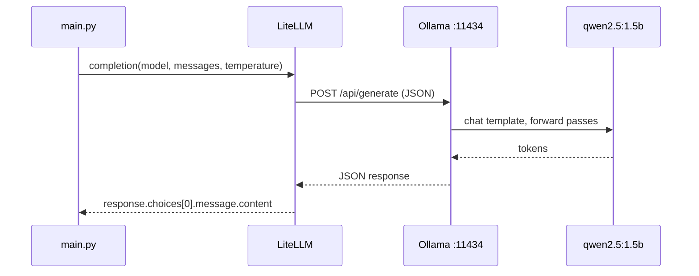

From here on, unless it matters, we will call the runner and the weights together the **model**, or the **LLM**. A hosted API is the same picture with a different hostname. This is also the shape of everything in the rest of this deck.

---
layout: center
---

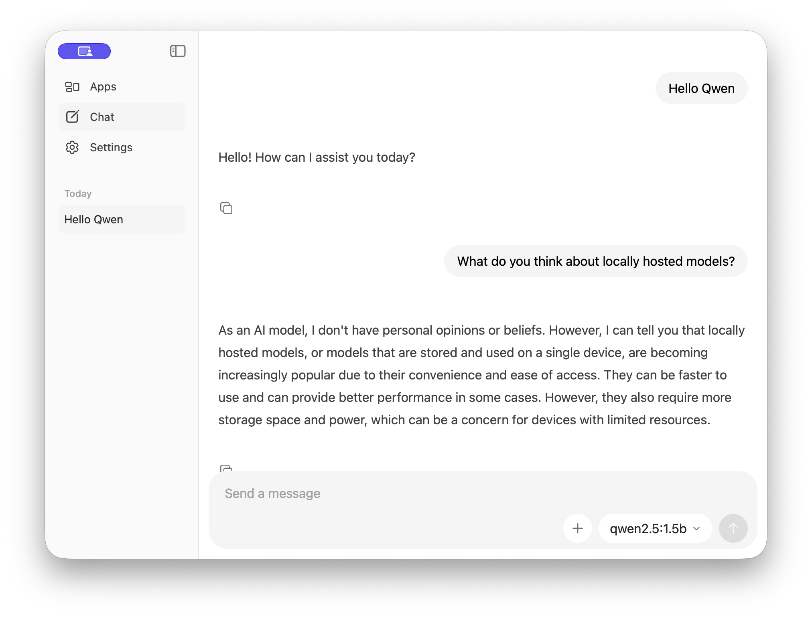{width=80% .mx-auto}


---
layout: side-title
color: rose
align: rm-lm
---

:: title ::

## The Problem

:: content ::


* **Access:** Users need Python, dependencies, and a GPU

* **State:** Conversation history lives in a single process's memory

* **Scale:** One user per running instance

* **Reliability:** If the process dies, the conversation is lost

<hr>

**Question:** How do we share our chatbot with others?

---
layout: section
color: teal
---

# A Little Internet Lesson
<hr>

Client-Server Architecture

---
layout: quote-portrait
color: sky-light
quotesize: text-l
authorsize: text-m
author: 'Ted Stevens (R-Alaska)'
---

::pic::


::default::

The internet is a series of tubes.

---
layout: two-cols
align: lm-cm
---

:: left ::

## Client-Server Architecture

The web is built on a simple division of labor.

### Client (Browser)
- Runs on the user's device
- Sends requests, receives responses
- Renders the user interface

<br>

### Server (Your Code)
- Runs on a machine you control
- Processes requests, generates responses
- Maintains state (databases, sessions)

:: right ::

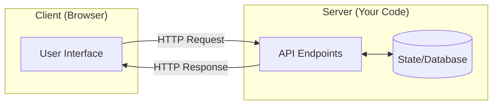

---
layout: two-cols-title
---

:: title ::

## HTTP: The Language

**HTTP** (HyperText Transfer Protocol) is how clients and servers communicate.

<br><br>

::left::

### Anatomy of a Request:

```
POST /chat HTTP/1.1
Host: mychatbot.com
Content-Type: application/json

{"message": "What is 2+2?"}
```

- **Method:** `GET` (retrieve) or `POST` (send)
- **Path:** `/chat` - which endpoint to hit
- **Headers:** Metadata (content type, auth)
- **Body:** The actual data

:: right ::

### Anatomy of a Response

```
HTTP/1.1 200 OK
Content-Type: application/json

{"response": "2+2 equals 4."}
```

- **Status Code:** `200` (success), `404` (not found), `500` (error)
- **Headers:** Metadata about the response
- **Body:** The data being returned

---
layout: default
---

<br><br>

## HTTP Methods

| Method   | Purpose             | Has Body? | Idempotent? |
|----------|---------------------|-----------|-------------|
| `GET`    | Retrieve a resource | No        | Yes         |
| `POST`   | Create/submit data  | Yes       | No          |
| `PUT`    | Replace a resource  | Yes       | Yes         |
| `DELETE` | Remove a resource   | No        | Yes         |

For chatbots, we typically use `POST /chat` to send messages and receive responses.

---
layout: iframe
url: https://http.cat/
---


---
layout: side-title
color: emerald
align: rm-lm
---

:: title ::

## Sessions and State

:: content ::

HTTP is **stateless**. Each request is independent; the server doesn't inherently remember previous requests.

To maintain conversation history, we use **sessions**:

1. Server generates a unique session ID on first request
2. Client stores it (cookie or local storage)
3. Client sends session ID with every subsequent request
4. Server looks up conversation history by session ID

---
layout: center
---

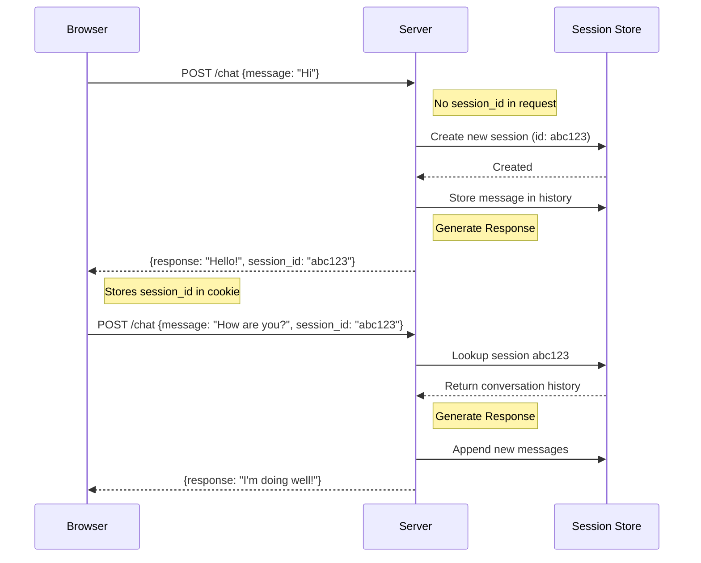

---
layout: code-right
---

:: left ::

<br>
<br>
<br>

## Session Management

<br>

### For production

Replace the in-memory dict with:
- **Redis** - Fast key-value store
- **Database** - PostgreSQL, MongoDB


<br>

### For learning

For a single process, a global dict variable works fine.


:: right ::


```python
# Server-side session management
sessions = {}  # session_id -> history

@app.post("/chat")
def chat(session_id: str, message: str):
    if session_id not in sessions:
        sessions[session_id] = []

    sessions[session_id].append({
        "role": "user", 
        "content": message
    })
    
    response = generate_response(
        sessions[session_id]
    )
    
    sessions[session_id].append({
        "role": "assistant", 
        "content": response
    })

    return {"response": response}
```

---
layout: section
color: fuchsia
---

# The Payload
<hr>

HTML, CSS, JavaScript

---
layout: two-cols
---

:: left ::

## The Web Trifecta

### HTML (Structure)

What elements exist

```html
<div class="chat-container">
  <div id="messages"></div>
  <input type="text" id="user-input">
  <button onclick="sendMessage()">Send</button>
</div>
```

### CSS (Style)

How elements look

```css
.chat-container {
  max-width: 600px;
  margin: 0 auto;
  font-family: sans-serif;
}
.messages {
  height: 400px;
  overflow-y: scroll;
  border: 1px solid #ccc;
}
```

::right::

<br>

### JavaScript (Behavior)

What happens when users interact:

```javascript
async function sendMessage() {
  const input = document.getElementById('user-input');
  const message = input.value;
  // Send to server
  const response = await fetch('/chat', {
    method: 'POST',
    headers: {'Content-Type': 'application/json'},
    body: JSON.stringify({message: message})
  });
  const data = await response.json();
  // Display response
  appendMessage('assistant', data.response);
}
```

<br>

<AdmonitionType type="tip" title="Your role">

For this class, I'll provide pre-built frontends. But you should experiment and tweak with coding agents.

</AdmonitionType>

---
layout: code-right
align: lm-lm
---

:: left ::

<br><br>

## APIs and JSON


An **API** (Application Programming Interface) defines how software components communicate.

For web apps, this means HTTP endpoints that accept and return **JSON**.

**JSON** (JavaScript Object Notation):
- Language-agnostic
- Self-documenting (keys describe data)
- Nested structures map to objects/dicts

:: right ::

```json
{
  "messages": [
    {
      "role": "user", 
      "content": "Hello"
    },
    {
      "role": "assistant", 
      "content": "Hi! How can I help?"
    }
  ],
  "temperature": 0.7,
  "max_tokens": 100
}
```

---
layout: default
---

<br><br>

## Chatbot API Design

A typical chatbot API:

| Endpoint | Method | Request Body | Response |
|----------|--------|--------------|----------|
| `/chat` | POST | `{message, session_id}` | `{response}` |
| `/history` | GET | (session_id in query) | `{messages: [...]}` |
| `/clear` | POST | `{session_id}` | `{status: "ok"}` |

---
layout: section
color: cyan
---

# Streaming
<hr>

Real-time Token Delivery

---
layout: side-title
color: amber
align: rm-lm
---

:: title ::

## The UX Problem

:: content ::

LLMs generate tokens one at a time.

Waiting for the full response creates poor UX - users stare at a blank screen for seconds.

**Standard HTTP is request-response.** The client waits for the *entire* response before displaying anything.

We need a way to send tokens as they're generated. There are two approaches: **polling** (client pulls) and **pushing** (server pushes).

---
layout: two-cols
align: lm-cm
---

:: left ::

## Option 1: Polling

The client repeatedly asks "are you done yet?"

### How it works
1. Client sends message, server returns job ID
2. Client polls `/status/{job_id}` repeatedly
3. Server returns partial results or "done"
4. Client stops polling when complete

<br>

**Pros:** Simple, works everywhere

**Cons:** Wasteful, latency between updates

:: right ::

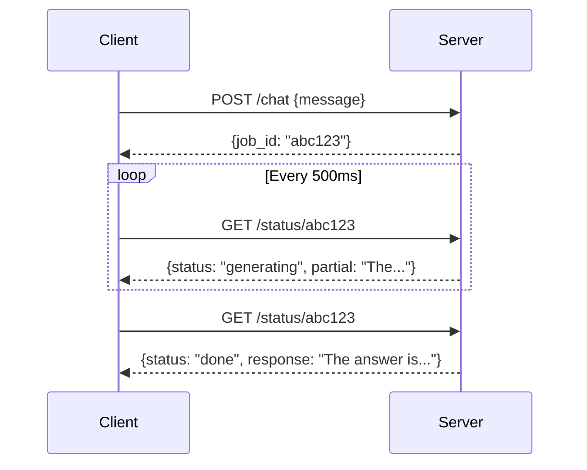

---
layout: two-cols
align: lm-cm
---

:: left ::

## Option 2: Server-Sent Events (SSE)

The server pushes updates to the client over a single HTTP connection.

### How it works
1. Client opens connection to `/stream`
2. Server sends events as they occur
3. Connection stays open until done
4. If timeout, client reconnects

<br>

**Pros:** Real-time, efficient

**Cons:** One-way only (server → client)

:: right ::

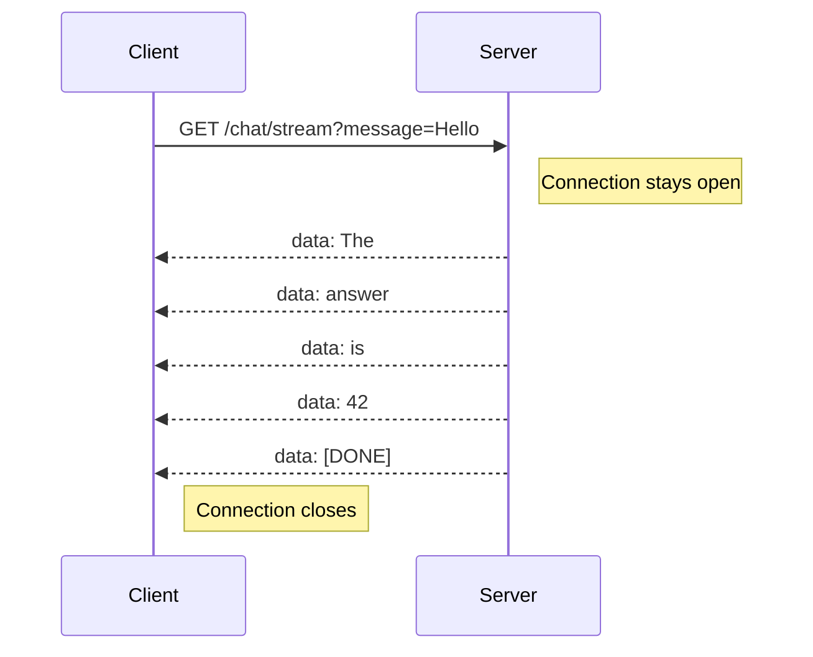

---
layout: two-cols
align: lm-cm
---

:: left ::

## Option 3: WebSockets

A persistent, bidirectional connection. Either side can send messages at any time.

### How it works
1. Client opens WebSocket connection
2. Either side can send messages
3. Connection persists across requests
4. Explicit close when done

<br>

**Pros:** Bidirectional, low latency

**Cons:** More complex, stateful

:: right ::

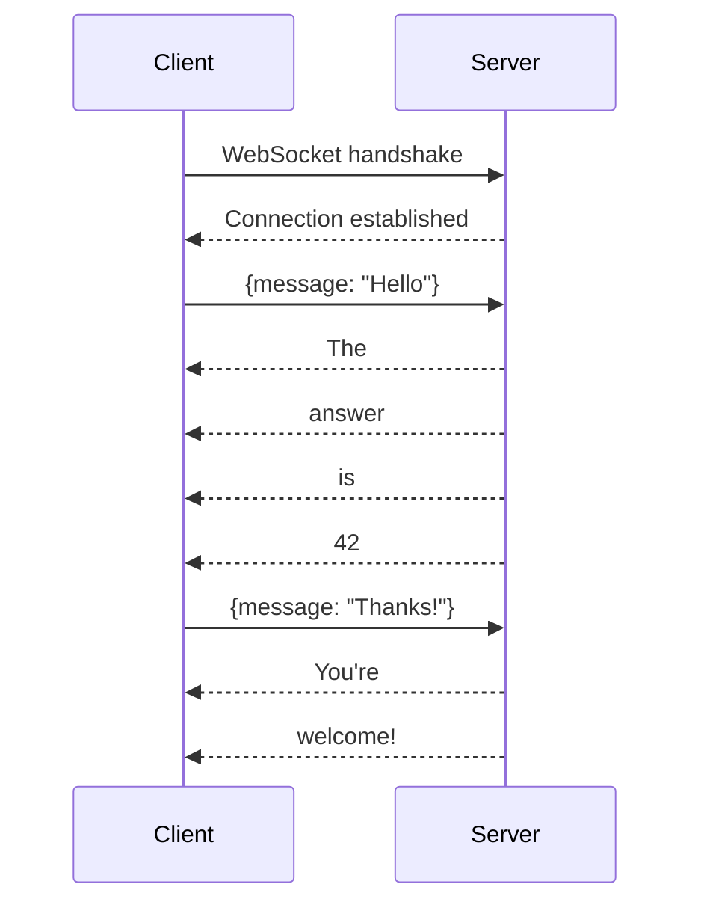

---
layout: center
---

## Protocol Comparison

| Protocol | Direction | Model | Use Case |
|----------|-----------|-------|----------|
| **Polling** | Client → Server | Pull | Simple implementations, legacy systems |
| **SSE** | Server → Client | Push | Token streaming, notifications |
| **WebSocket** | Bidirectional | Push | Real-time chat, typing indicators |

<br>

**For most chatbots, SSE is the sweet spot:** real-time updates without WebSocket complexity.

<br>

**Streamable HTTP** (used by MCP) is a variant where a single endpoint can return either JSON or an SSE stream depending on the request.

---
layout: section
color: violet
---

# The Anatomy of a Chatbot
<hr>

Putting It All Together

---
layout: full
---

<br>

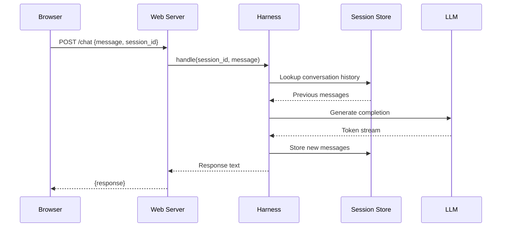

---
layout: full
---

<br><br>

## Component Breakdown

| Component | Responsibility | Examples |
|-----------|----------------|----------|
| **Web Server** | Handle HTTP requests, route to endpoints | Flask, FastAPI |
| **Harness** | Build prompts from system message + history | Custom code |
| **Session Store** | Map session IDs to conversation history | In-memory dict, Redis |
| **LLM** | Generate token completions | Local (Ollama), API (OpenAI, Anthropic) |

---
layout: section
color: red
---

# Exercise
<hr>

`qwen-web-chat.zip`. Needs Ollama running with `qwen2.5:1.5b` pulled.

---
layout: code-right
filename: app.py
columns: is-7
align: lt
codesize: 9px
wrap: true
---

:: left ::

## QwenWebChat

1. `ollama pull qwen2.5:1.5b`
2. Download [`qwen-web-chat.zip`](https://courseworks2.columbia.edu/courses/252703/files/folder/examples), unzip
3. run `uv run app.py`
4. open `http://localhost:8000`.


### What's happening

- `index.html` is front-end. `app.py` is the server
- The session store is a `dict` of message lists.
- **`/chat`** does four things: get or create the session, append the user turn, generate, append the assistant turn.
- The next model completion for that session sees the whole transcript.

:: right ::

```python
MODEL = "ollama_chat/qwen2.5:1.5b"
SYSTEM_PROMPT = "You are a polite AI assistant."

def generate_response(messages: list[dict]) -> str:
    response = completion(
        model=MODEL, messages=messages,
        temperature=0.7, max_tokens=128,
    )
    return response.choices[0].message.content.strip()

sessions: dict[str, list[dict]] = {}
app = FastAPI()

@app.post("/chat", response_model=ChatResponse)
def chat(request: ChatRequest):
    # 1. Get or create the session
    session_id = request.session_id or str(uuid.uuid4())
    if session_id not in sessions:
        sessions[session_id] = [
            {"role": "system", "content": SYSTEM_PROMPT}
        ]

    # 2. Append the user turn
    sessions[session_id].append(
        {"role": "user", "content": request.message}
    )

    # 3. Generate from the whole transcript
    reply = generate_response(sessions[session_id])

    # 4. Append it, so the next request sees it
    sessions[session_id].append(
        {"role": "assistant", "content": reply}
    )
    return ChatResponse(response=reply, session_id=session_id)
```

