# Lessons From Claude Code

Lessons that we, as agent developers, can learn from the Claude Code source code leak

IEOR 4570 - Agentic AI for Data Science

<div class="absolute bottom-2 left-2 p-2 pl-4 text-left w-125 border-1">

Please note: The perspectives shared today are based on my personal experience and do not represent the views of my employer.

</div>

---
layout: two-cols
align: lm-lm
---

:: left ::

## The Leak

On March 31, 2026, Anthropic accidentally shipped a `.map` sourcemap file in a Claude Code npm update.

Boris Cherny, creator, confirms developer error.

It spreads quickly and is mirrored over 8,000 times on Github.

Anthropic issues DMCA Takedown notices.

A popular rewrite, `claw-code` in Python hits 100K GH stars in one day.

:: right ::

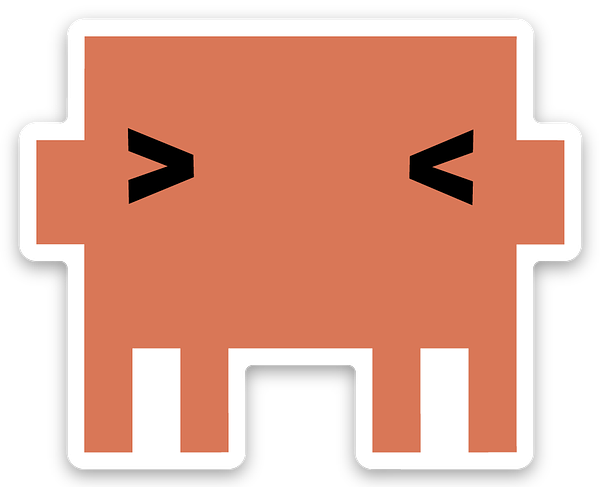

---
layout: center
---

<pre>
/* 
 * Heed these rules well, young wizard. For they are the rules of thinking,
 * and the rules of thinking are the rules of the universe.
 * If ye does not heed these rules, ye will be punished with an entire day
 * of debugging and hair pulling.
 */
</pre>

<div class="absolute bottom-2 left-2 text-xs text-gray-400"><pre>
src/query.ts:160
</pre></div>

---
layout: two-cols-title
margin: tight
---

::title::

## `src/constants/prompts.ts`

:: left ::

<StickyNote color="teal-light" textAlign="left" width="100%" title="Coding Style (line 201)">

Don't add features, refactor code, or make "improvements" beyond what was asked. A bug fix doesn't need surrounding code cleaned up.

</StickyNote>

<br>

<StickyNote color="teal-light" textAlign="left" width="100%" title="Coding Style (line 203)">

Don't create helpers, utilities, or abstractions for one-time operations. Three similar lines of code is better than a premature abstraction.

</StickyNote>

<br>

<StickyNote color="rose-light" textAlign="left" width="100%" title="Safety (line 258)">

Carefully consider the reversibility and blast radius of actions. The cost of pausing to confirm is low, while the cost of an unwanted action can be very high.

</StickyNote>

<br>

<StickyNote color="rose-light" textAlign="left" width="100%" title="Safety (line 266)">

Measure twice, cut once.

</StickyNote>

:: right ::

<StickyNote color="sky-light" textAlign="left" width="100%" title="Tool Usage (line 305)">

Do NOT use Bash to run commands when a relevant dedicated tool is provided. Using dedicated tools allows the user to better understand and review your work.

</StickyNote>

<br>

<StickyNote color="sky-light" textAlign="left" width="100%" title="Tool Usage (line 310)">

Make all independent tool calls in parallel. Maximize use of parallel tool calls where possible.

</StickyNote>

<br>

<StickyNote color="amber-light" textAlign="left" width="100%" title="Tone (line 432)">

Only use emojis if the user explicitly requests it. Avoid using emojis in all communication unless asked.

</StickyNote>

<br>

<StickyNote color="violet-light" textAlign="left" width="100%" title="Output (lines 418-420)">

Go straight to the point. Try the simplest approach first without going in circles. Do not overdo it. Be extra concise. Lead with the answer or action, not the reasoning. Skip filler words, preamble, and unnecessary transitions.

</StickyNote>

---
layout: center
---

But at a deeper level, what can we learn about Claude Code's design?

---
layout: section
color: neutral-light
---

# Claude Code the Asynchronous
<hr>

Hot Take: TypeScript is a great language for agents

---
layout: two-cols
align: lt-lm
---
:: left ::

## LLM, Agent, Harness

When talking about a coding agent, we're usually talking about three things:

- **LLM:** an API endpoint that takes context and returns new context to append
- **Agent:** the loop. Call model, inspect response, execute tools, feed results back, repeat
- **Harness:** everything else. The tools, context injection, permissions, state, memory, compression, multi-agent, the terminal UI

In the source code, `query.ts` is the agent and the other 1,883 `.ts` files are the harness.

:: right ::

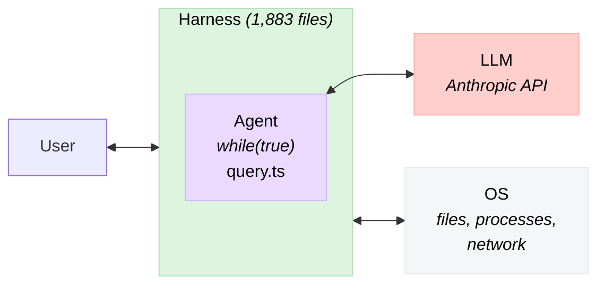

---
layout: center
---

## What is an agent?

---
layout: two-cols
align: lm-lm
---

:: left ::

## An Agent is a loop

<br>

1. Append new input to the message history.
2. Get LLM response: message or tool call(s).
3. If tool calls: Execute each, append the results to the message history. Repeat from step 2
4. If message: Return message.

:: right ::

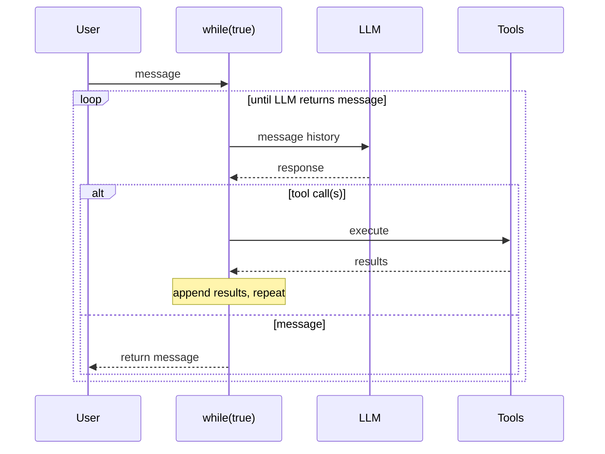

---
layout: two-cols-title
align: l-lt-lt
margin: tighter
---

:: left ::

## `while (true)` at Line 307

<br>

1. Read agent state (conversation history + harness state)
2. Start async prefetches (skills, memory — awaited in step 7)
3. Yield `stream_request_start` (spinner)
4. Run compression pipeline (5 strategies)
5. Call the model
6. Process response — tools start as Promises
7. Collect tool results + prefetch results, rebuild state, continue
9. If no tools → exit

<div class="absolute bottom-2 left-2 text-xs text-gray-400">src/query.ts:307</div>

:: right ::

```ts
while (true) {
    // 1. Read agent state
    let { toolUseContext } = state
    const { messages, turnCount } = state
    // 2-3. Prefetches + signal UI
    // ... (skill, memory — awaited in step 7)
    yield { type: 'stream_request_start' }
    // 4. Compress
    messagesForQuery = await compress(messages)
    // 5. Create tool executor BEFORE calling the model
    let executor = new StreamingToolExecutor(
      tools, canUseTool, toolUseContext,
    )
    // 6. Stream response — tools start as blocks arrive
    for await (const msg of deps.callModel({
      messagesForQuery, systemPrompt, tools, ...
    })) {
      yield msg  // → tokens render in terminal
      if (msg has tool_use blocks) {
        executor.addTool(block, msg)  // → fires Promise
      }
    }
    // 7. Collect tool + prefetch results
    for await (const update
      of executor.getRemainingResults()) {
      yield update.message  // → results render
    }
    // 8. If no tools → return { reason: 'completed' }
}
```

---
layout: two-cols-title
margin: tight
align: l-lt-lm
---

:: title ::

## The TypeScript Agent Loop

<div class="absolute bottom-2 left-2 text-xs text-gray-400">src/services/tools/StreamingToolExecutor.ts, src/query.ts</div>

:: left ::

The LLM returns **multiple tool calls in one response**. Each becomes a `Promise`. The `StreamingToolExecutor` fires each Promise as its block arrives **before the response finishes streaming.**

- `for await` + `Promise.all()` compose natively
- `AbortController` cancels streams, tools, and generators in one signal
- No GIL. No `asyncio`

<AdmonitionType type="tip" title="In OpenAI Agents SDK">

You get half-way there w/ `parallel_tool_calls=True` (defaults to the model settings).

But it doesn't start any tool calls until the entire response comes back from the LLM. AFAICT firing mid-stream is unique.

</AdmonitionType>

:: right ::

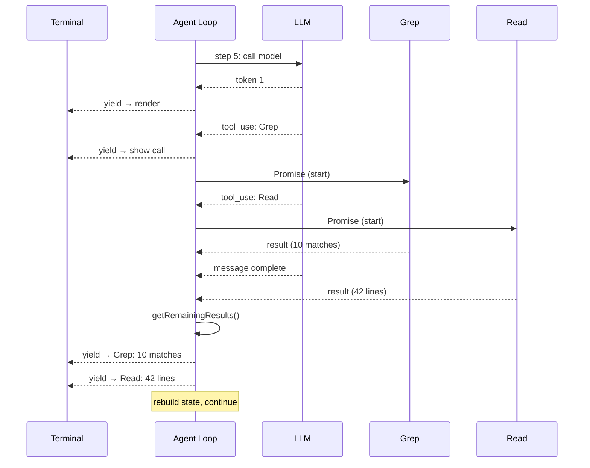

---
layout: center
---

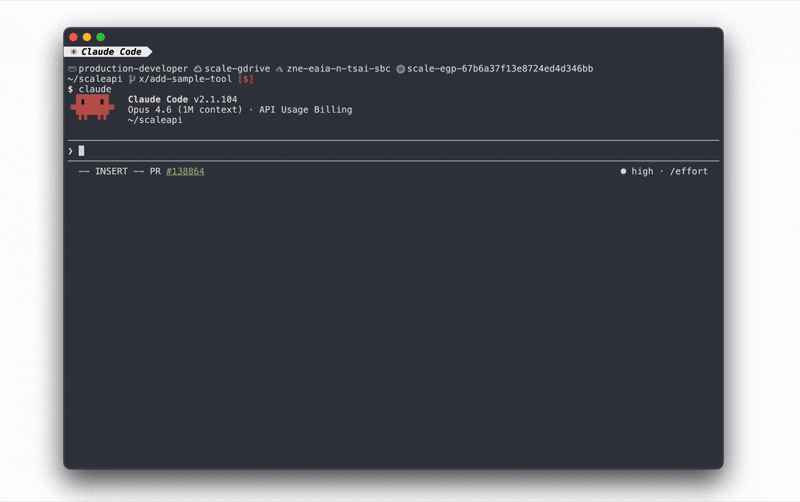

---
layout: two-cols-title
---

:: title ::

## Messages Interrupting the Loop 

<div class="absolute bottom-2 left-2 text-xs text-gray-400">src/query.ts:1547-1590, src/utils/attachments.ts</div>

:: left ::

1. User sends message while tools execute. Message enters a queue
2. Tools finish, results collected
3. `getAttachmentMessages()` drains the queue
4. New message + tool results appended
5. Model sees everything on the next iteration

Other events use the same injection point:

- File changes from your editor
- Background task completions
- Memory and skill prefetch results

:: right ::

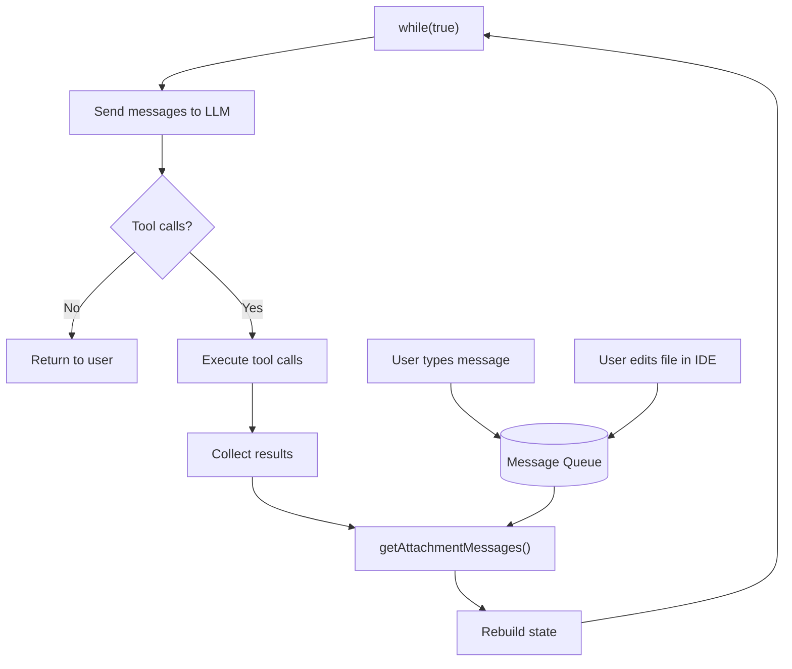

---
layout: section
color: neutral-light
---

# Claude Code the Context King
<hr>

---
layout: two-cols
align: lt-lm
---

:: left ::

## Autoregressive Generation

Tokens are generated **one at a time**. Each token requires its own forward pass through the model.

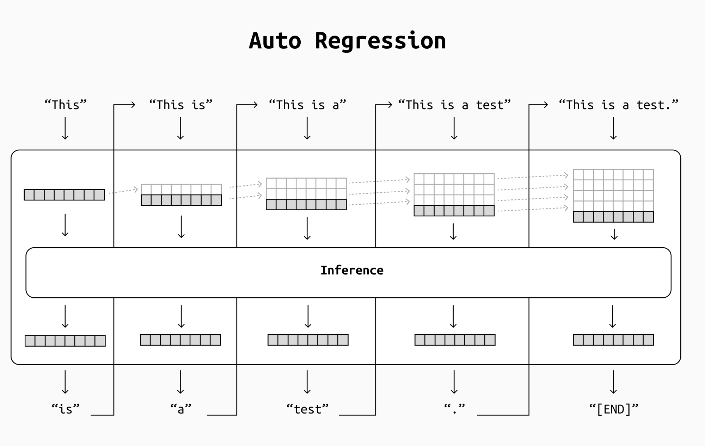

:: right ::

<div class="flex flex-col items-center justify-center h-full gap-2">

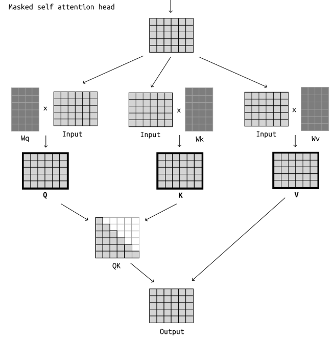

</div>

---
layout: center
---

## The Redundancy Problem

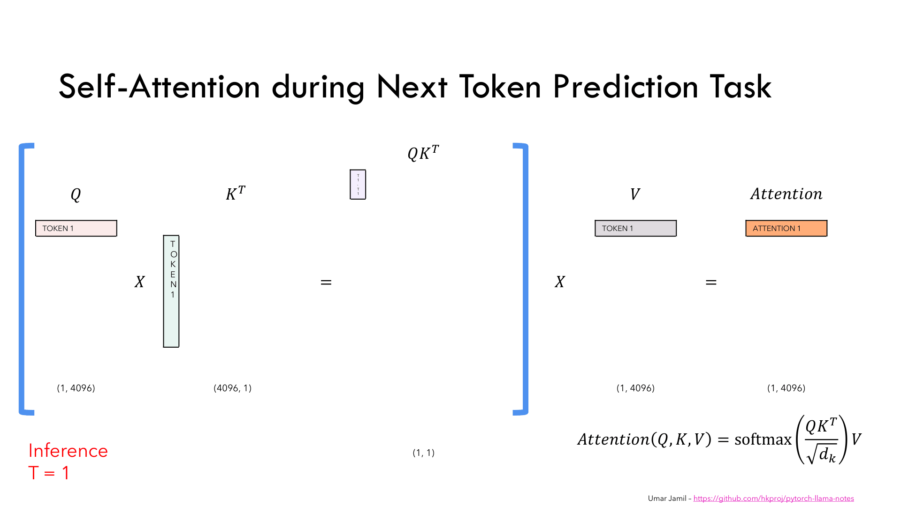

<div class="absolute bottom-2 left-2 text-xs text-gray-400">Umar Jamil — github.com/hkproj/pytorch-llama-notes</div>

---
layout: center
---

## Self-Attention with KV Cache

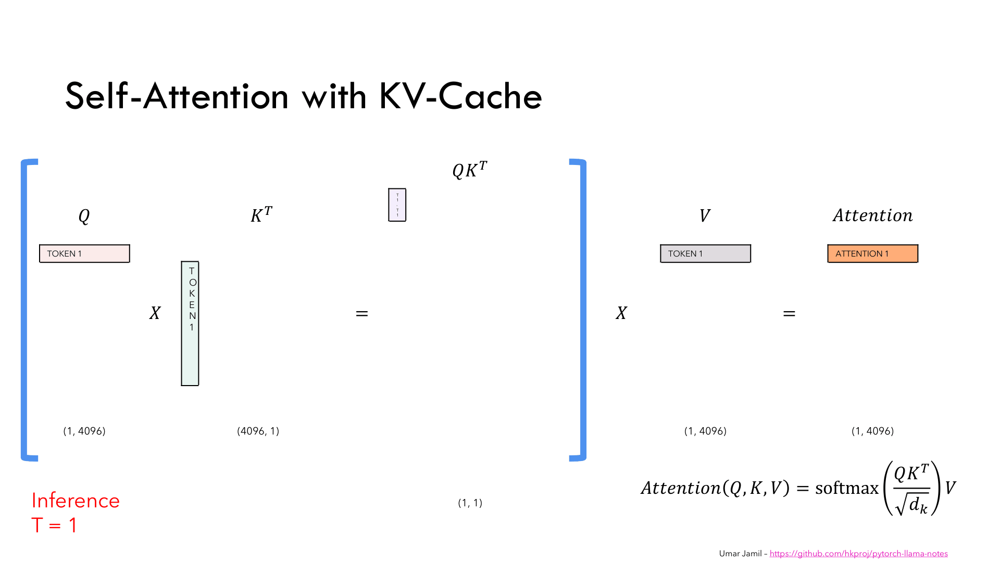

<div class="absolute bottom-2 left-2 text-xs text-gray-400">Umar Jamil — github.com/hkproj/pytorch-llama-notes</div>

---
layout: two-cols
align: lt-lm
---

:: left ::

## Two Stages of a Forward Pass

We've seen how KV caching works during decoding. Now zoom out to the **entire prompt**.

These prompts are huge — system instructions, tool schemas, conversation history. The model doesn't just decode; it has to **process all of that first**.

A prompt is handled in two distinct stages:

**1. Prefill** — process the entire input in one parallelized GPU pass. Generates and stores KV tensors for every input token. Compute-bound. This is what drives TTFT.

**2. Decode** — what we just looked at. Generate one token at a time, reading from the KV cache. Memory-bandwidth-bound.

:: right ::

<div class="flex flex-col gap-2 mt-4 text-xs text-gray-900 ml-16">

  <div class="border border-purple-400 rounded px-3 py-2" style="background: #f3eeff; color: #1a1a1a;">
    <div class="font-bold mb-1">Incoming Prompt</div>
    <div>System Prompt + Tools + User Message</div>
  </div>

  <div class="text-center text-white">↓</div>

  <div class="border border-orange-400 rounded px-3 py-2" style="background: #fef3e2; color: #1a1a1a;">
    <div class="font-bold mb-1">① Prefill — parallelized</div>
    <div>• Process all input tokens in parallel</div>
    <div>• Generate + store KV tensors per layer</div>
    <div>• Compute-bound — big matrix multiplies</div>
    <div>• One inference call for the whole prompt</div>
    <div>• Drives TTFT</div>
  </div>

  <div class="text-center text-white">↓</div>

  <div class="border border-green-500 rounded px-3 py-2" style="background: #edfaed; color: #1a1a1a;">
    <div class="font-bold mb-1">② Decode — autoregressive</div>
    <div>• Generate one token per inference call</div>
    <div>• Reads full KV cache from GPU RAM each step</div>
    <div>• Only computes Q for the new token</div>
    <div>• Memory-bandwidth-bound</div>
    <div>• Drives throughput</div>
  </div>

</div>

---
layout: two-cols
align: lt-lm
---

:: left ::

## Prompt Caching


**Within a request:** prefill generates KV tensors → decode reuses them every token.

**Across requests:** KV blocks stored server-side, keyed by prefix hash. Longest matching prefix = maximum cache hit.

**What you save:**
- Skip prefill for cached tokens entirely
- ↓ TTFT (Time to First Token)
- Significant cost reduction on prefix compute

<AdmonitionType type="important" title="The constraint">

Cache only hits if the prefix is **byte-identical**. One character changes → full miss → pay for all of it again.

</AdmonitionType>

:: right ::

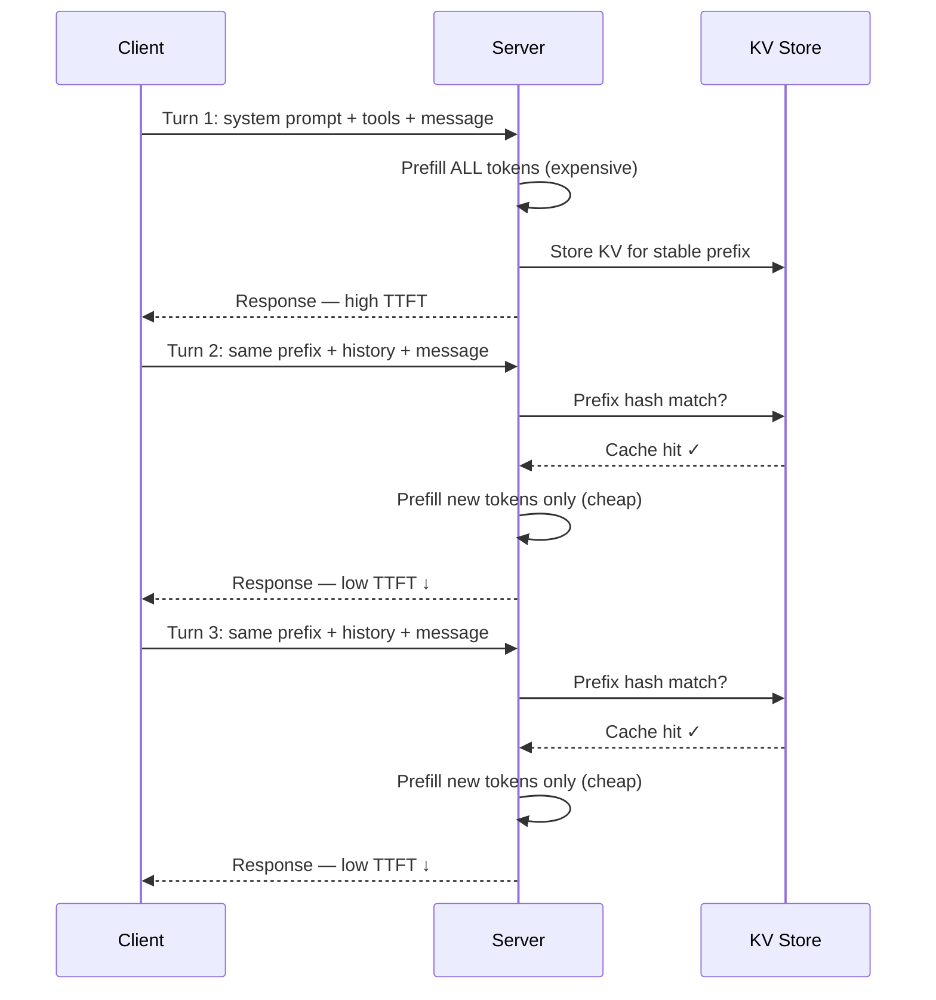

---
---

## Rules for Cache-Aware Agent Design

<div class="flex flex-col gap-3 mt-4">

<div class="flex flex-col gap-0.5">
  <div class="font-bold">1. Static first, dynamic last</div>
  <div class="text-xs text-gray-400 ml-4">System prompt, tool schemas, identity at the top. Conversation history, memory, user context after the cache boundary. Minimize dynamic content in the prefix.</div>
</div>

<div class="flex flex-col gap-0.5">
  <div class="font-bold">2. One token breaks everything</div>
  <div class="text-xs text-gray-400 ml-4">Timestamps, session IDs, dates, anything that changes = silent cache killers. Keep time-sensitive data out of the prefix entirely. Context is append-only.</div>
</div>

<div class="flex flex-col gap-0.5">
  <div class="font-bold">3. Deterministic serialization</div>
  <div class="text-xs text-gray-400 ml-4">Sort tool schemas alphabetically. JSON key ordering isn't guaranteed — output must be byte-identical every time. Never shuffle.</div>
</div>

<div class="flex flex-col gap-0.5">
  <div class="font-bold">4. Inject dynamic content as a side-channel</div>
  <div class="text-xs text-gray-400 ml-4">Project instructions, memory, date belong after the cache boundary, wrapped in a special tag. Not in the system prompt.</div>
</div>

<div class="flex flex-col gap-0.5">
  <div class="font-bold">5. Monitor your cache breaks</div>
  <div class="text-xs text-gray-400 ml-4">Log hit rates, latency, tokens cached. You're flying blind otherwise. Know exactly what caused each miss.</div>
</div>

</div>

<div class="absolute bottom-2 left-2 text-xs text-gray-500">
  <a href="https://developers.openai.com/api/docs/guides/prompt-caching" target="_blank">OpenAI Prompt Caching</a> ·
  <a href="https://manus.im/blog/Context-Engineering-for-AI-Agents-Lessons-from-Building-Manus" target="_blank">Manus: Context Engineering for AI Agents</a> ·
  <a href="https://platform.claude.com/docs/en/build-with-claude/prompt-caching" target="_blank">Anthropic Prompt Caching</a>
</div>

---
layout: center
color: neutral-light
---

## Now let's see how Claude Code implements all of this.

---
layout: two-cols
columns: is-7
align: l-lt-lm
---

:: left ::

## How the Prompt Gets Assembled

<div class="absolute bottom-2 left-2 text-xs text-gray-400">src/utils/api.ts, src/context.ts</div>

Each turn, the prompt is assembled from four sources:

1. **Stable prefix:** rules, tool schemas, identity (rarely changes → cached)
2. **Compressed messages:** conversation history after the 5-stage compression pipeline
3. **User message:** the latest prompt, wrapped with CLAUDE.md in `<system-reminder>`
4. **Memory:** MEMORY.md + relevant topic files (max 25KB)


:: right ::

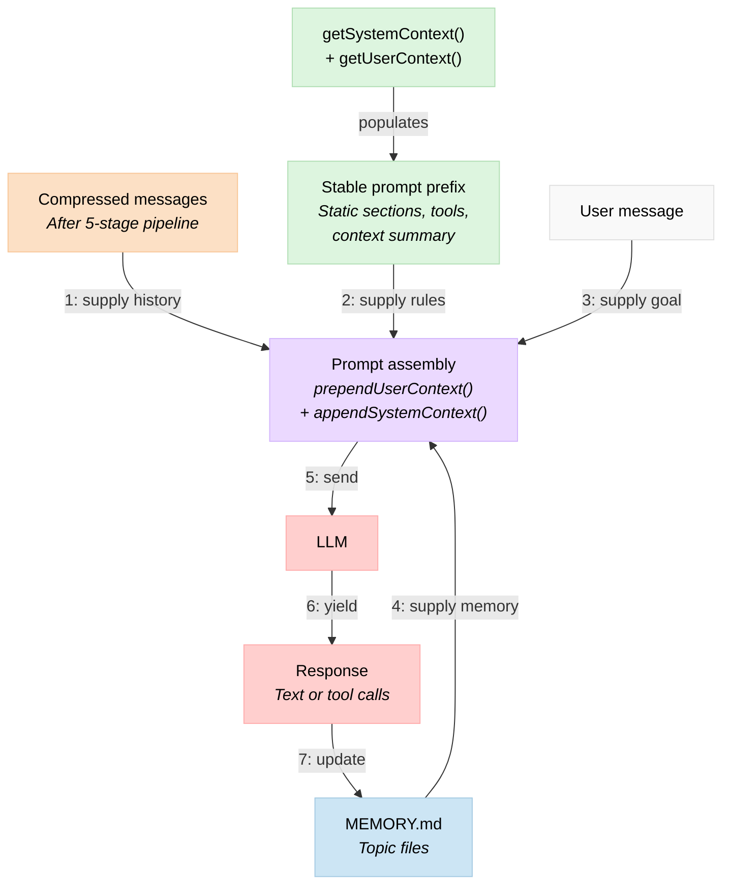

---
layout: two-cols-title
align: l-lt-lt
---

:: title ::

## The Static/Dynamic Boundary

<div class="absolute bottom-2 left-2 text-xs text-gray-400">src/constants/prompts.ts</div>

System prompt = ordered `string[]` with a boundary marker: `__SYSTEM_PROMPT_DYNAMIC_BOUNDARY__`

:: left ::

### Static (cached globally)

- Identity: who Claude Code is
- System rules: permissions, tags, hooks
- Coding style: no gold-plating
- Safety: reversibility, blast radius
- Tool usage: prefer dedicated tools
- Tone: no emojis, cite line numbers
- Output: be concise

:: right ::

### Dynamic w/ Session

- Session guidance: which agent types are available, skill discovery rules
- Memory: instructions for HOW to use `MEMORY.md` (not the memories themselves)
- Environment: OS, shell, working directory, model name, knowledge cutoff
- MCP: per-server instruction blocks from connected MCP servers
- Scratchpad: shared directory path for coordinator mode

---

## Engineering for Cache Stability

- **Tools sorted alphabetically** in `assembleToolPool()` — built-ins form a contiguous block, MCP tools follow. Order never changes even when MCP tools are added.
- **CLAUDE.md wrapped in `<system-reminder>` and moved to a user message** — NOT the system prompt — so project instructions never invalidate the cached prefix. This is a prompt caching optimization disguised as a formatting choice.
- **Date string left stale at midnight** — not updated until a new session starts, avoids a cache break on day rollover
- **Beta headers "latched"** — once enabled for a session, stay enabled even if the flag changes mid-session
- **Cache break detection** (`services/api/promptCacheBreakDetection.ts`) — monitors and logs what caused each invalidation

<div class="absolute bottom-2 left-2 text-xs text-gray-400">src/tools.ts, src/utils/api.ts, src/services/api/promptCacheBreakDetection.ts</div>

---
layout: two-cols-title
columns: is-5
---

:: title ::

## The `<system-reminder>` Side-Channel

<div class="absolute bottom-2 left-2 text-xs text-gray-400">src/utils/messages.ts, src/utils/api.ts</div>

:: left ::

The API has three roles: `<system>`, `<user>`, `<assistant>`

**Problem:** There's no `<harness>` role to inject things like memory, CLAUDE.md, reminders.

**Solution:** wrap dynamic content in `<system-reminder>` tags inside `<user>` messages.

A virtual fourth role via prompt engineering.


<div class="text-xs border border-green-400 rounded px-2 py-1 mt-1" style="background: #edfaed; color: #1a1a1a;">
<b>Steal this:</b> Define a tag, teach the model what it means in the system prompt, inject harness context into user messages.
</div>

:: right ::

What gets injected this way:

- **CLAUDE.md + date:** First (and re-read on compact)
- **Recalled memory files:** Between turns (up to 5 files)
- **Deferred tool names:** New MCP tools discovered
- **Agent type list:** Agent types available
- **Skill descriptions:** Skills discovered
- **Team context:** Teammate in a swarm
- **Hook outputs:** After hook execution
- **File read warnings:** Empty file, offset past end
- **Memory staleness:** Memory >1 day old

All wrapped by `wrapInSystemReminder()` in `utils/messages.ts`.


---
layout: section
color: neutral-light
---

# Claude Code the React app
<hr>
Yes, you heard me right.

---
layout: center
---

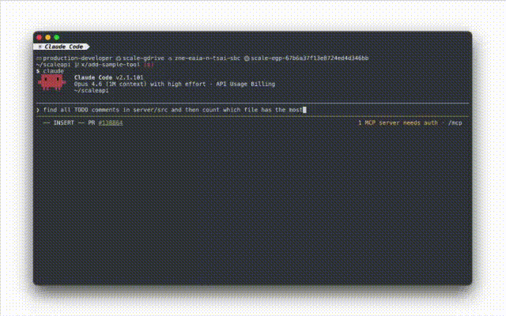

---
layout: image
image: images/image.png
backgroundSize: contain
---

---
layout: two-cols-title
columns: is-7
---

::title::

{width="10%"}

::left::

```js
import React, {useState, useEffect} from 'react';
import {render, Text} from 'ink';

const Counter = () => {
	const [counter, setCounter] = useState(0);

	useEffect(() => {
		const timer = setInterval(() => {
			setCounter(previousCounter => previousCounter + 1);
		}, 100);

		return () => {
			clearInterval(timer);
		};
	}, []);

	return <Text color="green">{counter} tests passed</Text>;
};

render(<Counter />);
```

::right::


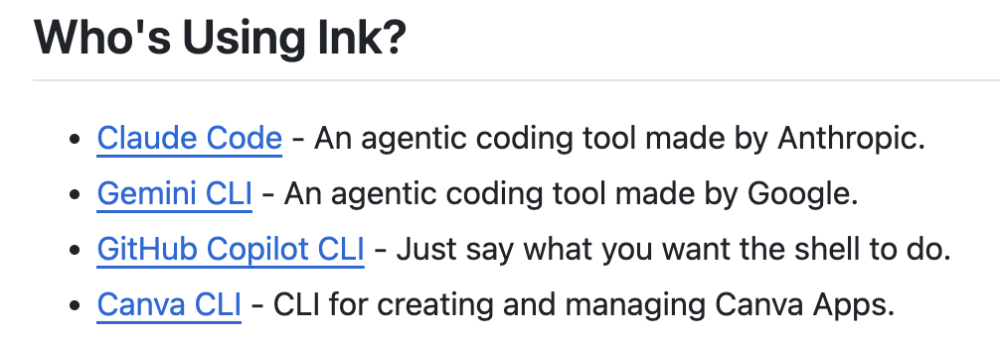

---

## Tool Rendering: React Bound to Tools

Each tool defines its own React-based rendering. The **display is bound to the tool**, not separate UI layer.

| Method | Purpose | Example |
|---|---|---|
| `renderToolUseMessage(input)` | How the call appears | "Editing src/auth.ts" |
| `renderToolResultMessage(content)` | How results display | Syntax-highlighted diff |
| `renderToolUseProgressMessage()` | Live progress | Streaming bash stdout |
| `renderToolUseErrorMessage()` | Error display | Red error with suggestion |
| `getActivityDescription(input)` | Spinner text | "Running tests..." |
| `isSearchOrReadCommand(input)` | UI collapse hint | `{ isSearch: true }` |

---
layout: two-cols-title
---

:: title ::

## Tool Rendering: React Bound to Tools

<div class="absolute bottom-2 left-2 text-xs text-gray-400">src/tools/GrepTool/UI.tsx, src/tools/GrepTool/GrepTool.ts, src/components/messages/AssistantToolUseMessage.tsx</div>

:: left ::

### `UI.tsx`, the React components

```tsx
export function renderToolUseMessage(
  { pattern, path }, { verbose }
): React.ReactNode {
  const parts = [`pattern: "${pattern}"`]
  if (path) parts.push(`path: "${getDisplayPath(path)}"`)
  return parts.join(', ')
}

export function renderToolResultMessage(
  { mode, numFiles, content }, _, { verbose }
): React.ReactNode {
  return <SearchResultSummary
    count={numFiles}
    countLabel="files"
    content={content}
    verbose={verbose} />
}
```

:: right ::

### `GrepTool.ts`, wires UI onto the tool

```typescript
import { renderToolResultMessage,
  renderToolUseMessage } from './UI.js'

export const GrepTool = buildTool({
  name: 'Grep',
  inputSchema: z.strictObject({ /* ... */ }),
  call(input, context) { /* ripgrep */ },
  renderToolUseMessage,      // ← just pass it
  renderToolResultMessage,
  getActivityDescription(input) {
    return `Searching for ${summary}`
  },
})
```

### Generic UI, consumes any tool

```typescript
// Doesn't know what tool it's rendering:
tool.renderToolUseMessage(parsed.data, { verbose })
```

---
layout: section
color: neutral-light
---

# Claude Code the Toolbox
<hr>

---
layout: default
margin: tight
---

## Built-In Tools

<div class="absolute bottom-2 left-2 text-xs text-gray-400">src/tools.ts, src/tools/</div>

| | |
|---|---|
| **File Operations** | `Read`, `Edit`, `Write`, `NotebookEdit` |
| **Search** | `Glob`, `Grep`, `ToolSearch` |
| **Execution** | `Bash`, `PowerShell` |
| **Web** | `WebSearch`, `WebFetch` |
| **Agent / Tasks** | `Agent`, `TaskCreate`/`Get`/`List`/`Update`/`Stop`, `TeamCreate`/`Delete`, `SendMessage` |
| **Planning** | `EnterPlanMode`, `ExitPlanMode`, `EnterWorktree`/`ExitWorktree`, `AskUserQuestion` |
| **Skills / Config** | `Skill`, `TodoWrite`, `ListMcpResources`, `ReadMcpResource`, `Brief` |
| **Scheduling** | `CronCreate`/`Delete`/`List`, `RemoteTrigger`, `Sleep` |

---
layout: two-cols
columns: is-9
align: l-lt-lt
---

:: left ::

## The Tool Pipeline

<div class="absolute bottom-2 left-2 text-xs text-gray-400">src/services/tools/toolOrchestration.ts</div>

When the model emits a `tool_use` block:

1. **Parse:** find tool by name (`findToolByName()`)
2. **Validate:** `validateInput()` checks args
3. **Permissions:** 10-step pipeline (covered later)
4. **Execute:** `tool.call(input, context)`
5. **Clip:** `mapToolResultToToolResultBlockParam()`<br>formats + truncates the result
6. **Append:** result added to messages
7. **Loop:** back to step 1 of the `while(true)`

Every tool implements the same `Tool<Input, Output, P>` interface. 

:: right ::

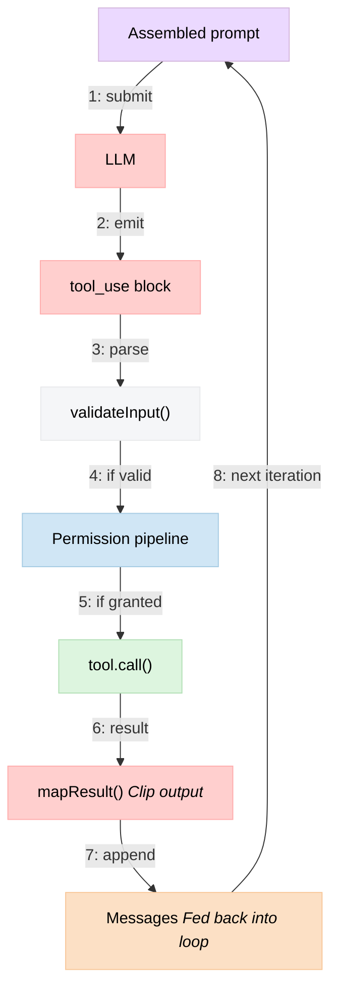

---
layout: default
margin: tighter
zoom: 0.93
---

## The Tool Interface

<div class="absolute bottom-2 left-2 text-xs text-gray-400">src/Tool.ts</div>

| | |
|---|---|
| **Identity** | `name`, `aliases`, `description()`, `searchHint`, `shouldDefer`, `alwaysLoad`, `strict` |
| **Schema** | `inputSchema`, `inputJSONSchema`, `outputSchema` |
| **Execution** | `call()`, `validateInput()`, `prompt()`, `maxResultSizeChars` |
| **Safety** | `isReadOnly()`, `isDestructive()`, `isOpenWorld()`, `isEnabled()`, `interruptBehavior()` |
| **Permissions** | `checkPermissions()`, `preparePermissionMatcher()`, `requiresUserInteraction()`, `toAutoClassifierInput()`, `getPath()` |
| **Rendering** | `renderToolUseMessage()`, `renderToolResultMessage()`, `renderToolUseProgressMessage()`, `renderToolUseErrorMessage()`, `getActivityDescription()`, `isSearchOrReadCommand()` |
| **Result** | `mapToolResultToToolResultBlockParam()`, `extractSearchText()`, `userFacingName()`, `isTransparentWrapper()` |
| **Flags** | `isMcp`, `isLsp`, `isOpenWorld()`, `isConcurrencySafe()` <small><- similar to MCP attributes</small> |

---
layout: default
margin: tighter
---

## Built-In Tools

| | |
|---|---|
| **File Operations** |<span v-mark="{ at: 0, color: 'red', type: 'circle' }">`Read`</span>, <span v-mark="{ at: 0, color: 'red', type: 'circle' }">`Edit`</span>, <span v-mark="{ at: 0, color: 'red', type: 'circle' }">`Write`</span>, `NotebookEdit` |
| **Search** | <span v-mark="{ at: 0, color: 'red', type: 'circle' }">`Glob`</span>, <span v-mark="{ at: 0, color: 'red', type: 'circle' }">`Grep`</span>, <span v-mark="{ at: 0, color: 'red', type: 'circle' }">`ToolSearch`</span> |
| **Execution** | <span v-mark="{ at: 0, color: 'red', type: 'circle' }">`Bash`</span>, `PowerShell` |
| **Web** | `WebSearch`, `WebFetch` |
| **Agent / Tasks** | <span v-mark="{ at: 0, color: 'red', type: 'circle' }">`Agent`</span>, `TaskCreate`/`Get`/`List`/`Update`/`Stop`, `TeamCreate`/`Delete`, `SendMessage` |
| **Planning** | `EnterPlanMode`, `ExitPlanMode`, `EnterWorktree`/`ExitWorktree`, `AskUserQuestion` |
| **Skills / Config** | `Skill`, `TodoWrite`, `ListMcpResources`, `ReadMcpResource`, <span v-mark="{ at: 0, color: 'red', type: 'circle' }">`Brief`</span> |
| **Scheduling** | `CronCreate`/`Delete`/`List`, `RemoteTrigger`, `Sleep` |

<div style="color: crimson">

**_Only 9 tools are "core tools". All others (and MCP tools) are "deferred"._**

</div>

<div class="absolute bottom-2 left-2 text-xs text-gray-400">src/tools.ts, src/tools/</div>

---
layout: two-cols-title
align: l-lt-lt
columns: is-7
margin: tight
---

:: title ::

## Deferred Tool Loading

:: left ::

1. Non-deferred tools + `ToolSearch` sent in `tools` param. Deferred tool schemas held back until discovered.2. Deferred tool **names only** announced to the LLM via `<system-reminder>` messages.3. LLM calls `ToolSearch`. Claude Code matches **locally** via weighted scorer (name + description + searchHint) or direct `select:` lookup.4. `tool_reference` returned as the `tool_result` content (normal tool_use → tool_result flow).5. Next API call: Claude Code includes that tool's full schema (w/ `defer_loading: true` to keep it out of cached).6. API expands the `tool_reference`. LLM sees full schema, calls the tool.
:: right ::

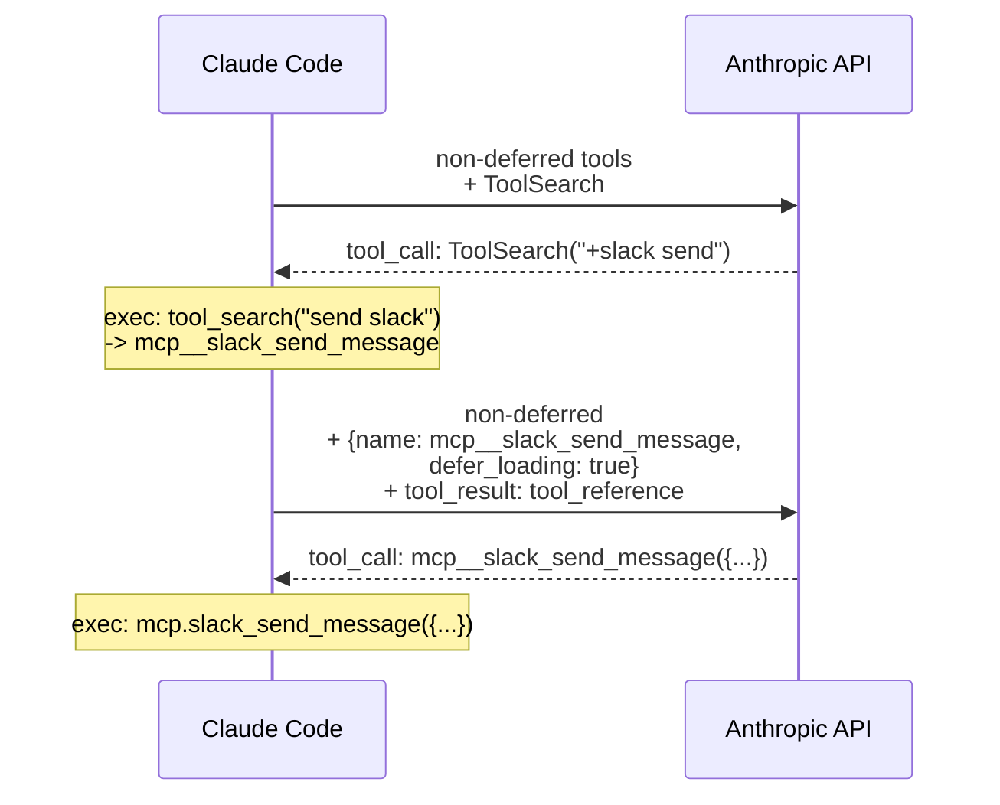

_Still not 100% on this workflow.<br>[Documentation suggests the search should happen server side](https://platform.claude.com/docs/en/agents-and-tools/tool-use/tool-search-tool)._

::default::

<div class="absolute bottom-2 left-2 text-xs text-gray-400">src/services/api/claude.ts:1155-1246, src/tools/ToolSearchTool/</div>

---
layout: section
color: neutral-light
---

# Claude Code the Memorable
<hr>

---
layout: two-cols
columns: is-7
align: l-lt-lt
---

:: left ::

## Memory System: Storage

<div class="absolute bottom-2 left-2 text-xs text-gray-400">src/memdir/memoryTypes.ts, src/memdir/memdir.ts</div>

Stored at `~/.claude/projects/<slug>/memory/`:

- **user:** role, preferences, expertise
- **feedback:** corrections AND confirmed approaches. Includes "Why" so the agent can judge edge cases.
- **project:** decisions, deadlines<br>(converts relative dates to absolute)
- **reference:** pointers to external systems

**Retrieval:** LLM relevance filter, not vector search.


<AdmonitionType type="note" title="See for yourself">

<pre>

ls  ~/.claude/projects/**/memory/

</pre>

</AdmonitionType>

:: right ::

```
memory/
├── MEMORY.md          ← index
├── user_role.md       ← type: user
├── feedback_testing.md← type: feedback
├── project_goals.md   ← type: project
└── reference_docs.md  ← type: reference
```

##### feedback_testing.md

```yaml
---
name: integration-tests-real-db
description: Must use real DB, not mocks
type: feedback
---
Integration tests must hit a real database.

**Why:** Prior incident where mock/prod
divergence masked a broken migration.

**How to apply:** Any test that touches
the data layer should use the test DB.
```

##### MEMORY.md

```yaml
- [User preferences](user_prefs.md) — Prefers terse responses
- [Testing policy](feedback_testing.md) — Use real DB, never mock
- [API docs](reference_api.md) — Endpoints at api.internal.co/v2
```

---
layout: two-cols
columns: is-7
align: lt-lm
---

:: left ::

## Memory System: Reading

Each turn, a Sonnet **"side query"** (one-shot LLM call, no agent loop) picks which memories to surface:

1. `scanMemoryFiles()` reads all memory frontmatters
2. Builds a manifest: filename + description for each
3. Sends manifest + user's last message to LLM
4. Sonnet returns up to 5 filenames (structured JSON)
5. Files get read and injected as `<system-reminder>`
6. Memories >1 day old get a staleness warning

<StickyNote color="teal-light" textAlign="left" width="100%" title="SELECT_MEMORIES_SYSTEM_PROMPT">

You are selecting memories that will be useful to Claude Code as it processes a user's query. Return filenames for memories that will clearly be useful (up to 5). Only include memories you are certain will be helpful.

</StickyNote>

:: right ::

```typescript
const result = await sideQuery({
  model: getDefaultSonnetModel(),
  system: SELECT_MEMORIES_SYSTEM_PROMPT,
  messages: [{
    role: 'user',
    content:
      `Query: ${query}\n\n` +
      `Available memories:\n${manifest}`,
  }],
  max_tokens: 256,
  output_format: {
    type: 'json_schema',
    schema: {
      type: 'object',
      properties: {
        selected_memories: {
          type: 'array',
          items: { type: 'string' },
        },
      },
      required: ['selected_memories'],
    },
  },
  signal,
})
```

:: default ::

<div class="absolute bottom-2 left-2 text-xs text-gray-400">src/memdir/findRelevantMemories.ts</div>

---
layout: two-cols-title
align: l-lt-lm
---

:: title ::

## Memory System: Writing (`extractMemories`)

<div class="absolute bottom-2 left-2 text-xs text-gray-400">src/services/extractMemories/extractMemories.ts</div>

:: left ::

In the system prompt, the main agent is told it can write memories.

<StickyNote color="teal-light" textAlign="left" width="100%" title="loadMemoryPrompt()">
If the user explicitly asks you to remember something, save it immediately.
</StickyNote>

Additionally, after each turn, a **forked sub-agent** decides what's worth saving.

- Shares the parent's full context but evaluates messages **this** turn (maintains a cursor)
- Writes topic files and updates `MEMORY.md` index
- Capped at 5 turns

:: right ::

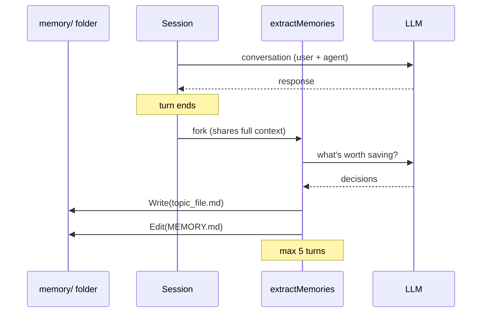

<br>

<StickyNote color="teal-light" textAlign="left" width="100%" title="buildExtractAutoOnlyPrompt()">

You are now acting as the memory extraction subagent. Analyze the most recent ~${newMessageCount} messages above and use them to update your persistent memory systems

</StickyNote>


---
layout: two-cols-title
align: l-lt-lm
---

:: title ::

## Memory System: Dreaming (`autoDream`)

<div class="absolute bottom-2 left-2 text-xs text-gray-400">src/tasks/DreamTask/DreamTask.ts, src/services/autoDream/</div>

A background subagent runs between sessions. Gated by time (24h), session count (5), and a lock.

:: left ::

1. **Orient:** `ls` the memory directory, read MEMORY.md, skim existing topic files
2. **Gather:** search for new signal: memories that drifted, grep transcripts for narrow terms
3. **Consolidate:** merge into existing files, convert relative→absolute dates, delete contradicted facts
4. **Prune:** keep MEMORY.md under 200 lines, remove stale pointers, resolve contradictions

<AdmonitionType type="note">

This feature stage is currently gated behind a feature flag. Force-enable using `"autoDreamEnabled": true` in `settings.json`.


</AdmonitionType>

:: right ::

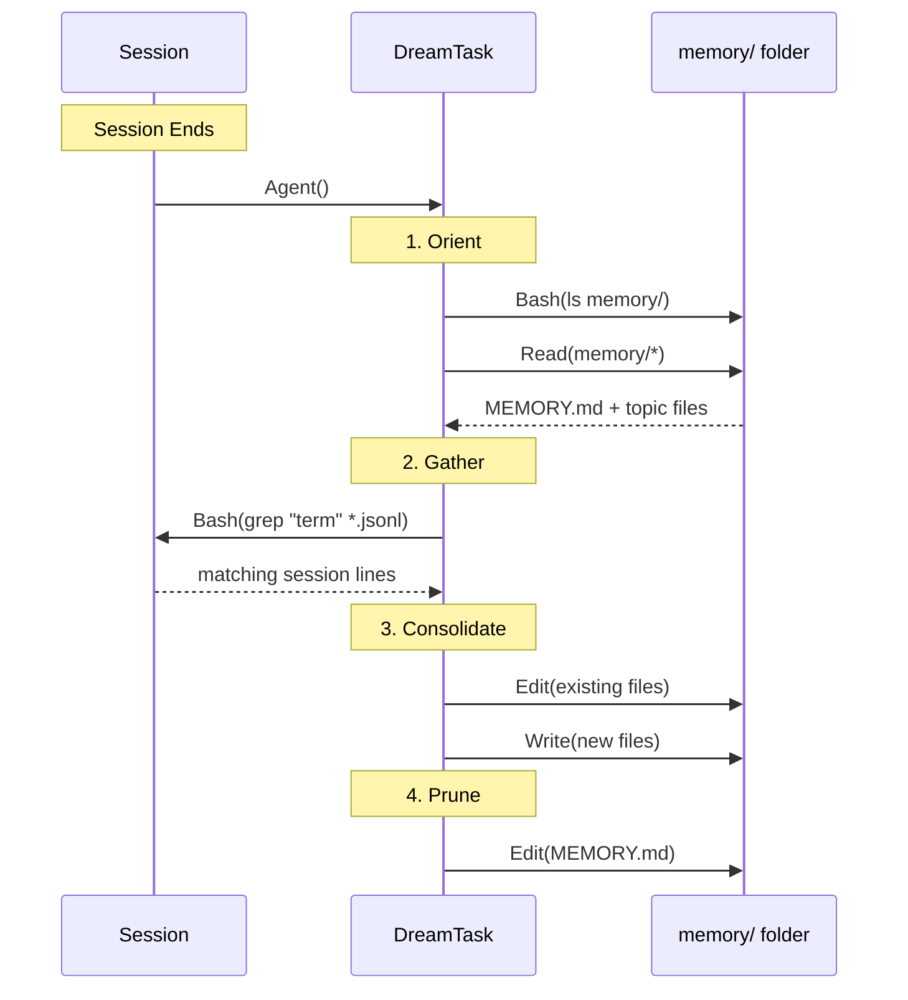

---
layout: two-cols-title
margin: tight
---

::title::

## `src/services/autoDream/consolidationPrompt.ts`

::left::

<StickyNote color="sky-light" textAlign="left" width="100%" title="Phase 1 — Orient" style="font-size: 65%">

<small>

- \`ls\` the memory directory to see what already exists
- Read \`MEMORY.md\` to understand the current index
- Skim existing topic files so you improve them rather than creating duplicates
- If \`logs/\` or \`sessions/\` subdirectories exist (assistant-mode layout), review recent entries there

</small>

</StickyNote>

<br>

<StickyNote color="teal-light" textAlign="left" width="100%" title="Phase 2 — Gather recent signal" style="font-size: 65%">

Look for new information worth persisting. Sources in rough priority order:

1. **Daily logs** (\`logs/YYYY/MM/YYYY-MM-DD.md\`) if present — these are the append-only stream
2. **Existing memories that drifted** — facts that contradict something you see in the codebase now
3. **Transcript search** — if you need specific context, grep the JSONL transcripts for narrow terms: \`grep -rn "&lt;narrow term&gt;" transcriptDir/ --include="*.jsonl" | tail -50\`

Don't exhaustively read transcripts. Look only for things you already suspect matter.

</StickyNote>

::right::

<StickyNote color="amber-light" textAlign="left" width="100%" title="Phase 3 — Consolidate" style="font-size: 60%">

For each thing worth remembering, write or update a memory file. Use the memory file format and type conventions from your system prompt's auto-memory section.

Focus on:
- Merging new signal into existing topic files rather than creating near-duplicates
- Converting relative dates ("yesterday", "last week") to absolute dates so they remain interpretable after time passes
- Deleting contradicted facts — if today's investigation disproves an old memory, fix it at the source

</StickyNote>

<br>

<StickyNote color="rose-light" textAlign="left" width="100%" title="Phase 4 — Prune and index" style="font-size: 60%">

Update \`MEMORY.md\` so it stays under 200 lines AND under ~25KB. It's an **index**, not a dump — each entry should be one line under ~150 characters: \`- [Title](file.md) — one-line hook\`. Never write memory content directly into it.

- Remove pointers to memories that are now stale, wrong, or superseded
- Demote verbose entries: if an index line is over ~200 chars, it's carrying content that belongs in the topic file
- Add pointers to newly important memories
- Resolve contradictions — if two files disagree, fix the wrong one

</StickyNote>

::default::

<div class="absolute bottom-2 left-2 text-xs text-gray-400">src/services/autoDream/consolidationPrompt.ts</div>

---
layout: side-title
color: navy
align: rm-lm
---

:: title ::

## Takeaways

:: content ::

**Nothing magic.** Standard patterns, heavily optimized. You could reproduce 90% with the features of most agent frameworks.

<br>

**Built like a front-end app.** Rendering bound to tools. Async generators for streaming. Promises for concurrent tool execution. This was built by FEs, not MLEs.

<br>

**Context engineering is the real engineering.** 5-stage compression, static/dynamic prompt boundary, `<system-reminder>`, prompt cache tricks, file-memory. The hardest problems are all about what goes into the context window.

<br>

**I don't feel done.** Permissions, auto-mode, the task system, multi-agent scratchpads. There's more to dig into.