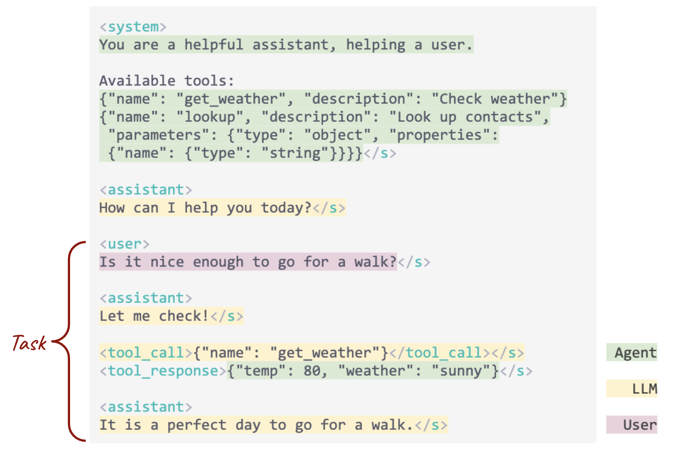
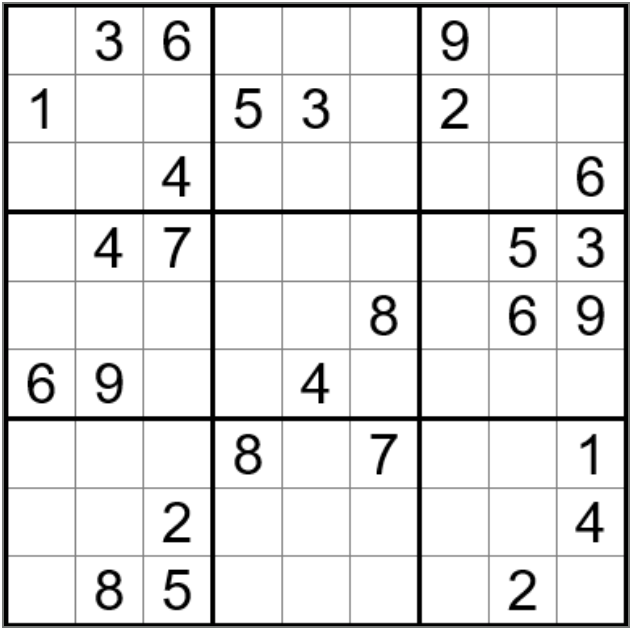
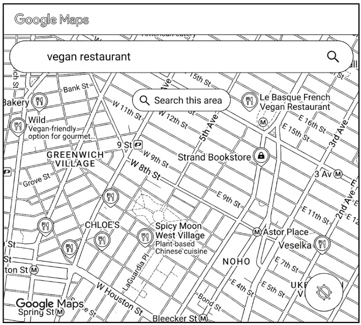
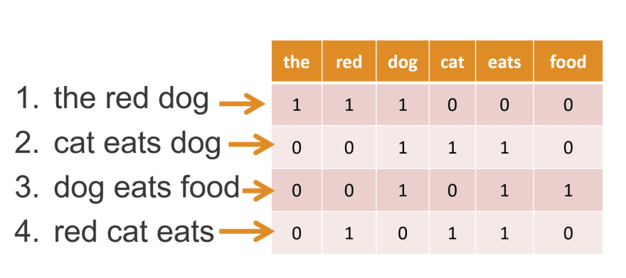
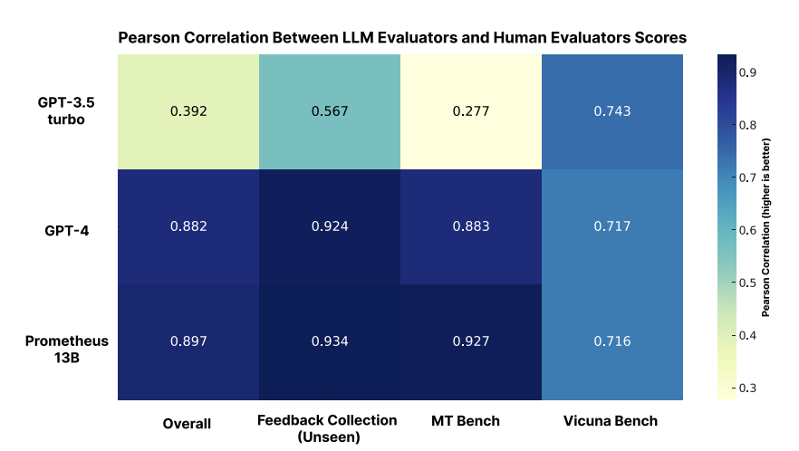
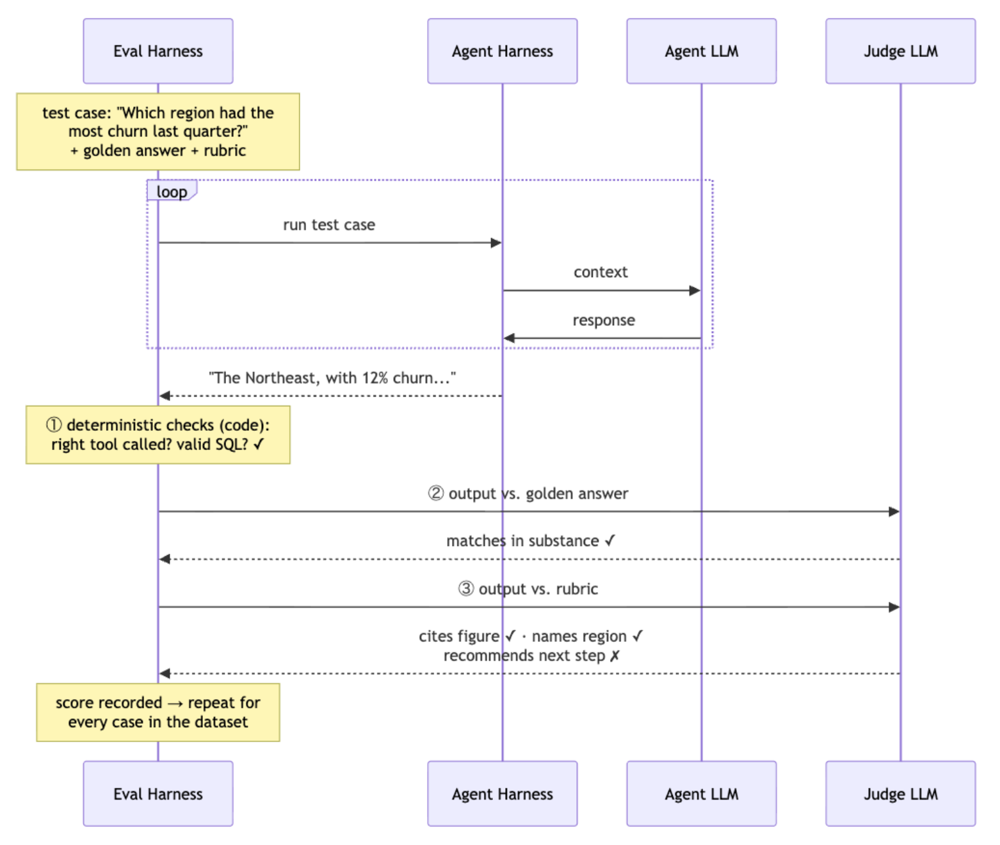
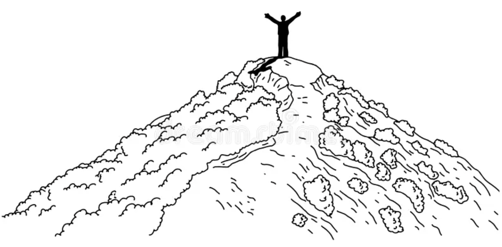
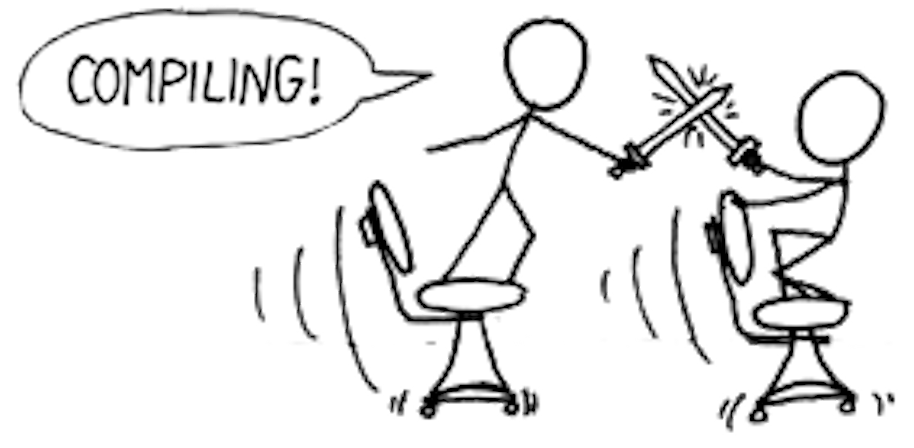

# Evaluations

IEOR 4570 - Agentic AI

<div class="absolute bottom-2 left-2 p-2 pl-4 text-left w-125 border-1">

Please note: The perspectives shared today are based on my personal experience and do not represent the views of my employer.

</div>

---
layout: side-title
color: sky
align: rm-lm
---

:: title ::

# Learning Objectives

:: content ::

1. What are evals and why do we need them?
2. Distinguish deterministic, golden-reference, and rubric evals.
3. Learn how to build an eval suite.

---
layout: three-cols-title
---

::title::

## Where we Left Off: Layers of AI Knowledge

How do agents know things?

<br>

::left::

### Pre-training

###### Knowledge

- Next-token prediction based on corpus of training data.
- Facts, language, patterns
- How concepts relate to each other in latent space.
- Trained into the model weights by labs (expensive)

::middle::

### Post-training

###### Behavior

- SFT, then RLHF and RLVR
- The role of the assistant and how it answers
- Aptitude for the verifiable
- Reasoning through problems with `<think>`
- Elicits what pre-training already holds
- Trained into the model weights by labs (expensive)

::right::

### In-Context Learning

###### Task-specific

- Everything in the prompt: instructions, few-shot examples, conversation history
- **Tool definitions and tool results**
- The task's "query", what is it trying to do
- Passed in entirety at scoring time (ephemeral and cheap)

---
layout: two-cols-title
align: l-lm-cm
---

::title::

## Where We Left Off: The Harness

How do agents do things?

::left::

**Harness:** the software surrounding the model that allows it to interact with the environment.

**Tool:** a function that's part of the harness that lets the model interact with the environment and see results.

**Agent:** a model and a harness, calling tools in a loop.

**Task:** one unit of work for an agent. One input, one output.

::right::

{.mx-auto}

---
layout: side-title
align: rm-lm
color: violet
---

::title::

## Overarching Questions

::content::

1. How do agents know things?
   - Pre-training, Post-training, In-Context Learning
2. How do agents do things?
   - Tools, guardrails, the agent loop
3. **How do we know if an agent is good at something?**

---
layout: section
color: teal
---

# Evaluating Agents
<hr>

Checkers and judges

---
layout: center
---

**_Q: Think of a hard task you recently gave a chatbot or agent.<br>Did it overperform or underperform your expectations?_**

---
layout: two-cols
---

::left::

### Hard to perform, easy to verify

Ask a model to check a sudoku solution. Anyone who knows the rules can verify the answer:

1. No repeated number in a row
2. None in a column
3. None in a square


{width=60% .mx-auto}

::right::

### Hard to perform, hard to verify

Ask a model for a Tuesday dinner spot for a vegan friend in New York City. Many answers are good, but each must be:

1. Open on Tuesday night
2. Vegan-friendly
3. In New York City

{width=60% .mx-auto}


---
layout: two-cols-title
---

::title::

## AI Struggles to Specialize

::left::

### Problem

Pre-training and post-training ship with the model. That is where AI generalizes: writing, coding, tool calling, math, science.

The most valuable use-cases need AI to be specialized.

In-context learning is the easiest and cheapest place to specialize: the system prompt, the tools, and retrieval.

<br>

<AdmonitionType color="teal-light" title="Question" icon="mdi-chat-question">

Have you seen an agent that worked in the demo and failed in the hands of a user?

</AdmonitionType>

::right::

<v-click>

### Proposal

Steal the signals the labs use in post-training, and use them to shape our in-task knowledge.

| Post-training | | Evals |
|-|-|-|
| SFT  | -> | Golden Reference |
| RLHF | -> | Model-as-a-judge |
| RLVR | -> | Deterministic checks |

These signals shape the system prompt, the tools, retrieval, and guardrails.

</v-click>

---
layout: center
---


###### Hypothesis

<hr>
<br>

##### _A well-designed eval turns what the task requires into measurable behavior. That makes an agent more reliable, easier to improve, and safer to deploy._

<br>
<hr>

---
layout: side-title
color: teal
align: rm-lm
---

::title::

## Three Kinds of Eval

::content::

1. **Deterministic checks.** Code checks whether something verifiable happened (or didn't).
2. **Model-as-a-judge w/ golden reference.** A model compares the output to an answer written by a subject-matter expert (SME).
3. **Model-as-a-judge w/ rubric.** A model grades the output against a list of yes/no questions.

---
layout: two-cols-title
---

::title::

## Deterministic Checks

::left::

Code checks the agent's actions and outputs. No model in the loop.

#### What you can check

- Was the right tool called, with the right arguments, in the right order?
- Did the agent affect the environment as expected?
- Does the output parse (SQL, JSON)?
- Does the answer match a known value?
- Does the output contain (or avoid) terms?
- Were any guardrails triggered?

#### When to use it

Whenever the answer is verifiable.

::right::

#### What's it good at?

- Cheap, fast, and reproducible.

#### Limits

- Brittle: string matching misses a correct answer phrased differently.
- Narrow: only asks questions code can answer.
- Literal: passes output that is technically correct but wrong in spirit.

<br>
<br>

<AdmonitionType type="tip" title="Connecting to post-training">

**RLVR** (reinforcement learning from verifiable rewards) rewards a model when code confirms its answer: the math checks out, the unit tests pass.

</AdmonitionType>


---
layout: two-cols-title
---

::title::

## Example: Deterministic Checks

A support agent that issues refunds

::left::

### Input

```
Order #4417 arrived broken. I want my money back.
```

<br>

### Trace

```python
lookup_order(order_id="4417")
# -> {"total": 38.50, "status": "delivered"}

issue_refund(order_id="4417", amount=38.50)
# -> {"ok": True}
```

<br>

### Output

```
Done. I've refunded $38.50 to your original
payment method for order #4417.
```

::right::

### Checks

```python
def test_refund(trace, output):
    calls = [c.name for c in trace.tool_calls]

    # Looked up the order before refunding it
    assert calls.index("lookup_order") \
         < calls.index("issue_refund")

    # Refunded the right order, for no more than it cost
    refund = trace.call("issue_refund")
    order = trace.result("lookup_order")
    assert refund.args["order_id"] == "4417"
    assert refund.args["amount"] <= order["total"]

    # Told the customer the amount
    assert "$38.50" in output
```

---
layout: two-cols-title
---

::title::

## Term Overlap Metrics

Deterministic checks against a golden reference

<br>

::left::

Count the words the output shares with the reference.

- **Jaccard:** shared words over all words, as sets.
- **Token F1:** precision and recall over word counts.
- **ROUGE:** overlap of n-grams or the longest common subsequence.

$$
J(A, B) = \frac{|A \cap B|}{|A \cup B|}
\qquad
F_1 = \frac{2PR}{P + R}
$$

**Semantic similarity** swaps words for embeddings and compares them with cosine similarity.

::right::



---
layout: two-cols-title
---

::title::

## Example: Term Overlap Metrics

Apollo 11

::left::

<style>
blockquote { font-size: 0.7rem; }
</style>

<div class="text-xs">

#### Golden reference

> The Apollo 11 mission's primary purpose was to achieve the national goal of landing humans on the Moon and returning them safely to Earth. Key outcomes included astronauts Neil Armstrong and Buzz Aldrin collecting the first lunar samples, deploying scientific experiments on the lunar surface, and demonstrating U.S. technological supremacy during the Cold War.

#### A: Wrong

> The Apollo 11 mission's primary purpose was to land humans on **Mars**. Key outcomes included astronauts Neil Armstrong and Buzz Aldrin collecting the first **Martian** samples and deploying scientific experiments on the **Martian** surface.

#### B: Correct paraphrase

> The main goal of Apollo 11 was to successfully land a crew on the Moon and ensure their safe return. During the mission, the astronauts gathered moon rocks and set up science equipment, which was a major victory for the U.S. in the Cold War.

</div>

::right::

<v-click>

| | A: Wrong | B: Correct |
|-|-|-|
| Jaccard | **0.54** | 0.24 |
| Token F1 | **0.67** | 0.44 |
| ROUGE-1 | **0.67** | 0.44 |
| ROUGE-2 | **0.53** | 0.20 |
| ROUGE-L | **0.65** | 0.34 |
| Semantic | 0.97 | 0.97 |

Every overlap metric prefers the wrong answer, since it reuses the reference's words. Embeddings score both the same.

</v-click>

---
layout: two-cols-title
---

::title::

## Model-as-a-Judge w/ Golden Reference

::left::

An SME writes the ideal answer. A judge model grades the agent's output against it.

#### What the judge sees

- The input
- The golden reference
- The agent's output

#### When to use it

- The task has one right answer, but many ways to phrase it.
- You want the judge anchored to an expert, not to its own knowledge of the domain.

-# Model-as-a-judge: Zheng et al. (2023), [arXiv:2306.05685](https://arxiv.org/abs/2306.05685). Grades: SimpleQA, Wei et al. (2024), [arXiv:2411.04368](https://arxiv.org/abs/2411.04368).

::right::

#### Judge prompt

```
You are grading a response against a reference
answer written by an expert.

<input>{input}</input>
<reference>{golden_reference}</reference>
<response>{output}</response>

Grade the response as one of:
  CORRECT        agrees with the reference
  INCORRECT      contradicts the reference
  NOT_ATTEMPTED  declines or doesn't answer

Reply with JSON:
{"reason": "<one sentence>", "grade": "..."}
```

<AdmonitionType type="tip" title="Connecting to post-training">

A golden reference is **SFT** data: an input and an expert's answer. The judge stands in for **RLHF**'s reward model.

</AdmonitionType>

---
layout: two-cols-title
---

::title::

## Example: Model-as-a-Judge w/ Golden Reference

::left::

### Input

```
At what age is a child likely to climb with alternate
steps, build a tower of 8-9 cubes, can say 'I' but
cannot state their name, age, or sex?
```

<br>

### Golden reference

```
A child who climbs stairs with alternate steps, can
say 'I' but cannot state their name, age, or sex,
and builds a tower of 8 to 9 cubes is likely around
2.5 to 3 years old. This age range generally
corresponds to the developmental milestones you've
described, where their physical coordination, speech
development, and fine motor skills align with these
abilities.
```

::right::

### Agent output

```
Around 2 years old. Most toddlers start climbing
stairs and stacking blocks at this age, and begin
referring to themselves as "I".
```

<br>

### Judge

```json
{
  "reason": "Says 2 years; the reference
says 2.5 to 3 years.",
  "grade": "INCORRECT"
}
```

::default::

-# Gunjal et al. (2025), Rubrics as Rewards. [arXiv:2507.17746](https://arxiv.org/abs/2507.17746). [RaR-Medicine dataset](https://huggingface.co/datasets/anisha2102/RaR-Medicine)

---
layout: two-cols-title
---

::title::

## Model-as-a-Judge w/ Rubric

::left::

An SME writes a list of criteria. A judge model grades the output against each one.

#### What the judge sees

- The input
- The rubric
- The agent's output
- Optionally, the golden reference

#### When to use it

- Many answers are good, so there is no single reference to match.
- You need to know *which* criterion failed, not just a score.
- Some criteria are pitfalls: things the answer must **not** do.

::right::

#### Judge prompt

```
You are an expert evaluator. You will see a user
input, a response, and a rubric of criteria.

For each criterion in the rubric:
  1. Decide whether the response meets it.
  2. Judge each criterion on its own. Don't let
     one failure color the others.
  3. Pitfall criteria describe mistakes. They pass
     only if the response avoids the mistake.
  4. Don't reward length.

<input>{input}</input>
<rubric>{rubric_as_json}</rubric>
<response>{output}</response>

Reply with JSON, one entry per criterion:
[{"title": "...", "reason": "...", "pass": true}]
```

<AdmonitionType type="tip" title="Connecting to post-training">

**Rubrics as Rewards (RaR)** swaps RLHF's reward model for a judge reading a rubric, written from the golden reference.

</AdmonitionType>


---
layout: two-cols-title
---

::title::

## Example: Model-as-a-Judge w/ Rubric

::left::

### Rubric

```json
[
  {
    "title": "Correct Age Range",
    "description": "Identifies the age range as
2.5 to 3 years old for the described
developmental milestones."
  },
  {
    "title": "Avoid Common Errors",
    "description": "Does not confuse these
milestones with those of an age group
outside of 2.5 to 3 years old."
  },
  {
    "title": "Brevity",
    "description": "Remains concise and avoids
unnecessary detail while covering the
essential developmental facts."
  }
  ...
]
```

::right::

### Judge, on the same agent output

```json
[
  {
    "title": "Correct Age Range",
    "reason": "Says 2 years.",
    "pass": false
  },
  {
    "title": "Avoid Common Errors",
    "reason": "Assigns the milestones to 2-year-olds.",
    "pass": false
  },
  {
    "title": "Brevity",
    "reason": "Three sentences, all on topic.",
    "pass": true
  }
]
```

::default::

-# Gunjal et al. (2025), Rubrics as Rewards. [arXiv:2507.17746](https://arxiv.org/abs/2507.17746). [RaR-Medicine dataset](https://huggingface.co/datasets/anisha2102/RaR-Medicine)

---
layout: four-cell-title
align: l-lt-lt-lt-lt
---

<style>
p, blockquote, table { font-size: 0.75rem; margin-top: 0.2rem; margin-bottom: 0.2rem; }
table td, table th { padding-top: 0.05rem; padding-bottom: 0.05rem; }
</style>

::title::

## Model-as-a-Judge Biases

Zheng et al. (2023), Judging LLM-as-a-Judge with MT-Bench and Chatbot Arena. [arXiv:2306.05685](https://arxiv.org/abs/2306.05685)

::top-left::

#### Position bias

> "Position bias is when an LLM exhibits a propensity to favor certain positions over others."

| Judge | Consistent when swapped | Favored first |
|-|-|-|
| Claude-v1 | 23.8% | 75.0% |
| GPT-4 | 65.0% | 30.0% |

**Fix:** judge twice with the order swapped.

::top-right::

#### Verbosity bias

> "Verbosity bias is when an LLM judge favors longer, verbose responses, even if they are not as clear, high-quality, or accurate as shorter alternatives."

| Judge | Fooled by a padded answer |
|-|-|
| Claude-v1 | 91.3% |
| GPT-3.5 | 91.3% |
| GPT-4 | 8.7% |

::bottom-left::

#### Self-enhancement bias

> "LLM judges may favor the answers generated by themselves."

| Judge | Higher win rate for its own answers |
|-|-|
| GPT-4 | 10% |
| Claude-v1 | 25% |

**Fix:** judge with a different model.

::bottom-right::

#### Limited reasoning

> Judges are "misled by the provided answers," even on math they can solve.

| Judge prompt | Failures on 20 math questions |
|-|-|
| Default | 14 |
| Solve it first (CoT) | 6 |
| Given a reference answer | 3 |

::default::

_This research is, at this point, fairly outdated. But it's important to remember that models are practical but imperfect judges._

---
layout: two-cols-title
---

::title::

## Prometheus: A Fine-Tuned Judge

Kim et al. (2024), Prometheus: Inducing Fine-grained Evaluation Capability in Language Models. ICLR

::left::

An open 13B model (Llama-2-Chat), fine-tuned to grade the way GPT-4 grades.

#### Training data

The Feedback Collection: 1,000 score rubrics, 20,000 instructions, and 100,000 responses, each with written feedback and a 1–5 score. Generated by GPT-4.

#### Input and output

- **In:** instruction, response, score rubric, reference answer
- **Out:** written feedback, then a score from 1 to 5

::right::



<AdmonitionType type="tip" title="Connecting to post-training">

This is **SFT** on data distilled from GPT-4: 50 human-written rubrics, expanded to 1,000, with responses written to *target* each score from 1 to 5.

</AdmonitionType>

-# [arXiv:2310.08491](https://arxiv.org/abs/2310.08491)

---
layout: section
color: amber
---

# The Eval Suite
<hr>

Golden and silver data

---
layout: two-cols-title
---

::title::

## The Anatomy of an Eval Suite

::left::

A suite is many, many evals. A good one is:

1. Demonstrative: real data, real usage.
2. Diverse: across topic, difficulty, user intent, and edge cases.
3. Dynamic: audited, updated, and versioned.
4. Decontaminated: nothing in the suite appears in the prompt as a few-shot example.

::right::



---
layout: side-title
align: rm-lm
color: amber
---

::title::

## Where Eval Data Comes From

::content::

#### Public benchmarks

- Measure general ability: MMLU (broad multiple choice), GSM8K (grade-school math), Spider (Text2SQL).
- The labs optimize hard for them, so they rarely tell you anything about your agent.

#### Gold: human-annotated by SMEs

- Required for most real tasks. They hold the specialized knowledge that makes your agent worth using.
- **Very** labor intensive to collect.

#### Silver: synthetic

- A model turns data the experts already produced into eval examples close to SME-written.
- *Being able to find and identify silver datasets is a high-value skill!*

---
layout: two-cols-title
---

::title::

## Example: A Text2SQL Agent

::left::

### Problem

A manufacturing analytics platform wants an agent that answers plain-English questions by writing SQL.

#### Question
> Which line operator produced the most product X in the last 30 days?

#### Expected output
```sql
SELECT operator_id, SUM(quantity) AS total_produced
  FROM production_runs
 WHERE product_id = 'X'
   AND run_date BETWEEN NOW()::date - INTERVAL '30 days' AND NOW()::date
 GROUP BY operator_id
 ORDER BY total_produced DESC
 LIMIT 1;
```

::right::

<v-click>

### Solution

1. Customer-success experts and engineers write questions and answers together. **Gold.**
2. Scrape the customer's dashboards. Use each title as a question, expanded by a model. **Silver.**
3. Scrape the query log. A model writes the question behind each query; an expert approves or rejects it. **Silver.**

</v-click>

---
layout: two-cols-title
---


::title::

## How Many Tests?

-# pass@1

::left::

Each test is a _sample_. Therefore we're really _estimating_ the pass rate $p$.

Assume you want to be 95% ($\pm 2\sigma$) confident in $p$ where $n$ is the number of tests. Then:

$$
\text{margin} \approx 2 \sqrt{\frac{p(1-p)}{n}}
$$

The margin is widest at $p = 0.5$, so:

$$
\text{margin}_{p=0.5} = 2 \sqrt{\frac{0.5 \times 0.5}{n}} = \frac{1}{\sqrt{n}}
$$

::right::


| Tests ($n$) | Margin of error ($\frac{1}{\sqrt{n}}$) |
|-|-|
| 100 | ±10 pts |
| 400 | ±5 pts |
| 2500 | ±2 pts |

#### In practice

- A 100-test suite can't tell a 5-point gain from noise.
- You can't compare the performance of two different-sized eval test suites.
- Add more tests before adding more runs. Reruns cut the model's run-to-run noise, but not real margin of error from having too few tests.

---
layout: three-cols-title
---

::title::

## How Many Runs per Test?

Every token is a fork: the same task can pass on one run and fail on the next

<br>

::left::

### `pass@1`

_"pass at one"_

Run each test once. Fastest and cheapest.

**Most common while hill-climbing.**

::middle::

### `pass@k`

_"pass at k"_

Run each test `k` times. Passes if **any** run passes.

**For tasks that can retry, or that produce one of many candidates**

Examples:
- deep-research sub-agents
- self-cosistency

-# Chen et al. (2021), Codex. [arXiv:2107.03374](https://arxiv.org/abs/2107.03374)

::right::

### `pass^k`

_"pass power k"_

Run each test `k` times. Passes only if **every** run passes.

**For user-facing tasks that should never fail**

Examples:

- Mutating tool calling
- "Siri, turn off the lights"

-# Yao et al. (2024), τ-bench. [arXiv:2406.12045](https://arxiv.org/abs/2406.12045)

---
layout: two-cols-title
align: l-lm-cm
---

:: title ::

## Running Evals

:: left ::

#### 1. Define the outcome

The behavior the agent exists to provide, stated so it can be measured.

#### 2. Encode it as an eval suite

Repeatable tests over the agent's actions and outputs.

#### 3. Score the agent

Run the suite. Report a number, usually a pass rate.

#### 4. Read the traces

Find where the agent went wrong, change the harness, and run it again.

::right::



_The SF-coded phrase for this loop is "hill-climbing."_


---
layout: two-cols-title
align: l-lm-lm
---

::title::

## Offline vs. Online Evals

::left::

### Offline

_"Did this change improve task success?"_

- A fixed suite, run on demand.
- Reproducible, so you can compare one version of the harness to the next.
- What you hill-climb against.

::right::

### Online

_"How is the agent behaving in the wild?"_

- Scores real user traffic.
- Model or human review of real traces, A/B tests, human-in-the-loop (HITL) checks.
- What actually matters in production.

::default::

_The usual pattern: hill-climb with offline evals until the agent is deployable. Then use online evals to find what the offline suite missed, and add it to the suite._

<br>

<AdmonitionType type="info" title="In the Field">

Claude Code leans heavily on online evals via A/B tests. The Spring '26 source leak included comments describing code changes made because of them.

</AdmonitionType>

---
layout: two-cols-title
columns: is-7
align: l-lm-cm
---

::title::

## Offline Evals Are Slow and Expensive

::left::

Cost is tests × runs per test × tokens per run. A 400-test suite at `pass^5` is 2,000 agent runs for every change you try.

### Expect

- Runs to be slow (often overnight).
- Hill-climbing to take weeks of scheduled experiments.
- To track eval token cost separately from production.

<br>

<AdmonitionType color="teal-light" title="/goal" icon="mdi-code">

Many coding agents have adopted `/goal` patterns similar to [github.com/karpathy/autoresearch](github.com/karpathy/autoresearch). If you're comfortable with the token spend, a coding agent can hillclimb for you.

[Doing this well is a big area of research.](https://labs.scale.com/blog/vero)

</AdmonitionType>

::right::



---
layout: three-cols-title
---

::title::

## Layers of AI Knowledge

After evals

<br>

::left::

### Pre-training

###### Knowledge

- Next-token prediction based on corpus of training data.
- Facts, language, patterns
- How concepts relate to each other in latent space.
- Trained into the model weights by labs (expensive)

::middle::

### Post-training

###### Behavior

- SFT, then RLHF and RLVR
- The role of the assistant and how it answers
- Aptitude for the verifiable
- Reasoning through problems with `<think>`
- Elicits what pre-training already holds
- Trained into the model weights by labs (expensive)

::right::

### In-Context Learning

###### The task

- Everything in the prompt: instructions, few-shot examples, conversation history
- Tool definitions and tool results
- The task's "query", what is it trying to do
- **Hill-climbed against our own eval suite**
- Passed in entirety at scoring time (ephemeral and cheap)

---
layout: section
---

# In-Practice

<hr>

There are ton of frameworks out there. Most are trying to sell you something.

---
layout: two-cols-title
---

<style>
table td, table th { padding-top: 0.15rem; padding-bottom: 0.15rem; }
</style>

::title::

## Inspect AI

An open-source evaluation framework from the UK AI Security Institute

::left::

| **How I refer to it** | **In Inspect** |
|-|-|
| Eval suite | `Task` |
| One test | `Sample` |
| Input, expected output | `input`, `target` |
| Agent | Solver (an `Agent`) |
| Checks and judges | Scorers |
| Pass rate | Metrics (`accuracy()`) |
| Runs per test | Epochs |
| Traces | Logs (`inspect view`) |

<br>

[inspect.aisi.org.uk](https://inspect.aisi.org.uk/)

::right::

A `Task` brings together a dataset, a solver, and scorers:

```python
from inspect_ai import Task, task
from inspect_ai.dataset import json_dataset

@task
def nyc_311() -> Task:
    return Task(
        dataset=json_dataset("evals/dataset.jsonl"),
        solver=nyc_311_agent(),
        scorer=[
            model_graded_rubric(),
            model_graded_reference(),
            deterministic_checks(),
        ],
    )
```

```bash
inspect eval task.py
```

::default::

-# _Inspect is not the most popular framework, but it's simple and it's not trying to sell you anything._

---
layout: code-right
---

<style>
table td, table th { padding-top: 0.15rem; padding-bottom: 0.15rem; }
</style>

::left::

## Samples

A dataset is a list of samples, read from JSONL, CSV, or Hugging Face.

| Field | Holds |
|-|-|
| `input` | The task given to the agent |
| `target` | The expected output, or the criterion a grader checks |
| `id` | A unique name, for `--sample-id` |
| `metadata` | Anything else, e.g. a golden reference |

## Agents

The solver can be Inspect's own agent (`react()`), or an agent from another framework run through `agent_bridge()`. The bridge sends the agent's model calls to the model being evaluated.


::right::

```json
// Sample.jsonl

{
  "id": "sv-56wj-sjdz",
  "input": "How many overflowing litter basket complaints came from Manhattan between 2020 and 2025?",
  "target": "185",
  "metadata": {
    "golden": "SELECT count(*) FROM requests WHERE borough = 'MANHATTAN' AND (complaint_type = 'Overflowing Litter Baskets' OR (complaint_type = 'Litter Basket Complaint' AND descriptor = 'Overflowing'))",
    "difficulty": "medium",
    "source": "https://data.cityofnewyork.us/d/56wj-sjdz"
  }
}
```

<hr>


```python
# task.py

@agent
def nyc_311_agent():
    async def execute(state):
        async with agent_bridge(state) as bridge:
            await Runner.run(
                starting_agent=sdk_agent,
                input=await messages_to_openai_responses(
                    state.messages
                ),
                run_config=RunConfig(model="inspect"),
            )
            return bridge.state
    return execute
```

---
layout: two-cols-title
---

<style>
table td, table th { padding-top: 0.15rem; padding-bottom: 0.15rem; }
</style>

::title::

## Inspect AI: Scorers

A scorer turns a sample's result into a `Score` (e.g. `C` or `I`). Metrics aggregate scores.

::left::

#### Deterministic checks

Built-in: `match()`, `includes()`, `pattern()`, `exact()`. Custom: a function decorated with `@scorer` that reads the agent's messages and tool calls.

#### Model-as-a-judge w/ golden reference

Built-in: `model_graded_fact()` compares the output to the `target`.

#### Model-as-a-judge w/ rubric

Built-in: `model_graded_qa()` grades the output against a criterion in the `target`. A scorer can return a dict of values, one per rubric criterion.

::right::

#### The judge

Model-graded scorers use the `grader` model role:

```bash
inspect eval task.py --model-role grader=...
```

#### Runs per test

| Lesson | `--epochs` | `--epochs-reducer` |
|-|-|-|
| `pass@1` | `1` (default) | |
| `pass@k` | `k` | `pass_at_k` |
| `pass^k` | `k` | `at_least_k` |

---
layout: section
---


# Example
<hr>

`nyc-311-agent.zip`

---
layout: quote
quotesize: text-xs
authorsize: text-s
author: 'Satya Nadella, "A Frontier without an Ecosystem is Not Stable" (2026)'
---

_I've been thinking a lot about the future of the firm in an AI-driven economy._

<br>

_This transition is different than any previous platform shift. In the past, we used digital systems to enhance human capital. This is the first time we can create **a real cognitive loop between people and digital systems**. That is a mind-bender, because it changes how we even conceptualize work inside an enterprise._

<br>

_What is at stake is not some digital tool or system and its use, but how organizations **continue to learn, build IP, differentiate, and thrive in a world where AI models can continuously absorb the expertise of humans and organizations and commoditize it**._

---
layout: quote
quotesize: text-xs
authorsize: text-s
author: 'Satya Nadella, "A Frontier without an Ecosystem is Not Stable" (2026)'
---

_Every company is going to have to build what I think of as human capital and token capital. Human capital comprises the knowledge, judgment, relationships, ingenuity, and pattern recognition of its people, while token capital is the firm's AI capability it builds and owns._

<br>

_Importantly, human capital does not become less valuable as token capital grows. It only becomes more valuable! I believe human agency will be the driver of token capital growth. Humans will set ambitious goals, connect dots across domains, build relationships, and recognize patterns that matter most. Without human direction, you have compute running in circles._

---
layout: quote
quotesize: text-xs
authorsize: text-s
author: 'Satya Nadella, "A Frontier without an Ecosystem is Not Stable" (2026)'
---

_This means the real opportunity is not in picking the best model but instead in **building a learning loop on top of models where human capital and token capital compound**. You can offload a task, or even a job, but you can never offload your learning. The future of the firm is the ability to compound that learning across people and AI._

<br>

_This requires a new architectural approach where every business is able to build agentic systems that improve over time, while still retaining control over their IP. A company should be able to switch out a "generalist" model without losing the "company veteran" expertise built into their learning system. This is the key "test" of your control and sovereignty in the era ahead._

---
layout: quote
quotesize: text-xs
authorsize: text-s
author: 'Satya Nadella, "A Frontier without an Ecosystem is Not Stable" (2026)'
---

_Companies need to turn their workflows, domain knowledge, and accumulated judgment into AI systems that improve with each use. **Private evals should capture whether a model is actually improving against outcomes that matter to the business** (not just external benchmarks!). Private reinforcement learning environments should let models grow stronger on real traces from inside the organization. Its knowledge base makes institutional memory queryable and use of tokens more efficient._

<br>

_**This loop becomes the new IP of the firm. I think of it as a hill climbing machine.** And unlike most assets, it compounds. Every improved workflow generates better training signal, which accelerates the accumulation of tacit knowledge unique to the firm. The companies that build this early will have an advantage that is hard to replicate, regardless of any new individual model capability._

---
layout: quote
quotesize: text-xs
authorsize: text-s
author: 'Satya Nadella, "A Frontier without an Ecosystem is Not Stable" (2026)'
---

_The last thing any of us want is a world where every company across every sector is ceding value to a few models that eat everything they see. If all the value is accrued by only a few models, the political economy will simply not tolerate it. There is no societal permission for an AI future that hollows out entire industries._

<br>

_Think about what happened in the first phase of globalization where entire industrial economies were hollowed out by outsourcing. The GDP numbers looked fine on the surface, but the displacement was real and the consequences are still being felt. Let us not bring that dynamic into the AI era, with a small number of AI systems capturing all the economic returns, while entire industries find their knowledge commoditized right out from underneath them._

---
layout: quote
quotesize: text-xs
authorsize: text-s
author: 'Satya Nadella, "A Frontier without an Ecosystem is Not Stable" (2026)'
---

_In my view, **our priority has to be building a frontier ecosystem, not just a frontier model**, so value flows broadly across every company, every industry, and every country. One where every organization can own the learning loop that encodes its institutional knowledge, compounding its human and token capital._

<br>

_This is the ethos I've grown up with where platforms enable more value on top than is captured inside, and where every company can continuously innovate and build value of its own._

---
layout: quote
quotesize: text-xs
authorsize: text-s
author: 'Satya Nadella, "A Frontier without an Ecosystem is Not Stable" (2026)'
---

_When that happens, companies will create value for themselves and for the economy around them. Employees will see their expertise amplified and their judgment become part of systems that make it replicable and scalable and the benefits accrue to the companies and communities around them._

<br>

_That is how companies drive value for themselves and the broader economy. And it is the stable equilibrium we should build together._

---
layout: default
---

## Reading List

<br>

<div class="ns-c-tight text-sm">

**Papers**
- Chen et al. (2021). [Evaluating Large Language Models Trained on Code](https://arxiv.org/abs/2107.03374). Codex, HumanEval, and `pass@k`.
- Zheng et al. (2023). [Judging LLM-as-a-Judge with MT-Bench and Chatbot Arena](https://arxiv.org/abs/2306.05685). GPT-4 as judge, 80%+ agreement with humans.
- Kim et al. (2024). [Prometheus](https://arxiv.org/abs/2310.08491). An open judge fine-tuned on rubrics and references.
- Wei et al. (2024). [SimpleQA](https://arxiv.org/abs/2411.04368). Short-answer factuality, graded correct / incorrect / not attempted.
- Yao et al. (2024). [τ-bench](https://arxiv.org/abs/2406.12045). Tool-agent-user benchmark; introduces `pass^k`.
- Gunjal et al. (2025). [Rubrics as Rewards](https://arxiv.org/abs/2507.17746). RaR.
- Wang (2025). [ProfBench](https://arxiv.org/abs/2510.18941). Rubrics that need professional knowledge to answer and to judge.

<br>

**Guides and commentary**
- Rudd (2025). [A Practical Guide for Evaluating LLMs and LLM-Reliant Systems](https://arxiv.org/abs/2506.13023). Datasets, metrics, and methods.
- Miller (2024). [Adding Error Bars to Evals](https://arxiv.org/abs/2411.00640). Margins of error and paired comparisons for eval scores.
- Nadella (2026). [A Frontier without an Ecosystem is Not Stable](https://snscratchpad.com/posts/frontier-ecosystem/). Private evals as the firm's IP.

<br>

**Podcasts**
- Software Engineering Daily (2025) [The Challenge of AI Model Evaluations with Ankur Goyal](https://softwareengineeringdaily.com/podcasts/the-challenge-of-ai-model-evaluations-with-ankur-goyal/) ⭐️

</div>
