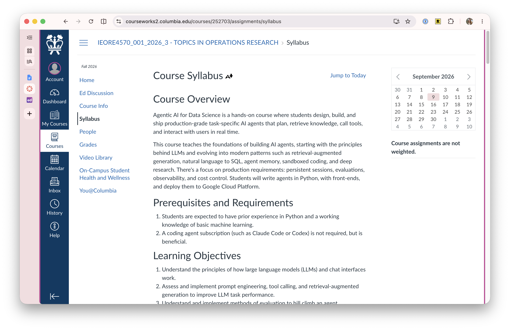
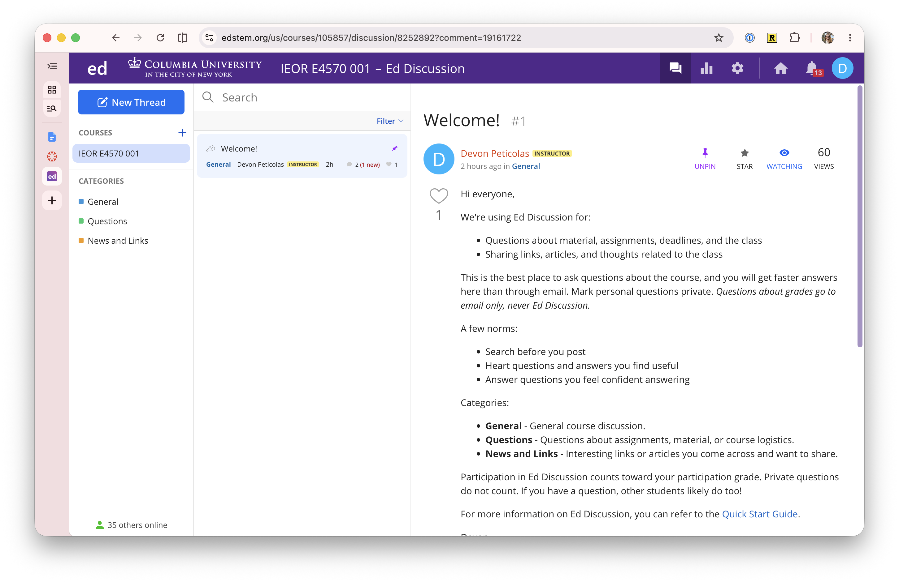
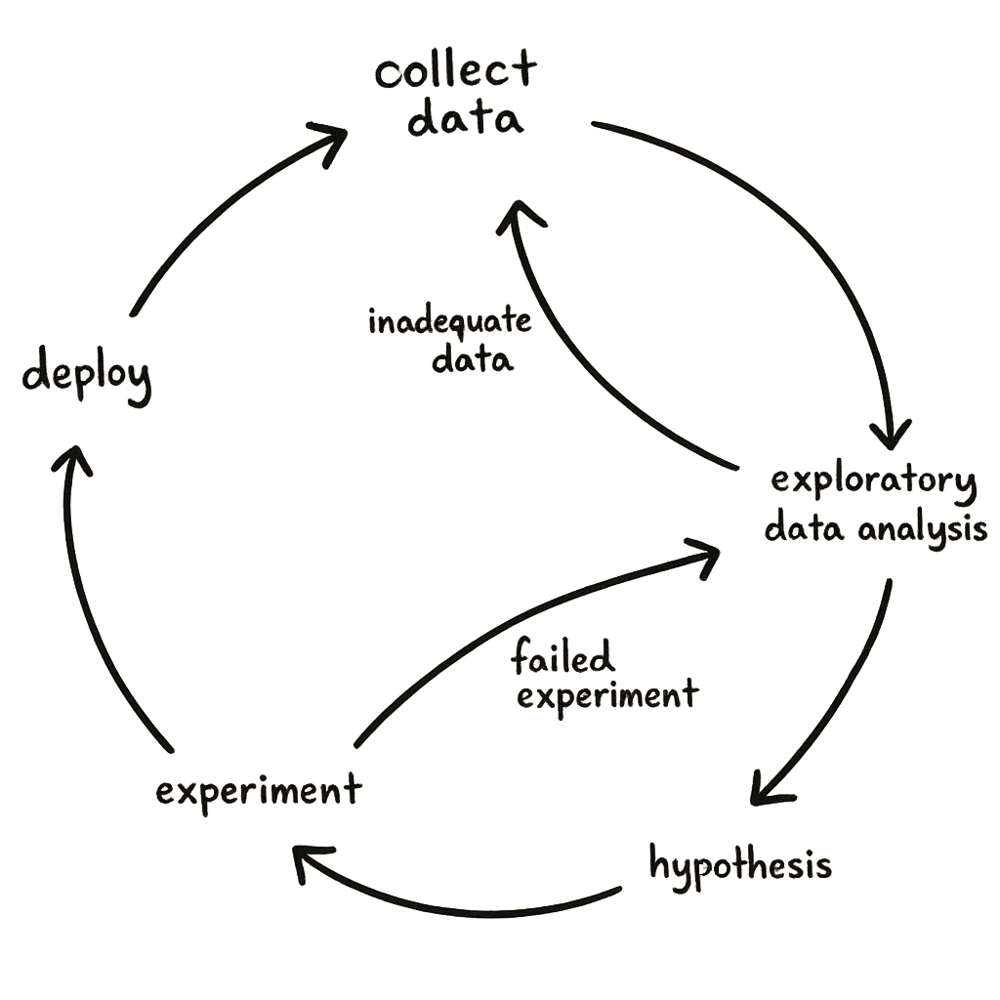
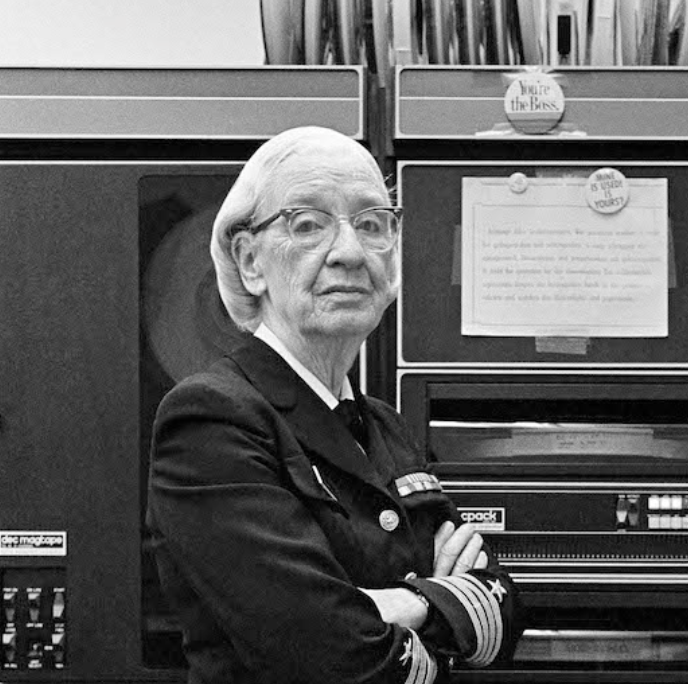

# Introduction

IEOR 4570 - Agentic AI for Data Science

<div class="absolute bottom-2 left-2 p-2 pl-4 text-left w-125 border-1">

Please note: The perspectives shared today are based on my personal experience and do not represent the views of my employer.

</div>

---
layout: side-title
align: rm-lm
color: pink
---

:: title ::

## What is this course?

:: content ::

Agentic AI for Data Science is a <span v-mark="{ at: 1, color: 'red', type: 'underline' }">hands-on course</span> where students design, build, and <span v-mark="{ at: 2, color: 'red', type: 'underline' }">ship production-grade</span> task-specific agents that plan, retrieve knowledge, call tools, and interact with users in real time.

We start with the principles behind <span v-mark="{ at: 3, color: 'red', type: 'underline' }">LLMs</span> and evolve into modern patterns such as retrieval-augmented generation, natural language to SQL, agent memory, sandboxed coding, and deep research. Throughout, we focus on production requirements: persistent sessions, evaluations, observability, and cost control.

You will write agents in <span v-mark="{ at: 4, color: 'red', type: 'underline' }">Python</span>, give them front-ends, and <span v-mark="{ at: 4, color: 'red', type: 'underline' }">deploy them</span> to Google Cloud Platform.

---
layout: two-cols-title
align: l-lt-cm
---

:: title ::

## Who am I?

:: left ::


### Background
- Practitioner in Data Science, Machine Learning, and AI
- 14 years of experience building analytics systems and products
- Previously taught Data Science and Machine Learning for Columbia SPS and this course for IEOR last semester
- Staff engineer at Scale AI

<br>    

### Fun facts

<v-clicks>

- My background is entirely startups
- I biked from here to Canada
- I have a single character github handle

</v-clicks>

:: right ::

{width=280px .rounded-lg}


# _Devon Peticolas_

---
layout: side-title
align: rm-lm
color: emerald
---
:: title ::

## Learning Objectives

:: content ::

1. Understand the principles of how large language models (LLMs) and chat interfaces work.
2. Assess and implement prompt engineering, tool calling, and retrieval-augmented generation to improve LLM task performance.
3. Understand and implement methods of evaluation to hill-climb an agent.
4. Assess and implement multi-agent architectures.
5. Deploy production-grade agents to GCP using the OpenAI Agents SDK, with supporting services such as databases, vector databases, and monitoring.
6. Make design decisions that shape accuracy, cost, and latency, and communicate trade-offs to stakeholders.

---
layout: side-title
align: rm-lm
color: sky
---

:: title ::

## Prerequisites

:: content ::

* Prior experience in **Python**
* A working knowledge of **basic machine learning**

---
layout: side-title
align: rm-lm
color: slate
---

:: title ::

# System Requirements

:: content ::

All students are expected to bring a Mac, Windows, or Linux **laptop** with the following software installed:

- [Python 3.12+](https://www.python.org/downloads/)
- [UV](https://docs.astral.sh/uv/guides/install-python/)
- [git](https://git-scm.com/downloads)

Additionally, students will need [a GitHub account](https://github.com/signup).


---
layout: side-title
align: rm-lm
color: cyan
---

:: title ::

## Use of AI Tools

:: content ::

You are **encouraged** to use command-line AI coding tools (e.g., Claude Code, Codex) to help write, debug, and understand code.

However:

* You must be able to **explain** the code you submit.
* Don't paste confidential or personal data into these tools.
* Any write-ups or documents that are part of an assignment must be **your own words**, not AI-generated.

-# Full policy: [Columbia Generative AI Policy](https://provost.columbia.edu/content/office-senior-vice-provost/ai-policy)

---
layout: side-title
align: rm-lm
color: amber
---

:: title ::

## Class Structure

:: content ::

* **14 weeks** (but really 13). 150-minute classes of lecture, coding, and (when possible) a real-world case study.
* In lieu of midterms and finals, you submit **three projects**. The last is a capstone presented the final week.
* Material reflects current, rapidly-changing industry patterns. There is no textbook. Materials may change mid-semester.
* We have three phenomenal Course Assistants.

---
layout: section
color: rose
---

# *I expect in-person attendance*

---
layout: side-title
align: rm-lm
color: rose
---

::title::

# Attendance Policy

::content::


### Why in-person?

- I can't speak freely if I'm recording lectures.
- This class is only successful if it's a conversation.
- It's the schools policy.

<br><hr>

### What if I can't make a lecture?

- I'm not counting attendance and you won't be penalized.
- Slides and code samples will be posted online.
- Final presentations can be submitted async.

<br><hr>

### What if I can't make lectures regularly?

- If DSi offers for me to teach in the spring, I'll say yes.
- There are 50 students on the waitlist.


---
layout: two-cols-title
---

::title::

## Courseworks and Ed Discussion

::left::

### Courseworks

- Announcements
- Slides and code examples from each lesson (Files tab)
- Posting, submitting, and grading assignments



::right::

### Ed Discussion

- Questions about material, assignments, and the class
- Sharing links, articles, and thoughts
- Bulding some community



::default::

Questions about grades go to **email only**, not Ed Discussion.

---
layout: four-cell-title
---

::title::

## Course Schedule

Weeks 1–4

::top-left::

#### 9/10 · Introduction & Large Language Models

- Syllabus, deliverables, grading, expectations
- Dev environment: Python env, repo skeleton, local run
- History and inner workings of modern LLMs
- Post-training: RLHF, RLVR, RaR

::bottom-left::

#### 9/17 · Chatbots, Prompting, and Reasoning

- How does an LLM become a chatbot? Who am I talking to?
- Classic prompt engineering techniques
- Chain-of-thought prompting and modern reasoning
- Working with hosted models

::top-right::

#### 9/24 · Agents that Live and Do

- Tool calling: how it works and best practices
- What's an agent harness?
- Client/server HTTP agents
- Deploying to GCP
- **Project 1 assigned**

::bottom-right::

#### 10/1 · Agents in Production and Evaluated

- OpenAI Agents SDK
- Other frameworks: Google ADK, LangGraph, PydanticAI
- Agent traces (OTEL)
- Guardrails

---
layout: four-cell-title
---

::title::

## Course Schedule

Weeks 5–8

::top-left::

#### 10/8 · Evaluating Agents

- Offline evaluations and hill climbing
- Golden and silver datasets
- Online evaluations
- Eval-first agent design
- **Project 1 due**

::bottom-left::

#### 10/15 · Guest Lecture

- TBD

::top-right::

#### 10/22 · RAG

- Classic (semantic) retrieval-augmented generation
- Text2SQL
- Non-semantic RAG

::bottom-right::

#### 10/29 · Multi-Agent Architectures

- Basic multi-agent patterns
- Composite patterns: Deep Research
- **Project 2 assigned**

---
layout: four-cell-title
---

::title::

## Course Schedule

Weeks 9–12

::top-left::

#### 11/5 · Memory & Modern Context Engineering

- State vs. session vs. context vs. memory
- Trimming, truncating, and summarizing context
- The overwhelming importance of the KV-cache

::bottom-left::

#### 11/12 · Coding Agents & Modern Tools

- Model Context Protocol: local and remote
- Coding as tool composition and "Code Mode"
- Progressive tool disclosure
- Sandboxes
- **Project 2 due**

::top-right::

#### 11/19 · Claude Code

- A walk through the Spring '26 Claude Code source code leak
- How I use Claude Code
- **Final project assigned**

#### 11/26 · No Class (Thanksgiving)

::bottom-right::

#### 12/3 · Fun Topics

- Autoresearch / goal-mode
- Constrained decoding
- AI detectors and watermarking
- Industry landscape: frontier labs, hyperscalers, FDEs

#### 12/10 · Final presentations

---
layout: two-cols-title
---

::title::

## Projects

<br>

::left::

### Project 1: A Tool-Calling Agent
Build a domain-specific tool-calling agent and deploy it to GCP.


<br>

### Project 2: A Deep Research Agent
Build a multi-agent research system that explores both structured and unstructured data sources to synthesize answers to novel questions.

::right::

### Final Project: Capstone Agent
Identify a real-world need, then architect, code, and deploy an agent of your own design to solve it.

Define a target user and business model, and deliver a working agent that employs multiple techniques from class and is hill-climbed with robust evals.


::default::

For all projects, you may work in **groups of up to three**.

Larger groups come with larger expectations.

---
layout: side-title
align: rm-lm
color: violet
---

:: title ::

## Project Submissions

:: content ::

* Due **11:59pm on the Wednesday** before the lecture where they're marked "due."
* Submit as a **GitHub repository URL**; deploy the live agent to **GCP**.
* Every repo has a `submission.json` at the root:

```json
{
  "deploy_url": "https://your-agent.example.run.app",
  "authors": ["abc1234", "xyz9876"]
}
```

* List every UNI on the team in `authors`. One person submits per group.
* Private repos are fine, so long as you add myself and the CAs.

---
layout: side-title
align: rm-lm
color: teal
---

:: title ::

## Peer Reviews and Presentation

:: content ::

After Projects 1 and 2:

* You **review assigned classmates' projects** asynchronously, due one week after the deadline.
* In your review, you may **nominate** a project for presentation.
* The most-nominated students (up to 3) present at the start of the following class.

<hr><br>

* Peer reviews **do not affect the project grade**. They're for feedback and creative critique.
* Participating **is part of your participation grade**.
* Students who present earn **+1 point** on their final grade.

---
layout: center
---

## Grading

| | |
|---|---|
| Project 1 | 25% |
| Project 2 | 25% |
| Final Project | 40% |
| Participation* | 10% |


* _Based on peer reviews and public discussion on Ed Discussion._

---
layout: section
color: sky-light
---

## Why does this class exist?

---
layout: center
---

{ width=60% .mx-auto }

---
layout: quote-portrait
color: sky-light
quotesize: text-s
authorsize: text-s
author: 'Andrew Feldman - CEO, Cerebras Systems'
---

::pic::


::default::

When the internet was slow, Netflix delivered DVDs in envelopes. When the internet got fast, Netflix didn't get better at delivering DVDs, it became a movie studio. Speed enabled Netflix to be something different. It wasn't a change in degree, it was a fundamental change in kind.

---
layout: quote-portrait
color: sky-light
quotesize: text-m
authorsize: text-s
author: 'Grace Hopper - Computer Scientist, Navy Admiral, Mark 1 programmer'
---

::pic::



::default::

The only phrase I've ever disliked is, 'Why, we've always done it that way.'
