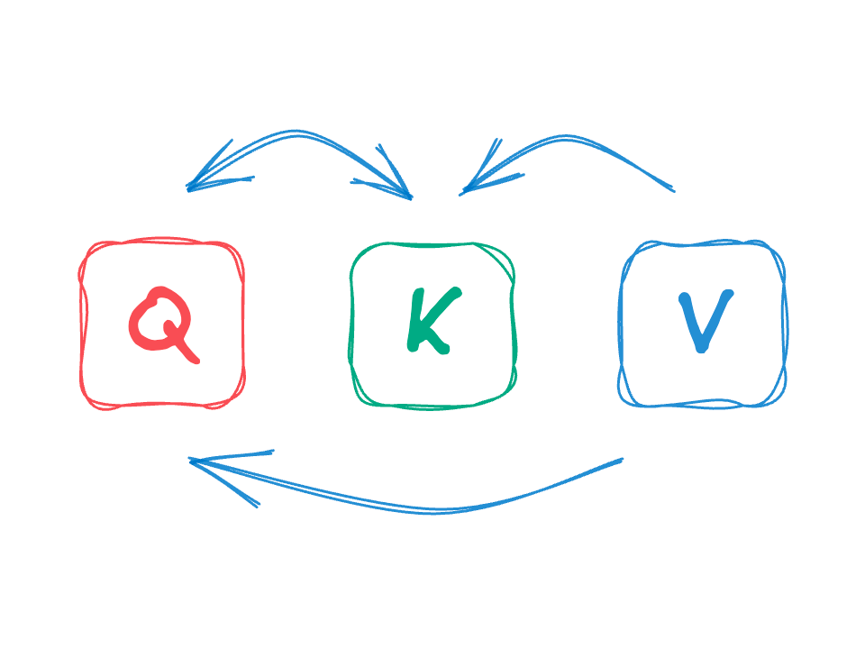
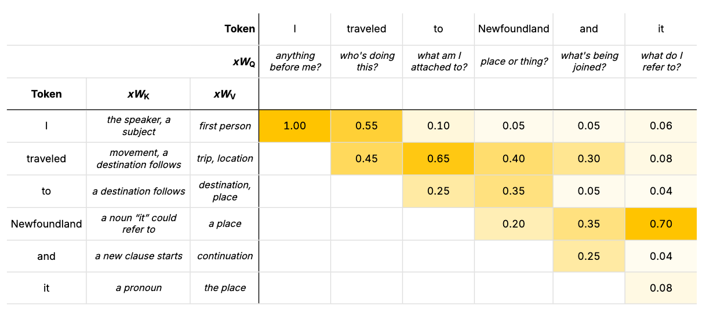
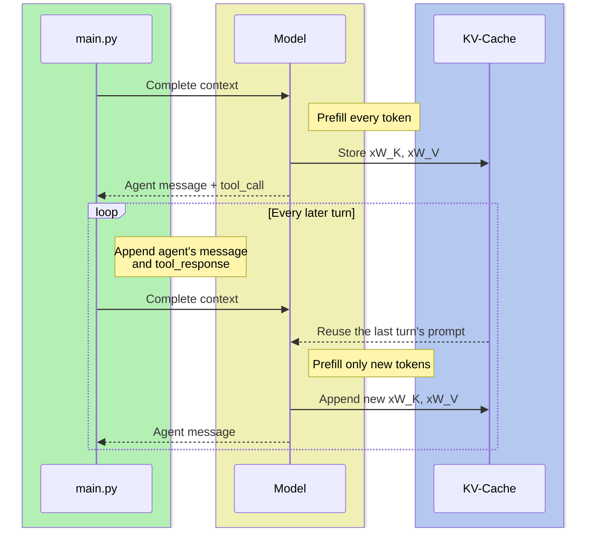

# KV-Cache

IEOR 4570 - Agentic AI for Data Science

<div class="absolute bottom-2 left-2 p-2 pl-4 text-left w-125 border-1">

Please note: The perspectives shared today are based on my personal experience and do not represent the views of my employer.

</div>

---
layout: two-cols
margin: tighter
columns: is-5
zoom: 0.8
align: lm-lm
---

<style>
table td, table th { padding: 0.15rem }
</style>

::left::

## Recap: $QKV$

<br>

$Q$uery
: A vector representing what the current token is looking for from the previous tokens.

$K$ey
: A vector for each token we might attend to that $Q$ is scored against for relevance.

$V$alue
: A vector for each token we might attend to. What the token might contribute.



::right::

#### I petted the ==Newfoundland==

<br>

| Token | $K$ | Match | $V$ |
|-------|-----|-------|-----|
| **I** | _the speaker, a subject_ | LOW | _first person_ |
| **petted** | _something you do to an animal_ | HIGH | _animal, pet, dog_ |
| **the** | _a specific, countable thing follows_ | MEDIUM | _an individual thing, not a region_ |
| **Newfoundland** | _ambiguous noun_ | MEDIUM | _its own starting meaning_ |

<br>

#### I traveled to ==Newfoundland==

<br>

| Token | $K$ | Match | $V$ |
|-------|-----|-------|-----|
| **I** | _the speaker, a subject_ | LOW | _first person_ |
| **traveled** | _movement, a destination follows_ | HIGH | _trip, location, geography_ |
| **to** | _a direction or destination follows_ | HIGH | _destination, place_ |
| **Newfoundland** | _ambiguous noun_ | MEDIUM | _its own starting meaning_ |

---
layout: two-cols-title
align: l-lm-lm
---

::title::

## I traveled to Newfoundland and it ==_________==

::left::


<style>
table td, table th { padding: 0.15rem }
</style>

| Token | $K$ | Match | $V$ |
|-------|-----|-------|-----|
| I | _a noun, but the speaker_ | LOW | _first person_ |
| traveled | _an action_ | LOW | _trip, movement_ |
| to | _a preposition_ | LOW | _direction_ |
| **Newfoundland** | **_a noun "it" could refer to_** | **HIGH** | _**a place**_ |
| and | _a new clause starts_ | LOW | _continuation_ |
| it | _a pronoun_ | LOW | _the place_ |


::right::

<style>
  html,body{margin:0;background:#fff;color:#000;font-family:-apple-system,"Helvetica Neue",Arial,sans-serif}
  .wrap{width:420px;padding:12px}
  .prompt{font-size:16px;margin-bottom:10px}
  .panel{border:1.5px solid #000;border-radius:14px;padding:12px 14px 0}
  .title{text-align:center;font-size:14px;margin-bottom:6px}
  .bars{display:flex;align-items:flex-end;justify-content:space-around;height:120px;border-bottom:1.5px solid #000}
  .bw{display:flex;flex-direction:column;align-items:center;justify-content:flex-end;width:34px;height:100%}
  .p{font-size:11px;color:#555;margin-bottom:2px}
  .bar{width:20px;background:#d3d8fb;border:1.5px solid #4a5fe0;border-bottom:none;border-radius:4px 4px 0 0}
  .bar.pk{background:#4a5fe0}
  .labels{display:flex;justify-content:space-around;height:66px}
  .l{width:34px;position:relative}
  .l span{position:absolute;top:8px;left:50%;transform:translateX(-100%) rotate(-60deg);transform-origin:right top;white-space:nowrap;font-size:13px;color:#4a5fe0}
  .l.pk span{font-weight:700}
  .sample{text-align:center;margin-top:10px;font-size:14px;color:#555}
  .chip{display:inline-block;border:1.5px solid #4a5fe0;color:#4a5fe0;border-radius:8px;padding:2px 10px;font-weight:700;font-size:15px;margin-left:4px}
</style>
<div class="wrap">
  <div class="prompt">I traveled to Newfoundland and it</div>
  <div class="panel">
    <div class="title">Next token probabilities</div>
    <div class="bars"><div class="bw"><div class="p">0.30</div><div class="bar pk" style="height:90px"></div></div><div class="bw"><div class="p">0.25</div><div class="bar" style="height:75px"></div></div><div class="bw"><div class="p">0.12</div><div class="bar" style="height:36px"></div></div><div class="bw"><div class="p">0.08</div><div class="bar" style="height:24px"></div></div><div class="bw"><div class="p">0.08</div><div class="bar" style="height:24px"></div></div><div class="bw"><div class="p">0.06</div><div class="bar" style="height:18px"></div></div><div class="bw"><div class="p">0.01</div><div class="bar" style="height:3px"></div></div><div class="bw"><div class="p">0.01</div><div class="bar" style="height:3px"></div></div></div>
    <div class="labels"><div class="l pk"><span>rained</span></div><div class="l"><span>was</span></div><div class="l"><span>snowed</span></div><div class="l"><span>looked</span></div><div class="l"><span>felt</span></div><div class="l"><span>poured</span></div><div class="l"><span>wagged</span></div><div class="l"><span>barked</span></div></div>
  </div>
  <div class="sample">sampled <span class="chip">rained</span></div>
</div>

---
layout: center
---

<style>
  body{margin:16px;background:#fff;color:#000;font-family:-apple-system,"Helvetica Neue",Arial,sans-serif;font-size:14px}
  table{border-collapse:collapse;table-layout:auto;width:864px;font-size:13px;line-height:1.25}
  th,td{padding:5px 4px;text-align:center;border-bottom:1px solid #ddd}
  thead tr:nth-child(2) td{width:90px}
  tbody td:nth-child(2){width:130px}
  tbody td:nth-child(3){width:86px}
  th{font-weight:700}
  th,td{height:40px;border-left:1px solid #ddd}
  th:first-child,td:first-child{border-left:none}
  thead td:first-of-type,tbody td:nth-child(4){border-left:1px solid #000}
  thead tr:nth-child(2) td,tbody td:nth-child(2),tbody td:nth-child(3){font-size:12px;font-style:italic}
  thead tr:last-child th,thead tr:last-child td{border-bottom:1px solid #000}
  th.lab{text-align:right}
  td.w{font-variant-numeric:tabular-nums}
</style>
<table>
<thead>
<tr><th colspan="3" class="lab">Token</th><td>I</td><td v-click="1">traveled</td><td v-click="2">to</td><td v-click="3">Newfoundland</td><td v-click="4">and</td><td v-click="5">it</td></tr>
<tr><th colspan="3" class="lab"><i>x</i><i>W</i><sub>Q</sub></th><td>anything before me?</td><td v-click="1">who's doing this?</td><td v-click="2">what am I attached to?</td><td v-click="3">place or thing?</td><td v-click="4">what's being joined?</td><td v-click="5">what do I refer to?</td></tr>
<tr><th>Token</th><th><i>x</i><i>W</i><sub>K</sub></th><th><i>x</i><i>W</i><sub>V</sub></th><td></td><td></td><td></td><td></td><td></td><td></td></tr>
</thead>
<tbody>
<tr><td>I</td><td>the speaker, a subject</td><td>first person</td><td class="w" style="background:rgba(255,196,0,1.00)">1.00</td><td v-click="1" class="w" style="background:rgba(255,196,0,0.79)">0.55</td><td v-click="2" class="w" style="background:rgba(255,196,0,0.14)">0.10</td><td v-click="3" class="w" style="background:rgba(255,196,0,0.07)">0.05</td><td v-click="4" class="w" style="background:rgba(255,196,0,0.07)">0.05</td><td v-click="5" class="w" style="background:rgba(255,196,0,0.09)">0.06</td></tr>
<tr><td v-click="1">traveled</td><td v-click="1">movement, a destination follows</td><td v-click="1">trip, location</td><td></td><td v-click="1" class="w" style="background:rgba(255,196,0,0.64)">0.45</td><td v-click="2" class="w" style="background:rgba(255,196,0,0.93)">0.65</td><td v-click="3" class="w" style="background:rgba(255,196,0,0.57)">0.40</td><td v-click="4" class="w" style="background:rgba(255,196,0,0.43)">0.30</td><td v-click="5" class="w" style="background:rgba(255,196,0,0.11)">0.08</td></tr>
<tr><td v-click="2">to</td><td v-click="2">a destination follows</td><td v-click="2">destination, place</td><td></td><td></td><td v-click="2" class="w" style="background:rgba(255,196,0,0.36)">0.25</td><td v-click="3" class="w" style="background:rgba(255,196,0,0.50)">0.35</td><td v-click="4" class="w" style="background:rgba(255,196,0,0.07)">0.05</td><td v-click="5" class="w" style="background:rgba(255,196,0,0.06)">0.04</td></tr>
<tr><td v-click="3">Newfoundland</td><td v-click="3">a noun “it” could refer to</td><td v-click="3">a place</td><td></td><td></td><td></td><td v-click="3" class="w" style="background:rgba(255,196,0,0.29)">0.20</td><td v-click="4" class="w" style="background:rgba(255,196,0,0.50)">0.35</td><td v-click="5" class="w" style="background:rgba(255,196,0,1.00)">0.70</td></tr>
<tr><td v-click="4">and</td><td v-click="4">a new clause starts</td><td v-click="4">continuation</td><td></td><td></td><td></td><td></td><td v-click="4" class="w" style="background:rgba(255,196,0,0.36)">0.25</td><td v-click="5" class="w" style="background:rgba(255,196,0,0.06)">0.04</td></tr>
<tr><td v-click="5">it</td><td v-click="5">a pronoun</td><td v-click="5">the place</td><td></td><td></td><td></td><td></td><td></td><td v-click="5" class="w" style="background:rgba(255,196,0,0.11)">0.08</td></tr>
</tbody>
</table>

<br><br>

_Note how $xW_K$ and $xW_V$ don't change for new $xW_Q$._

---
layout: side-title
color: sky
align: rm-lm
transition: fade
---

::title::

## The KV-Cache

::content::

_The stored $xW_K$ and $xW_V$ of every token processed so far, for every layer and every head._

_Past the first layer, a token's $x$ already includes what it attended to, so its $xW_K$ and $xW_V$ depend on every token before it._

---
layout: side-title
color: sky
align: rm-lm
transition: fade
---

::title::

## The KV-Cache

::content::

### Each generation step

1. The new token computes its $xW_Q$, $xW_K$, and $xW_V$
2. Its $xW_K$ and $xW_V$ are appended to the cache
3. Its $xW_Q$ attends over everything in the cache
4. The model samples the next token, and the loop repeats

<br>

### The KV-Cache

- Lives in GPU memory alongside the model.
- If invalidated, all $xW_K$ and $xW_V$ are just computed again.

---
layout: side-title
color: sky
align: rm-lm
---

<style>
table td, table th { padding: 0.15rem }
</style>

::title::

## The KV-Cache

::content::

### Per generation step (token $t$, per layer)

| | No cache | KV-Cache |
|---|---|---|
| Per-token work | $O(t \cdot d^2)$ | $O(d^2)$ |
| Token-to-token work | $O(t^2 \cdot d)$ | $O(t \cdot d)$ |

-# _Where $d$ is the length of each token's vector._

<br>

### Generating of $n$ tokens (per layer)

| | No cache | KV-Cache |
|---|---|---|
| Per-token work | $O(n^2 d^2)$ | $O(n d^2)$ |
| Token-to-token work | $O(n^3 d)$ | $O(n^2 d)$ |
| Memory | none extra | $O(n \cdot d)$ |

<br>

$$\text{work per step} \approx L \cdot (\text{per-token} + \text{token-to-token})$$

---
layout: question-answer
color: emerald
---

::question::

## Why KV-Cache? Not KVQ-Cache?

::answer::

Looking back at our table representation:



Each row's $xW_K$ and $xW_V$ is an answer needed by every $xW_Q$ column. But each $xW_Q$'s question is only needed once.

We just never need $Q$ again.

---
layout: question-answer
color: purple
---

::question::

## How would enabling a KV-Cache impact metrics?

<br>
<hr>
<br>

### Time-to-first-token (TTFT)?
### Tokens-per-second (TPS)?

::answer::

### Time-to-first-token (TTFT)?

<u>Unchanged</u> for the first request. The prompt is processed in one parallel pass. This is **prefill**. The token-by-token loop after it is **decode**.

<u>Improved</u> for subsequent requests so long as the cache is still around and valid.

### Tokens-per-second (TPS)?

Much higher.

Each new token only does its own per-token work, then reads the cache.

Without the cache, every step redoes the whole sequence.

---
layout: question-answer
color: orange
---

<style>
rt { font-size: 1em; font-style: italic; }
</style>

::question::

## What if we changed already cached tokens?

<br>
<hr>
<br>

##### I <ruby>~~traveled to~~<rt>petted the</rt></ruby> Newfoundland and it

::answer::

Everything from the change onward is invalid:

- "I" is still valid.
- "petted" and "the" need new $xW_K$ and $xW_V$.
- "Newfoundland" hidden state, $x$, was built from the prior tokens' $xW_V$. Its cached $xW_K$ and $xW_V$ are invalidated.
- So are those of every token after it.

---
layout: section
color: teal
---

## The KV-Cache in Practice

---
layout: two-cols-title
---

::title::

## The Cache Ain't Free

::right::

### Memory per token Llama 3.1 8B

$$
32 \text{ layers} \times 8 \text{ KV heads} \times 128 \times 2_{(K,V)} \times 2 \text{ bytes} \\
\approx 128 \text{ KB per token}
$$

| Context | KV-Cache |
|---|---|
| 1K tokens | 128 MB |
| 8K tokens | 1 GB |
| 32K tokens | 4 GB |
| 128K tokens | 16 GB |

-# _At 128K, the cache is as big as the (16GB) model._

::left::

The cache lives in GPU memory, next to the model weights. Every decode step reads all of it.

<br>

### How Models Optimize

- **Grouped-query attention:** share $K$ and $V$ across heads. Llama 3 uses 8 KV heads instead of 32, a 4x smaller cache.
- **Quantized cache:** store $K$ and $V$ in fewer bytes.
- **Paged attention (vLLM):** allocate cache in blocks, like virtual memory.

<br>

<AdmonitionType type="tip" title="Question">

What does this teach us about local inference on consumer grade hardware?

</AdmonitionType>

---
layout: two-cols-title
align: l-lt-lm
---

::title::

## Prompt Caching: Keep the KV-Cache Between Requests

::left::

#### Within one request

Prefill KV-Cache for every prompt token. Decode then generates while appending to the KV-Cache.

#### Across requests

The server keeps the KV-Cache (for some TTL) after it responds. When the next request starts with the same tokens, prefill skips them.

If the first part of the prompt/context was changed, the cache is invalidated and must be prefilled again.

<AdmonitionType type="tip" title="Why agents benefit">

Every turn resends the whole context plus a little more, and agent contexts run long. Almost every token in a request was already cached by the one before it.

</AdmonitionType>

::right::



---
layout: side-title
color: amber
align: rm-lm
---

<style>
table td, table th { padding: 0.15rem 0.4rem }
</style>

::title::

## Cached Reads Cost 5 to 10% of Input

::content::

| Model | Input | Write | Read | 
|---|---|---|---|
| gpt-6.1-sol | $2.00 | $2.50 | $0.10 (5%) |
| gpt-6-luna | $0.10 | $0.125 | $0.01 (10%) |
| gpt-5.4 | $2.50 | none | $0.25 (10%) |
| Claude Opus 5.5 | $4.00 | $5.00 | $0.20 (5%) |
| Claude Sonnet 5.5 | $2.00 | $2.50 | $0.10 (5%) |
| Claude Haiku 5.5 | $0.10 | $0.125 | $0.01 (10%) |
| gemini-4-argon | $2.00 | none | $0.10 (5%) |
| gemini-3.8-flash | $0.75 | none | $0.075 (10%) |

-# _Per 1M tokens, checked Nov 9, 2026. Gemini 4 Argon rises to \$4.00 input and \$0.20 read on Dec 1. Gemini also lists hourly cache storage on some models._

---
layout: side-title
color: rose
align: rm-lm
---

<style>
table { table-layout: fixed; }
table td, table th { padding: 0.15rem 0.4rem }
</style>

::title::

## What does caching save a 20-turn agent?

::content::

### Agent

- 10K-token prefix of tools and system prompt
- Each turn adds 1K tokens

### w/out Cache

| | Tokens | Per 1M | Cost |
|---|---|---|---|
| Input | 410K | $2.00 | $0.82 |
| **Total** | 410K | | **$0.82** |

### w/ Cache

| | Tokens | Per 1M | Cost |
|---|---|---|---|
| Cache writes | 30K | $2.50 | $0.075 |
| Cache reads | 380K | $0.10 | $0.038 |
| **Total** | 410K | | **$0.11** |

<br>

An intact prefix cuts input cost by 86%.

---
layout: default
---

<style>
table td, table th { padding: 0.2rem 0.5rem }
</style>

## Across Providers

<br>

| | OpenAI (GPT-5.6+) | Anthropic | Gemini |
|---|---|---|---|
| **Enabling** | Automatic, or place your own breakpoints | Add `cache_control` to the request, or to up to 4 blocks | Automatic |
| **Lifespan** | 30 min default, 12 h option | 5 min default, 1 h option | A "short time window" |
| **Min length** | 1,024 tokens | 512 to 4,096 by model | 4,096 tokens |

<br>

_All three reward the same thing. Static content first, dynamic content last._

### Gotches

- OpenAI: A hit requires reaching a machine that holds the cache (see `prompt_cache_key`)
- Gemini 4: Caches only if the new request adds 2050 tokens.

-# _Checked Nov 9, 2026. Self-hosting: [vLLM](https://docs.vllm.ai/en/latest/design/prefix_caching.html) reuses full KV-Cache blocks across requests with a shared prefix._

---
layout: two-cols-title
align: l-lt-lt
---

::title::

## Two OpenAI Controls for More Cache Hits

::left::

#### Keep the tool list fixed

Tools sit at the front of the prompt, so removing one misses the whole cache. Send every tool and restrict which ones are callable.

```python
response = client.responses.create(
    model="gpt-6.1-sol",
    input=messages,
    tools=tools,  # same list, same order
    tool_choice={
        "type": "allowed_tools",
        "mode": "auto",
        "tools": [{"type": "function",
                   "name": "get_weather"}],
    },
)
```

::right::

#### Route related requests together

A cache lives on individual machines, so a request only hits if it reaches one that holds it. On GPT-5.5 and earlier, a key groups related requests.

```python
response = client.responses.create(
    model="gpt-5.4",
    input=messages,
    prompt_cache_key="agent-v2-user-123",
)
```

<br>
<br>

<AdmonitionType type="note" title="Nov 2026">

Keep each key near 15 requests per minute. Past that, traffic overflows to machines without the cache.

On GPT-5.6+, OpenAI routes requests itself. The key is optional and used to keep customer's caches separate.

</AdmonitionType>

---
layout: four-cell-title
align: l-lt-lt-lt-lt
---

::title::

## Rules for Cache-Aware Agent Design

::top-left::

### 1. Static first, dynamic last

Tools, system prompt, and identity at the top. History, memory, and user context after them. If new tools are added mid-session, they can be appended.

::top-right::

### 2. One change invalidates everything after it

A timestamp, a new tool, or a handoff's swapping instructions near the top of the context cuases a cache-miss for every later token. **Context is append-only.**

::bottom-left::

### 3. Don't change model mid-context

A common impluse is to switch models between turns based on difficulty. However, **KV-Caches cannot be shared between models.** New model means prefill. It's better to give each it's own context (e.g. _subagent as tool-call_).

::bottom-right::

### 4. Monitor your cache hits

Log `cached_tokens` or `cache_read_input_tokens` on every request. **A sudden zero means something near the top of the prompt changed** (or the runner infrastructure invalidated the cache due to the partition being overloaded).

::default::

-# [OpenAI Prompt Caching](https://developers.openai.com/api/docs/guides/prompt-caching) · [Manus: Context Engineering for AI Agents](https://manus.im/blog/Context-Engineering-for-AI-Agents-Lessons-from-Building-Manus) · [Anthropic Prompt Caching](https://platform.claude.com/docs/en/build-with-claude/prompt-caching)

---
layout: section
color: blue
---

# Example
<hr>

`kv-cache-web.zip`