# Large Language Models

IEOR 4570 - Agentic AI for Data Science

<div class="absolute bottom-2 left-2 p-2 pl-4 text-left w-125 border-1">

Please note: The perspectives shared today are based on my personal experience and do not represent the views of my employer.

</div>

---
layout: side-title
color: sky
align: rm-lm
---

:: title ::

# Learning Objectives

:: content ::

1. Learn the basics of how an LLM works and how we got here.
2. Learn the differnce between a "token" and an "embedding."
3. Learn how to talk to a model.

---
layout: two-cols
align: lm-rm
color: amber-light
---

::left::

# When was the first language model?

::right::

<v-click>

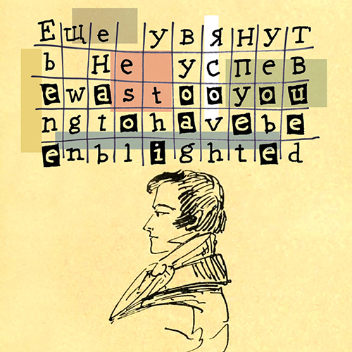

</v-click>

---
layout: side-title
align: rm-lm
color: rose
---

:: title ::

## Russia, 1905

:: content ::

Socialist uprisings against the Tsar split the country: **Tsarists** vs. **reformers**. The split reaches mathematics.

* **Pavel Nekrasov**, "the Tsar of Probability." Religious, monarchist, Moscow. Claimed math could prove free will.
* **Andrey Markov**, "Andrey the Furious." Atheist, republican, St. Petersburg. Called Nekrasov's work "an abuse of mathematics."

The feud ran from 1902 to 1913 over an dea: **the law of large numbers.**

---
layout: two-cols-title
align: l-lm-cm
---

:: title ::

## The Law of Large Numbers

:: left ::

### Bernoulli (1713)

The average of many independent trials converges to the expected value.

<br>

### Example

Flip an unknown coin enough times and the ratio tells you its weight.

<br>

### The Catch

It was only shown for **independent** events.

:: right ::

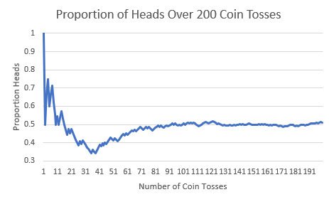

---
layout: two-cols
align: lm-lm
---

:: left ::

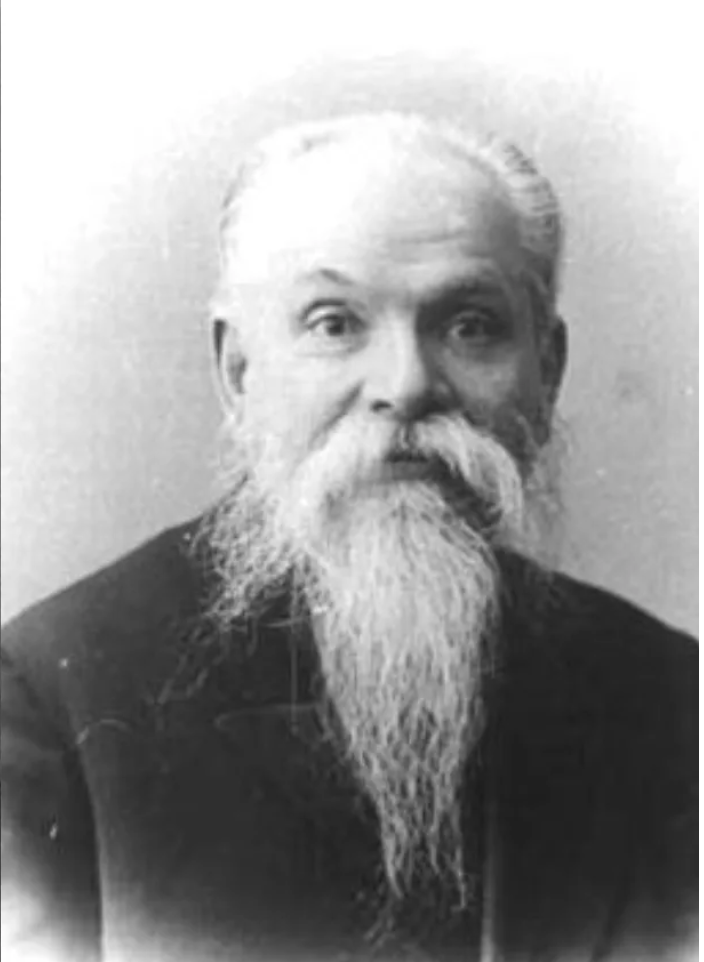{width="80%" .mx-auto} 

:: right ::

## Pavel Nekrasov (1853-1924)

Nekrasov's 1902 argument ran the law backwards:

1. **Independent events** follow the **law of large numbers**.
2. So if you **observe** it, the events **must be** independent.
3. **Social statistics** like marriage, crime, and birth rates stabilize year over year, **fitting the law of large numbers**.

<br>

<SpeechBubble position="l" color="gray-light" shape="round">

Those come from **human decisions**. So human decisions must be independent, and **humans must have free will**.

</SpeechBubble>

---
layout: section
color: rose
---

$$
\Huge
\begin{aligned}
\text{Bernoulli:} &\quad \text{Independent} \implies \text{LLN} \\
\text{Nekrasov:}  &\quad \text{LLN} \implies \text{Independent}
\end{aligned}
$$

---
layout: two-cols
align: lm-lm
---

:: left ::

## Andrey Markov (1856-1922)

Markov attacked the math: does the law of large numbers **require** independence?

1. Took the first 20,000 letters of Pushkin's **Eugene Onegin**. Stripped punctuation. Labeled each letter **vowel** or **consonant**.
2. Counted **8,638** vowels, **11,362** consonants (43/57).
3. If independent, expect $0.43^2 \times 20{,}000 \approx 3{,}731$ vowel-vowel pairs.
4. Found **1,104**. The letters are **dependent**.

<br>

<SpeechBubble position="r" color="gray-light" shape="round">

If every $P_{ij}$ is strictly between 0 and 1, the state frequencies converge. **Dependence does not break the law of large numbers.**

</SpeechBubble>

<br>

:: right ::

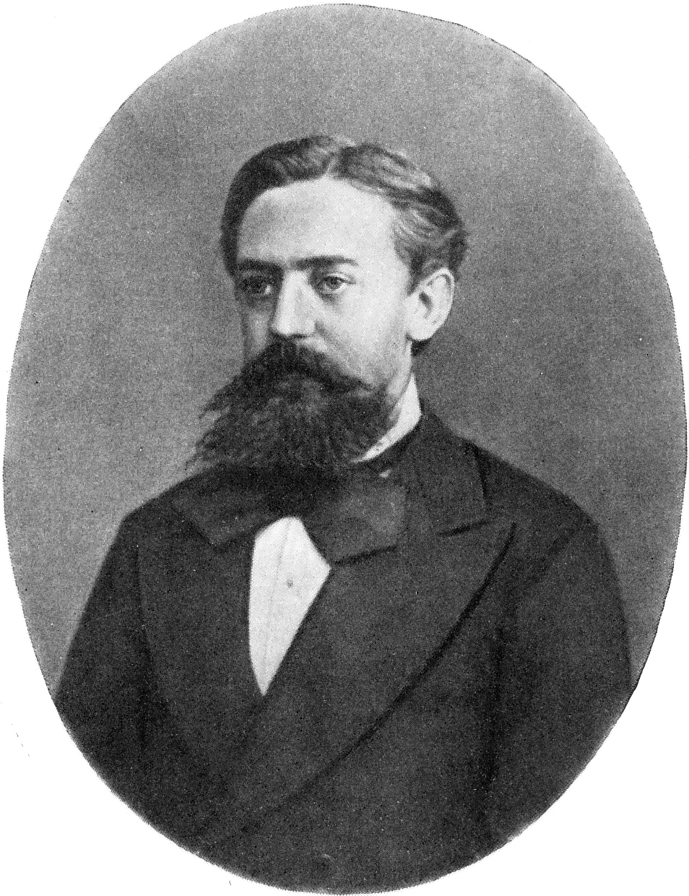{width="90%" .mx-auto}


---
layout: quote
author: 'Andrey Markov (1906)'
color: rose
---

"Thus, free will is not necessary to do probability."

---
layout: center
---

<center><QRCode value="https://peticol.as/markovs-onegin/" :size="200" render-as="svg" /></center>

<br>

## [peticol.as/markovs-onegin/](https://peticol.as/markovs-onegin/)

---
layout: two-cols
align: lm-rm
---

:: left ::

## Beyond Language

A Markov chain is **memoryless**: the future depends on the present, not the past.

Any states work. Weather:

$$
P = \begin{bmatrix}
P_{RR} & P_{RC} & P_{RS} \\
P_{CR} & P_{CC} & P_{CS} \\
P_{SR} & P_{SC} & P_{SS}
\end{bmatrix}
$$

**_Q: How would we predict the liklihood of rain two days from now?_**

<v-click>

_A: Square the matrix: $P^2_{ij}$ is the probability of going from state $i$ to state $j$ in two steps, so if today is cloudy, the chance of rain two days out is $(P^2)_{CR}$._

</v-click>

:: right ::

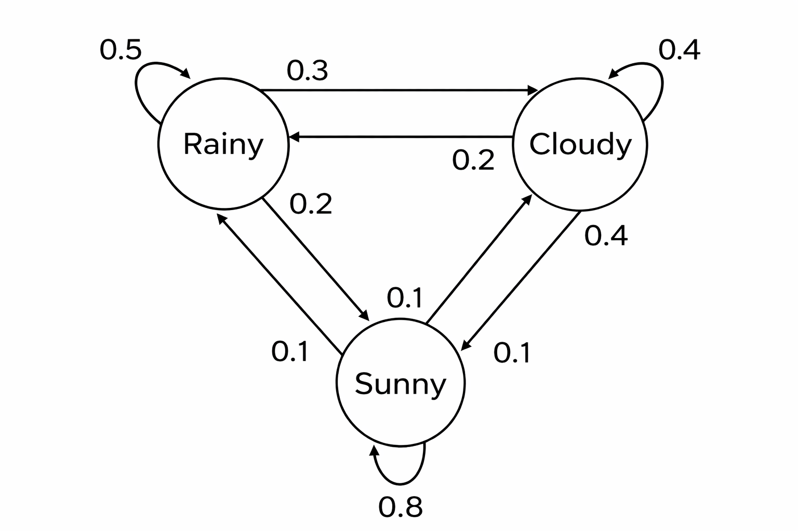

---
layout: center
---

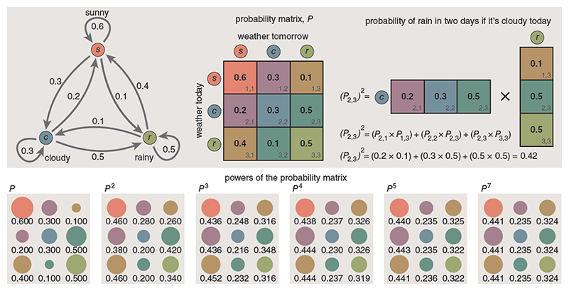

#### _We can also use this strategy to predict two, three, or n-days out._


---
layout: section
---

# Exercise Break 
<hr>

Markov Chains as Language Models

---
layout: side-title
color: emerald
align: rm-lm
---

:: title ::

# Before We Code

:: content ::

In this course, we'll be using **Python** and the **uv** package manager to run code examples.

### Options

1. See the **Python & UV Setup Guide** on the **Courseworks Files** page.
2. Follow the **Installation** guide on `uv`'s website:
   `https://docs.astral.sh/uv/`

### 👍 when you can run
```bash
uv --version
```

---
layout: center
---

1. Download `markov-chains-basic.zip` from the [Courseworks examples folder](https://courseworks2.columbia.edu/courses/252703/files/folder/examples) and unzip it.

2. Run the training script:
   ```bash
   uv run train.py
   ```
   <br>

   This should create an output file `transitions.json` containing the learned transition probabilities.


3. Run the prediction script:
   ```bash
   uv run predict.py
   ```

---
layout: code-right
filename: train.py
columns: is-5
codesize: 11px
---

:: left ::

## Training Markov Chains

We can apply the same technique to text:
1. Define tokens (words)
2. Count transitions: "I" → "like" appears 3 times
3. Normalize to probabilities

Six sentences in, a dictionary of dictionaries out:

```python
transitions["I"]["like"] = 1.0
transitions["to"]["eat"] = 0.5
transitions["to"]["play"] = 0.5
```


:: right ::

```python
import json

corpus = [
    "I like to eat apples",
    "I like to eat bananas",
    ...  # six sentences total
]
transitions = {}

# 1. Populate the transitions dictionary with counts
for document in corpus:
    tokens = document.split(" ")
    for i in range(len(tokens) - 1):
        current_token = tokens[i]
        next_token = tokens[i + 1]
        if current_token not in transitions:
            transitions[current_token] = {}
        if next_token not in transitions[current_token]:
            transitions[current_token][next_token] = 0
        transitions[current_token][next_token] += 1

# 2. Convert counts to probabilities
for current_token, next_tokens in transitions.items():
    total = sum(next_tokens.values())
    for next_token in next_tokens:
        transitions[current_token][next_token] /= total

# 3. Save the transitions to a file
with open("transitions.json", "w") as f:
    json.dump(transitions, f, indent=2)
```

---
layout: code-right
filename: predict.py
columns: is-5
codesize: 11px
---

:: left ::

## Predicting Markov Chains

We form a loop:

1. Start with a token (e.g., "I")
2. Look up possible next tokens
3. Sample proportional to probabilities
4. Repeat

This is **weighted random sampling**; more likely tokens get picked more often, but there's still randomness.

### Prediction Example
```
I like to eat apples are good
```

:: right ::

```python
import json
import random

with open("transitions.json") as f:
    transitions = json.load(f)

def predict_next(current_token):
    if current_token not in transitions:
        return None
    candidates = list(transitions[current_token].keys())
    probs = list(transitions[current_token].values())
    # Weighted random selection
    return random.choices(candidates, weights=probs)[0]

def generate_sequence(start_token, length):
    sequence = [start_token]
    current_token = start_token
    for _ in range(length - 1):
        next_word = predict_next(current_token)
        if next_word is None:
            break
        sequence.append(next_word)
        current_token = next_word
    return sequence

start_token = "I"
sequence = generate_sequence(start_token, 10)
print(" ".join(sequence))
```

---
layout: code-right
align: lm
filename: train.py
columns: is-5
codesize: 11px
---

:: left ::

## Scaling Up: Real Books

Our toy corpus only has 6 sentences. What happens with a real book?

Download [`markov-chains-books.zip`](https://courseworks2.columbia.edu/courses/252703/files/folder/examples). It ships two Project Gutenberg books.

```bash
uv run train.py frankenstein.txt
uv run predict.py \
  frankenstein-transitions.json
```

Same loop as before. The only change is where the tokens come from.

:: right ::

```python
import json
import sys
from pathlib import Path

book_file = sys.argv[1]
output_path = Path(book_file).stem + "-transitions.json"

with open(book_file, "r", encoding="utf-8") as f:
    text = f.read()

tokens = text.split()
transitions = {}

for i in range(len(tokens) - 1):
    ...  # same counting loop as before

for current_token, next_tokens in transitions.items():
    ...  # same normalization as before

with open(output_path, "w") as f:
    json.dump(transitions, f)

print(f"Total unique tokens: {len(transitions)}")
print(f"Saved to: {output_path}")
```

---
layout: two-cols
---

:: left ::

<br><br><br>

## Frankenstein Output

**Starting token:** "The"

#### _The sun had been the same time I was the most of the most beautiful and I had been the same time I had been the same time I was a few moments I was a few moments I was the same time..._

:: right ::

<br><br><br>

## Moby Dick Output

**Starting token:** "The"

#### _The whale was the same thing I had been the most of the whale and I was the same thing I had seen the whale and the whale was the most of the sea and I was the same thing I had been..._

---
layout: section
---

# Tokenization
<hr>

Forming a discrete vocabulary

---
layout: two-cols-title
columns: is-6
align: l-lt-lt
---

:: title ::

## Tokenization

:: left ::

Markov's analysis of *Eugene Onegin* was our first tokenization. He distilled natural language (in this case letters) into math representations (binary).

Language Models require:
* A fixed vocabulary $V$
* Discrete indices to look up embeddings

::default::

| Level | Example | |
|-------|---------|--------|
| **Character** | `[a, p, p, l, e]` | Long sequences, low meaning |
| **Word** | `[apple]` | Short sequences, high meaning |
| **Subword** | `[app, le]` | Balanced (modern choice) |

_But how do we determine what's a "sub-word?"_

:: right ::

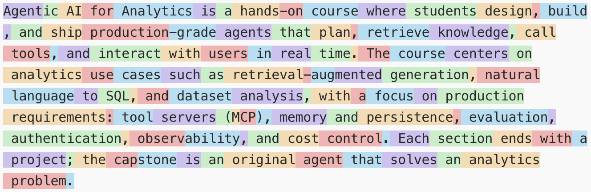


---
layout: two-cols
align: lt-lt
---

:: left ::

## Byte-Pair Encoding

How the subword vocabulary gets built. Originally a compression algorithm.

1. **Start:** vocabulary = every character
2. **Count:** find the most frequent adjacent pair ("e" + "s")
3. **Merge:** add "es" to the vocabulary, replace every occurrence
4. **Repeat** until the vocabulary hits its target size (about 50k to 200k)

Common words are one token. Rare words split.

| | |
|-|-|
|"the"|`the`|
|"tokenization"|`token` + `ization`|

:: right ::

## Byte-Level BPE

Character-level BPE breaks on the long tail: thousands of CJK characters, rare symbols, unknown-token errors.

**Fix:** run BPE over **UTF-8 bytes**.

- Base vocabulary is 256 bytes
- Every string is representable
- No unknown token, ever

This also improves performance with emoji.

| | |
|-|-|
|"😂"|`😂`|
|"🎉"|`f0 9f 8e` + `89`|
|"👍🏽"|`👍` + `f0 9f 8f` + `bd`|

---
layout: two-cols-title
---

::title::

<br><br>

## BPE is compression

English compresses well, high entropy strings do not.

<br>

::left::

### The description of our class

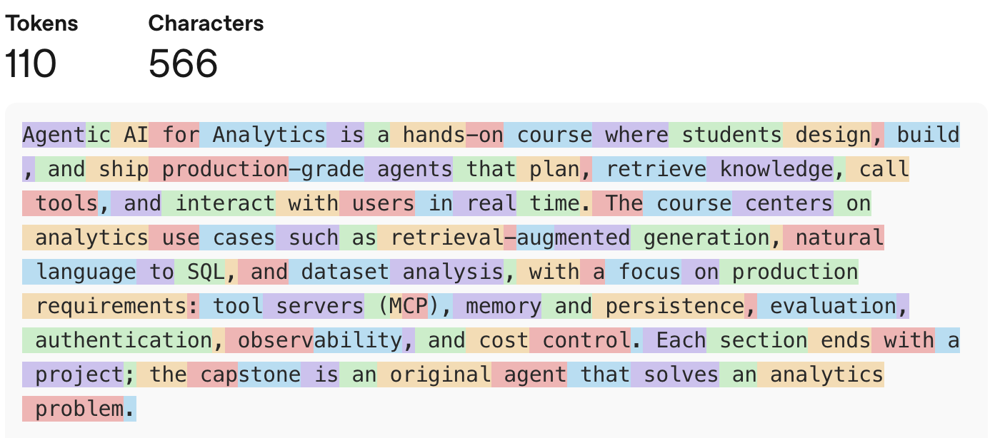

::right::

### A (fake) OpenAI API Key

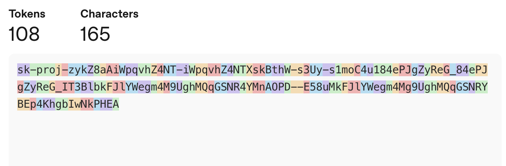

::default::

<center>

#### [platform.openai.com/tokenizer](https://platform.openai.com/tokenizer)

</center>

---
layout: side-title
color: orange
align: rm-lm
---

:: title ::

# Limitations

:: content ::

**Markov chains are simple, but limited:**

* **Context window = 1 token**, it only looks at the previous word
* **No semantic understanding**, "apple" and "banana" are unrelated
* **Sparsity**, many valid sequences never seen in training

This motivates the evolution to **N-grams** (bigger context) and **Word2Vec** (semantic vectors).

---
layout: section
---

# N-gram Models
<hr>

Extending the Context Window

---
layout: two-cols
align: lm-lm
---

:: left ::

## From 1-gram to N-gram

**The generalization**

An N-gram model considers a history window of $n-1$ tokens:

* **Order 1 (Unigram):** No history. $P(w_t)$
* **Order 2 (Bigram):** Markov property. $P(w_t \mid w_{t-1})$
* **Order N:** $P(w_t \mid w_{t-n+1}, \dots, w_{t-1})$

**Chain rule approximation:**

$$
P(w_1, \dots, w_m) \approx \prod_{i=1}^m P(w_i \mid w_{i-(n-1)}, \dots, w_{i-1})
$$

:: right ::

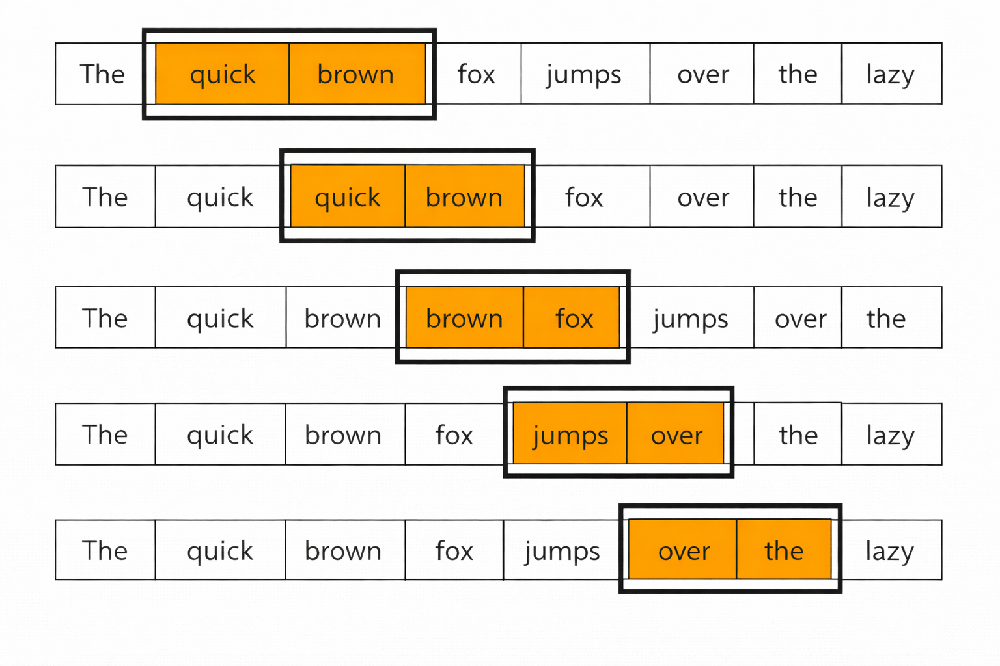

---
layout: two-cols
align: lt-cm
---

::left::

## N-grams as Language Models

We've productized probabilistic modeling as **"Autocomplete."**

**Objective:** Maximize likelihood of the next token ($w_{t+1}$) given a context window of previous tokens.

$$
P(w_{t+1} | w_{t}, w_{t-1}, ...)
$$

A standard feature of smartphones, originally built on **n-gram models**.

We simulate "Generative AI" by simply predicting the most likely next word repeatedly.

::right::

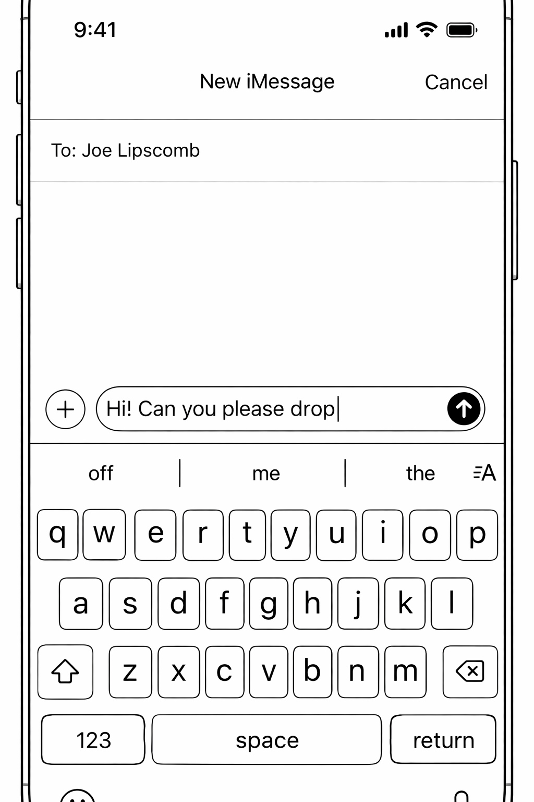

---
layout: center
---

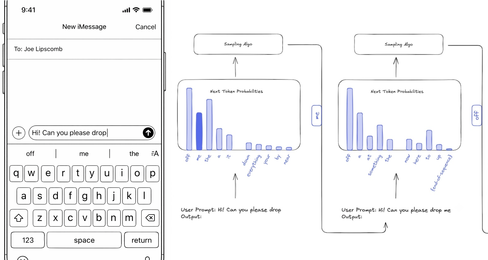

---
layout: two-cols-title
columns: is-6
align: l-lt-lt
---

:: title ::

## But how big can N be?

Google 1T: Scaling N-grams (2007)

<br>

:: left ::

Before Transformers, Google researchers asked: *"How far can we push n-gram models?"*

- Trained on **1 trillion tokens** (web data)
- Produced **300 billion n-grams**
- Solved machine translation without neural networks

:: right ::

This proved that **scale** matters more than sophistication.

- Raw statistical magnitude solved complex tasks
- No neural networks required
- Memory and sparsity remained problems

::default::


<AdmonitionType type="tip" title="Technique: Stupid Backoff" width=600px>

If the N-gram is missing, back off to (N-1)-grams with a penalty:

$
S(w_i \mid w_{i-k+1}^{i-1}) = \begin{cases}
\frac{count(w_{i-k+1}^i)}{count(w_{i-k+1}^{i-1})} & \text{if } count(w_{i-k+1}^i) > 0 \\
0.4 \cdot S(w_i \mid w_{i-k+2}^{i-1}) & \text{otherwise}
\end{cases}
$

</AdmonitionType>

---
layout: section
---

# Word2Vec
<hr>

From Tokens to Semantic Vectors

---
layout: two-cols-title
---

::title::

## First, What is an Embedding?


::left::

Let's consider the humble Bulbasaur who was born and lives in vector-space.

```python
> df.set_index("Name", inplace=True)
> df[["HP", "Attack", "Defense", "Sp. Atk", "Sp. Def", "Speed"]]
> df.loc["Bulbasaur"]
HP         45
Attack     49
Defense    49
Sp. Atk    65
Sp. Def    65
Speed      45
Name: Bulbasaur, dtype: int64
```

<br>

<AdmonitionType type="info" title="Check out this dataset!" icon="mdi-link-variant">

#### [kaggle.com/datasets/rounakbanik/pokemon](https://www.kaggle.com/datasets/rounakbanik/pokemon)

</AdmonitionType>


::right::

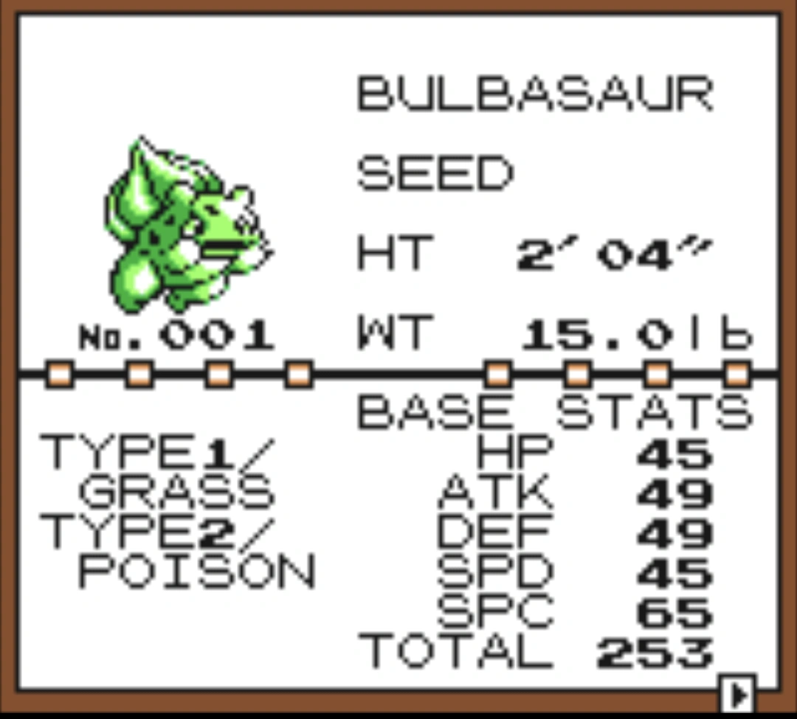

---
layout: two-cols
---

::left::

## Comparing Bulbasaur and Pikachu

* Each Pokemon can be thought of as a vector in a 6-dimensional pokemon-stat space (HP, Attack, Defense, Sp. Atk, Sp. Def, Speed).
* In stat-space, Bulbasaur and Pikachu can be compared with euclidean distance.

```python
p = df.loc["Bulbasaur"].values
q = df.loc["Pikachu"].values
np.linalg.norm(p - q)
```

Additionally, we can search for pokemon with questions like "What pokemon is _more Bulbasaur than Bulbasaur_."

If we increase the magnitude of Bulbasaur's stat vector we'll get closer to Venusaur.

::right::

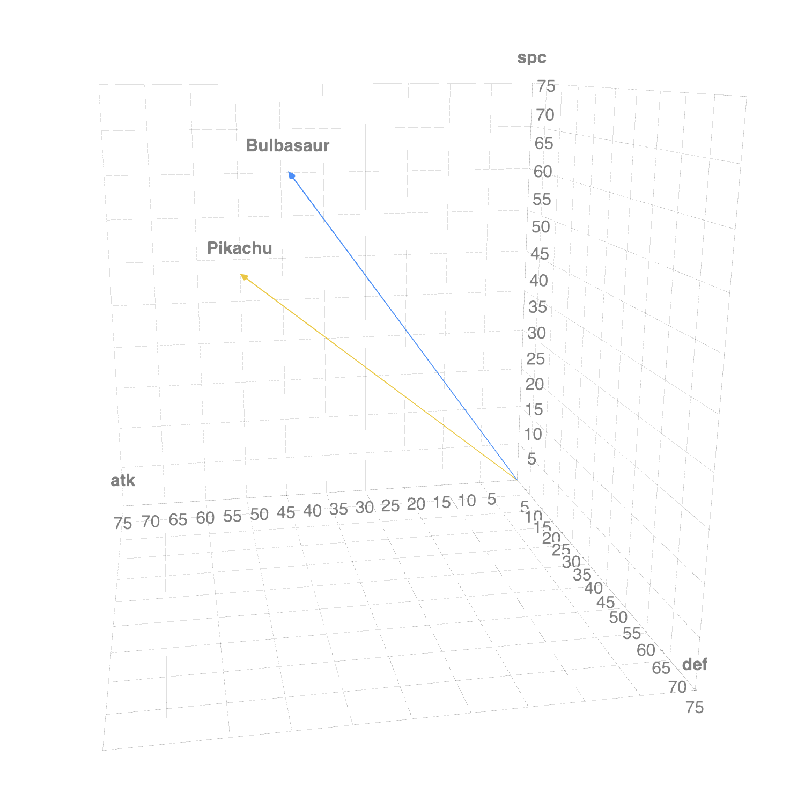

---
layout: two-cols
align: lm-cm
---

:: left ::

## Turning Words into Vectors


**Bag-of-Words and One-Hot Encoding**

Early approaches to NLP treated words as atomic units without inherent relationships.

* A vocabulary $V$ is defined containing all unique words.
* Each word is represented as a vector of dimension $|V|$.
* For the $i$-th word in the vocabulary, the vector has a $1$ at index $i$ and $0$ everywhere else.

$$
\begin{aligned}
w_{\text{apple}} &= [1, 0, 0, \dots, 0] \\
w_{\text{banana}} &= [0, 1, 0, \dots, 0]
\end{aligned}
$$

::right::

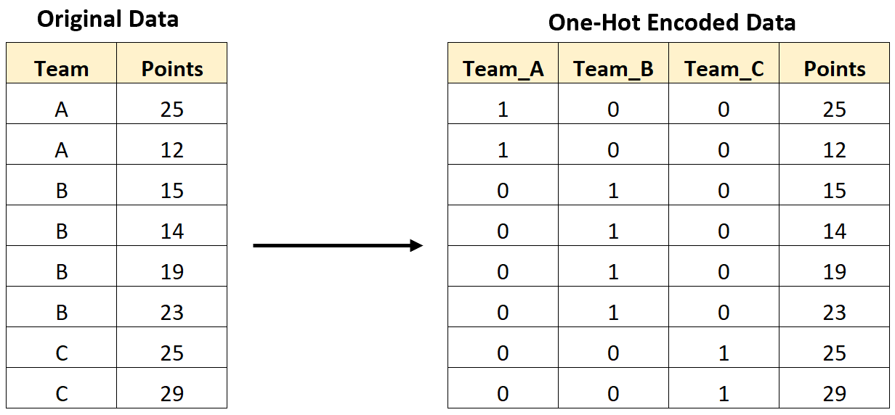{.mx-auto}

---
layout: side-title
color: red
align: rm-lm
---

:: title ::

## The fatal flaw

:: content ::

* **Sparsity:** As vocabulary grows ($|V| \approx 50k+$), vectors become massive and mostly empty.
* **Lack of Semantics:** The model perceives no more similarity between "apple" and "banana" than it does between "apple" and "spaceship."

$$
w_{\text{apple}} \cdot w_{\text{banana}} = 0
$$


<AdmonitionType type="important" title="Intuit the flaw">

This is the same as saying "every word is orthogonal to every other word."

But, intuitively, we know words like "want" and "desire" are _directionally_ similar.

</AdmonitionType>

---
layout: quote-portrait
quotesize: text-l
authorsize: text-m
author: 'J.R. Firth (1957)'
---
::pic::


::default::

You shall know a word by the company it keeps.

---
layout: two-cols-title
columns: is-6
align: l-lt-lt
---

:: title ::

## Word2Vec

Mikolov et al. 2013


:: left ::

### The Distributional Hypothesis

Words that appear in similar contexts (near similar words) should have similar meanings so their vectors should be close

<br>

### CBOW & Skip-gram
- **CBOW:** given the surrounding words $w_{t \pm k}$, predict the center word $w_t$
- **Skip-gram:** given the center word $w_t$, predict the surrounding words $w_{t \pm k}$

<AdmonitionType type="tip" title="Getting the Embedding">

For both, train a shallow network, discard the output layer, keep the weight matrixas embeddings

</AdmonitionType>

:: right ::

### The result

Each word gets a dense vector $\mathbb{R}^d$ (typically $d$ = 300).

Semantic similarity = geometric proximity.

$$
\text{similarity}(A, B) = \frac{A \cdot B}{\|A\| \|B\|} = \cos(\theta)
$$

<br>

<AdmonitionType type="important" title="Great Artists Steal">

AI progress often comes from mimicking human cognition.

Humans infer meaning from context. Word2Vec does the same, learning geometry from neighbors.

You will see this repeat **many** times in future lectures.

</AdmonitionType>

---
layout: two-cols
align: lm-lm
---

::left::

## The Geometry of Language

Because Word2Vec minimizes prediction error, words in similar contexts get pushed together in vector space.

**Vector arithmetic emerges:**

$$
f(\text{King}) - f(\text{Man}) + f(\text{Woman}) \approx f(\text{Queen})
$$

This wasn't explicitly trained, it's an **emergent property** of optimizing the context prediction task.

::right::

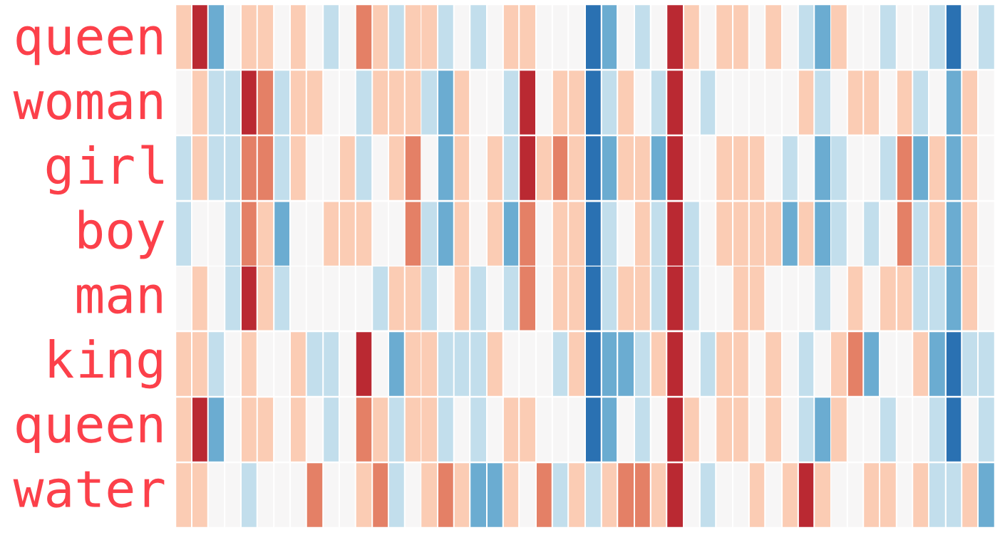{.mx-auto}

---
color: pink-light
---

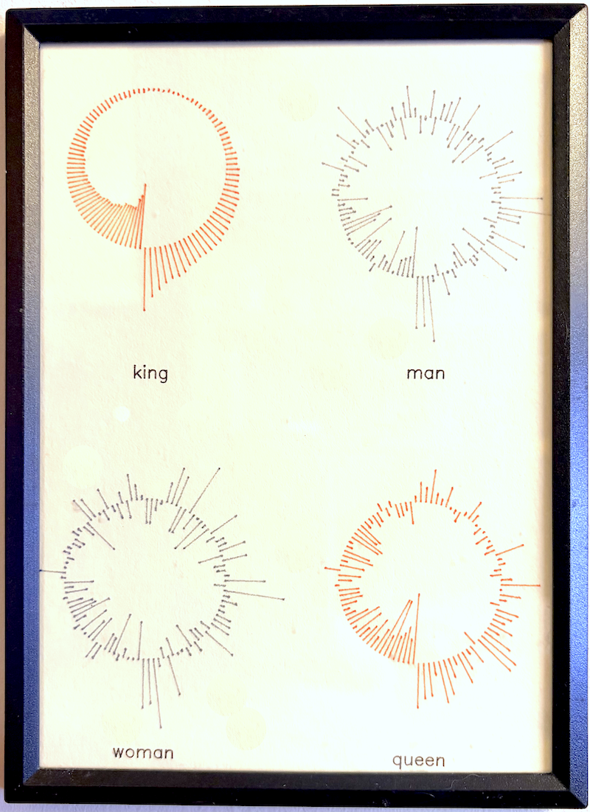{.mx-auto width=40%}

---
layout: two-cols-title
align: l-lm-lm
---

::title::

## Word Embeddings with SpaCy

::left::

```python
import spacy
import numpy as np

nlp = spacy.load("en_core_web_lg")  # Large English model
cat = nlp("cat")
dog = nlp("dog")
ham = nlp("ham")

cat_to_dog = np.linalg.norm(cat.vector - dog.vector)
cat_to_ham = np.linalg.norm(cat.vector - ham.vector)

print(f"Distance from 'cat' to 'dog' is {cat_to_dog}")
print(f"Distance from 'cat' to 'ham' is {cat_to_ham}")
```

<br>

```
Distance from 'cat' to 'dog' is 42.8679084777832
Distance from 'dog' to 'ham' is 77.25950622558594
```

::right::

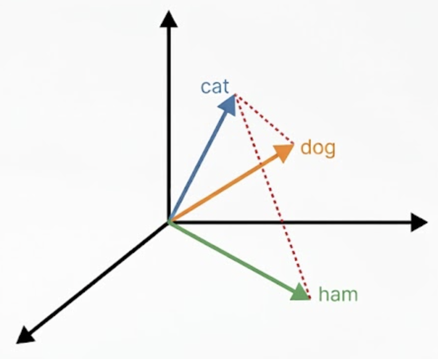

##### _real word embddings exist in higher spaces_

---
layout: side-title
color: violet
align: rm-lm
---

:: title ::

## Tokens vs Embeddings

Two different questions

:: content ::


#### Tokenization asks

> "What are the discrete symbols my model operates on?"

**Format:** Integers (vocabulary indices)

**Example:** `[1042, 9921]` = `["hello", "world"]`

<br>

### Embeddings ask

> "How do I turn the discrete symbols into numbers a neural network can read?"

**Format:** Dense floating-point vectors

**Example:** `[[0.2, -0.9, ...], [0.8, 0.1, ...]]`

---
layout: two-cols-title
columns: is-6
align: l-lt-lm
---

:: title ::

## The Sequential Era: RNNs and LSTMs

:: left ::

N-grams model order but go sparse. Word2Vec models meaning but drops order. **Recurrent Neural Networks** do both: read tokens one at a time, carry a **hidden state** $h_t$ forward.

$$
h_t = \sigma(W_h h_{t-1} + W_x x_t + b)
$$

LSTMs (1997) added gates so $h_t$ forgets less. They powered neural translation and speech for a decade.

**Two limits never went away:**

- **Forgetting:** everything before $t$ is squeezed into one vector. Long-range dependencies fade.
- **Sequential:** to compute $h_{100}$ you must first compute $h_{99}$. No parallelism.

:: right ::

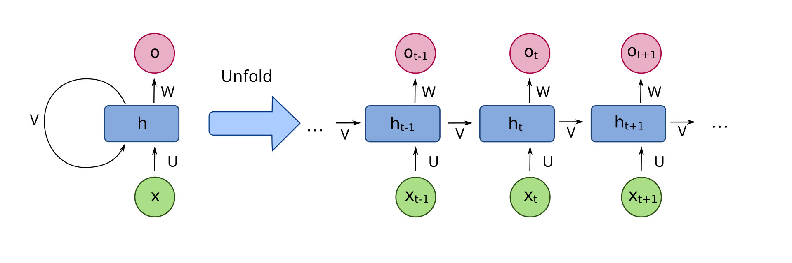

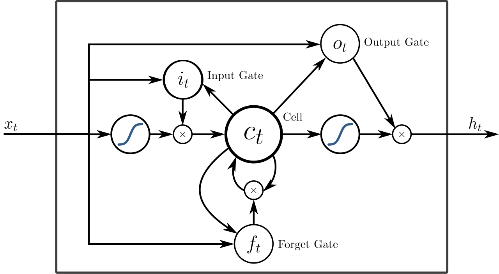

---
layout: section
---

# Attention Is All You Need
<hr>

Vaswani et al. (2017) - Google Research

---
layout: two-cols-title
align: l-lm-cm
---

:: left ::


## The Transformer

Vaswani et al. (2017)

Drop recurrence. Process the whole sequence at once.

1. **Tokens** in, as before.
2. **Embeddings**, plus a position signal.
3. **N identical layers.** Each one:
   - **attention:** every token reads from every other token
   - **feed-forward:** a small neural network applied to each token on its own
4. **Logits** out: one score per vocabulary token.

Every step is a matrix multiply over the full sequence. No $h_{t-1}$ to wait on.

:: right ::

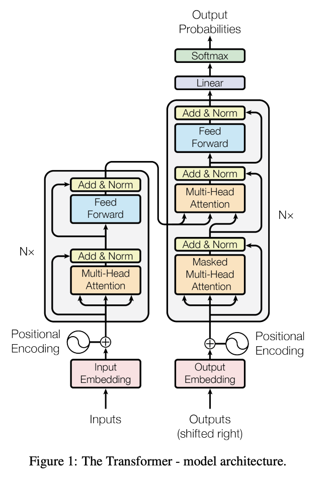{width="70%" .mx-auto}

---
layout: two-cols
align: lm-cm
---

:: left ::

## Embeddings get upgraded

Imagine two different sentences:

1. "The <span v-mark="{ at: -1, color: 'yellow', type: 'highlight' }">newfoundland</span> ran through the park."

2. "I traveled to <span v-mark="{ at: -1, color: 'yellow', type: 'highlight' }">newfoundland</span> last summer."

In Word2Vec, there's one embedding for "newfoundland" used for both sentences.

_In the Transformer, embeddings are a **starting point**. Through the layers of attention, the vector is updated (moved) and it becomes a representation of the word **in context**._

:: right ::

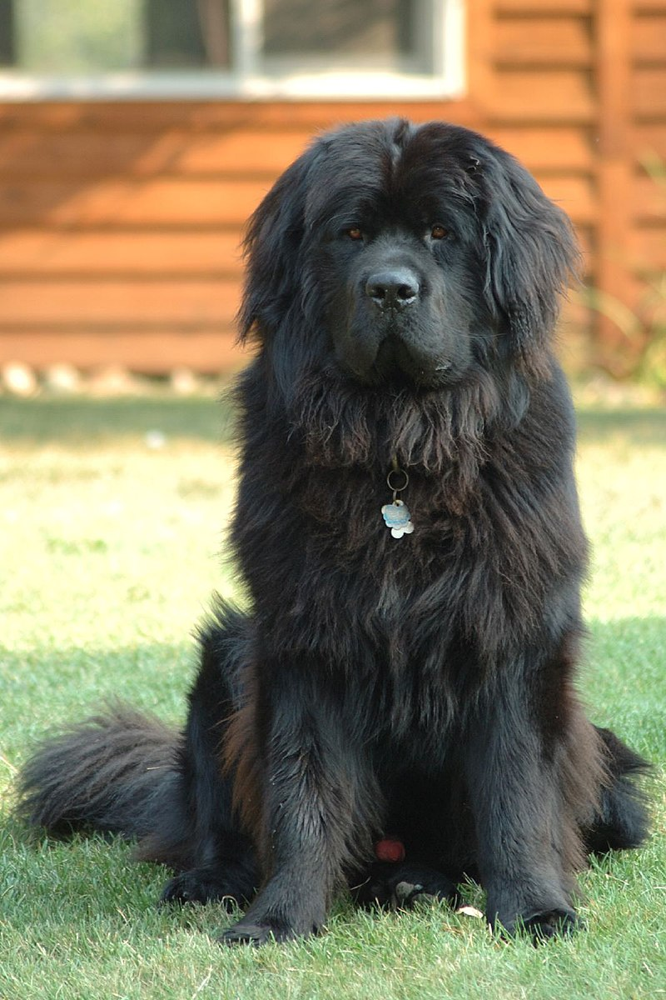{width="72%" .mx-auto}

---
layout: two-cols-title
columns: is-5
align: l-lt-cm
---

:: title ::

## Attention: Query, Key, Value

:: left ::

Each token's embedding is projected three ways:

- **Query (Q):** what this token is looking for
- **Key (K):** what this token contains
- **Value (V):** the information it hands over

Score every key against the query, softmax, take the weighted sum of values.

$$
\text{Attention}(Q, K, V) = \text{softmax}\!\left(\frac{QK^T}{\sqrt{d_k}}\right)V
$$

:: right ::

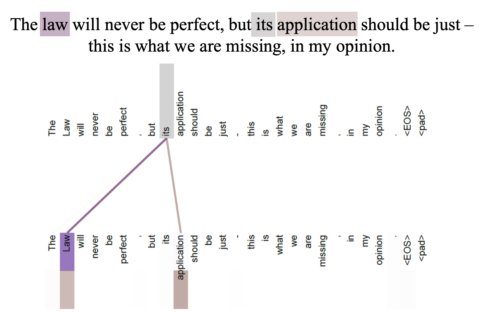{width="85%" .mx-auto}

::default::

### Positional Encoding

Attention is blind to order, so a position encoding is added to every embedding first. Otherwise "dog bites man" would be identical to "man bites dog."

---
layout: two-cols
columns: is-6
align: lm-cm
---

:: left ::

## Multi-Head Attention

One head learns one kind of relationship. Run **8 to 16 heads** in parallel, each with its own $Q, K, V$ projections, and concatenate.

$$
\text{MultiHead} = \text{Concat}(\text{head}_1, \dots, \text{head}_h)W^O
$$

Some heads track syntax, some coreference, some are opaque but useful.

:: right ::

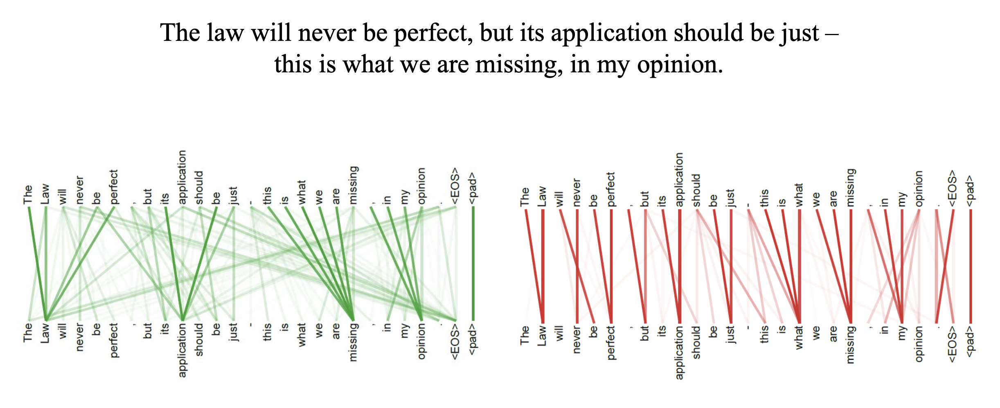

---
layout: side-title
color: green
align: rm-lm
---

:: title ::

## Why Attention Won

:: content ::

The two limits of the sequential era, answered:

* **No forgetting.** Every token reads every other token directly. Path length between any two positions is $O(1)$, not $n$ recurrent steps. Nothing is squeezed through a single $h_t$.
* **No waiting.** Every layer is one matrix multiply over the whole sequence. Training parallelizes across GPUs and cost scales with compute, not sequence length.

In 2017: the best translation scores, at a fraction of the training cost.

Since: GPT, BERT, T5, LLaMA, Claude. **ChatGPT** is Chat with a *Generative Pre-trained Transformer*.

---
layout: center
---


<center><QRCode value="https://ishamf.dev/p/llm-attention-visualizer/" :size="200" render-as="svg" /></center>

<br>

## [ishamf.dev/p/llm-attention-visualizer/](https://ishamf.dev/p/llm-attention-visualizer/)


---
layout: section
---

# Exercise Break
<hr>

Run a real Transformer

---
layout: code-right
filename: main.py
align: lm
codesize: 11px
---

:: left ::

## In-Class Exercise

**Goal:** run a real Transformer locally.

1. Download [`tiny-llama-completions.zip`](https://courseworks2.columbia.edu/courses/252703/files/folder/examples)
2. Unzip, open the folder, `uv run main.py`
3. Watch it complete "The scientific method is"

**Expected:**

```
The scientific method is a process that is
used to test hypotheses and theories. It is
a systematic approach to gathering and...
```

**Challenge:** change `text` to get it to answer a question of your choice.

:: right ::

```python
import torch
from transformers import AutoModelForCausalLM, AutoTokenizer

# 1. Load model
model_id = "TinyLlama/TinyLlama-1.1B-Chat-v1.0"
tokenizer = AutoTokenizer.from_pretrained(model_id)
model = AutoModelForCausalLM.from_pretrained(
    model_id,
    dtype=torch.float32,
)

# 2. Tokenize the input
text = "The scientific method is"
inputs = tokenizer(text, return_tensors="pt")

# 3. Generate: next-token prediction in a loop
output_tokens = model.generate(
    **inputs,
    max_new_tokens=50,
    do_sample=True,
    temperature=0.7,
    pad_token_id=tokenizer.eos_token_id,
)

# 4. Decode tokens back to text
completion = tokenizer.decode(
    output_tokens[0], skip_special_tokens=True
)
print(completion)
```

---
layout: section
---

# From Completion to Assistant
<hr>

Sampling, the fork, in-context learning, alignment

---
layout: side-title
color: cyan
align: rm-lm
---

:: title ::

## The Inference Loop

:: content ::

1. **Tokenize:** text to vocabulary indices
2. **Embed:** look up dense vectors, add position
3. **Transform:** N layers of attention and feed-forward
4. **Output:** logits, one score per vocabulary token
5. **Sample:** pick the next token
6. **Repeat:** feed it back

The output is a distribution over the vocabulary. The model does not decide anything. It assigns scores. Step 5 is where we get a knob.

---
layout: side-title
color: yellow
align: rm-lm
---

:: title ::

## The Fork

BERT, Devlin et al. (2018)

:: content ::

BERT pretrained a Transformer on masked-word prediction, then adapted it to tasks. Two ways to adapt, and the whole field split on them:

* **Fine-tuning:** update the weights for a task. Durable, expensive, one model per task.
* **Prompting:** change the input text to evoke a behavior. Ephemeral, cheap, one model for everything.

This course lives on the prompting side of the fork.

---
layout: side-title
color: indigo
align: rm-lm
---

:: title ::

## Every Task Is Text

T5, Raffel et al. (2019)

:: content ::

T5 made every NLP task text-in, text-out, selected by a prefix:

```
translate English to German: Hello   ->  Hallo
summarize: [article]                 ->  [summary]
sentiment: I love this               ->  positive
```

One model, one loss, many tasks. The **task prefix** is the direct ancestor of the prompt.

---
layout: two-cols-title
align: l-lm-lm
---

:: title ::

## Sizing Up

GPT-3, Brown et al. (2020)

:: left ::

OpenAI bet that scale mattered more than architecture.

* **GPT (2018):** the first Generative Pre-trained Transformer

* **GPT-2 (2019):** 1.5B parameters, coherent paragraphs

* **GPT-3 (2020):** 175B parameters, no fine-tuning required

:: right ::

### In-Context Learning

Put examples in the prompt and the model picks up the task.

```
Q: What is the capital of France?
A: Paris

Q: What is the capital of Japan?
A: Tokyo

Q: What is the capital of Brazil?
A:
```

_These are our first examples of performing "few-shot" example training._

---
layout: two-cols-title
---

:: left ::

## The Gopher Prompt

Google released 'Scaling Language Models: Methods, Analysis & Insights from Training Gopher', Rae, et al. (2021)

Appendix Table A30 was, for us outside observers, our first window into AI's big secret.

_If you frame the in-context learning as a **screenplay** between a "helpful assistant" and a "curious human," the model will write the lines of someone useful._

This appendix was trivial to reproduce in code and kicked off an early wave of AI products on top of OpenAI's APIs months before ChatGPT launched.

:: right ::


---
layout: side-title
color: teal
align: rm-lm
---

:: title ::

## RLHF

InstructGPT, Ouyang et al. (2022)

:: content ::

Size and prompting helped, but GPT-3 still completed text rather than following instructions. InstructGPT added three steps after pretraining:

1. **Supervised fine-tuning:** humans write good answers. Model trains on them.
2. **Reward model:** model generates several answers. Humans rank them. A second model learns the ranking.
3. **RL (PPO):** fine-tune the language model to maximize the reward model's score.

**Result:** ChatGPT, November 2022. A completion engine became an assistant.

---
layout: side-title
color: fuchsia
align: rm-lm
---

:: title ::

## Post-training Today

:: content ::

RLHF was the first post-training recipe, but not the last.

* **RLHF (2022):** reward is a model of human preference. Good for tone and helpfulness. Rewards what sounds right.
* **RLVR (2024):** reinforcement learning from **verifiable rewards**. Reward is a checker: did the math answer match, did the tests pass. Behind reasoning models like o1 and DeepSeek-R1.
* **RaR (2025):** **rubrics as rewards**. For tasks with no checker, a written rubric is graded by a model. Extends RLVR to writing, medicine, and open-ended work.

_We'll dig deeper into these subjects in a future lecture._

---
layout: section
---

# Exercise Break
<hr>

Building a Chatbot

---
layout: code-right
filename: main.py
align: lm
codesize: 11px
---

:: left ::

## Building a Chatbot

The Gopher trick on a base model. `SYSTEM_PROMPT` is Table A30, verbatim. Each turn appends to the transcript and the model continues it.

**Download** [`tiny-llama-chat.zip`](https://courseworks2.columbia.edu/courses/252703/files/folder/examples), then `uv run main.py`.

**Try:** have a conversation. Notice where it breaks.

The "chat" is string handling. Nothing about the model changed.

:: right ::

```python
SYSTEM_PROMPT = """<|system|>The following is a
conversation between a highly knowledgeable and
intelligent AI assistant, called <|assistant|>, and
a human user, called <|user|>. ...</s>
<|user|>
OK Gopher, I'm going to start by quizzing you with
a few warm-up questions. Who is the president?</s>
<|assistant|>
It's Joe Biden; he was sworn in earlier this year.</s>
... 11 more scripted turns, Gopher Table A30 ..."""

conversation = f"{SYSTEM_PROMPT}</s>\n<|user|>\n"

while True:
    user_input = input("User: ")
    conversation += user_input + "</s>\n<|assistant|>\n"

    raw_output = generate_text(conversation)

    # Cut at the stop token, or it keeps writing
    # the user's lines too
    reply = raw_output.split("</s>")[0]
    print(f"Assistant: {reply.strip()}")

    conversation += reply + "</s>\n<|user|>\n"
```

---
layout: default
---

## Reading List

<div class="ns-c-tight text-sm">

**Papers**
- Mikolov et al. (2013). [Efficient Estimation of Word Representations in Vector Space](https://arxiv.org/abs/1301.3781). Word2Vec.
- Vaswani et al. (2017). [Attention Is All You Need](https://arxiv.org/abs/1706.03762). The Transformer.
- Devlin et al. (2018). [BERT](https://arxiv.org/abs/1810.04805). The fork: fine-tune or prompt.
- Raffel et al. (2019). [T5](https://arxiv.org/abs/1910.10683). Every task is text.
- Brown et al. (2020). [Language Models are Few-Shot Learners](https://arxiv.org/abs/2005.14165). GPT-3 and in-context learning.
- Rae et al. (2021). [Scaling Language Models: Gopher](https://arxiv.org/abs/2112.11446). Appendix A30 is the chat prompt.
- Ouyang et al. (2022). [Training language models to follow instructions with human feedback](https://arxiv.org/abs/2203.02155). InstructGPT and RLHF.
- Lambert et al. (2024). [Tulu 3](https://arxiv.org/abs/2411.15124). RLVR.
- Gunjal et al. (2025). [Rubrics as Rewards](https://arxiv.org/abs/2507.17746). RaR.

**History**
- Hayes (2013). [First Links in the Markov Chain](https://www.americanscientist.org/article/first-links-in-the-markov-chain). American Scientist.
- Schwartz (2019). [Andrey Markov and Claude Shannon Counted Letters to Build the First Language-Generation Models](https://spectrum.ieee.org/andrey-markov-and-claude-shannon-built-the-first-language-generation-models). IEEE Spectrum.
- Schmidhuber (2022). [Annotated History of Modern AI and Deep Learning](https://people.idsia.ch/~juergen/deep-learning-history.html).

**Tools**
- [LLM Attention Visualizer](https://ishamf.dev/p/llm-attention-visualizer/). Watch attention heads on your own text.
- [OpenAI Tokenizer](https://platform.openai.com/tokenizer). See how text becomes tokens.
- [Hugging Face Transformers](https://huggingface.co/docs/transformers).

</div>
