# Multi-Agent Architectures

IEOR 4570 - Agentic AI for Data Science

<div class="absolute bottom-2 left-2 p-2 pl-4 text-left w-125 border-1">

Please note: The perspectives shared today are based on my personal experience and do not represent the views of my employer.

</div>

---
layout: side-title
color: sky
align: rm-lm
---

::title::

## Learning Objectives

::content::

1. Understand when and why to split work across multiple agents
2. Compare the different methods for communicating across agent boundaries
3. Learn common multi-agent architecture patterns

---
layout: section
color: orange
---

# Why Multi-Agent?
<hr>

When one agent with many tools stops working

---
layout: two-cols-title
---

::title::

## The Single-Agent Ceiling

::left::

As you add capabilities to a single agent, three things degrade:

#### Instruction confusion
The system prompt grows long and contradictory. The model forgets rules, applies the wrong ones, or applies them in the wrong order.

#### Tool sprawl
With 20+ tools, the model picks the wrong tool more often. Each extra tool adds decision surface.

#### Evaluation
An agent with several jobs needs evals that cover all of them, and a failure is hard to pin on one job.

::right::

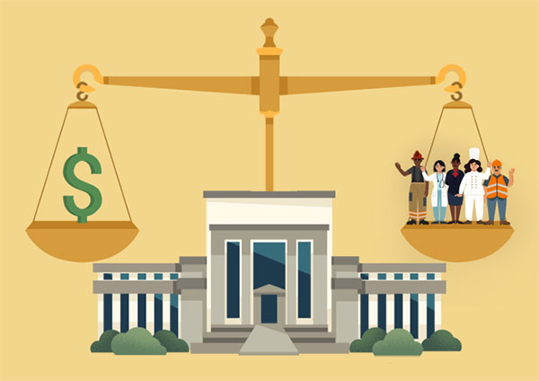

-# _The Federal Reserve is a single agent with a dual mandate: maximum employment and stable prices. Its main tool, the interest rate, trades one against the other. Raising rates cools inflation but tends to cost jobs, and cutting them does the reverse._

---
layout: quote
quotesize: text-m
---

_**Hypothesis:**_ Splitting an agentic system into several agents splits its instructions, tools, and context, so each agent works with a focused subset.

---
layout: two-cols-title
align: l-lm-lm
zoom: 0.6
---

::title::

## IFScale: How Many Instructions Can a Model Follow?

-# Jaroslawicz et al. (2025). [How Many Instructions Can LLMs Follow at Once?](https://arxiv.org/abs/2507.11538)

::left::

### Error Rate w/ more instructions

- A business report must include every keyword on a list of 10 to 500. Each keyword is one instruction. 20 models, 5 runs each.
- The best models reached 68% accuracy at 500 instructions.
- Reasoning models (o3, gemini-2.5-pro) hold near 100% past 150 instructions, then fall. gpt-4.1 and claude-sonnet-4 decline steadily. gpt-4o and llama-4-scout collapse early.

<br>
<br>

### Primacy Effect w/ more instructions

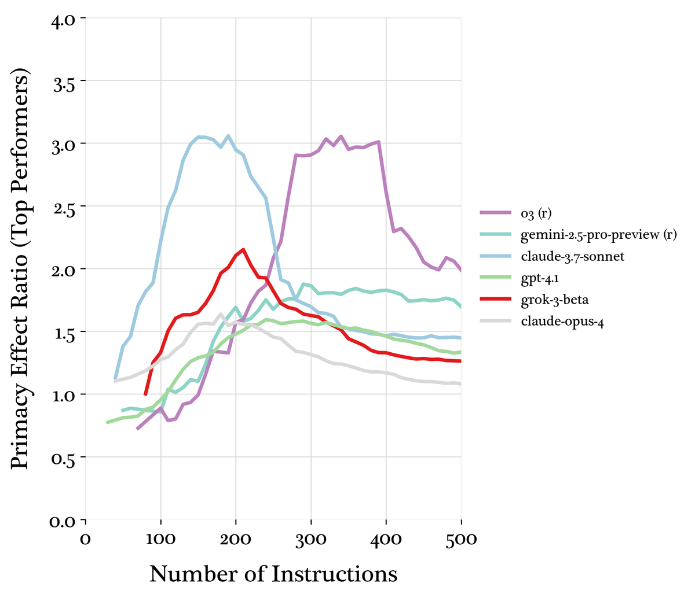

- Instructions late in the list are dropped more often than early ones. The gap peaks (2-3x more likely) around 150 to 200 instructions.

::right::

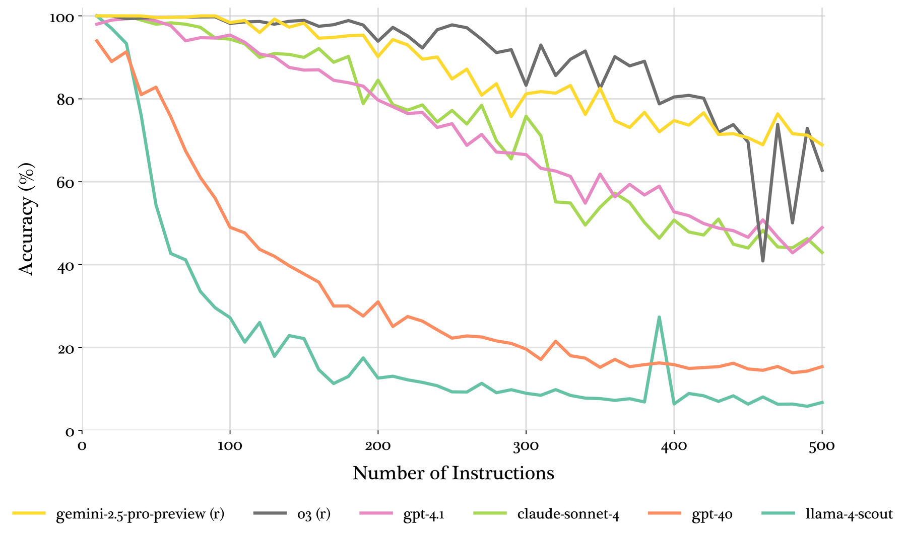

<br>

```
You are tasked with writing a professional business report that adheres strictly to a set of constraints. Each constraint requires that you include the exact, literal word specified… The report should be structured like a professional business document with clear sections and relevant business insights. Do not simply repeat the constraints; rather, use them to inform the text of the report.
 
CONSTRAINTS

Include the exact word: 'customer'.
Include the exact word: 'revenue'. ...
```

---
layout: two-cols-title
columns: is-6
align: l-lm-cm
zoom: 0.8
---

::title::

## IFScale, One Year Later

-# Voss (2026). [Models Got an Order of Magnitude Better at Following Instructions in One Year](https://arize.com/blog/llm-instruction-following-benchmark-2026/)

::left::

The 2025 models drop instructions from about 100 to 300. The 2026 frontier holds to about 2,000, so Arize grew the keyword list to 10,000. The new models fail in new ways.

GPT-5.5
: About 99% through 5,000, then falls off. Sometimes returns half a report: "I'm sorry, but the requested report cannot be produced in full."

Gemini 3.1 Pro
: Reliable to 5,000. Past that, spends its output budget on reasoning and returns little or no report.

Claude Opus 4.7
: Frequent refusals, likely a safety classifier tripped by words like "anthrax" in the list. Follows about half by 5,000.

DeepSeek V4 Pro
: Closest to 2025: drops instructions from about 750, nearly half by 2,000.

::right::

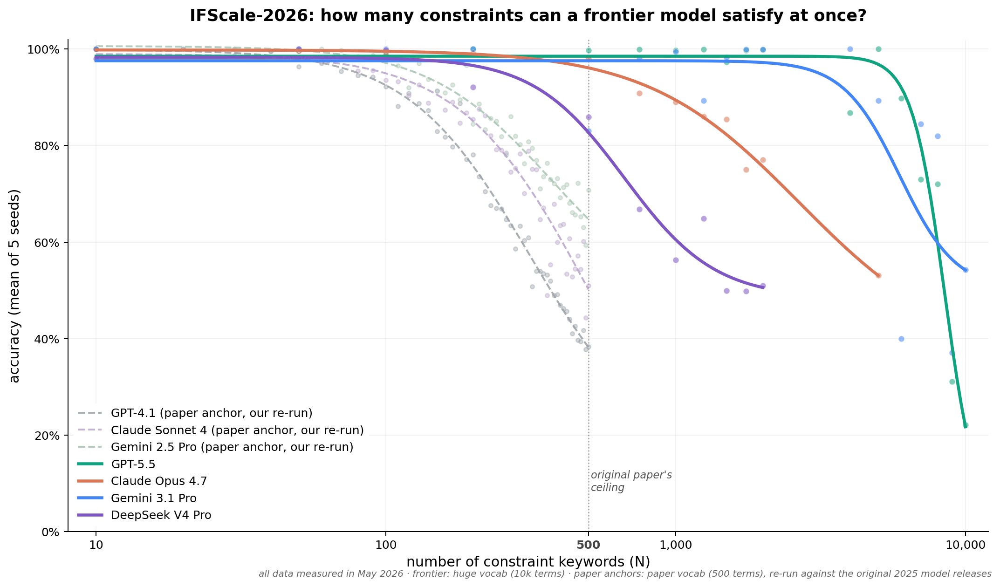

::default::

<center>

#### _Models got an order of magnitude better at following instructions in one year._

</center>

<br>

---
layout: two-cols-title
columns: is-5
align: l-lm-lm
---

::title::

## Convenience of Evaluation

-# A practical reason to split

::left::

Frontier models now handle long, multi-job system prompts far better than they did a year ago.

Splitting still pays off when you evaluate.

Break a system with competing instructions into sub-agents that hand off to one another, and you can evaluate each sub-agent on its own job.

::right::

```mermaid {scale: .35}
flowchart LR
    U["User"]@{shape: person }
    subgraph MultiAgent
        F["Clarifying Agent"]
        A["Table Agent"]
        B["Query Agent"]
    end
    subgraph Database
        pg_tables
        C[("Table 1")]
        D[("Table 2")]
        E[("Table 3")]
    end
    U --"Question"--> F --"Ask for clarification"--> U
    F --"Clarified question"--> A
    A --"Table 2"--> B
    A --"Which Table?"--> pg_tables --"Table 2"--> A
    B --"Which query for Table 2"--> D --"Results"--> B --"Results"--> U
```

::default::

<div style="font-size: 0.75em">

| Agent | Eval |
|-------|------|
| Clarifying Agent | Does it reject ambiguous questions? |
| Table Agent | Given a clear question, does it find the right table? |
| Query Agent | Given a clear question and the right table, does it write and run the right query? |

</div>

---
layout: section
color: cyan
---

# Connecting Agents
<hr>

How agents talk across agent boundaries

---
layout: two-cols
align: lm-cm
---

::left::

## Recap: The Harness

Harness
: The software surrounding the model that allows it to interact with the environment.

Tool
: a function that's part of the harness that lets the model interact with the environment and see results.

Agent
: a model and a harness, calling tools in a loop.

::right::

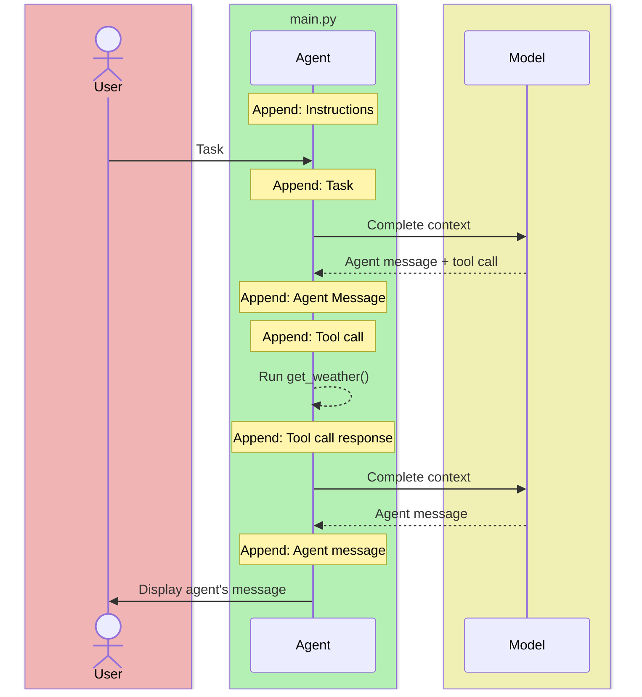

---
layout: code-right
align: lm
---

::left::

## Recap: OpenAI Agents SDK

### Agent

-# [Agent reference](https://openai.github.io/openai-agents-python/ref/agent/)

An `Agent` is container class that holds a model slug, instructions, and tools.

`name`
: (`str`) required.

`instructions`
: (`str|Callable`) static system prompt or func that generates.

`model`
: (`str`) which model to use.

`tools`
: (`list[Tool]`) tools it can call.

### Runner

-# [Runner reference](https://openai.github.io/openai-agents-python/ref/run/#agents.run.Runner)

The `Runner` executes the agent loop for a single entrypoint `Agent`. It takes a single task and returns a result.

::right::

```python
from agents import Agent, function_tool

@function_tool
def get_weather(location: str) -> str:
    """Get current weather for a location."""
    return fetch_weather(location)

agent = Agent(
    name="Assistant",
    instructions="You are a helpful assistant.",
    model="gpt-5-mini",
    tools=[get_weather, lookup_contact],
)

task = "What's the weather in Tokyo?"
result = await Runner.run(agent, task)
```

---
layout: two-cols
columns: is-6
align: lt-lm
zoom: 0.85
---

::left::

## Agents in Sequence

- The simplest connection: run one agent, then pass its final output to the next as its task.
- Each run has its own context. `booking_agent` sees only the request `customer_agent` wrote, never the user's message.
- Code determines the order.
- Neither agent knows that the other exists.

<br>
<br>

```python
customer_agent = Agent(
    name="customer_agent",
    instructions="Turn the customer's message into a "
                 "booking request: dates, places, travelers.",
)
booking_agent = Agent(
    name="booking_agent",
    instructions="Book the trip in the request. "
                 "Reply with the confirmation.",
    tools=[search_flights, book_flight],
)

request = await Runner.run(customer_agent, task)
booking = await Runner.run(booking_agent, request.final_output)
print(booking.final_output)
```

::right::

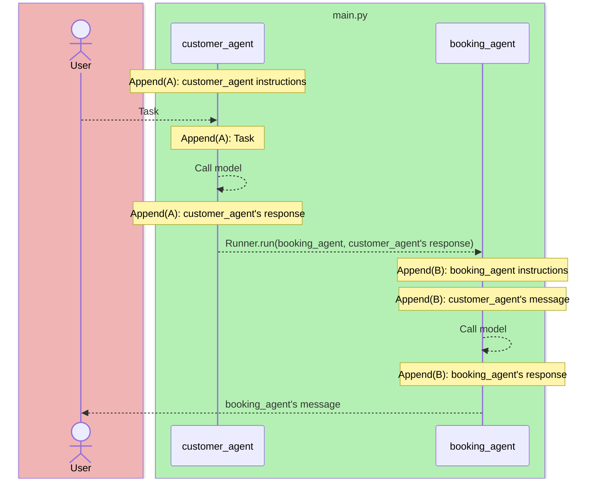


---
layout: two-cols-title
zoom: 0.9
---

::title::

## Handoffs vs. Agent as Tool

::left::

**Handoffs**

Agent transfers **control** to another Agent. The new agent takes over the conversation.

```python
booking_agent = Agent(
    name="Booking agent",
    instructions="Handle bookings.",
)
refund_agent = Agent(
    name="Refund agent",
    instructions="Handle refunds.",
)
customer_agent = Agent(
    name="Customer agent",
    instructions=(
        "Route to booking or refund "
        "agent as appropriate."
    ),
    handoffs=[booking_agent, refund_agent],
)
```

::right::

**Agents as tools**

Manager keeps **control** and gets result back.

```python
customer_agent = Agent(
    name="Customer-facing agent",
    instructions="Handle all communication.",
    tools=[
        booking_agent.as_tool(
            tool_name="booking_expert",
            tool_description="Handles booking questions."
        ),
        refund_agent.as_tool(
            tool_name="refund_expert",
            tool_description="Handles refund questions."
        ),
    ],
)
```

::default::

The difference comes down to **control** and **context**.

---
layout: two-cols
columns: is-7
align: lm-lm
---

::left::

## Subagent as Tool Call

- The sub-agent runs its own loop with a sub-task (tool input) until it's done.
- The sub-agent has a separate context.
- Control is returned to the parent-agent when complete.

#### Forked vs Fresh Context

- Sometimes it makes sense for the sub-agent to carry over a copy of the parent agent's context.

#### Simple Async Fan-out

- Just like normal tool calls, multiple sub-agents as tools can be initialized at the same time.

<AdmonitionType type="note" title="IO Bount">

A common premature optimization is to think that "multi-agent" must mean "multi-process". In reality, most agents are IO-bound and use very little CPU-time.

</AdmonitionType>

::right::

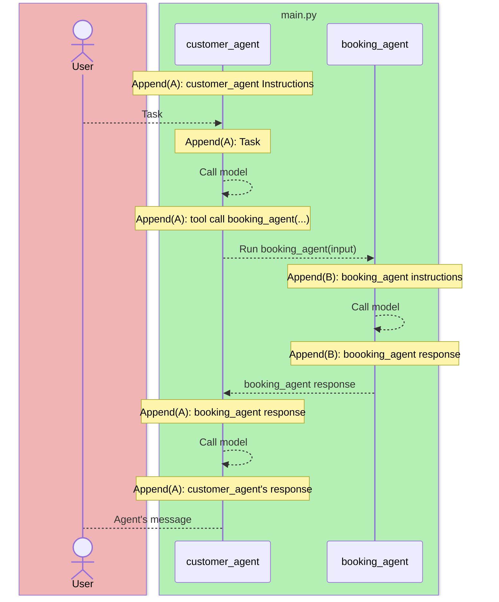

---
layout: two-cols-title
zoom: 0.9
---

::title::

## `.as_tool()` is Just Wrapping the SubAgent

::left::

### w/ `.as_tool()`

```python
@function_tool
def get_weather(location: str) -> str:
    """Gets the weather for a location."""
    ...

subagent = Agent(
    name="weather_sub_agent",
    instructions="Get the weather using tools.",
    tools=[get_weather],
)

agent = Agent(
    name="weather_agent",
    instructions="Handle all communication.",
    tools=[subagent.as_tool(
        tool_name="ask_weather_subagent",
        tool_description="Asks a sub-agent for the weather.",
    )],
)

task = "Get the weather"
response = await Runner.run(agent, task)
```

::right::

### w/ `@function_tool`

```python
@function_tool
def get_weather(location: str) -> str:
    """Gets the weather for a location."""
    ...

@function_tool
async def ask_weather_subagent(prompt: str) -> str:
    """Asks a sub-agent for the weather."""
    subagent = Agent(
        name="weather_sub_agent",
        instructions="Get the weather using tools.",
        tools=[get_weather],
    )
    result = await Runner.run(subagent, prompt)
    return result.final_output

agent = Agent(
    name="weather_agent",
    instructions="Handle all communication.",
    tools=[ask_weather_subagent],
)

task = "Get the weather"
response = await Runner.run(agent, task)
```

---
layout: two-cols-title
columns: is-6
align: l-lt-lm
zoom: 0.95
---

::title::

## Handoffs

::left::

- A handoff is a tool call, `transfer_to_<agent>`, that switches which agent the loop runs.
- The second agent (usually) carries over the first agent's context but swaps out the instructions for it's own.
- The new agent answers the user.
- To give control back within the task, the second agent needs a handoff of its own back to first.
- A follow-up message, by default, will start with the first agent again.
- It's common to filter the context being passed (e.g. removing tool calls of the previous agent).

<br>

<AdmonitionType type="info" title="In 2026: KV-Cache Might Matter More">

Handoffs can be situationally very useful but the cost of keeping history in context but swapping the instructions can be VERY HIGH in modern long-context models that are cost-sensitive to the KV-Cache invalidation.

</AdmonitionType>

::right::

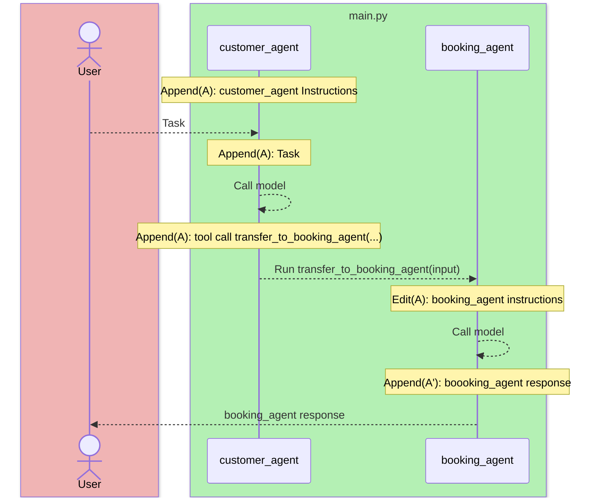

---
layout: code-right
align: l
codesize: 10px
---

::left::

## Shared State: `RunContext`

- Every agent and tool in one run can share a typed context object, including across handoffs.
- Tools read and change it through `ctx.context`. The SDK hides `ctx` from the tool's schema.
- The model never sees the context. It only reaches the prompt if a tool returns it or dynamic instructions put it there.
- Use it for state the code needs to trust, like IDs and progress, instead of hoping the model carries it through the conversation.

<br>

<AdmonitionType type="info" title="Across other frameworks">

The concept of "state that lives outside of context" is popular among _all_ agent frameworks. But they all call this something different. Google ADK calls this "State".

</AdmonitionType>

::right::

```python
from dataclasses import dataclass
from agents import (
    Agent, RunContextWrapper, Runner, function_tool)

@dataclass
class TripContext:
    traveler: str
    booking_id: str | None = None

@function_tool
def book_flight(
    ctx: RunContextWrapper[TripContext], flight: str,
) -> str:
    """Book a flight for the traveler."""
    trip = ctx.context
    trip.booking_id = airline.book(trip.traveler, flight)
    return f"Booked {flight}"

booking_agent = Agent[TripContext](
    name="Booking agent", tools=[book_flight])
triage_agent = Agent[TripContext](
    name="Triage agent", handoffs=[booking_agent])

ctx = TripContext(traveler="Ada")
await Runner.run(
    triage_agent, "Book me on UA 100", context=ctx)
print(ctx.booking_id)  # set by the tool, after a handoff
```
---
layout: section
color: emerald
---

# Multi-Agent Patterns
<hr>

Great artists steal.

---
layout: two-cols-title
align: l-lm-lm
---

::title::

## Generator and Critic

::left::

Separate *creation* from *validation*. One agent drafts, a second reviews against specific criteria.

- If review passes, the loop breaks and output is finalized
- If it fails, feedback routes back to the Generator for another attempt
- Useful for code generation, compliance review, structured output validation

::right::

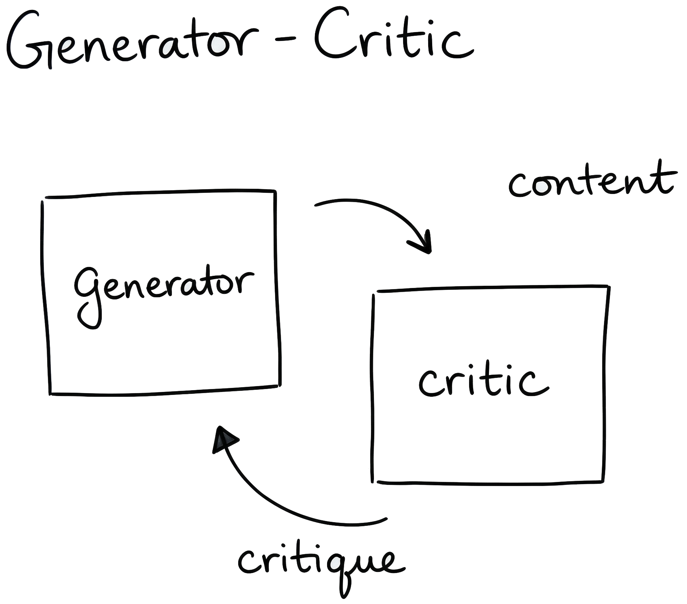


---
layout: two-cols-title
align: l-lm-lm
---

::title::

## Generator and Critic - Marketing

::left::

- The Marketing Writer is responsible for composing a tweet.
- The Editor critiques the tweet calling its specialized judgment tools, which return deterministic true/false values.
- The Editor provides feedback to the Marketing Writer if needed so it can try again.


::right::

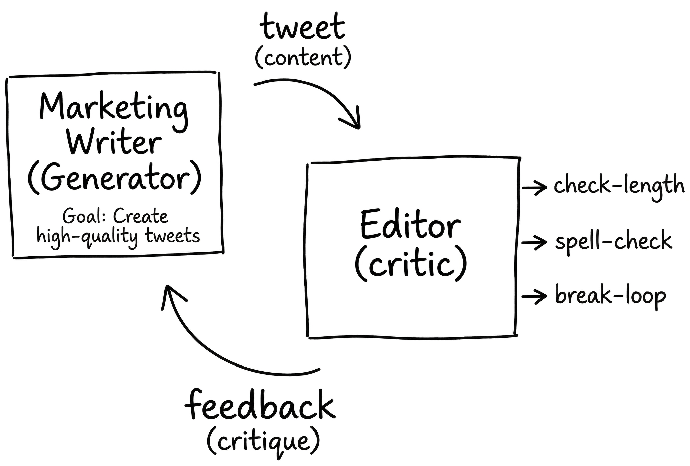

---
layout: code-right
align: lm
---

::left::

## Generator and Critic

Variation 1 - The call loop

- Standard Python loop that calls the Generator, then calls the Critic.
- The loop breaks when the Critic is satisfied.
- Feedback is appended back into the context for the generator to learn from.

_The code decides when to hand-off to the next agent and when to stop._

::right::

```python
from agents import Agent, Runner # OpenAI Agents SDK
gen = Agent(
  name="Generator",
  instructions="You are a poet. Write a short poem."
)
crit = Agent(
  name="Critic",
  instructions=(
    "You are a critic."
    "If it rhymes, say PASS. Else give feedback."
  )
)
async def main(prompt):
  history = [prompt]
  while True:
    # 1. Generate
    res = await Runner.run(gen, input=history)
    draft = res.final_output
    # 2. Critique
    fb_res = await Runner.run(crit, input=draft)
    fb = fb_res.final_output
    
    if "PASS" in fb:
        return draft
    history.append(f"Draft: {draft}")
    history.append(f"Feedback: {fb}")
```

---
layout: code-right
align: lm
---

::left::

## Generator and Critic

Variation 2 - Subagent as Tool Call

- Wraps the agent as a tool call.
- The "loop" happens because the generator is retrying to appease the critic.


_The generator maintains control, chooses when to call the Critic, what to pass it, and chooses when to stop._

::right::

```python
from agents import Agent # OpenAI Agents SDK

# 1. Define the Critic first
critic = Agent(
  name="Critic",
  instructions=(
    "If it rhymes, say it's good, otherwise give feedback."
  ),
)

# Wrap the critic in a tool call
critic_tool = critic.as_tool(
  tool_name="ask_critic",
  tool_description="Reviews a draft poem.",
)

# 2. Define the Generator with the Critic bound
gen = Agent(
  name="Generator",
  instructions=(
    "Draft poem, then ask the critic for feedback. "
    "If the critic says it's good, you're done."
  ),
  tools=[critic_tool]
)

# Run the entry point
res = await Runner.run(gen, input="Write a poem.")
```

---
layout: code-right
align: lm
codesize: 9px
---

::left::

## Generator and Critic

Variation 3 - Agent handoff

- Use the SDK's built-in handoff mechanism.
- The "loop" happens because the agents hand the conversation back and forth.
- A reply without a tool call ends the run, so the loop only holds if every turn must call a tool: `tool_choice="required"`, kept on with `reset_tool_choice=False`.
- That leaves no way to stop, so the Critic gets one: `approve`, which `StopAtTools` turns into the end of the run.

_The Generator chooses when to hand off, and both agents see the whole conversation unless you add an `input_filter`. Only the Critic can stop._

::right::

```python
from agents import (Agent, ModelSettings, Runner,
                    StopAtTools, function_tool)

# Every turn must call a tool: a handoff, or approve
FORCED = ModelSettings(tool_choice="required")

@function_tool
def approve() -> str:
    """Approve the latest draft. This ends the run."""
    return "approved"

crit = Agent(
  name="Critic",
  instructions=(
    "If the poem rhymes, call approve. Else give "
    "feedback and hand off to the Generator."
  ),
  tools=[approve],
  tool_use_behavior=StopAtTools(
    stop_at_tool_names=["approve"]),
  model_settings=FORCED,
  reset_tool_choice=False,  # keep forcing after one call
)
gen = Agent(
  name="Generator",
  instructions="Write a poem, then hand off.",
  handoffs=[crit],
  model_settings=FORCED,
  reset_tool_choice=False,
)
crit.handoffs = [gen]  # close the loop once both exist

res = await Runner.run(gen, input="Write a poem.")
```

---
layout: section
---

# Example
<hr>

`wikipedia-deck-critic.zip`

---
layout: two-cols-title
align: l-lt-lm
---

::title::

## The Router Pattern

::left::

When you agent has many specialist capabilities, you may want to split them into independent specialist agents.

A front-line "router" (or "triage") agent can handoff to the appropriate sub-agent or give backpressure to the user.

- Each specialist has it's own prompt and it's own code.
- The router only needs to know what the specialist do at a high level.
- Specialists can handoff back to the router.
- Evaluating specialist capabilities is now easy.
- State external the Runner needs to track which agent is currently in charge.

::right::

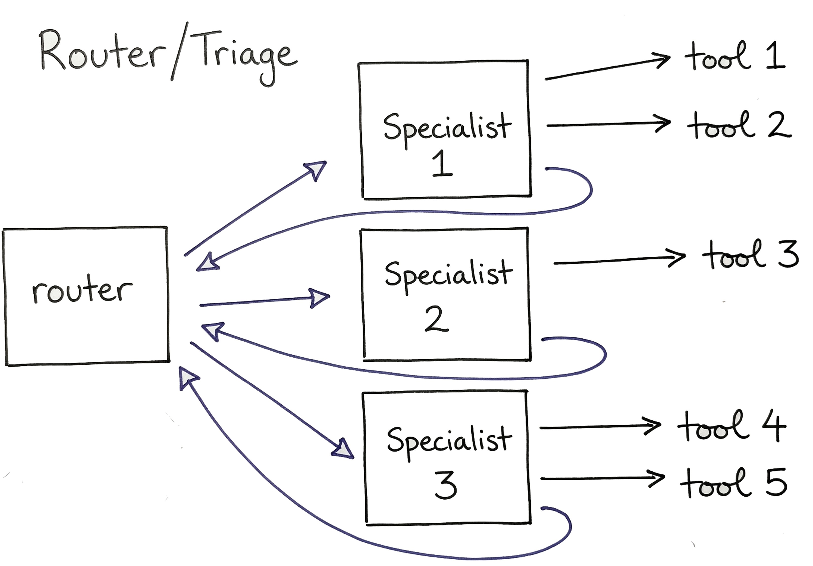

---
layout: two-cols-title
align: l-lt-lm
---

::title::

## The Router Pattern - Bank Operator

::left::

- In the system prompt for the operator, there are three tools each with a description of what the sub-agent can handle:
    - `handoff_to_fraud_support`
    - `handoff_to_check_balance`
    - `handoff_to_activate_new_card`
- The operator can only handoff to one of these or tell the user it can't handle their request.
- Each sub-agent has specialized tools (`get_transactions`, `activate_card`) specific to their specialty that only they can call.

<br>

<AdmonitionType type="info" title="History management">

Conversation history should carry from the Bank Operator to the Check Balance, but we may want to clear or summarize it before routing back to prevent leaking information. (see: [input_filters](https://openai.github.io/openai-agents-python/handoffs/#input-filters))

</AdmonitionType>

::right::

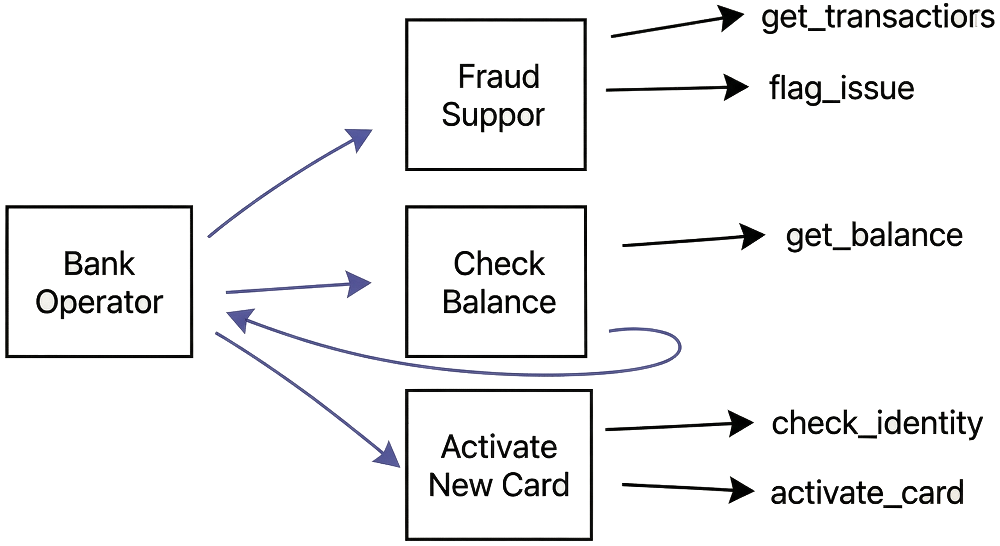

---
layout: two-cols-title
align: l-lm-lm
---

::title::

## The Router Pattern - Analytics Agent

::left::

- A top-level router answers basic questions and explains what it can do but only calls handoffs to lower agents.
- If a user wants to configure a dashboard or set a line-speed target, they can be routed to the sub-agent to do so.
- Most abstract queries go to the Explore agent which has access to a Text2SQL agent which can write and read time-series data.
- If the explore agent helps the user get to a valuable insight, they can hand-off to one of the configuration agents to _act_ on that insight.

::right::

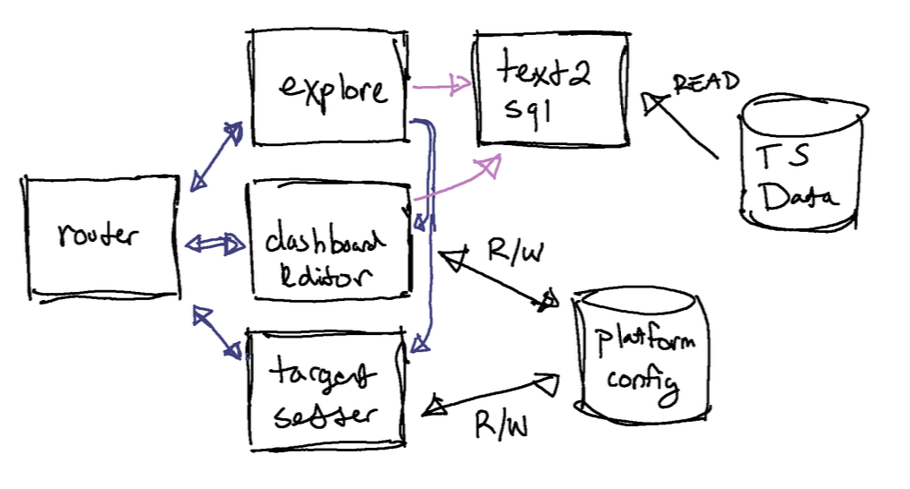

---
layout: two-cols
align: l-lm
---

::left::

## Gatekeeper / Disambiguation

- Similar to the router, a lightweight agent (gatekeeper) can sit between the user and the agent they want to run their query (executor).
- This agent can ask for clarification if it doesn't meet criteria.
- If it does, it can handoff.
- This can also be performed with a tool call, but I like the handoff approach.

::right::

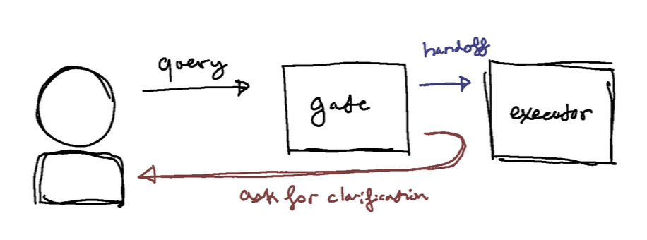

---
layout: section
---

# Example
<hr>

`nyc-data-desk.zip`

---
layout: section
---

# Async Multi-Agent
<hr>

---
layout: three-cols-title
align: l-lm-lm-lm
zoom: .9
---

::title::

## What is Async?

When you hear "async" think "queue" and "concurrency"

::left::

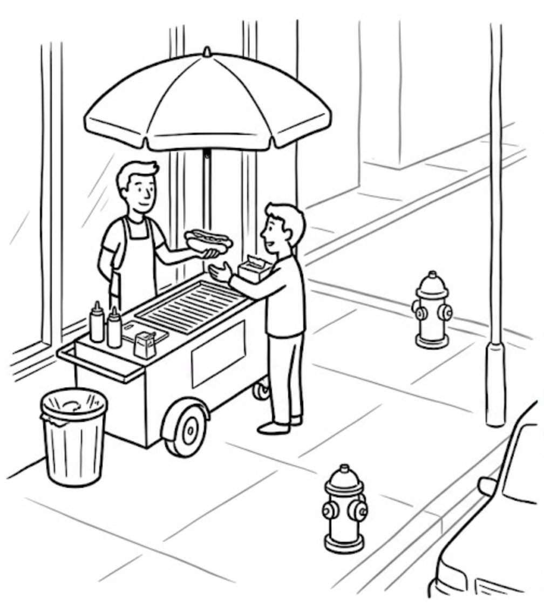

::left-bottom::

###### No queue, concurrency = 1

::middle::

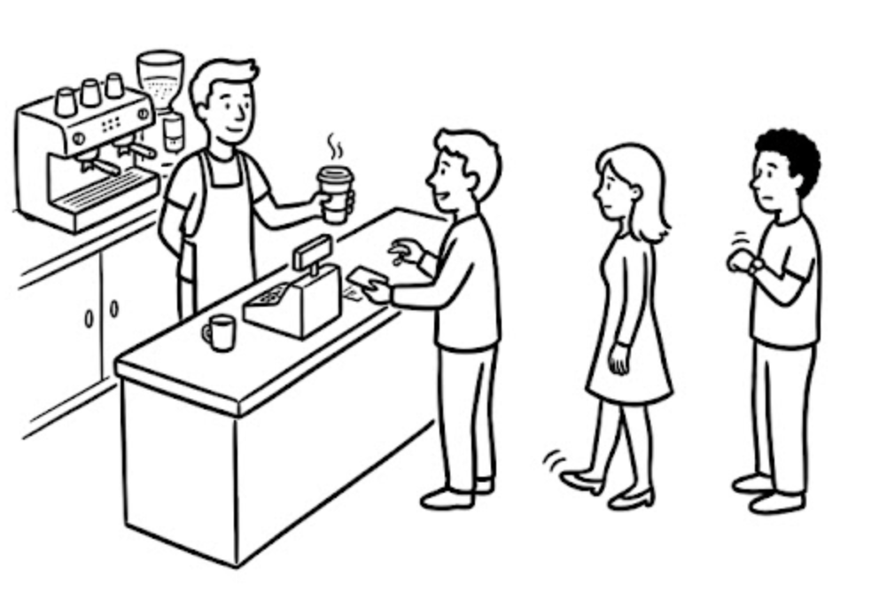

::middle-bottom::

###### Queue, concurrency = 1

::right::

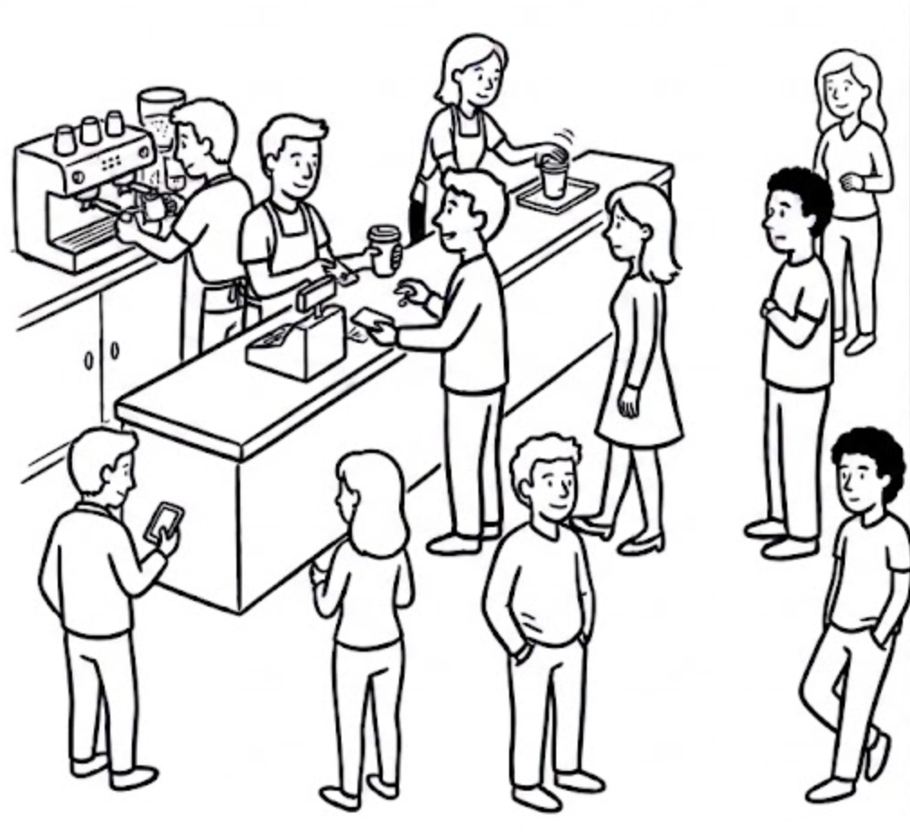{width="95%"}

::right-bottom::

###### Queue, concurrency > 1


::default::

<br>

Queue
: Is there a place for the request to wait?

Async
: Does the request block other requests while it's waiting?

Concurrency
: How many workers are there to fulfill requests?

---
layout: code-right
align: lm
codesize: 10px
---

::left::

## The Inbox

- An agent's inbox is a queue of messages for it. So far, every message has come from the user.
- The loop waits on the inbox, runs one turn with everything in it, and goes back to waiting.
- `Runner.run` is one turn. A message that arrives during it waits in the inbox until the turn ends.

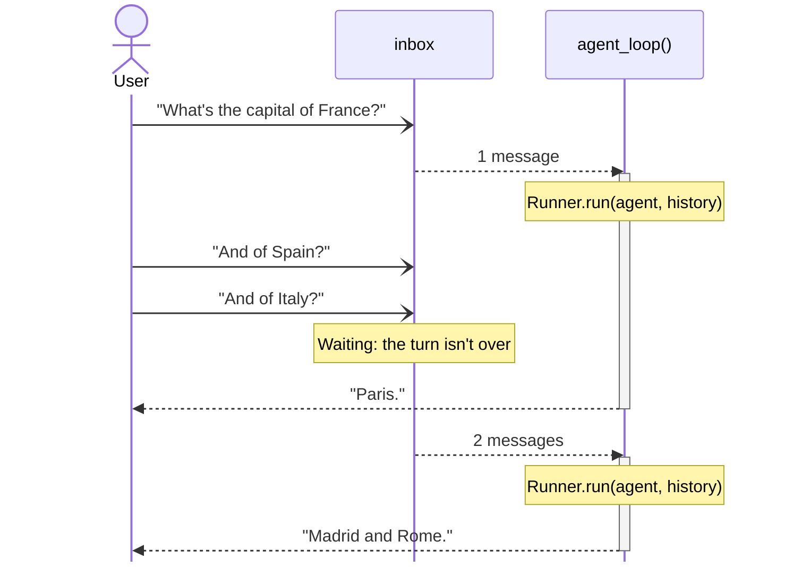

::right::

```python
import asyncio
from agents import Agent, Runner

agent = Agent(name="Assistant", instructions="Be brief.")
inbox = asyncio.Queue()

async def agent_loop():
    history = []
    while True:
        # Wait for a message, plus any that came during the turn
        messages = [await inbox.get()]
        while not inbox.empty():
            messages.append(inbox.get_nowait())
        history += [{"role": "user", "content": m}
                    for m in messages]

        # One turn: nothing new reaches the model until it returns
        result = await Runner.run(agent, history)
        history = result.to_input_list()
        print(result.final_output)

async def main():
    asyncio.create_task(agent_loop())
    inbox.put_nowait("What's the capital of France?")
    await asyncio.sleep(0.3)  # the first turn is running
    inbox.put_nowait("And of Spain?")
    inbox.put_nowait("And of Italy?")
    await asyncio.sleep(15)

asyncio.run(main())
# Paris.
# Madrid and Rome.
```


---
layout: code-right
align: lm
zoom: .95
---

::left::

## Fan-out

Several specialists work on the same input at once, then one agent combines what they found.

Variation 1 - `asyncio.gather`

- The code starts every specialist sub-agent at the same time.
- Then run _concurrently_.
- `asyncio.gather` awaits for them to all complete before continuing.


::right::

```python
import asyncio
from agents import Agent, Runner

specialists = [
  Agent(name="Features",
        instructions="List the product's key features."),
  Agent(name="ProsCons",
        instructions="List the pros and cons."),
  Agent(name="Sentiment",
        instructions="Summarize the sentiment."),
]
summarizer = Agent(
  name="Summarizer",
  instructions="Combine these analyses into a summary.",
)

async def review(text):
  results = await asyncio.gather(
    *(Runner.run(a, text) for a in specialists))
  analyses = "\n\n".join(
    f"### {r.last_agent.name}\n{r.final_output}"
    for r in results)
  res = await Runner.run(summarizer, analyses)
  return res.final_output
```

-# OpenAI Cookbook: [Running Specialized Agents in Parallel](https://developers.openai.com/cookbook/examples/agents_sdk/parallel_agents)


---
layout: full
---

<div class="flex h-full items-center justify-center">

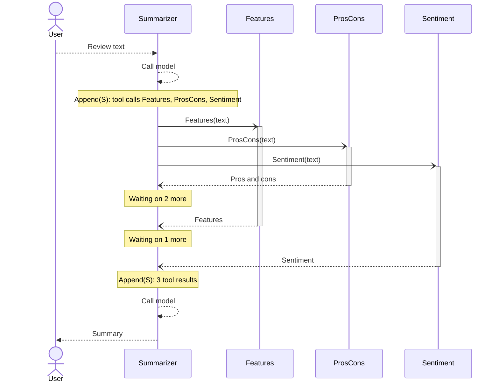

</div>

---
layout: code-right
align: lm
---

::left::

## Fan-out

Variation 2 - Subagents as tools

- The summarizer calls the specialists itself, in parallel when it calls several in one turn.
- It can skip a specialist or call one twice.
- It's slower: there is an extra model call to plan, and every tool result lands in its context.

_The model decides who runs._

<br>
<br>
<br>

-# OpenAI Cookbook: [Running Specialized Agents in Parallel](https://developers.openai.com/cookbook/examples/agents_sdk/parallel_agents)

::right::

```python
from agents import Agent, ModelSettings, Runner

summarizer = Agent(
  name="Summarizer",
  instructions="Call each tool, then summarize.",
  tools=[
    a.as_tool(
      tool_name=a.name,
      tool_description=a.instructions,
    )
    for a in specialists
  ],
  model_settings=ModelSettings(parallel_tool_calls=True),
)

res = await Runner.run(summarizer, review_text)
```

<br>


<AdmonitionType type=note>

ModelSettings default, `parallel_tool_calls=None`, defaults to the model which, in 2026, for frontier models, is always `True`.

</AdmonitionType>

---
layout: full
---

<div class="flex h-full items-center justify-center">

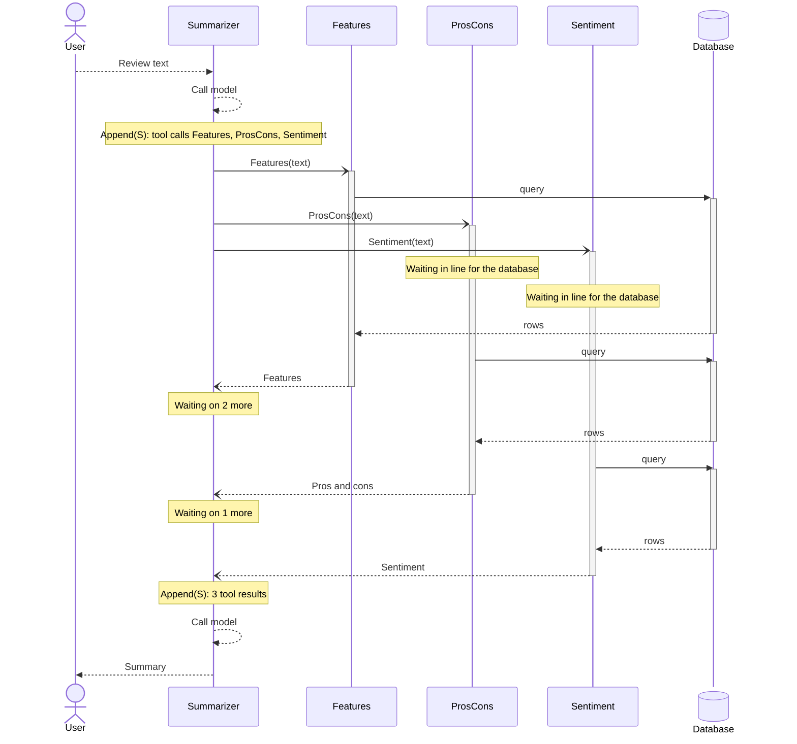

</div>

---
layout: two-cols
columns: is-6
align: lm-lm
zoom: .9
---

::left::

## Background Sub-agents

<br>

- A tool call starts a sub-agent and gets back an ID right away.
- Unlike fan-out, the parent doesn't wait. Its turn can end while its sub-agents run.
- When a sub-agent finishes, it puts a message in the parent's inbox, the same inbox user messages wait in.
- Between turns, the parent can keep calling tools or answering the user.

<br>

<AdmonitionType type="info" title="Claude Code">

This is how Claude Code runs background agents. The message in the inbox is a `<task-notification>` with the task ID, a status, and the result.

</AdmonitionType>

::right::

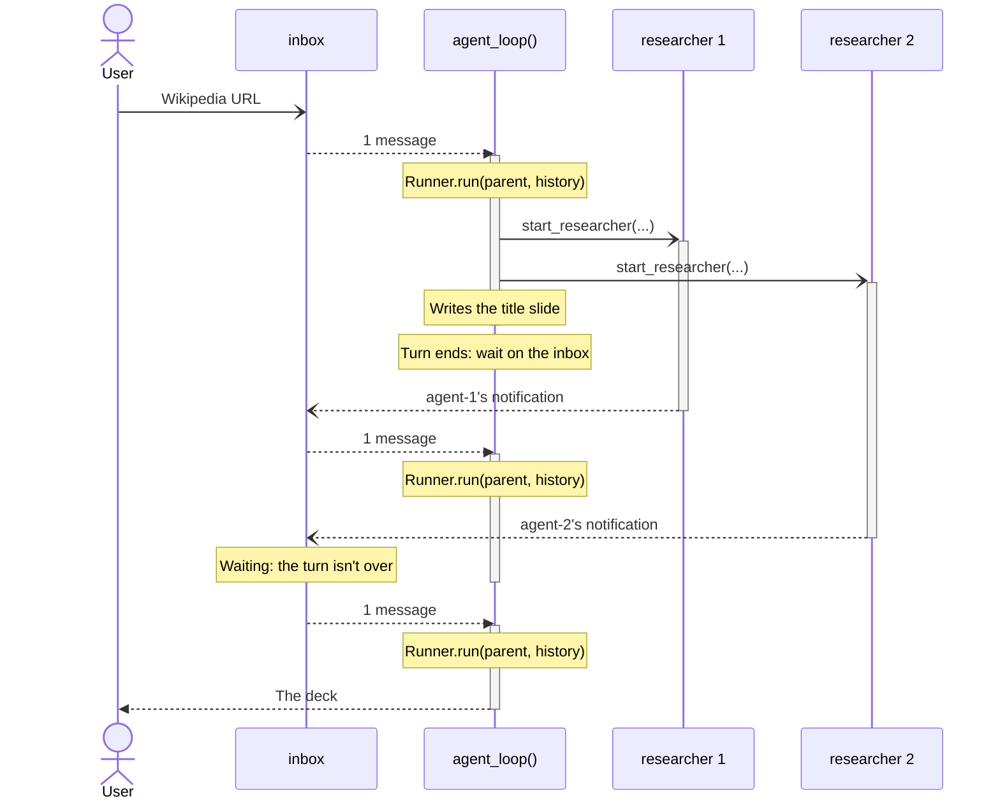

---
layout: code-right
align: lm
codesize: 9px
---

::left::

## The Wake Loop

- `run()` is the inbox loop from before, starting with the user's message.
- A tool calls `start()`, which uses `asyncio.create_task` instead of `await`. The tool returns while the sub-agent runs.
- A done callback puts the notification in the same inbox.
- `unread` counts messages still to come. A turn that ends with none ends `run()`.

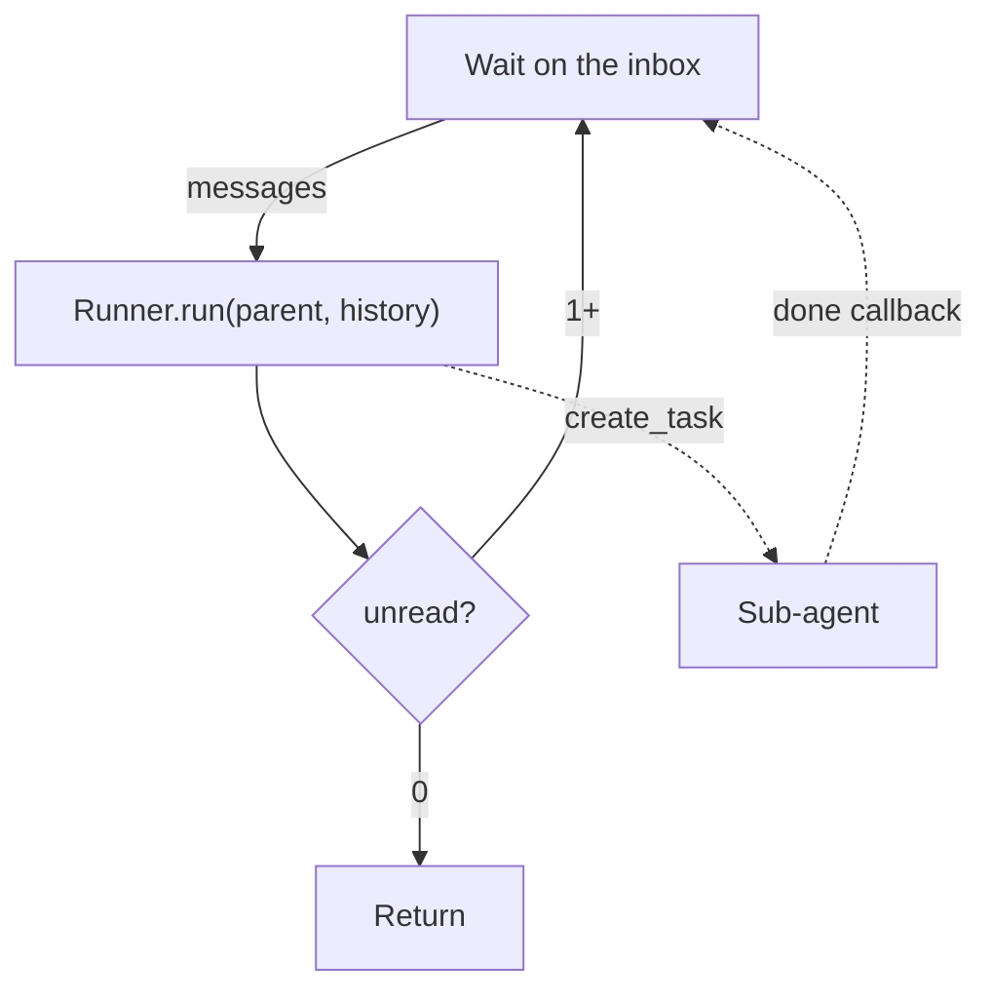

::right::

```python
class BackgroundAgents:
    def __init__(self, hooks):
        self.hooks, self.runs, self.unread = hooks, [], 0
        self.inbox = asyncio.Queue()

    def start(self, agent, prompt, description):
        agent_id = f"agent-{len(self.runs) + 1}"
        run = asyncio.create_task(Runner.run(
            agent, prompt, context=self, hooks=self.hooks))
        run.add_done_callback(lambda run: self.inbox
            .put_nowait(notification(agent_id, description, run)))
        self.runs.append(run)
        self.unread += 1
        return f"Started {agent_id}. You'll be notified when it completes."

    async def run(self, agent, input):
        self.inbox.put_nowait(input)
        self.unread += 1
        history = []
        while True:
            messages = [await self.inbox.get()]
            while not self.inbox.empty():
                messages.append(self.inbox.get_nowait())
            self.unread -= len(messages)
            history += [{"role": "user", "content": m}
                        for m in messages]
            result = await Runner.run(
                agent, history, context=self, hooks=self.hooks)
            history = result.to_input_list()
            if not self.unread:
                return result
```

---
layout: section
---

# Example
<hr>

`wikipedia-deck-researchers.zip`

---
layout: section
---

# Deep Research

<hr>

---
layout: side-title
color: teal
align: rm-lm
---

::title::

## What is Deep Research?

::content::

Like Text2SQL, Deep Research is a _common agent pattern_. There are lots of business needs for deep research agents (especially over private datasets).

A user asks a complex question that requires:

### 1. Planning
Breaking the question into sub-questions

### 2. Retrieval
Searching multiple sources for each sub-question

### 3. Synthesis
Combining findings into a coherent answer

### 4. Iteration
Identifying gaps and searching again

In this task, retrieval is _horizontally scalable and independently measurable_. Therefore, it is a clear candidate for a multi-agent pipeline.

---
layout: two-cols-title
align: l-lm-lm
zoom: 0.72
---

::title::

## Deep Research Architecture

::left::

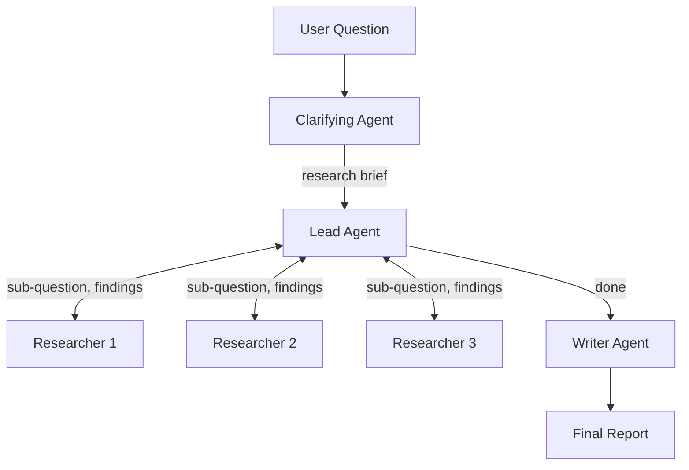

<br>

<AdmonitionType type="note" title="The fan-out waits for the slowest researcher">

"Currently, our lead agents execute subagents synchronously, waiting for each set of subagents to complete before proceeding. This simplifies coordination, but creates bottlenecks in the information flow between agents." (Anthropic)

-# Anthropic (2025). [How we built our multi-agent research system](https://www.anthropic.com/engineering/multi-agent-research-system). LangChain (2025). [Open Deep Research](https://www.langchain.com/blog/open-deep-research)

</AdmonitionType>

::right::

| Agent | Job | Pattern |
|-|-|-|
| Clarifier | Turns the question into a research brief, asking the user first if it's vague. | Disambiguation |
| Lead | Plans sub-questions, sends them to researchers, reads the findings, and sends more until the brief is covered. | Critic, with an `.as_tool()` fan-out |
| Researcher | Answers one sub-question in a fresh context, often as a semantic, filesystem, or SQL RAG agent. | Generator |
| Writer | Runs once, after the research ends, and writes the report from the brief and the findings. | Agents in sequence |

The Lead plans and judges gaps because it's the only agent that sees both the plan and the findings.

_For modern models, it's fine for the Lead and Writer to be the same agent._


---
layout: side-title
align: rm-lm
---

::title::

## Researcher Agent

::content::

The simplest version of the Research agent has a single tool that allows repeated reading.

```python
researcher = Agent(
    name="Researcher",
    model=LitellmModel(
        model="vertex_ai/gemini-3.5-flash-lite"),
    tools=[get_article],
    instructions=(
        "Research the question on Wikipedia. Follow "
        "links until you can answer it. Return the "
        "facts, each with the article it came from."
    ),
)
result = await Runner.run(
    researcher, question, max_turns=30)
```

However, you're not limited. There are _kinds_ of Researchers your Deep Research pattern can employ based on the _data source_.

- WebSearch Agents
- PDF OCR Agents
- Text2SQL Agents
- Coding Agents

---
layout: code-right
align: lm
codesize: 11px
zoom: 0.72
---

::left::

## Built on the Fundamentals

<br>

#### Gatekeeper / Disambiguation

- Optionally, a sub-agent specialized in query disambiguation can sit at the front of the Lead agent asking clarifying questions before hand-off.

#### Generator-Critic

- In deep research, the Lead acts as the Critic, while the Researchers act as Generators.

#### Fan-Out

- Each round is an `.as_tool()` fan-out: the Lead calls several Researchers in one turn, then waits for the slowest before it reads any findings.

#### Router-Specialist

- With several kinds of data sources (e.g. PDFs and SQL databases), the Lead can employ several _kinds_ of Researchers (e.g. RAG vs. Text2SQL). By picking the right one for each sub-question, the Lead acts as a Router to Specialists.

#### Background Sub-agents

- The simplest pattern waits for every Researcher before the Lead reads anything. With background sub-agents, the Lead reads each Researcher's findings as they arrive in its inbox, and can critique and resubmit one while the others are still running.

::right::

```python
FLASH = LitellmModel(model="vertex_ai/gemini-3.5-flash")

lead = Agent(
    name="Lead",
    instructions=(
        "Split the brief into independent sub-questions "
        "and research each one. Read the findings. If "
        "something is missing, research more. When the "
        "brief is covered, reply DONE."
    ),
    model=FLASH,
    tools=[researcher.as_tool(
        tool_name="research",
        tool_description="Researches one sub-question.",
    )],
    model_settings=ModelSettings(parallel_tool_calls=True),
)

writer = Agent(
    name="Writer",
    instructions=(
        "Write a report that answers the brief using only "
        "the findings. Cite their sources."
    ),
    model=FLASH,
)

async def deep_research(brief: str) -> str:
    # 1. Research: plan, fan out, check for gaps
    research = await Runner.run(lead, brief, max_turns=20)
    findings = [item.output for item in research.new_items
                if item.type == "tool_call_output_item"]

    # 2. Write: one call. The Writer sees only the findings.
    report = await Runner.run(
        writer,
        f"Brief:\n{brief}\n\nFindings:\n" + "\n---\n".join(findings),
    )
    return report.final_output
```

---
layout: section
---

# Example
<hr>

`wikipedia-deep-research.zip`

---
layout: side-title
color: red
align: rm-lm
---

::title::

## Common Pitfalls

::content::

- **Over-splitting**: Modern models have longer contexts and can execute on complex workflows. They don't need to be handheld as closely with handoffs.
- **Untested routing**: The router is an overlooked prompt and needs to be independently evaluated.
- **Untyped shared state**: When passing state over RuntimeContext or externally as JSON, values should be explicitly typed.
- **Vague delegation**: A (non-forked) sub-agent knows only its brief and is missing necessary context.
- **Fan-out into a bottleneck**: A research task spins up many research agents but they're bottlenecked on the same database or rate-limited by the model API.
- **Prompt-only limits**: Saying "At most twice" is less consistent then `MAX_TOOL_CALLS=2`.
- **Hidden sub-agent errors**: A researcher fails, and the Lead quietly fills the gap (this has probably happened to you!).

---
layout: default
---

## Reading List

<hr>

<br>

###### OpenAI Agents SDK
- [Orchestrating multiple agents](https://openai.github.io/openai-agents-python/multi_agent/), [Handoffs](https://openai.github.io/openai-agents-python/handoffs/), [Agents as tools](https://openai.github.io/openai-agents-python/tools/#agents-as-tools), and [Context management](https://openai.github.io/openai-agents-python/context/)
- OpenAI Cookbook. [Running Specialized Agents in Parallel](https://developers.openai.com/cookbook/examples/agents_sdk/parallel_agents) and [Deep Research API with the Agents SDK](https://developers.openai.com/cookbook/examples/deep_research_api/introduction_to_deep_research_api_agents)

###### When to split
- Jaroslawicz et al. (2025). [How Many Instructions Can LLMs Follow at Once?](https://arxiv.org/abs/2507.11538)
- Voss (2026). [Models Got an Order of Magnitude Better at Following Instructions in One Year](https://arize.com/blog/llm-instruction-following-benchmark-2026/)
- Anthropic (2024). [Building Effective Agents](https://www.anthropic.com/engineering/building-effective-agents)
- Cognition (2025). [Don't Build Multi-Agents](https://cognition.ai/blog/dont-build-multi-agents)

###### Async and background sub-agents
- Python. [asyncio Queues](https://docs.python.org/3/library/asyncio-queue.html) and [Coroutines and Tasks](https://docs.python.org/3/library/asyncio-task.html)
- Anthropic. [Claude Code subagents](https://code.claude.com/docs/en/sub-agents)

###### Deep research
- Anthropic (2025). [How we built our multi-agent research system](https://www.anthropic.com/engineering/multi-agent-research-system)
- LangChain (2025). [Open Deep Research](https://www.langchain.com/blog/open-deep-research)
