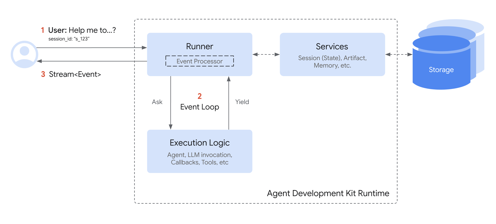
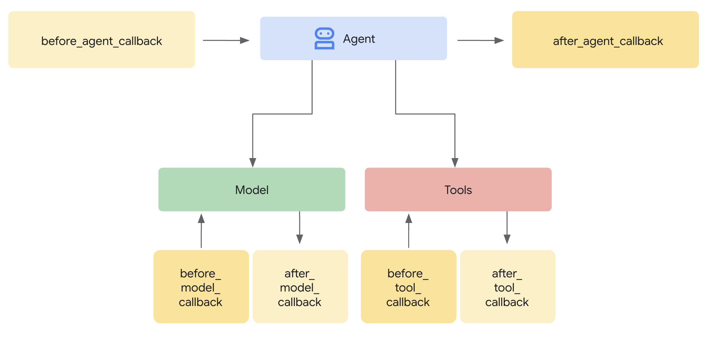
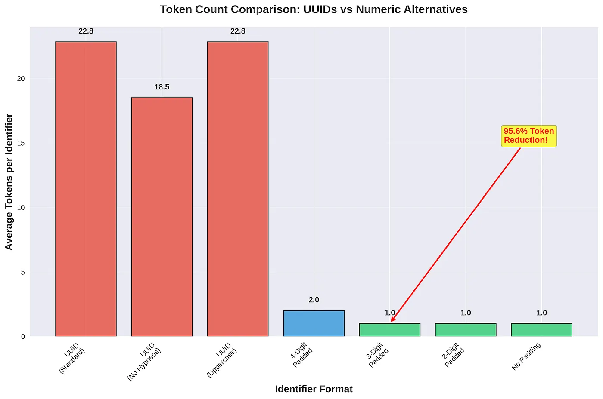
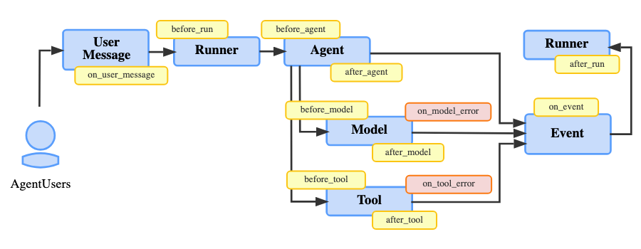
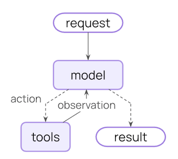
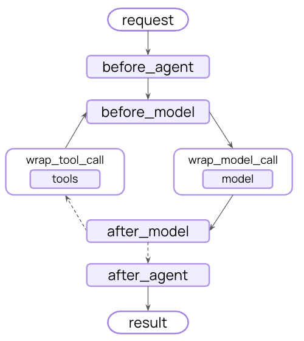
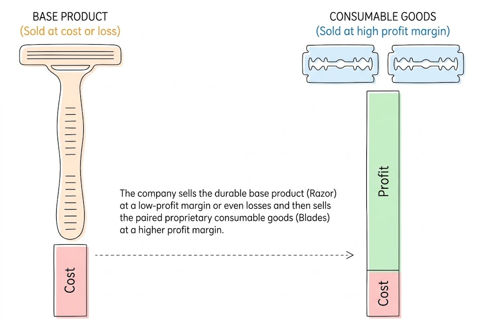
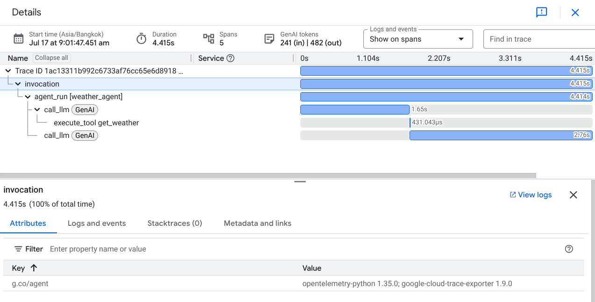
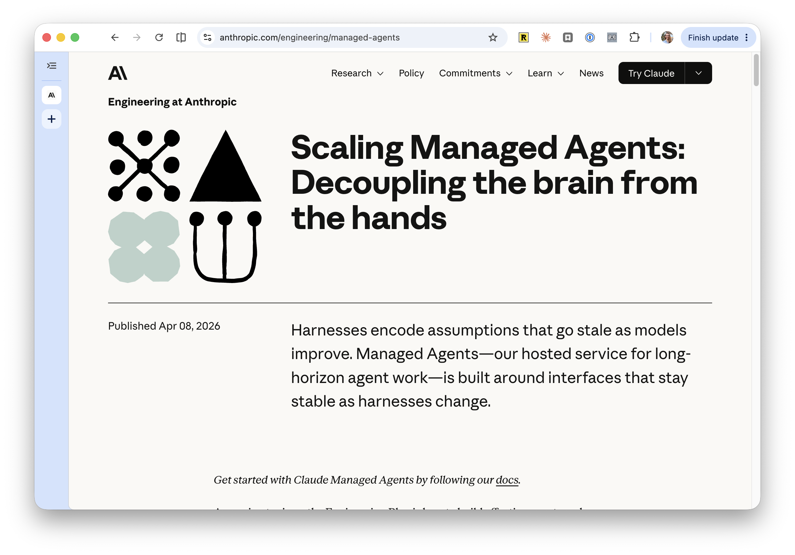
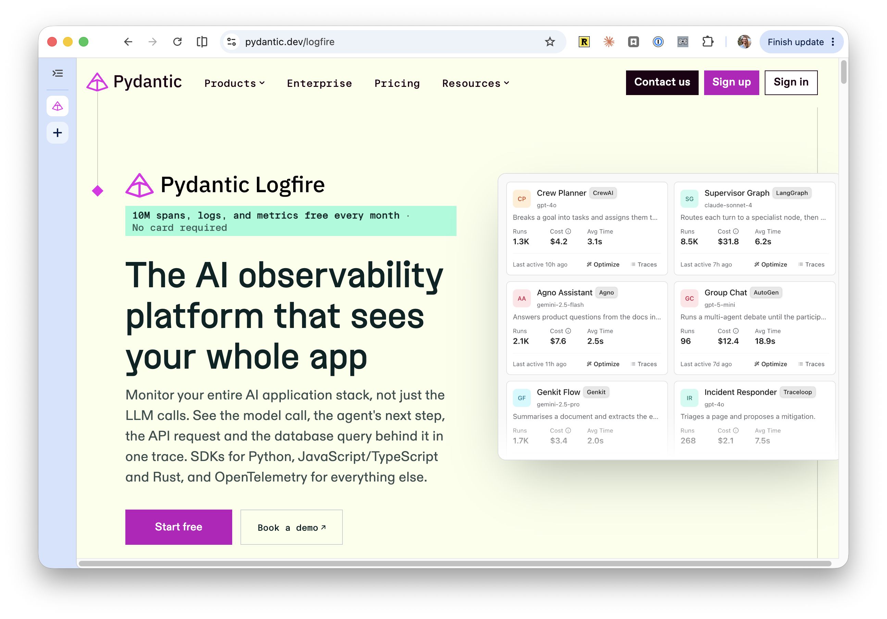

# Other Agent Frameworks

IEOR 4570 - Agentic AI for Data Science

<div class="absolute bottom-2 left-2 p-2 pl-4 text-left w-125 border-1">

Please note: The perspectives shared today are based on my personal experience and do not represent the views of my employer.

</div>

---
layout: side-title
color: sky
align: rm-lm
---

:: title ::

# Learning Objectives

:: content ::

1. Accept that these frameworks are all basically the same.
2. Ponder on the perils of capitalism in open source.

---
layout: section
color: neutral-light
---

# Recap
<hr>

OpenAI Agents SDK

---

## Where We Left Off: OpenAI Agents SDK

<br>

| **Primitive** | **What it does** |
|---|---|
| `Agent` | The system prompt, model, and tools |
| `Runner` | The tool loop: `run`, `run_sync`, `run_streamed` |
| `@function_tool` | Builds the JSON schema from type hints and the docstring |
| `Session` | Conversation history |
| `RunContextWrapper` | Data for your code, never sent to the model |
| `RunHooks` | Callbacks at each step |
| Guardrails | Checks on agent input, tool input, tool output, and agent output |

---
layout: side-title
color: slate
align: rm-lm
---

:: title ::

## Frameworks and Platforms

:: content ::

Each framework is open source. Each company behind one also sells a platform the framework connects to.

| Framework | Company | Platform |
|---|---|---|
| Google ADK | Google | Gemini Enterprise Agent Platform (formerly Vertex AI) |
| Claude Agent SDK | Anthropic | Claude Managed Agents |
| LangChain + LangGraph | LangChain | LangSmith |
| Pydantic AI | Pydantic | Logfire |

The platform sells what the framework leaves to you: hosting, managed sessions and memory, tracing, and evals.

---
layout: section
color: navy
---

# Google ADK
<hr>

Agent Development Kit

---
layout: default
---

## Core Primitives

| `Agent` (alias of `LlmAgent`) | The model, instruction, and tools |
|---|---|
| `Runner` | Runs the loop and yields an `Event` for every step |
| Function tools | Any Python function in `tools` |
| `SessionService` and `Session` | Conversation history (`events`) and a scratchpad (`state`) |
| `ToolContext`, `CallbackContext` | Read and write session state from your code |
| Callbacks | Before and after the agent, the model, and each tool |
| Plugins | Callbacks registered once, on the `Runner` |

-# [ADK](https://adk.dev/) (`pip install google-adk`). Python, TypeScript, Go, Java, and Kotlin.

-# Gemini natively. Other providers through LiteLLM: `model=LiteLlm(model="<provider>/<model>")`.

---
layout: code-right
codesize: 10.5px
align: lm
---

::left::

## `Agent`

- **`name`**: required.
- **`model`**: which LLM.
- **`description`**: what _other_ agents read when deciding to delegate.
- **`instruction`**: the system prompt. A string, with `{var}` filled from session state, or a function that returns one.
- **`tools`**: plain functions.
- **`output_schema`**: a schema for the final output. With tools, only some models (e.g. Gemini 3) support both in one request.

-# [LLM agents](https://adk.dev/agents/llm-agents/)

::right::

```python
from google.adk.agents import Agent
from google.adk.agents.readonly_context import ReadonlyContext

def get_weather(city: str) -> dict:
    """Retrieves the current weather report
    for a specified city."""
    return fetch_weather(city)

def instruction(ctx: ReadonlyContext) -> str:
    units = ctx.state.get("user:units", "fahrenheit")
    return f"You answer questions about the weather, in {units}."

root_agent = Agent(
    name="weather_agent",
    model="gemini-flash-latest",
    description="Answers questions about the weather in a city.",
    instruction=instruction,
    tools=[get_weather],
)
```

---
layout: code-right
codesize: 10.5px
align: lm
---

::left::

## `Runner`

The `Runner` needs a `SessionService`, and each run needs a session.

- `run_async` yields an `Event` for every model reply, tool call, and tool result.
- `event.is_final_response()` marks the reply for the user.
- `RunConfig(streaming_mode=StreamingMode.SSE)` streams partial text as events.

-# [Runtime](https://adk.dev/runtime/) and [RunConfig](https://adk.dev/runtime/runconfig/)

::right::

```python
from google.adk.runners import Runner
from google.adk.sessions import InMemorySessionService
from google.genai import types

sessions = InMemorySessionService()
runner = Runner(agent=root_agent, app_name="weather",
                session_service=sessions)
session = await sessions.create_session(
    app_name="weather", user_id="u1")

message = types.Content(role="user", parts=[
    types.Part(text="Weather in New York?")])

async for event in runner.run_async(
    user_id="u1", session_id=session.id,
    new_message=message,
):
    if event.is_final_response():
        print(event.content.parts[0].text)
```

---
layout: two-cols-title
columns: is-5
align: l-lm-cm
---

::title::

## The Event Loop

The ADK runtime is an event-driven loop between the `Runner` and the agent.

::left::

1. The agent **yields** an `Event`: a model reply, a tool call, a tool result.
2. The `Runner` **commits** it through its services: the session's history and state.
3. The event goes upstream, to the UI or the caller.
4. The agent **resumes** only after the commit, so the state it reads next is saved.

::right::




::default::

_"Events" are mostly obscured but is also consistent throughout the framework. When not obscured, events are fantastic for debugging._

---
layout: code-right
codesize: 11px
align: lm
---

::left::

## Function Tools

No decorator: ADK wraps any function in `tools` as a `FunctionTool`.

- The name, docstring, type hints, and defaults form the schema.
- "A parameter is considered required if it has a type hint but no default value." If the model leaves one out, "the ADK will return an error to the LLM, prompting it to correct the call."
- A `tool_context: ToolContext` parameter is hidden from the model. Use it to read and write session state.

-# [Function tools](https://adk.dev/tools-custom/function-tools/)

::right::

```python
from google.adk.tools import ToolContext

def add_to_cart(
    item: str,
    tool_context: ToolContext,
    quantity: int = 1,
) -> dict:
    """Add an item to the shopping cart."""
    cart = tool_context.state.get("cart", [])
    cart += [item] * quantity
    tool_context.state["cart"] = cart
    return {"cart_size": len(cart)}

root_agent = Agent(
    name="shopper",
    model="gemini-flash-latest",
    instruction="Help the user shop.",
    tools=[add_to_cart],
)
```

---
layout: code-right
codesize: 11px
align: lm
---

::left::

## Sessions and State

A `Session` holds one conversation: its `events` (the history) and its `state` (a scratchpad of key-value pairs). There is no separate run context: data for your code goes in state too.

| Prefix | Shared across |
|---|---|
| _(none)_ | This session |
| `user:` | All sessions for this user |
| `app:` | All users and sessions |
| `temp:` | This invocation only, never saved |

-# [Sessions](https://adk.dev/sessions/session/) and [state](https://adk.dev/sessions/state/)

::right::

```python
from google.adk.sessions import (
    DatabaseSessionService, InMemorySessionService,
)

# Lost on restart
sessions = InMemorySessionService()

# SQLite, Postgres, or MySQL
sessions = DatabaseSessionService(
    db_url="sqlite+aiosqlite:///./sessions.db")

session = await sessions.create_session(
    app_name="my_app",
    user_id="user_123",
    state={"user:preferred_language": "en"},
)
session.id      # this conversation
session.events  # the history
session.state   # the scratchpad
```

---
layout: two-cols-title
columns: is-6
align: l-lm-cm
---

::title::

## Where Callbacks Run

The same six points as `RunHooks`. The difference: a hook can only watch. A callback can also **change** the run.

::left::

| ADK callback | OpenAI `RunHooks` |
|---|---|
| `before_agent_callback` | `on_agent_start` |
| `after_agent_callback` | `on_agent_end` |
| `before_model_callback` | `on_llm_start` |
| `after_model_callback` | `on_llm_end` |
| `before_tool_callback` | `on_tool_start` |
| `after_tool_callback` | `on_tool_end` |

::right::



-# [Types of callbacks](https://adk.dev/callbacks/types-of-callbacks/)

::default::

<br>

-# ADK also has `on_model_error_callback` and `on_tool_error_callback`.

---
layout: code-right
codesize: 11px
align: lm
---

::left::

## Callbacks as Guardrails

A callback returns `None` to continue. Returning a value replaces the step.

| Placement | ADK callback |
|---|---|
| Agent input | `before_model_callback` returns an `LlmResponse`: the model is skipped |
| Tool input | `before_tool_callback` returns a dict: the tool is skipped |
| Tool output | `after_tool_callback` returns a dict: it replaces the result |
| Agent output | `after_model_callback` returns an `LlmResponse`: it replaces the reply |

-# [Callbacks](https://adk.dev/callbacks/) and [safety](https://adk.dev/safety/)

::right::

```python
def no_dangerous_sql(tool, args, tool_context):
    if tool.name != "run_sql":
        return None
    if is_dangerous_sql(args["query"]):
        # Skips the tool; the model sees this dict
        return {"error": "Query blocked."}
    return None

root_agent = Agent(
    name="analyst",
    model="gemini-flash-latest",
    instruction="You answer questions with SQL.",
    tools=[run_sql],
    before_tool_callback=no_dangerous_sql,
)
```

---
layout: code-right
codesize: 10px
---

::left::

## Example: UUID Aliasing

A UUID costs about 23 tokens. An agent passing around dozens of them fills its context, and the model starts inventing IDs.

- `before_model`: swap each UUID for an alias like `FACTORY_001`.
- `after_model`: swap the aliases back.
- The map lives in `temp:` state.



::right::

```python
UUID = re.compile(
    r"[0-9a-f]{8}-[0-9a-f]{4}-[0-9a-f]{4}-"
    r"[0-9a-f]{4}-[0-9a-f]{12}", re.IGNORECASE)

def compress_uuids(callback_context, llm_request):
    state = callback_context.state
    for content in llm_request.contents:
        for part in content.parts:
            if part.text:
                part.text = UUID.sub(
                    lambda m: alias_for(state, m.group()),
                    part.text)
    return None  # proceed with the model call

def expand_aliases(callback_context, llm_response):
    aliases = callback_context.state.get("temp:aliases", {})
    for part in llm_response.content.parts:
        if part.text:
            for alias, uuid in aliases.items():
                part.text = part.text.replace(alias, uuid)
    return None  # keep the (edited) response

root_agent = Agent(
    ...,
    before_model_callback=compress_uuids,
    after_model_callback=expand_aliases,
)
```

---
layout: two-cols-title
align: l-lm-cm
---

::title::

## Plugins

::left::

A plugin is a class that defines one or more callbacks. Register it once on the `Runner`, and it applies to every agent, model call, and tool call the runner manages.

```python
runner = Runner(
    agent=root_agent,
    app_name="my_app",
    session_service=session_service,
    plugins=[LoggingPlugin()],
)
```

**Built in:** logging, global instructions, reflect-and-retry for failed tool calls, context filtering, and saving uploaded files as artifacts.

::right::



::default::

Plugins offer a nice way to share hooks across agents. I wish it was implemented in OpenAI Agents SDK.

---
layout: side-title
color: emerald
align: rm-lm
---

:: title ::

## Running Locally

:: content ::

An ADK project is a folder with an `agent.py` that defines `root_agent`, an `__init__.py` with `from . import agent`, and a `.env` for credentials.

| Command | What it does |
|---|---|
| `adk web` | A browser dev UI on `localhost:8000`, with an Events tab for every tool call and a trace view |
| `adk run my_agent` | Chat with the agent in the terminal |
| `adk api_server` | A local FastAPI server, to test with `curl` before deploying |

_ADK Web is not meant for use in production deployments but it can be useful to mount in a private route for internal debugging._

-# [Multi-tool agent tutorial](https://adk.dev/tutorials/multi-tool-agent/)

---
layout: section
color: lime
---

# Demo
<hr>

`adk-web.zip`

---
layout: section
color: navy
---

# Claude Agent SDK
<hr>

Claude Code as a library

---
layout: default
---

## Core Primitives

| `query()` | Runs the loop and yields each message as it arrives |
|---|---|
| `ClaudeAgentOptions` | The system prompt, model, tools, hooks, and permissions |
| `ClaudeSDKClient` | Keeps one session open across exchanges |
| `@tool` and `create_sdk_mcp_server` | Custom tools, served in-process over MCP |
| Built-in tools | `Read`, `Edit`, `Write`, `Bash`, `Grep`, `WebSearch`, ... |
| Sessions | A JSONL transcript per session, on by default |
| Hooks | `PreToolUse`, `PostToolUse`, `UserPromptSubmit`, `Stop`, ... |
| Permissions | Modes and rules for which tools may run |

-# Claude only, through the Claude API, Amazon Bedrock, GCP Model Garden, or M$ Foundry.

---
layout: code-right
codesize: 11px
align: lm
---

::left::

## `ClaudeAgentOptions`

There is no `Agent` class. A `ClaudeAgentOptions` `dataclass` configures the agent, and goes to `query()`.

- **`system_prompt`**: a string, or the `claude_code` preset (Claude Code's own prompt).
- **`model`**: `"sonnet"`, `"opus"`, `"haiku"`, or a full model ID.
- **`tools`**: the built-in tools to load. `[]` loads none.
- **`mcp_servers`**, **`allowed_tools`**: your own tools, and which run without asking.
- **`output_format`**: a JSON Schema for the final output.
- **`max_turns`**, **`max_budget_usd`**: limits on the loop.

-# [Python reference](https://code.claude.com/docs/en/agent-sdk/python)

::right::

```python
from claude_agent_sdk import ClaudeAgentOptions

options = ClaudeAgentOptions(
    system_prompt="You answer questions about the weather.",
    model="sonnet",
    mcp_servers={"demo": server},
    tools=[],  # no built-in tools
    allowed_tools=["mcp__demo__get_weather"],
    max_turns=10,
)
```

---
layout: code-right
codesize: 11px
align: lm
---

::left::

## `query()`

One rount trip in the agent loop.

- Async only. Messages arrive as they happen; the last is a `ResultMessage` with `result`, `session_id`, and `total_cost_usd`.
- "When your code calls `query()`, the SDK spawns a separate `claude` CLI process and talks to it over stdio."
- `ClaudeSDKClient` is for chat interfaces: one session across many exchanges.

-# [Agent loop](https://code.claude.com/docs/en/agent-sdk/agent-loop) and [hosting](https://code.claude.com/docs/en/agent-sdk/hosting)

::right::

```python
import asyncio
from claude_agent_sdk import ResultMessage, query

async def main():
    async for message in query(
        prompt="Weather in Paris?", options=options,
    ):
        if isinstance(message, ResultMessage):
            print(message.result)

asyncio.run(main())
```

---
layout: code-right
codesize: 10.5px
align: lm
---

::left::

## `@tool`

Custom tools are MCP tools, served in-process. Claude calls them as `mcp__{server}__{tool}`.

- The schema is a dict of names to types, passed to `@tool` (no nice type-hints support).
- The handler receives a plain `dict` of arguments.
- It returns MCP content blocks. `"is_error": True` marks a failure.

-# [Custom tools](https://code.claude.com/docs/en/agent-sdk/custom-tools)

<br>

### Built-in tools

Additionally, you get the core Claude Code tools: `Read`, `Edit`, `Write`, `Glob`, `Grep`, `Bash`, `WebSearch`, `WebFetch`, `Skill`.

::right::

```python
from typing import Annotated, Any
from claude_agent_sdk import create_sdk_mcp_server, tool

@tool("get_weather", "Get the current weather for a city",
      {"city": Annotated[str, "City name"]})
async def get_weather(args: dict[str, Any]) -> dict[str, Any]:
    weather = fetch_weather(args["city"])
    return {"content": [{"type": "text", "text": weather}]}

server = create_sdk_mcp_server(
    name="demo", version="1.0.0", tools=[get_weather])
```

---
layout: code-right
codesize: 11px
align: lm
---

::left::

## Sessions

Sessions look very similar to claude code sessions. The SDK writes to disk.

- Each session is a JSONL transcript under `~/.claude/projects/`.
- `resume=session_id` continues one. `fork_session=True` branches it.
- `session_store=` keeps sessions elsewhere, for servers.
- "Sessions persist the conversation, not the filesystem."

There is no run context: a tool handler receives only its arguments.

-# [Sessions](https://code.claude.com/docs/en/agent-sdk/sessions)

::right::

```python
async def ask(prompt: str, options) -> ResultMessage:
    async for message in query(prompt=prompt, options=options):
        if isinstance(message, ResultMessage):
            return message

first = await ask("Weather in Paris?", options)

# Continue the same conversation
options.resume = first.session_id
second = await ask("And tomorrow?", options)
```

---
layout: code-right
codesize: 11px
align: lm
---

::left::

## Hooks

"Intercept and customize agent behavior at key execution points with hooks."

- `PreToolUse`, `PostToolUse`, `PostToolUseFailure`
- `UserPromptSubmit`, `Stop`
- `SubagentStart`, `SubagentStop`, `PreCompact`

A `HookMatcher` picks which tools a hook runs on. A hook can also block a call, change its input, or add context.

_These match the already existing `hooks` in Claude Code that you can configure in your `~/.claude/settings.json`._

-# [Hooks](https://code.claude.com/docs/en/agent-sdk/hooks)

::right::

```python
from claude_agent_sdk import HookMatcher

async def log_tool(input_data, tool_use_id, context):
    print(input_data["tool_name"], input_data["tool_input"])
    return {}  # change nothing

options = ClaudeAgentOptions(
    ...,
    hooks={
        "PreToolUse": [HookMatcher(hooks=[log_tool])],
        "PostToolUse": [HookMatcher(hooks=[log_tool])],
    },
)
```

---
layout: section
color: navy
---

# LangChain + LangGraph
<hr>

First mover's advantage

---
layout: two-cols-title
---

::title::

## A Little History

::left::

### LangChain

Released October 2022 (a month before ChatGPT)

Six areas of focus:
- LLMs and Prompts
- Chains
- Data Augmented Generation
- Agents
- Memory
- Evaluation

::default::

<hr>

_When LangChain launched, OpenAI's `text-davinci-003` had a 4097-token context window. Chains split work into steps that each fit and followed ReAct pattern (no native tool calling)._

-# [Early README](https://github.com/langchain-ai/langchain/blob/v0.0.64/README.md)

::right::

### LangGraph

January 2024: "a module built on top of LangChain to better enable creation of cyclical graphs, often needed for agent runtimes."

Chains ran one way. "So far we've lacked a method for easily introducing cycles into these chains." An agent is "running an LLM in a for-loop."

October 2025, v1.0: "LangChain agents are built on LangGraph."

-# [LangGraph announcement](https://www.langchain.com/blog/langgraph) and [LangChain and LangGraph 1.0](https://www.langchain.com/blog/langchain-langgraph-1dot0)

---
layout: default
---

## Core Primitives

| `create_agent` | The model, system prompt, tools, and middleware. Returns a compiled graph. |
|---|---|
| `"provider:model"` | One interface across model providers |
| `@tool`, or any function | Builds the schema from type hints and the docstring |
| `invoke`, `stream` | Run the agent |
| Checkpointer and `thread_id` | Conversation history |
| `context_schema` `ToolRuntime` | Data for your code, never sent to the model |
| Middleware | Hooks around the model and tool calls |
| `AgentState` | The messages, plus any fields you add |

---
layout: code-right
codesize: 11px
align: lm
---

::left::

## `create_agent`

"An agent is a model calling tools in a loop until a given task is complete. A harness is everything around that loop: the prompt, the tools, and any middleware."

- **`model`**: a `"provider:model"` string, or a model object.
- **`tools`**: any function, or a `@tool`.
- **`system_prompt`**: a string. For a dynamic prompt, use `@dynamic_prompt` middleware.
- **`response_format`**: a schema for the final output.
- **`checkpointer`**, **`context_schema`**, **`middleware`**: later.

-# [Agents](https://docs.langchain.com/oss/python/langchain/agents)

::right::

```python
from pydantic import BaseModel
from langchain.agents import create_agent

def get_weather(city: str) -> str:
    """Get the current weather for a city."""
    return fetch_weather(city)

class Report(BaseModel):
    city: str
    summary: str

agent = create_agent(
    model="google_genai:gemini-3.5-flash-lite",
    tools=[get_weather],
    system_prompt="You answer questions about the weather.",
    response_format=Report,
)
```

---
layout: code-right
codesize: 11px
align: lm
---

::left::

## `@tool`

`create_agent` takes any function. `@tool` adds a custom name, description, or schema.

- "By default, the function's docstring becomes the tool's description."
- "Type hints are **required** as they define the tool's input schema."
- `@tool(args_schema=MyModel)` uses a Pydantic model.

A `runtime: ToolRuntime` parameter is hidden from the model. Through it, a tool reads the runtime context, the agent state, and its own `tool_call_id`.

-# [Tools](https://docs.langchain.com/oss/python/langchain/tools)

::right::

```python
from dataclasses import dataclass
from langchain.tools import ToolRuntime, tool

@dataclass
class Context:
    db_url: str

@tool
def run_sql(query: str, runtime: ToolRuntime[Context]) -> str:
    """Run a read-only SQL query.

    Args:
        query: A SQLite SELECT statement.
    """
    # The model only sees `query`
    return execute(runtime.context.db_url, query)
```

---
layout: code-right
codesize: 11px
align: lm
---

::left::

## `invoke` and `stream`


- `create_agent` returns a compiled LangGraph graph, and it runs itself.
- `invoke`, `ainvoke`: run to the end. Result is the agent's state: messages + structured response
- Running the agent traverses the graph: the cycle between `model` and `tools` is the agent loop.
- `stream(..., stream_mode="messages")`: tokens and tool calls as they're produced.

{.mx-auto width=60%}

-# [Agents](https://docs.langchain.com/oss/python/langchain/agents#invocation) and [streaming](https://docs.langchain.com/oss/python/langchain/streaming)

::right::

```python
result = agent.invoke(
    {"messages": [{"role": "user", "content": "Weather in SF?"}]}
)
print(result["messages"][-1].content)
print(result["structured_response"])

# Stream tokens and tool calls
for chunk in agent.stream(
    {"messages": [{"role": "user", "content": "Weather in SF?"}]},
    stream_mode="messages",
    version="v2",
):
    if chunk["type"] == "messages":
        token, metadata = chunk["data"]
        print(token.content_blocks)
```

---
layout: code-right
codesize: 10.5px
align: lm
---

::left::

## Checkpointers and Context

- **Checkpointer:** saves the agent's state after each step, keyed by `thread_id`. `InMemorySaver` for local, `PostgresSaver` for production.
- **Context:** declare a `context_schema`, pass `context=` on every call. "Runtime context provides **dependency injection** for your tools and middleware."

-# [Short-term memory](https://docs.langchain.com/oss/python/langchain/short-term-memory) and [runtime](https://docs.langchain.com/oss/python/langchain/runtime)

::right::

```python
from langchain.agents.middleware import ModelRequest, dynamic_prompt
from langgraph.checkpoint.memory import InMemorySaver

@dynamic_prompt
def prompt(request: ModelRequest) -> str:
    db = request.runtime.context.db_url
    return f"You answer questions about {db} with SQL."

agent = create_agent(
    model="google_genai:gemini-3.5-flash-lite",
    tools=[run_sql],
    middleware=[prompt],
    context_schema=Context,
    checkpointer=InMemorySaver(),
)

agent.invoke(
    {"messages": [{"role": "user", "content": "Top customer?"}]},
    config={"configurable": {"thread_id": "1"}},
    context=Context(db_url="sqlite:///shop.db"),
)
```

---
layout: two-cols-title
columns: is-7
align: l-lm-cm
---

<style>
table td, table th { padding-top: 0.15rem; padding-bottom: 0.15rem; }
</style>

::title::

## Middleware

::left::

"Middleware provides a way to more tightly control what happens inside the agent."

| Node-style hook | Runs |
|---|---|
| `before_agent`, `after_agent` | Once per invocation |
| `before_model`, `after_model` | Around each model call |

| Wrap-style hook | Runs |
|---|---|
| `wrap_model_call` | Around each model call |
| `wrap_tool_call` | Around each tool call |

_Unlike `RunHooks`, middleware can change the state, skip a call, retry it, or jump to the end._

-# [Middleware](https://docs.langchain.com/oss/python/langchain/middleware/overview) and [custom middleware](https://docs.langchain.com/oss/python/langchain/middleware/custom)

::right::

{.mx-auto width=80%}

---
layout: code-right
codesize: 10.5px
align: lm
---

::left::

## Middleware as Guardrails

"You can implement guardrails using middleware to intercept execution at strategic points - before the agent starts, after it completes, or around model and tool calls."

| Agent input | `@before_agent(can_jump_to=["end"])` |
|---|---|
| Tool input | `@wrap_tool_call`, without calling `handler` |
| Tool output | `@wrap_tool_call`, after `handler` |
| Agent output | `@after_agent(can_jump_to=["end"])` |

-# [Guardrails](https://docs.langchain.com/oss/python/langchain/guardrails)

::right::

```python
from langchain.agents.middleware import wrap_tool_call
from langchain.messages import ToolMessage

@wrap_tool_call
def no_dangerous_sql(request, handler):
    call = request.tool_call
    if call["name"] == "run_sql" \
            and is_dangerous_sql(call["args"]["query"]):
        # handler is never called: the tool never runs
        return ToolMessage(content="Query blocked.",
                           tool_call_id=call["id"])
    return handler(request)

agent = create_agent(
    model="google_genai:gemini-3.5-flash-lite",
    tools=[run_sql],
    middleware=[no_dangerous_sql],
)
```

---
layout: code-right
codesize: 11px
align: lm
---

::left::

## Prebuilt Middleware

|Context | `SummarizationMiddleware`, `ContextEditingMiddleware`|
|-|-|
|Reliability | `ModelRetryMiddleware`, `ModelFallbackMiddleware`, `ToolRetryMiddleware`|
|Limits | `ModelCallLimitMiddleware`, `ToolCallLimitMiddleware` |
|Safety | `PIIMiddleware`, `HumanInTheLoopMiddleware`|
|Tools | `LLMToolSelectorMiddleware`, `TodoListMiddleware`|

-# [Prebuilt middleware](https://docs.langchain.com/oss/python/langchain/middleware/built-in)

::right::

```python
from langchain.agents.middleware import (
    ModelFallbackMiddleware,
    PIIMiddleware,
    SummarizationMiddleware,
    ToolCallLimitMiddleware,
)

agent = create_agent(
    model="google_genai:gemini-3.5-flash-lite",
    tools=[run_sql],
    middleware=[
        SummarizationMiddleware(
            model="google_genai:gemini-3.5-flash-lite",
            trigger=("tokens", 4000),
            keep=("messages", 20),
        ),
        PIIMiddleware("email", strategy="redact",
                      apply_to_input=True),
        ToolCallLimitMiddleware(thread_limit=20, run_limit=10),
        ModelFallbackMiddleware("anthropic:claude-sonnet-5"),
    ],
    checkpointer=InMemorySaver(),
)
```

---
layout: section
color: navy
---

# Pydantic AI
<hr>

"GenAI Agent Framework, the Pydantic way"

---
layout: default
---

## Core Primitives

| `Agent` | The model, instructions, tools, `deps_type`, and `output_type` |
|---|---|
| `run`, `run_sync`, `run_stream`, `iter` | Run the loop. There is no separate runner. |
| `@agent.tool`, `@agent.tool_plain` | Tools, with or without access to `RunContext` |
| `message_history` | Conversation history. You store `all_messages()` yourself. |
| `RunContext` | Your `deps`, plus the current tool call |
| `Hooks` | Callbacks before, after, and around each step |
| Validators and `ModelRetry` | Check a tool's arguments or the output; the model tries again. Blocking guardrails are in Pydantic AI Harness. |

---
layout: code-right
codesize: 11px
align: lm
---

::left::

## `Agent`

"Agents are Pydantic AI's primary interface for interacting with LLMs."

- **`model`**: a `"provider:model"` string.
- **`instructions`**: the system prompt. `@agent.instructions` adds a function that is "always reevaluated" each run.
- **`deps_type`**: the type of your dependencies.
- **`output_type`**: a schema for the final output, validated by Pydantic.

The agent is generic in both, `Agent[Deps, Output]`, so a type checker catches mismatches.

-# [Agents](https://pydantic.dev/docs/ai/core-concepts/agent/)

::right::

```python
from dataclasses import dataclass
from pydantic_ai import Agent, RunContext

@dataclass
class Deps:
    user_name: str
    db_path: str

agent = Agent(
    "google-cloud:gemini-3.7-flash",
    deps_type=Deps,
    instructions="You answer questions with SQL.",
)

@agent.instructions
def user_name(ctx: RunContext[Deps]) -> str:
    return f"The user's name is {ctx.deps.user_name}."
```

---
layout: code-right
codesize: 11px
align: lm
---

::left::

## Running an Agent

"There are five ways to run an agent":

- `run`: async.
- `run_sync`: sync.
- `run_stream`, `run_stream_events`: streaming.
- `iter`: step through the loop one node at a time.

There is no runner: the agent runs itself. "Under the hood, each Agent in Pydantic AI uses pydantic-graph to manage its execution flow."

-# [Running agents](https://pydantic.dev/docs/ai/core-concepts/agent/#running-agents)

::right::

```python
deps = Deps(user_name="Devon", db_path="shop.db")

result = agent.run_sync("Top 5 customers?", deps=deps)
print(result.output)

async with agent.run_stream("Top 5?", deps=deps) as stream:
    async for text in stream.stream_output():
        print(text)

# UserPromptNode, ModelRequestNode, CallToolsNode, ..., End
async with agent.iter("Top 5?", deps=deps) as run:
    async for node in run:
        print(type(node).__name__)
```

---
layout: code-right
codesize: 11px
align: lm
---

::left::

## `@agent.tool`

- **`@agent.tool`**: the first parameter is `RunContext`. "Considered the default decorator since in the majority of cases tools will need access to the agent context."
- **`@agent.tool_plain`**: no context.

Type hints and the docstring form the schema, including each argument's description. Pydantic validates the arguments; a validation error goes back to the model as a retry.

-# [Tools](https://pydantic.dev/docs/ai/tools-toolsets/tools/)

::right::

```python
@agent.tool_plain
def get_weather(city: str) -> str:
    """Get the current weather.

    Args:
        city: City name, e.g. "Paris".
    """
    return fetch_weather(city)

@agent.tool
def run_sql(ctx: RunContext[Deps], query: str) -> str:
    """Run a read-only SQL query.

    Args:
        query: A SQLite SELECT statement.
    """
    return execute(ctx.deps.db_path, query)
```

---
layout: code-right
codesize: 11px
align: lm
---

::left::

## Dependencies and History

"Pydantic AI uses a dependency injection system to provide data and services to your agent's instructions, tools and output validators."

`RunContext` holds `deps`, plus the current tool call: `tool_name`, `tool_call_id`, and `retry`.

There is no session object. "Pydantic AI is deliberately unopinionated about your database. It gives you a full-fidelity serialization boundary and leaves the schema to you."

-# [Dependencies](https://pydantic.dev/docs/ai/core-concepts/dependencies/) and [message history](https://pydantic.dev/docs/ai/core-concepts/message-history/)

::right::

```python
from pydantic_ai import ModelMessagesTypeAdapter

result = agent.run_sync("Top 5 customers?", deps=deps)

# Store the history yourself...
saved = result.all_messages_json()

# ...and pass it back on the next turn
history = ModelMessagesTypeAdapter.validate_json(saved)
result = agent.run_sync(
    "And the bottom 5?",
    deps=deps,
    message_history=history,
)
```

---
layout: code-right
codesize: 11px
align: lm
---

::left::

## `Hooks`

"Hooks let you intercept and modify agent behavior at every stage of a run -- model requests, tool calls, streaming events -- using simple decorators or constructor arguments."

Each stage has `before_*`, `after_*`, `wrap_*`, and `*_error` hooks:

- `run`
- `model_request`
- `tool_execute`

`Hooks` is a **capability**: pass it in `capabilities=[...]`.

-# [Hooks](https://pydantic.dev/docs/ai/core-concepts/hooks/)

::right::

```python
from pydantic_ai.capabilities import Hooks

hooks = Hooks()

@hooks.on.before_run
async def start(ctx: RunContext) -> None:
    print("Run started")

@hooks.on.before_tool_execute(tools=["run_sql"])
async def log_sql(ctx, *, call, tool_def, args):
    print("SQL:", args["query"])
    return args

agent = Agent(
    "google-cloud:gemini-3.7-flash",
    deps_type=Deps,
    capabilities=[hooks],
)
```

---
layout: code-right
codesize: 10.5px
align: lm
---

::left::

## Validators as Guardrails

Raising `ModelRetry` sends the message to the model and lets it try again.

| Placement | Pydantic AI |
|---|---|
| Tool input | `args_validator=` on the tool |
| Agent output | `@agent.output_validator` |
| Human review | `requires_approval=True` ends the run with `DeferredToolRequests` |

The separate **Pydantic AI Harness** package adds `InputGuardrail`, `OutputGuardrail`, and `ToolGuardrail`.

-# [Advanced tools](https://pydantic.dev/docs/ai/tools-toolsets/tools-advanced/) and [Harness guardrails](https://pydantic.dev/docs/ai/harness/guardrails/)

::right::

```python
from pydantic_ai import ModelRetry

def no_dangerous_sql(ctx: RunContext[Deps], query: str) -> None:
    # Runs after Pydantic validation, before the tool
    if is_dangerous_sql(query):
        raise ModelRetry("Query blocked. Write a SELECT.")

@agent.tool(args_validator=no_dangerous_sql)
def run_sql(ctx: RunContext[Deps], query: str) -> str:
    """Run a read-only SQL query."""
    return execute(ctx.deps.db_path, query)

@agent.output_validator
def not_empty(ctx: RunContext[Deps], output: str) -> str:
    if not output.strip():
        raise ModelRetry("Answer the question.")
    return output
```

---
layout: code-right
codesize: 11px
align: lm
---

::left::

## Testing and Local Development

**`TestModel`** stands in for the LLM: no API calls. **`agent.override`** swaps the model or the deps, inside a test.

**`agent.to_web()`**: a chat UI for your agent, "meant for local development and debugging."

**`clai`**: a CLI to chat with any model or agent.

**Durable execution:** Temporal, DBOS, and Prefect, each as a capability.

-# [Testing](https://pydantic.dev/docs/ai/guides/testing/), [web UI](https://pydantic.dev/docs/ai/guides/web/), and [durable execution](https://pydantic.dev/docs/ai/capabilities/durable_execution/overview/)

::right::

```python
from pydantic_ai.models.test import TestModel

def test_agent():
    deps = Deps(user_name="test", db_path=":memory:")
    with agent.override(model=TestModel()):
        result = agent.run_sync("Top 5?", deps=deps)
    assert result.output

# A local chat UI: uvicorn my_agent:app
app = agent.to_web()
```

---
layout: section
color: neutral-light
---

# Comparison
<hr>

Same ideas, different names

---
layout: default
---

<style>
table { font-size: 0.7rem; }
table td, table th { padding-top: 0.7rem; padding-bottom: 0.7rem; }
</style>

## Framework Primatives Comparison

| | **OpenAI Agents SDK** | **Google ADK** | **Claude Agent SDK** | **LangChain** | **Pydantic AI** |
|---|---|---|---|---|---|
| **The agent** | `Agent` | `Agent` | `ClaudeAgentOptions` | `create_agent` | `Agent` |
| **Dynamic instructions** | A function | A function | A hook | `@dynamic_prompt` | `@agent.instructions` |
| **Tools** | `@function_tool` | A plain function | `@tool` (MCP) | `@tool` | `@agent.tool` |
| **The loop** | `Runner.run` | `Runner.run_async` | `query()` | `agent.invoke` | `agent.run` |
| **History** | `Session` | `SessionService` | Built-in transcripts | Checkpointer, `thread_id` | `message_history` |
| **Data for your code** | `RunContextWrapper` | Session `state` | None | `context`, `ToolRuntime` | `RunContext.deps` |
| **Watching the loop** | `RunHooks` | Callbacks, plugins | Hooks | Middleware | `Hooks` |
| **Checks on the loop** | Guardrails | Callbacks, plugins | Hooks, permissions | Middleware | Validators |
| **Languages** | Python, TS | Python, TS, Go, Java, Kotlin | Python, TS | Python, TS | Python |
| **Models** | Any (via LiteLLM) | Any (Gemini native) | Claude | Any | Any |

---
layout: section
color: amber
---

# The Razor and Blades 
<hr>

Free frameworks, paid platforms

---
layout: center
---

## The Razor and Blades Business Model

{width=70% .mx-auto}

---
layout: two-cols-title
align: l-lm-lm
---

<style>
table td, table th { padding-top: 0.15rem; padding-bottom: 0.15rem; }
</style>

::title::

## Google's Platform: Gemini Enterprise Agent Platform

::left::

_"Gemini Enterprise Agent Platform is a unified platform to build, deploy, govern, and optimize enterprise-grade AI agents and model-based solutions."_

| | | |
|---|---|-|
| `SessionService` | → | Agent Platform Sessions |
| `MemoryService` | → | Memory Bank |
| `adk deploy agent_engine` | → | Agent Runtime |
| events | → | Cloud Trace |

::default::

_Set up is built into the library. Using the vendor-locked managed service is as easy as writing to Postgres._

```python
from google.adk.sessions import VertexAiSessionService
sessions = VertexAiSessionService(project=PROJECT, location=LOCATION)
```

::right::



-# [Agent Platform](https://docs.cloud.google.com/gemini-enterprise-agent-platform/overview) and [ADK sessions](https://adk.dev/sessions/session/)

---
layout: two-cols-title
---

<style>
table td, table th { padding-top: 0.15rem; padding-bottom: 0.15rem; }
</style>

::title::

## Claude's Platform(s)

::left::

### Claude Agent SDK

- Claude Code wrapper agent framework
- Only works with Claude models



-# My least favorite Anthropic blog post ever ↑

::right::

### Claude Managed Agents

-# Launch April 6th, 2026

_"Claude Managed Agents provides the harness and infrastructure for running Claude as an autonomous agent. Instead of building your own agent loop, tool execution, and runtime, you get a fully managed environment."_

| | |
|---|---|
| **Agent** | Your `ClaudeAgentOptions` |
| **Environment** | Your container, as a managed sandbox |
| **Session** | Your transcripts, stored server-side |
| **Events** | Your `query()` messages |

-# [Managed Agents](https://platform.claude.com/docs/en/managed-agents/overview) (beta)

---
layout: two-cols-title
---

::title::

## Pydantic's Platform: Logfire

::left::

_"Pydantic is the AI engineering stack for teams building with AI. Observe with Logfire, evaluate with Pydantic Evals, build type-safe agents with Pydantic AI, and track LLM costs with AI Gateway."_


| | |
|---|---|
| **Logfire** | Hosted observability, with a free tier. The SDK is open source. |
| **Pydantic Evals** | An open-source eval framework. Results show in Logfire. |
| **AI Gateway** | One key for many model providers, managed through Logfire. |

-# [pydantic.dev](https://pydantic.dev/) and [Logfire](https://pydantic.dev/docs/ai/integrations/logfire/)


::right::



```python
import logfire

logfire.configure()
logfire.instrument_pydantic_ai()
```

---
layout: image-right
image: images/langsmith-engine-subway-ad.png
---

## LangGraph's Platform: LangSmith

_"LangSmith is the platform for tracing, evaluation, prompts, and deployment across frameworks."_

| Observability | Every run, model call, and tool call, traced |
|---|---|
| Evaluation | Scores against datasets, and against production traffic |
| Deployment | "When deployed on LangSmith, a checkpointer is provisioned automatically." |
| Studio | An agent IDE that draws the graph and steps through threads |

-# [Observability](https://docs.langchain.com/langsmith/observability), [deployment](https://docs.langchain.com/langsmith/deployment), and [Studio](https://docs.langchain.com/langsmith/studio)


---
layout: default
---

<style>
table { font-size: 0.7rem; }
table td, table th { padding-top: 0.7rem; padding-bottom: 0.7rem; }
</style>

## Framework Platforms Comparison

<br>

| **Framework** | **Platform** | **Hosting** | **Observability** | **Evals** |
|---|---|---|---|---|
| **Google ADK** | Gemini Enterprise Agent Platform | Agent Runtime, Cloud Run, GKE | Cloud Trace | Gen AI evals |
| **Claude Agent SDK** | Claude Managed Agents | Your own container; Managed Agents (a separate API) | OpenTelemetry export | |
| **LangChain + LangGraph** | LangSmith | LangSmith Deployment | LangSmith Observability | LangSmith Evaluation |
| **Pydantic AI** | Pydantic | None (Temporal, DBOS, Prefect for durability) | Logfire | Pydantic Evals |

---
layout: default
---

## Reading List

<br>

**Google ADK**
- [LLM agents](https://adk.dev/agents/llm-agents/), [callbacks](https://adk.dev/callbacks/types-of-callbacks/), [state](https://adk.dev/sessions/state/), and [deployment](https://adk.dev/deploy/).
- [Gemini Enterprise Agent Platform](https://docs.cloud.google.com/gemini-enterprise-agent-platform/overview), and its [release notes](https://docs.cloud.google.com/gemini-enterprise-agent-platform/release-notes) with the Vertex AI renames.

**Claude Agent SDK**
- [Overview](https://code.claude.com/docs/en/agent-sdk/overview), [custom tools](https://code.claude.com/docs/en/agent-sdk/custom-tools), [hooks](https://code.claude.com/docs/en/agent-sdk/hooks), and [permissions](https://code.claude.com/docs/en/agent-sdk/permissions).
- [Claude Managed Agents](https://platform.claude.com/docs/en/managed-agents/overview).

**LangChain + LangGraph**
- [LangChain overview](https://docs.langchain.com/oss/python/langchain/overview), [agents](https://docs.langchain.com/oss/python/langchain/agents), [tools](https://docs.langchain.com/oss/python/langchain/tools), [middleware](https://docs.langchain.com/oss/python/langchain/middleware/overview), and [guardrails](https://docs.langchain.com/oss/python/langchain/guardrails).
- [LangSmith Deployment](https://docs.langchain.com/langsmith/deployment).

**Pydantic AI**
- [Agents](https://pydantic.dev/docs/ai/core-concepts/agent/), [dependencies](https://pydantic.dev/docs/ai/core-concepts/dependencies/), [hooks](https://pydantic.dev/docs/ai/core-concepts/hooks/), and [comparison with the OpenAI Agents SDK](https://pydantic.dev/docs/ai/comparisons/vs-openai-agents-sdk/).
- [Logfire](https://pydantic.dev/docs/ai/integrations/logfire/).
