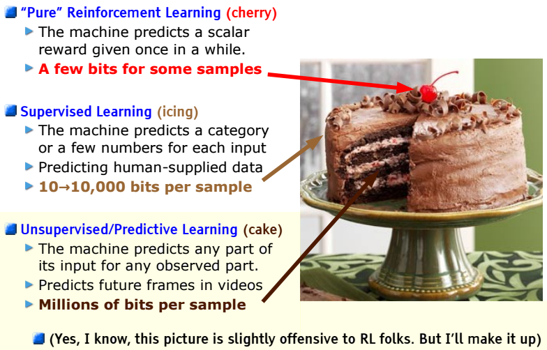
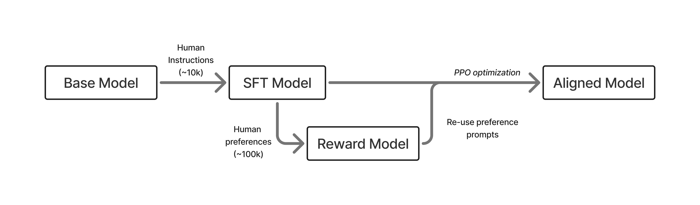
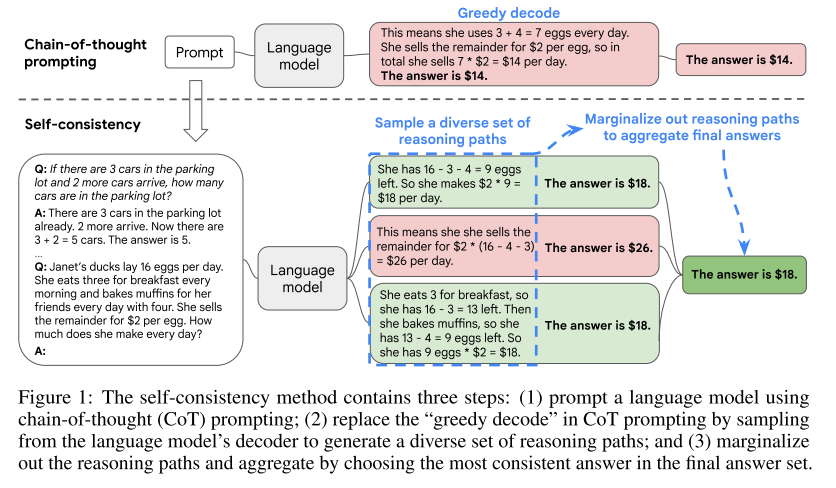
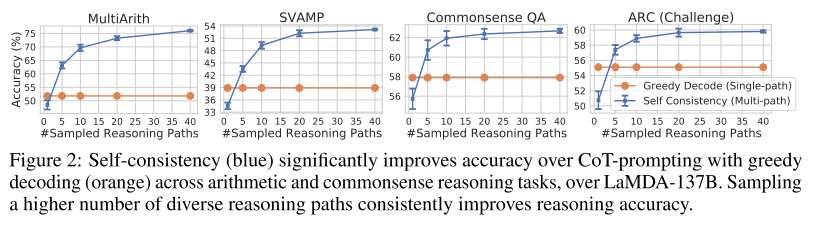
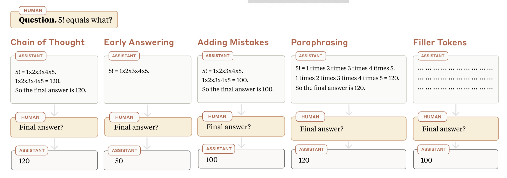
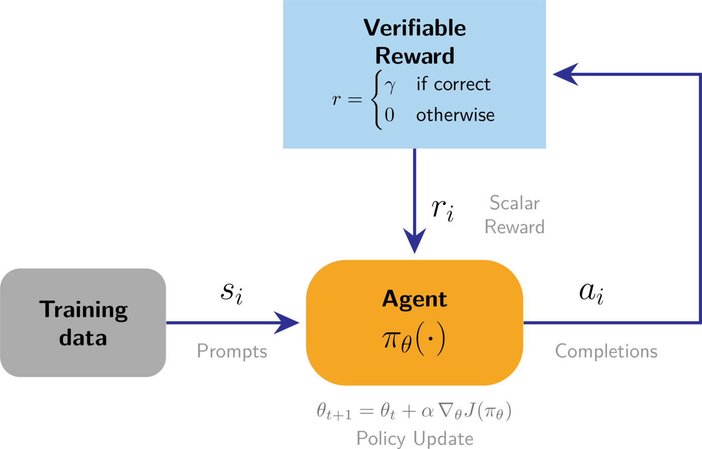
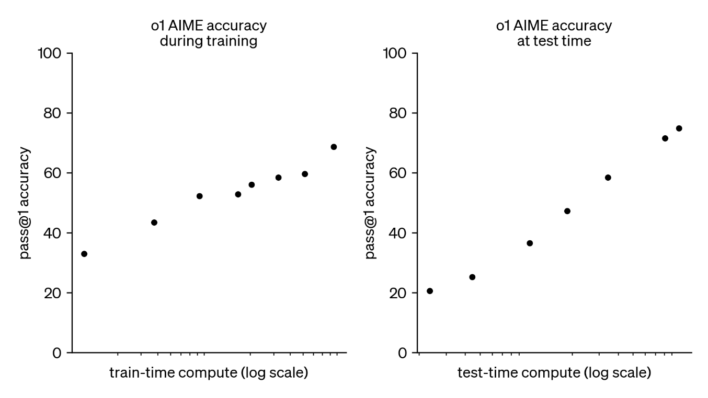
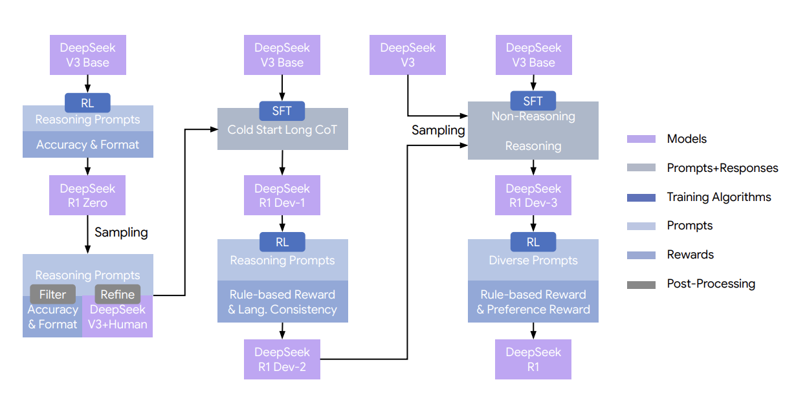
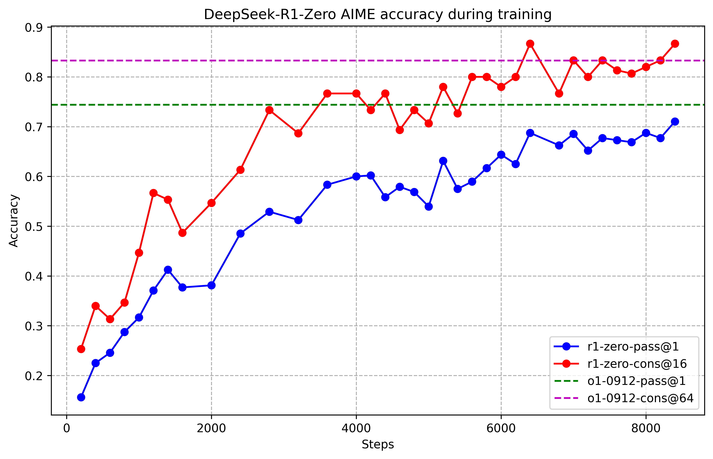

# Reasoning

IEOR 4570 - Agentic AI

<div class="absolute bottom-2 left-2 p-2 pl-4 text-left w-125 border-1">

Please note: The perspectives shared today are based on my personal experience and do not represent the views of my employer.

</div>

---
layout: side-title
color: sky
align: rm-lm
---

:: title ::

# Learning Objectives

:: content ::

1. How do models think?
2. Describe how o1 and DeepSeek-R1 trained the chain in.
3. Steer a reasoning model: budgets, visibility, and what not to prompt anymore.

---
layout: section
color: amber-light
---

# 2016
<hr>

The cherry on the cake

---
layout: two-cols
columns: is-6
align: lm-cm
---

:: left ::

## LeCun's Cake

NeurIPS 2016. Yann LeCun coined the cake metaphore.

<SpeechBubble position="r" color="gray-light" shape="round">

If intelligence is a cake, the bulk of the cake is unsupervised learning, the icing is supervised learning, and the cherry on top is reinforcement learning.

</SpeechBubble>

Ten years later, with language models, it came true layer by layer, in that order.

:: right ::



-# LeCun, NeurIPS 2016 keynote. Retold in Lambert, [The RLHF Book](https://rlhfbook.com/c/07-reasoning)

---
layout: two-cols-title
align: l-lm-rm
---

::title::

## Where We Left Off: InstructGPT

Ouyang et al. (2022). [arXiv:2203.02155](https://arxiv.org/abs/2203.02155)

::left::


Size and prompting helped, but GPT-3 still completed text rather than following instructions. InstructGPT added three steps after pretraining:

1. **Supervised fine-tuning:** humans write good answers. Model trains on them.
2. **Reward model:** model generates several answers. Humans rank them. A second model learns the ranking.
3. **RL (PPO):** fine-tune the language model to maximize the reward model's score.

**Result:** ChatGPT, November 2022. A completion engine became an assistant.


::right::




<br>

-# Lambert, <em>The RLHF Book</em>, ch. 3, Fig. 5. [rlhfbook.com](https://rlhfbook.com/c/03-training-overview)

---
layout: two-cols-title
columns: is-6
align: l-lt-lm
---

:: title ::

## Where We Left Off: Chain-of-Thought

-# Wei et al. (2022), Fig. 1 and 4. [arXiv:2201.11903](https://arxiv.org/abs/2201.11903)

:: left ::

Put worked reasoning in the few-shot examples instead of just answers. Model copies the "steps, then answer" shape and gets better answers.

### Properties

1. **Decomposition.** Harder problems get more steps, so more compute.
2. **An interpretable window** into how the model got there.
3. Any task humans solve **via language.**
4. **Off-the-shelf.** Nothing is trained; only the exemplars change.

:: right ::

{width="92%" .mx-auto}

---
layout: two-cols
align: lm-cm
columns: is-5
---

:: left ::

## Where We Left Off: Every Token Is a Fork

Sampling is a walk down a tree of possible completions.

_A prompt does not "tell" the model anything. It prunes and re-weights possible branches._

:: right ::


-# Shanahan et al. (2023), Fig. 3. [arXiv:2305.16367](https://arxiv.org/abs/2305.16367)

---
layout: two-cols
align: lt-cm
---

:: left ::

## 2022: Self-Consistency

-# Wang et al. (2022). Follow-up to CoT.

### Technique

Same chain-of-thought prompt but explore branches of the tree.

1. Sample the model $n$ times instead of (greedily) taking the first path.
2. Each path ends in an answer.
3. Take the answer most paths agree on.

<br>

### Takeaway

If multiple different ways of thinking lead to the same answer, one has greater confidence that the final answer is correct.

-# _This is the only CoT sampling method we'll touch on, but the rabbit hole goes deep. See: [Lilian Weng 'Why we Think'](https://lilianweng.github.io/posts/2025-05-01-thinking/)_

:: right ::

{width="96%" .mx-auto}



-# Wang et al. (2022) [arXiv:2203.11171](https://arxiv.org/abs/2203.11171)

---
layout: two-cols-title
columns: is-5
align: l-lt-lt
---

:: title ::

## 2023: Is the Chain the Reason?

Measuring Faithfulness in Chain-of-Thought Reasoning. Lanham et al. (2023), Anthropic.

:: left ::

CoT says the chain is a window into the model's reasoning. Lanham tested it by **breaking the chain on purpose**.

### Methods

- **Early answering.** Cut the chain short.
- **Adding mistakes.** Corrupt one step.
- **Paraphrasing.** Reword the whole chain.
- **Filler tokens.** Replace it with dots.

<br>

### Results

- Generally showed that the chain _was_ impactful on answer.
- Showed that smaller models couldn't use the chain as well as larger.

:: right ::

<br>
<br>



-# Lanham et al. (2023). [arXiv:2307.13702](https://arxiv.org/abs/2307.13702)

<br>

-# Related: [Turpin et al. (2023)](https://arxiv.org/abs/2305.04388) bias the examples toward one answer; the model follows the bias and the chain never mentions it.

---
layout: section
color: violet
---

# 2024
<hr>

Training the chain in

---
layout: two-cols-title
columns: is-6
align: l-lt-lt
---

:: title ::

## Reinforcement Learning w/ Verifiable Rewards

Lambert, <em>The RLHF Book</em>, ch. 7

:: left ::

There are two dominant post-training reinforcement strategies at this time.

### RLHF: a judge

```yaml{class:'wrap'}
Prompt: Explain the concept of opportunity cost.
Response: Opportunity cost is the value of the next best alternative you give up...
```

Scoring this needs a learned model of what humans prefer. It can be fooled.

### RLVR: a checker

```yaml{class:'wrap'}
Prompt: What is the sum of all primes less than 20?
Response: 2 + 3 + 5 + 7 + 11 + 13 + 17 + 19 = 77. The answer is [77].
Verification: extracted_answer == 77
```

Math and code are verified with logic. There's nothing to fool.

:: right ::

{width="80%" .mx-auto}

-# Lambert (2025), ch. 7. [rlhfbook.com/c/07-reasoning](https://rlhfbook.com/c/07-reasoning)

<AdmonitionType type="tip" title="RLVR training in CoT">

RLVR optimizes for correct answers wherever a checker exists (math, code, science).

It can also reward behavior: CoT inside of `<think>` tags.

</AdmonitionType>

---
layout: two-cols-title
align: l-lm-lm
---

:: title ::

## 2024: OpenAI o1

"Learning to Reason with LLMs." September 12, 2024.

:: left ::

The first shipped model trained with large-scale RL to **think before it answers**. CoT is produced by default and inside of `<think>` tags. 

<br>

| | GPT-4o | o1 |
|---|---|---|
| AIME 2024 | 12% | 74% |
| Codeforces Elo | 808 <small>(11th pct)</small> | 1673 <small>(89th pct)</small> |

<br>

<AdmonitionType type="caution" title="Much less Open AI">

Starting w/ GPT-4 (March 2023), OpenAI stops publishing details about architecture and training. So we're left making educated guesses at how they trained this behavior.

</AdmonitionType>

:: right ::

{width="98%"}

-# OpenAI (2024). [Learning to Reason with LLMs](https://openai.com/index/learning-to-reason-with-llms/).

<AdmonitionType type="tip" title="Log-linear pay-off">

More RL during training and more tokens produced at test time both produce better accuracy.

</AdmonitionType>

---
layout: quote
quotesize: text-sm
authorsize: text-s
author: 'Jakub Pachocki, OpenAI Chief Scientist, on why o1 hides its chain of thought (2024)'
---

_We believe that a hidden chain of thought presents a unique opportunity for monitoring models. Assuming it is faithful and legible, the hidden chain of thought allows us to "read the mind" of the model and understand its thought process. For example, in the future we may wish to monitor the chain of thought for signs of manipulating the user. However, for this to work the model must have freedom to express its thoughts in unaltered form, so we cannot train any policy compliance or user preferences onto the chain of thought. We also do not want to make an unaligned chain of thought directly visible to users._

---
layout: section
color: rose
---

# 2025
<hr>

Everyone can do it

---
layout: two-cols-title
align: l-lm-cm
---

:: title ::

## 2025: DeepSeek-R1-Zero

DeepSeek-AI (2025) [arXiv:2501.12948](https://arxiv.org/abs/2501.12948)

:: left ::

Four months after o1, a full recipe, open weights. Start from the base model, no SFT.

Two RLVR rewards:

1. **Accuracy.** Does the final answer match?
2. **Format.** Is the reasoning inside `<think>` tags?

**AIME 2024:** 15.6% → 77.9%. 

<br>

<StickyNote textAlign="left" width="100%" title="Prompt they used during training">

```text {class:'wrap plain'}
The reasoning process and answer are enclosed within <think> </think> and <answer> </answer> tags, respectively.
```

</StickyNote>

:: right ::



-# DeepSeek-AI (2025), Fig. 2. [arXiv:2501.12948](https://arxiv.org/abs/2501.12948)

---
layout: two-cols-title
align: l-cm-cm
---

::title::

## RL: Up and to the Right

::left::

{.mx-auto}

::right::

{.mx-auto}

::default::

-# DeepSeek-AI (2025), Table 3. [arXiv:2501.12948](https://arxiv.org/abs/2501.12948)

---
layout: two-cols-title
columns: is-6
align: l-lm-lm
---

:: title ::

## The Cambrian Explosion of reasoning

:: left ::

| | |
|---|---|
| **Jan** | DeepSeek-R1 and Kimi 1.5, same day |
| **Feb** | Open-Reasoner-Zero: first open data replication |
| **Apr** | Qwen 3: toggleable thinking mode |
| **Jun** | OpenThoughts 3, MiniMax M1 |
| **Jul** | Kimi K2, GLM-4.5: "agentic" reasoning |
| **Nov** | Olmo 3 Think: the fully open one |
| **Dec** | DeepSeek V3.2, Nemotron 3 |

:: right ::

### What settled

- Simple beat clever. RLVR spread because it is easy to explain and easy to run.
- Math and code first, then tool use by mid-year.
- Toggleable thinking was tried and mostly abandoned. In 2026 you get a reasoning model, and the knob is effort: `low`, `medium`, `high`.

-# Lambert (2026), Lecture 5, and <em>The RLHF Book</em> ch. 7, Table 1.

---
layout: three-cols-title
---

::title::

## Layers of AI Knowledge
After o1, Deepseek, and RLVR

<br>

::left::

### Pre-training

###### Knowledge

- Next-token prediction based on corpus of training data.
- Facts, language, patterns
- How concepts relate to each other in latent space.
- Trained into the model weights by labs (expensive)

::middle::

### Post-training

###### Behavior

- SFT, then RLHF and **RLVR**
- The role of the assistant and how it answers
- **Aptitude for the verifiable**
- **Reasoning through problems with `<think>`**
- Elicits what pre-training already holds
- Trained into the model weights by labs (**expensive**)

::right::

### In-Context Learning

###### The task

- Everything in the prompt: instructions, few-shot examples, conversation history
- The task's "query", what is it trying to do
- Passed in entirity at scoring time (ephemeral and cheap)

---
layout: default
---

## Reading List

<div class="ns-c-tight text-sm">

**Papers**
- Wei et al. (2022). [Chain-of-Thought Prompting Elicits Reasoning in Large Language Models](https://arxiv.org/abs/2201.11903).
- Wang et al. (2022). [Self-Consistency Improves Chain of Thought Reasoning](https://arxiv.org/abs/2203.11171).
- Turpin et al. (2023). [Language Models Don't Always Say What They Think](https://arxiv.org/abs/2305.04388). Unfaithful chains.
- Zelikman et al. (2022). [STaR: Bootstrapping Reasoning With Reasoning](https://arxiv.org/abs/2203.14465).
- Lambert et al. (2024). [Tülu 3](https://arxiv.org/abs/2411.15124). Coined RLVR.
- OpenAI (2024). [Learning to Reason with LLMs](https://openai.com/index/learning-to-reason-with-llms/). o1.
- DeepSeek-AI (2025). [DeepSeek-R1: Incentivizing Reasoning Capability in LLMs via Reinforcement Learning](https://arxiv.org/abs/2501.12948).

**Guides and commentary**
- Lambert. [The RLHF Book, ch. 7: Reasoning and Inference-Time Scaling](https://rlhfbook.com/c/07-reasoning), and Lecture 5, "The Rise of Reasoning Models."
- Weng (2025). [Why We Think](https://lilianweng.github.io/posts/2025-05-01-thinking/).
- Kyars (2026). Reinforcement Learning From Verifiable Rewards.
- OpenAI (2025). [Why we built the Responses API](https://developers.openai.com/blog/responses-api).

</div>
