# Retrieval Augmented Generation

IEOR 4570 - Agentic AI

<div class="absolute bottom-2 left-2 p-2 pl-4 text-left w-125 border-1">

Please note: The perspectives shared today are based on my personal experience and do not represent the views of my employer.

</div>

---
layout: side-title
color: navy
align: rm-lm
---

::title::

## Learning Objectives

::content::

1. Explain why LLMs alone fall short on knowledge-intensive tasks
2. Trace RAG from a fixed pipeline step to a tool
3. Implement classic (semantic) RAG with a vector db
4. Identify failure modes of semantic RAG and the techniques that address them

---
layout: section
color: neutral-light
---

# Why RAG Exists
<hr>

What a model can't know

---
layout: two-cols
align: lm-cm
columns: is-5
---

::left::

## The Problem

An LLM knows two things: what was in its training data, and what's in its context.

Before web search, ChatGPT couldn't say which bus to take. After, the same question gets a schedule, because the answer was put in its context.

::right::

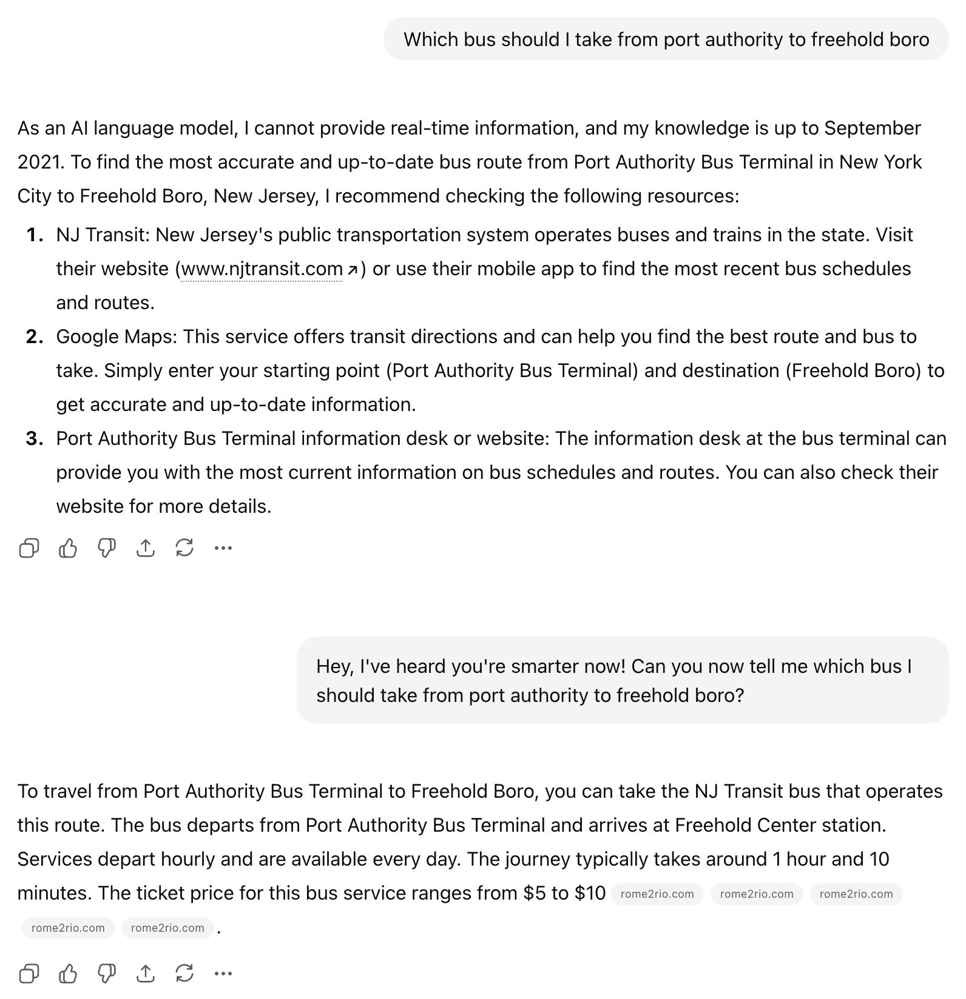

---
layout: side-title
align: rm-lm
---

::title::

## Three Constraints

::content::

1. **Hallucination:** LLMs predict the next likely token; they don't retrieve verifiable facts
2. **Static Knowledge Cutoffs:** Knowledge is frozen at the moment of training
3. **Domain & Privacy Gaps:** General models lack deep expertise and can't see private data

---
layout: section
color: neutral-light
---

# The Pre-LLM Roots of Retrieval
<hr>

The semantic alignment problem

---
layout: two-cols-title
align: l-lm-lm
margin: tight
columns: is-7
---

::title::

## Dialog Navigator (2004)

-# Kiyota (2004), *Dialog Navigator*, PhD thesis, Kyoto University.

::left::

Dialog Navigator answered user questions on Microsoft's Japanese support site by searching thousands of help articles.

The answers were in those articles but users struggled to reach them.

The failure was not lack of data. It was a mismatch between how users *ask questions* and how answers *exist in text*.

$$
Q \rightarrow Q' \rightarrow A
$$

_Where $Q$ is the user's question and $Q'$ is the user's question phrased the way the article, containing answer $A$, does._

Kiyota sorted the ways $Q$ fails to reach $Q'$ into three gaps...

::right::

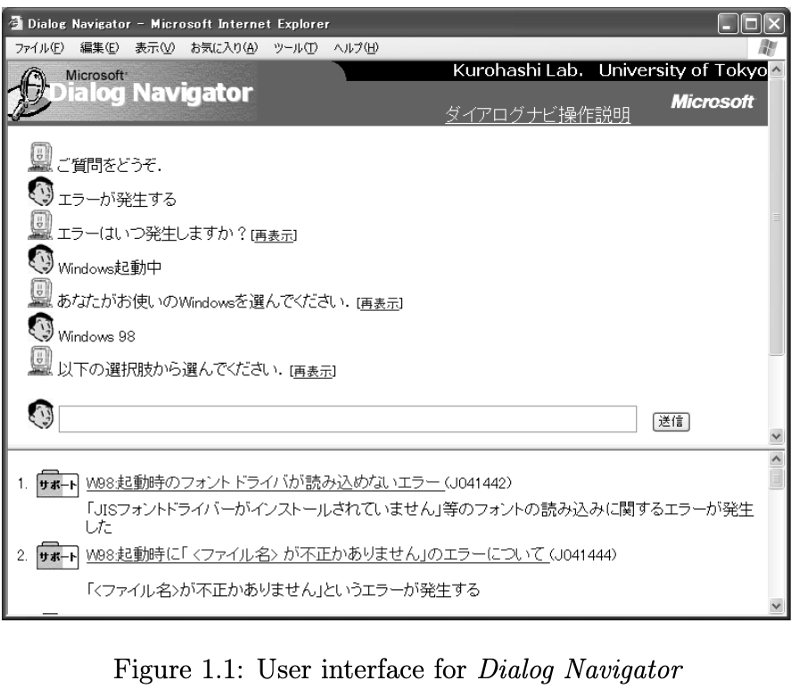

---
zoom: 0.85
---

## Gap 1: Expression

The user's words don't match the text's words, though they mean the same thing.

| Kind | $Q$ | $Q'$ |
|---|---|---|
| Spelling variant | dial-up | dial up |
| Abbreviation | IE | Internet Explorer |
| Loanword vs. native word | layout | haichi |
| Synonym | defect | disorder |
| General vs. specific | word processor | Word |
| Misspelling | Parl | Perl |
| Phrasing | read mail | receive mail |
| Metonymy | display a GIF | display a GIF image |

"Read" and "receive" aren't synonyms in general, only here. No synonym list catches that.

---
layout: two-cols-title
columns: is-8
align: l-lm-lm
---

::title::

## Gap 2: Vagueness

::left::

The question is too broad to match any one article. Users describe the symptom (`"An error occurred"`), but not the cause.

Taylor describes four Levels of an Information Need:

| | |
|---|---|
| $Q_4$ Compromised | What the user types into the system |
| $Q_3$ Formalized | A precise statement |
| $Q_2$ Conscious | A description in the user's head |
| $Q_1$ Visceral | Felt, but not put into words |

<br>

Search systems expect $Q_4$ to match $Q'$. Most users are at $Q_1$ or $Q_2$.

::right::

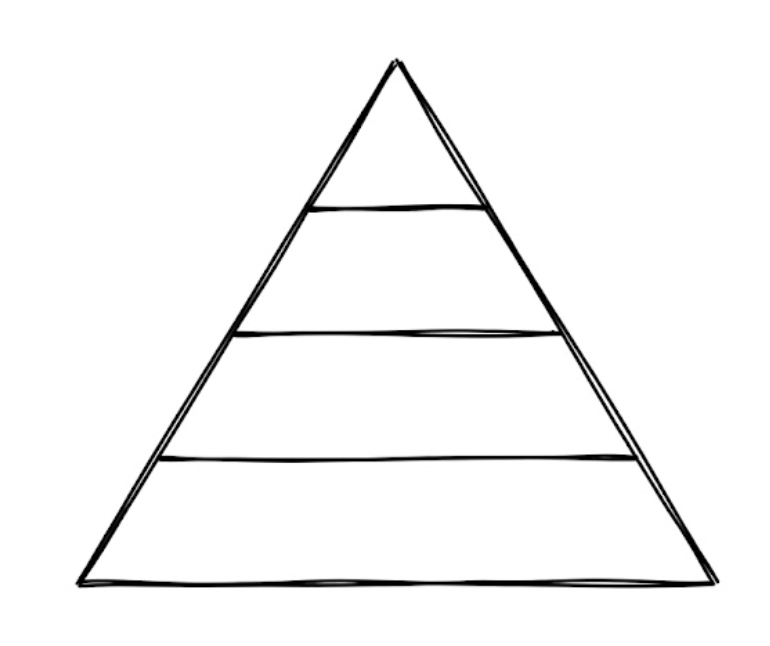

::default::

-# Taylor (1968), Question-Negotiation and Information Seeking in Libraries. *College & Research Libraries*.

---
layout: two-cols-title
align: l-lm-lm
---

::title::

## Gap 3: Belief

::left::

The question rests on a false premise.

$Q$: "How do I save a Word document as a PDF?"

-# (this was not possible with Word in 2004)

$A$ was to install Adobe Acrobat, and it lived in articles like "Using Acrobat to create PDFs."

No article says "Word can/can't make a PDF", so keyword searches fail to match.

::right::

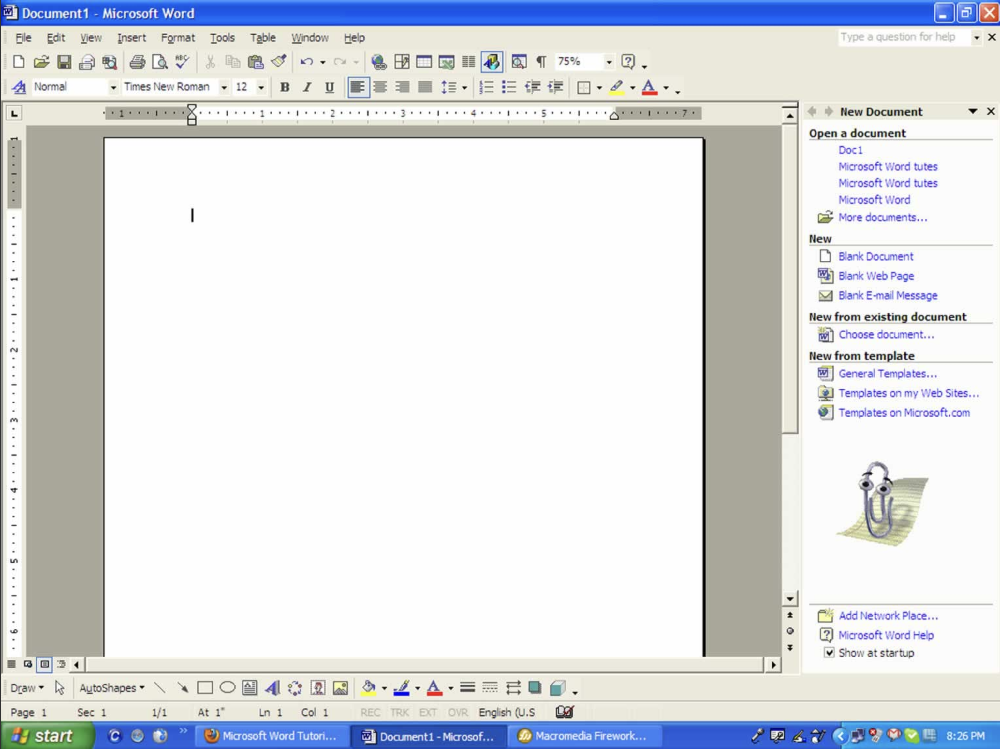

---
layout: side-title
align: rm-lm
---

::title::

## LLM's

Going from 2004 to 2024

::content::

Kiyota's gaps couldn't be solved with better ranking or bigger indexes. They needed a system that understands language.

<br>

LLMs understand language:

- **Expression:** Paraphrase and synonyms come with embeddings.
- **Vagueness:** World knowledge fills in what the user meant

<br>

But an LLM's knowledge lives in its weights, its parametric memory:

- **Lossy:** Details get conflated or hallucinated
- **Unverifiable:** There are no sources to cite
- **Frozen:** Nothing after the training cutoff

---
layout: section
color: neutral-light
---

# What If We Shoved It All Into Context?
<hr>

Why brute-force context stuffing fails

---
layout: two-cols
align: lm-cm
---

::left::

## Lost in the Middle

-# Liu et al. (2024), Lost in the Middle. [arXiv:2307.03172](https://arxiv.org/abs/2307.03172)

Filling the context often hurts accuracy. The effect shows up with just 20 documents, about 4K tokens.

> "Performance is highest when relevant information occurs at the beginning or end of the input context, and significantly degrades when models must access information in the middle."

This U-shaped curve shows models are biased toward primacy (start) and recency (end).

RAG performs curation: selecting only the signal, removing the noise.

::right::

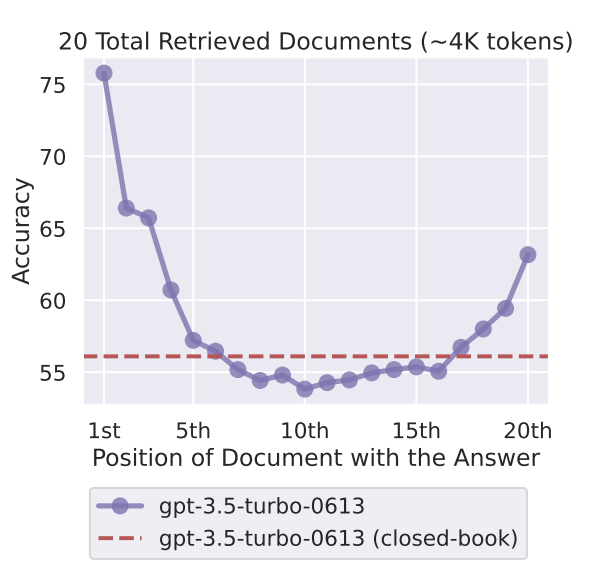

---
layout: section
color: navy
---

# Classic RAG (2020)
<hr>

-# Lewis et al., RAG for Knowledge-Intensive NLP Tasks (2020)

---
layout: two-cols-title
columns: is-6
align: l-lm-lm
---

::title::

## Two Kinds of Memory

-# Lewis et al., RAG for Knowledge-Intensive NLP Tasks (2020)

::left::

Two kinds of memory:

1. **Parametric:** What the generator learned in its weights in pre-training. Broad, but hard to update or inspect.
2. **Non-parametric:** Wikipedia, internet searches, external files. Easy to replace and inspect.

::right::

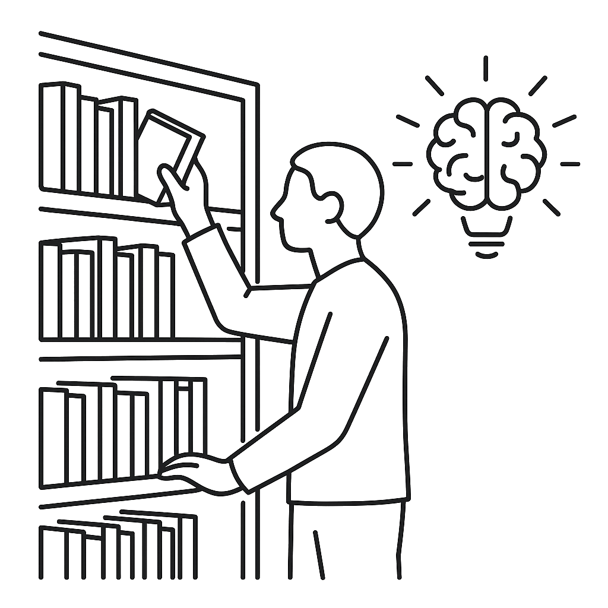{width=90%}

::default::

---
layout: quote
quotesize: text-m
authorsize: text-s
author: 'Lewis et al., RAG for Knowledge-Intensive NLP Tasks (2020)'
---

"Hybrid models that combine parametric memory with non-parametric memories can address some of these issues because knowledge can be <u>directly revised and expanded</u>, and accessed knowledge can be <u>inspected and interpreted</u>."

---
layout: two-cols-title
align: l-lm-cm
columns: is-4
---

::title::

## Two Phases (Classic RAG)

-# Lewis et al., RAG for Knowledge-Intensive NLP Tasks (2020)

::left::

#### 1. Indexing (Offline)

Pre-process external knowledge into a searchable format. A one-time cost.

<br>

#### 2. Runtime (Online)

Every user message is embedded, matched against the index, and the matches are added to the context.

::right::

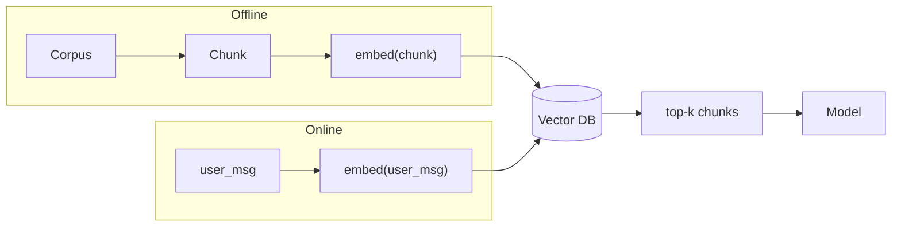

---
layout: two-cols-title
---

::title::

## Index Construction (Indexing)

-# Lewis et al., RAG for Knowledge-Intensive NLP Tasks (2020)

::left::

### Acquire & Chunk

The corpus is the non-parametric memory. The original paper used a December 2018 snapshot of English Wikipedia.

Documents are split into smaller units for retrieval.

- Original paper: 100-word disjoint (non-overlapping) chunks
- Transformed Wikipedia into ~21 million passages
- Retrieves specific evidence rather than entire articles

<AdmonitionType type="Note" title="Modern semantic RAG...">

Use larger, token-based sliding windows with overlap rather than strict 100-word chunks.

</AdmonitionType>

::right::

### Embed & Index

Each chunk $z$ is passed through a document encoder ($BERT_d$) to produce a dense vector $d(z)$.

- Output: 768-dimensional vector per chunk
- The document encoder is kept fixed so the index never has to be recomputed

The 21 million vectors are stored in an index built for fast nearest-neighbor lookup.

- FAISS with HNSW approximation
- Maximum Inner Product Search (MIPS) in sub-linear time

<AdmonitionType type="Note" title="Modern semantic RAG...">

Use off-the-shelf embedding models. HNSW is still very popular for embedding lookup.

</AdmonitionType>

---
layout: two-cols-title
align: l-lt-cm
---

::title::

## Runtime: Embed & Retrieve

-# Lewis et al., RAG for Knowledge-Intensive NLP Tasks (2020)

::left::

### 1. Embed the query

The harness maps the user's message $x$ to a dense vector $q(x)$ w/ a **query encoder** ($BERT_q$).

This completes the **bi-encoder** design: $d(z)$ computed offline, $q(x)$ computed per message.

### 2. Retrieve

$$p_{\eta}(z|x) \propto \exp(d(z)^\top q(x))$$

- MIPS finds the top-$k$ nearest chunks
- The authors used $k \in \{5, 10\}$
- The raw text of those chunks comes back

::right::

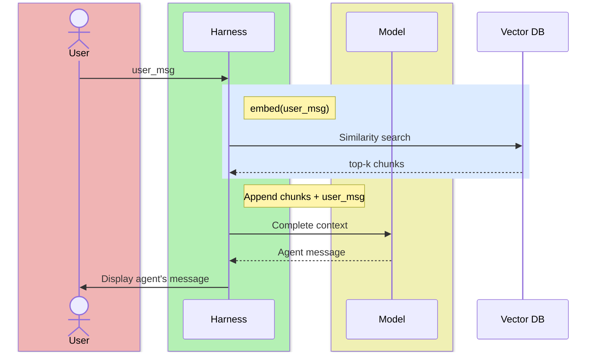

---
layout: two-cols-title
align: l-lt-cm
---

::title::

## Runtime: Augment & Generate

-# Lewis et al., RAG for Knowledge-Intensive NLP Tasks (2020)

::left::

### 3. Augment

The harness pairs the user's message $x$ with the retrieved chunks $z$, moving data from the external index into the model's context.

Lewis et al. paired $x$ with each chunk separately, generated from each pair, and weighted the results by retrieval score. Today we paste all $k$ chunks into one prompt.

### 4. Generate

The model answers conditioned on both the message and the evidence. This is also where we can ask for citations.

::right::

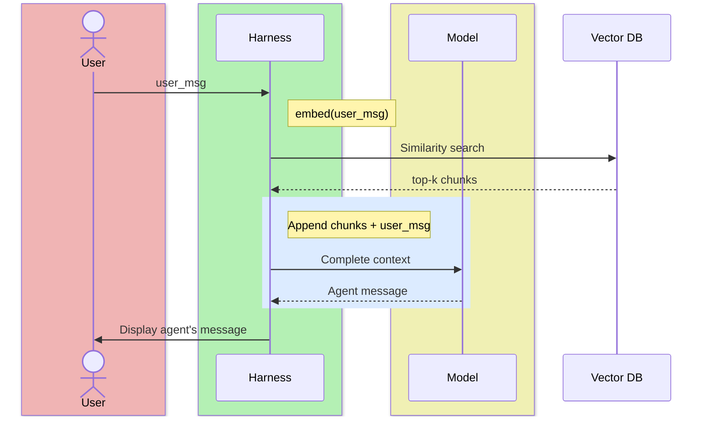

---
layout: quote
---

**Semantic RAG**: retrieval by similarity between the embedding of the query and the embeddings of the documents, as opposed to retrieval by keyword, SQL, or an API call.

---
layout: section
color: sky
---

# Example
<hr>

`magic-item-shop-classic-rag.zip`

---
layout: code-right
codesize: 9px
filename: index_items.py
---

::left::

## The Corpus

-# `magic-item-shop-classic-rag.zip`

1,029 D&D magic items, one markdown file each. The first lines hold the name and the type, rarity, and attunement tags.

```markdown
# [Flame Tongue](https://...)

#Weapon *(Any Melee Weapon),* #Rare

While holding this magic weapon, you can take a
Bonus Action and use a command word to cause
flames to engulf the damage-dealing part of the
weapon...
```

Each item is short, so we skip chunking: one item is one chunk.

::right::

```python
def parse_item(path: Path) -> dict | None:
    """Parse an item file into an id, text, and metadata."""
    text = path.read_text(encoding="utf-8")
    if not text.strip():
        return None  # a few files in the dataset are empty
    lines = text.strip().split("\n")

    name = path.stem
    for line in lines:
        if m := H1_PATTERN.match(line.strip()):
            name = m.group(1).split("](")[0].strip()
            break

    item_type, rarity, attunement = "", "", False
    for line in lines[:5]:
        ...  # read the #Weapon / #Rare / attunement tags

    return {
        "id": path.stem,
        "document": text,  # the full markdown is what gets embedded
        "metadata": {"name": name, "item_type": item_type,
                     "rarity": rarity, "attunement": attunement},
    }
```

---
layout: code-right
codesize: 10.5px
filename: index_items.py
---

::left::

## Embed & Store (Offline)

-# `magic-item-shop-classic-rag.zip`

```bash
$ uv run index_items.py
```

1. ChromaDB's default embedding model, `all-MiniLM-L6-v2`, runs locally. No API key.
2. Cosine (`1 - distance`) similarity.
3. `upsert()` is idempotent.
4. Batches stay under requested size limits.

The index is built into `chroma_data/`

<AdmonitionType type="important">

The embedding model used at index time must be the same model used at query time.

</AdmonitionType>

::right::


```python
def main():
    collection = chromadb.PersistentClient(
        path=str(CHROMA_PATH),
    ).get_or_create_collection(
        "magic_items",
        configuration={"hnsw": {"space": "cosine"}},
    )

    items = [
        item for path in sorted(ITEMS_DIR.glob("*.md"))
        if (item := parse_item(path))
    ]

    for i in range(0, len(items), 200):
        batch = items[i : i + 200]
        collection.upsert(
            ids=[item["id"] for item in batch],
            documents=[item["document"] for item in batch],
            metadatas=[item["metadata"] for item in batch],
        )
```

---
layout: code-right
codesize: 10px
filename: app.py
---

::left::

## The Pipeline (Online)

-# `magic-item-shop-classic-rag.zip`

```bash
$ uv run index_items.py
```

1. Embed the user's message, verbatim
2. Retrieve the top $n$ items
3. Paste them into the prompt
4. Generate one completion<br>(using Gemini instead of BART)

<AdmonitionType type="important">

In this primative version of RAG, retrieval is run _on every task_.

</AdmonitionType>

::right::

```python
# No tools: the model never decides to search
agent = Agent(name="Keeper", instructions=SYSTEM_PROMPT,
              model=...)  # Gemini via LiteLLM

async def run_rag(message: str) -> tuple[str, str]:
    """One pass, the same on every message:
    retrieve, augment, generate."""
    # 1-2. Embed the user's message, verbatim, and retrieve
    ==docs = search_magic_items(message)==

    # 3. Augment: paste the retrieved items in front
    ==prompt = f"<context>\n{docs}\n</context>\n\n{message}"==

    # 4. Generate: no tools, so exactly one model call
    result = await ==Runner.run(agent, prompt)==
    return result.final_output, docs
```

---
layout: two-cols-title
align: l-lm-cm
---

::title::

-# `magic-item-shop-classic-rag.zip`

::left::

1. The user sends a message.
2. `run_rag()` searches ChromaDB with the message, verbatim.
3. ChromaDB returns the 3 nearest items.
4. `Runner.run()` sends the items and the message to Gemini in one prompt.
5. Gemini answers. The agent has no tools, so there's no loop.
6. The page shows the answer, with the retrieval above it.

::right::

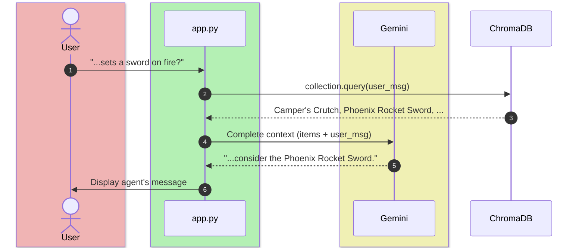

---
layout: section
color: navy
---

# From Pipeline to Tool
<hr>

Who decides when to retrieve?

---
layout: two-cols-title
align: c-ct-ct
---

::title::

## Two Ways to Retrieve

<br>

::left::

### In the pipeline (2020)

<br>
<br>
<br>

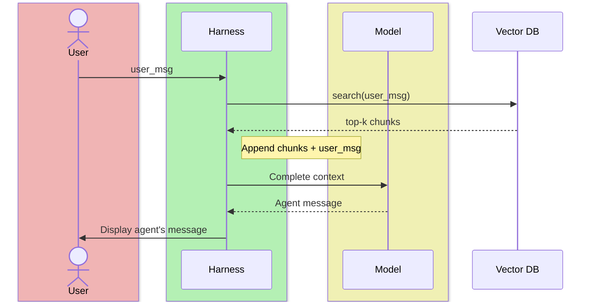

::right::

### As a tool (agentic RAG)

<br>
<br>

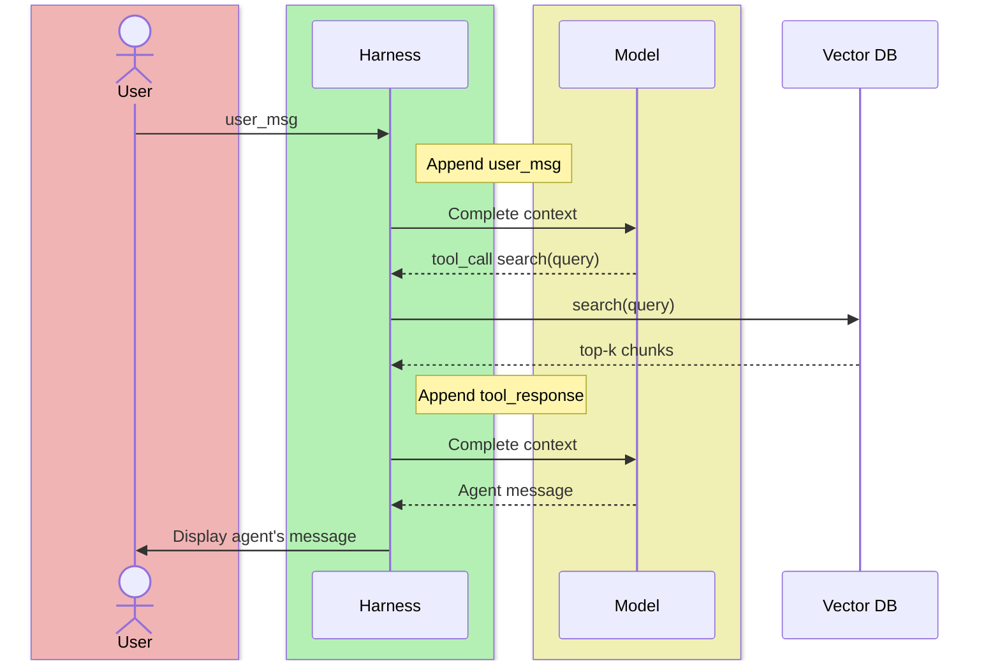

---
layout: section
color: sky
---

# Example
<hr>

`magic-item-shop-semantic-rag.zip`

---
layout: code-right
codesize: 9.5px
filename: app.py
---

::left::

## The Search Tool

-# `magic-item-shop-semantic-rag.zip`

`agents-sdk-web` with `get_weather` swapped for `search_magic_items`, over the same index as `magic-item-shop-classic-rag`.

1. `app.py` opens the index read-only at startup.
2. `collection.query()` embeds the query with the same model and returns the `TOP_K` nearest items.
3. `@function_tool` turns the docstring into the tool's schema. The description tells the model when to search; `Args` tells it what to write.

The `Runner`, the `SQLiteSession`, `/chat`, and `index.html` are unchanged. The instructions now play the shopkeeper.

::right::

```python
collection = chromadb.PersistentClient(
    path=str(CHROMA_PATH),
).get_collection("magic_items")

==@function_tool==
def ==search_magic_items(query: str)== -> str:
    =="""Search the shop's inventory for magic items matching==
    ==a description. Use this whenever a customer asks about==
    ==items, their properties, or what you have available.==

    ==Args:==
        ==query: A natural-language description of the items==
            ==to search for, e.g. 'a sword that deals fire damage'.==
    =="""==
    results = ==collection.query(==
        ==query_texts=[query], n_results=TOP_K,==
    ==)==
    documents = results["documents"][0]
    distances = results["distances"][0]
    return "\n---\n".join(
        f"[relevance: {1 - dist:.2f}]\n{doc}"
        for doc, dist in zip(documents, distances)
    )

agent = Agent(
    name="Keeper",
    instructions=SYSTEM_PROMPT,
    model=...,  # Gemini via LiteLLM, as in agents-sdk-web
    ==tools=[search_magic_items],==
)
```

---
layout: two-cols-title
align: l-lm-cm
zoom: 0.9
---

::title::

-# `magic-item-shop-semantic-rag.zip`

::left::

1. The user sends a message.
2. The `Runner` sends the context and the `search_magic_items` schema to Gemini.
3. Gemini calls `search_magic_items` with a query it wrote: "sword on fire fire damage flame".
4. The `Runner` runs the tool, which calls `collection.query()`.
5. ChromaDB returns the 3 nearest items.
6. The `Runner` appends the tool result and calls Gemini again.
7. Gemini answers with no tool call, ending the loop.
8. The page shows the answer, with the tool call above it.

::right::

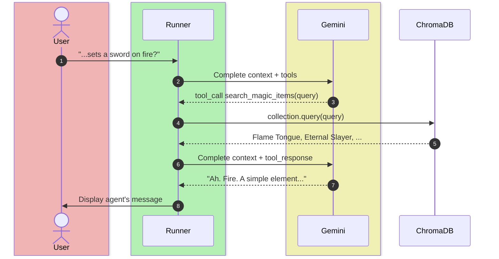

---
layout: section
color: emerald-light
---

# What Semantic RAG Solved
<hr>

Mapping back to Kiyota's gaps

---
layout: side-title
color: emerald-light
align: rm-lm
---

::title::

## Closing the Gaps

::content::

### Expression Gaps ✓

Dense retrieval matches by semantic similarity, not keywords. "Sets a sword on fire" finds items that say "flames" and "fire damage."

### Vagueness Gaps ✓

The model can search several readings of a vague question, or ask which one the user meant. Dialog Navigator's dialog did the same: "Please choose the Windows you're using."

### Belief Gaps ✓

For "How do I save a Word document as a PDF?", semantic search finds the articles about Acrobat. The model can correct the false premise with evidence.

---
layout: section
color: rose-light
---

# Where the Baseline Breaks
<hr>

Predictable failure modes of semantic RAG

---
layout: side-title
color: rose-light
align: rm-lm
---

::title::

## Four Failure Modes

::content::

### 1. Noisy Retrieval

Embedding similarity is coarse. In our shop, "anything that sets a sword on fire?" ranks a Camper's Crutch first and Flame Tongue fourth.

### 2. Exact Terms

Embeddings blur identifiers. A search for "Error Code 503" can return "Gateway Timeout" (HTTP 504) because the vectors are close, but the answer is wrong.

### 3. Questions Don't Look Like Answers

A short question and the paragraph that answers it sit far apart in embedding space. The gap widens in specialized domains where general-purpose embedding models transfer poorly.

### 4. Fragmented Context

Chunking loses surrounding context. "Revenue grew by 3%" is useless without knowing which company.

---
layout: section
color: neutral-light
---

# Fixing the Baseline
<hr>

One fix per failure

---
layout: two-cols
align: lm-cm
---

::left::

## Reranking

A second-stage filter that improves the precision of retrieved context.

1. **Initial retrieval** (recall): Fetch the top ~100 candidates with a fast retriever
2. **Reranking** (precision): A model scores each candidate's relevance to the query
3. **Selection**: Keep only the top few

In our shop: retrieve 10, rerank, keep 3. Flame Tongue, at rank 4, gets a second look.

::right::

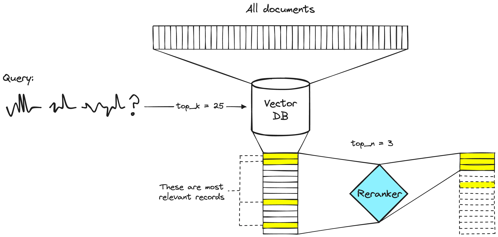

---
layout: two-cols-title
margin: tighter
---

::title::

## Reranking Methods

::left::

### Cross-Encoder

-# The classic method

A small cross-encoder model (e.g. `cross-encoder/ms-marco-MiniLM-L-6-v2`) takes a (`query`, `document`) pair and outputs one relevance score. Run it on each candidate and sort.

```python
from sentence_transformers import CrossEncoder
_cross_encoder = CrossEncoder(...)

def rerank(query, documents, top_k=3):
    pairs = [(query, doc) for doc in documents]
    scores = _cross_encoder.predict(pairs)
    ranked_indices = sorted(
        range(len(scores)),
        key=lambda i: scores[i], reverse=True,
    )
    return ranked_indices[:top_k]
```

::right::

### LLM Reranking

-# The lazy modern method

Just ask the LLM to do it for you.

```python
def rerank(query, documents, top_k=3):
    numbered = "\n\n".join(
        f"[{i}] {doc}" for i, doc in enumerate(documents)
    )
    prompt = (
        "You are a relevance ranking assistant.\n\n"
        f"Query: {query}\n\n"
        f"Candidates:\n{numbered}\n\n"
        "Return ONLY a JSON array of candidate indices "
        "ordered from most to least relevant to query. "
        "Example: [2, 0, 1]. Include all indices."
    )
    res = litellm.completion(...).choices[0]
    return json.loads(res.message.content.strip())[:top_k]
```


::default::

<br>

_**Question to ask:** Is embedding a reranking model inside your harness a pro or a con?_


---
layout: two-cols
columns: is-7
align: lm-lm
---

::left::

## Hybrid Search

-# Fixes failure 2: exact terms

Semantic search by itself doesn't work well with unknown terms and codes (think stock tickers). So run two retrievers in parallel:

1. **Dense** (semantic): Embeddings for conceptual similarity
2. **Sparse** (lexical): BM25 for exact keyword matches

**Reciprocal Rank Fusion (RRF):** Combine the lists: 

$$score(d) = \sum_{r \in L} \frac{1}{k + rank(d, r)}$$

$L$ = set of ranked lists (dense + sparse)<br>
$rank(d, r)$ = position of doc $d$ in list $r$<br>
$k$ = smoothing constant (typically 60)

::right::

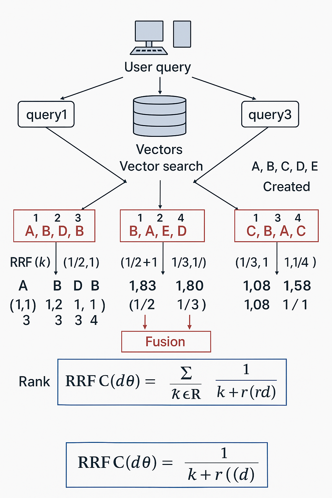{width=70% .mx-auto}

-# [RAG Fusion w/ Reciprocal Rank Fusion - Abheshith](https://medium.com/@abheshith7/rag-fusion-with-reciprocal-rank-fusion-73f67934dde7)

---
layout: two-cols
align: lm-lb
---

::left::

## HyDE: Zero-Shot Retrieval

-# Fixes failure 3: questions don't look like answers

Questions don't look like answers. HyDE (Hypothetical Document Embeddings) has an LLM write a fake answer, then searches with that:

1. **Generate:** An LLM writes a hypothetical answer document (maybe w/ hallucinations)
2. **Embed & Retrieve:** Embed the hypothetical document and search the real index.

The encoder acts as a "lossy compressor." It needs no relevance labels, so it works in new domains.

-# Gao et al. (2023), Precise Zero-Shot Dense Retrieval without Relevance Labels. [arXiv:2212.10496](https://arxiv.org/abs/2212.10496)

::right::

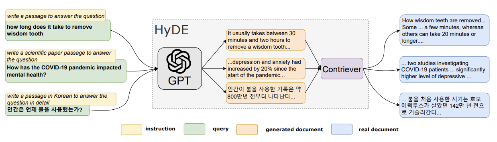

<br>
<br>
<br>

<AdmonitionType type="note" title="TBH">

I've actually never seen this one work in an agent _but I really want it to because it's so cool!_

</AdmonitionType>


---
layout: two-cols-title
columns: is-8
---

::title::

## RAG with a filesystem, `ls`, `cat`, and `grep`

RAG is dead. Long live RAG. (And a preview of coding agents)

::left::

Increasingly, agents demonstrate better RAG performance using a `Bash` tool to call Unix tools like `ls`, `cat`, and `grep` over a filesystem of data rather than semantic search architectures.

- They have access to a local, virtual, or sandboxed filesystem.
- The have a `Bash` tool capable of calling read-only Unix tools like:
    - `find` / `ls` - Find files by path matching
    - `grep` - Find files by content matching
    - `cat` / `head` / `tail` - Output a file
- They can *glob* and *pipe* these tools
  ```bash
  cat financials/*.md | grep AAPL`
  ```
  allowing zero-cost tool composition.

A common technique is to organize "cold context" into `.md` files and folders. Sometimes using markdown frontmatter to act as a "description index."

::right::


---
layout: code-right
codesize: 11px
filename: app.py
---

::left::

## Filesystem RAG

-# `magic-item-shop-filesystem-rag.zip`

`agents-sdk-web` with the weather tools swapped for a sandbox.

1. The items are filed as `items/<type>/<rarity>/<Item>.md`. No embeddings, no index.
2. The `Manifest` grants read-only access to `items/` where it lives. Nothing is copied.
3. `Shell()` gives the model one tool, `exec_command`.
4. The instructions describe the folder layout. The folder and file names are the index.

::right::

```python
# items/<type>/<rarity>/<Item>.md, read-only, in place
==manifest = Manifest(extra_path_grants=(==
    ==SandboxPathGrant(path=str(ITEMS_DIR), read_only=True),==
==))==

agent = ==SandboxAgent(==
    name="Keeper",
    instructions=f"""...
- Your inventory is in {ITEMS_DIR}, filed as
  <type>/<rarity>/<Item>.md. It is read-only.
- Search the shelves with ls, grep, and cat ...""",
    ==default_manifest=manifest,==
    ==capabilities=[Shell()],==  # one tool: exec_command
    model=...,  # Gemini via LiteLLM, as in agents-sdk-web
)

# Commands run on this machine; macOS enforces read-only
run_config = RunConfig(sandbox=SandboxRunConfig(
    ==client=UnixLocalSandboxClient(),==
))

# In /chat:
result = await Runner.run(agent, request.message,
    session=session, hooks=hooks, ==run_config=run_config==)
```

---
layout: two-cols-title
align: l-lm-cm
zoom: 0.8
---

::title::

-# `magic-item-shop-filesystem-rag.zip`

::left::

1. The user sends a message.
2. The `Runner` sends the context and `exec_command` to Gemini.
3. Gemini asks to grep the shelves for "fire".
4. The sandbox runs `grep -rnwi "fire" items/`.
5. The matching lines come back, each with its file path.
6. The `Runner` appends them and calls Gemini again.
7. Gemini picks `weapon/rare/Flame Tongue.md` and two others to read.
8. The sandbox runs `cat` on each.
9. The three files come back.
10. The `Runner` appends them and calls Gemini again.
11. Gemini answers with no tool call, ending the loop.
12. The page shows the answer, with every command above it.

::right::

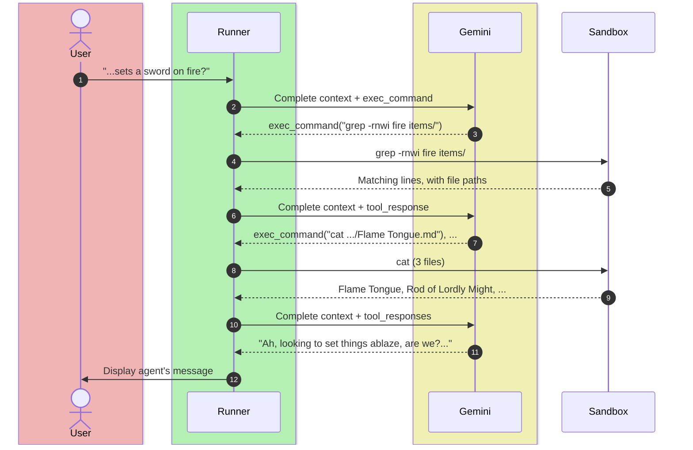

---
layout: four-cols-title
margin: tighter
---

::title::

## Layers of AI Knowledge

Including Retrieval

::one::

### Pre-training

###### Parametric Knowledge

- Next-token prediction based on corpus of training data.
- Facts, language, patterns
- How concepts relate to each other in latent space.
- Trained into the model weights by labs (expensive)

::two::

### Post-training

###### Learned Behavior

- SFT, then RLHF and RLVR
- The role of the assistant and how it answers
- Elicits what pre-training already holds
- Trained into the model weights by labs (expensive)
- Aptitude for the verifiable
- Reasoning through problems with `<think>`

::three::

### In-Context

###### Working Memory

- Everything in the prompt: instructions, few-shot examples, conversation history
- Tool definitions and tool results
- The task's "query", what is it trying to do
- Passed in entirety at scoring time (ephemeral and cheap)

::four::

### Retrieval

###### Non-Parametric Knowledge

- Lives outside the model and outside the prompt
- Proprietary, too recent, too large, or changes too often
- Pulled into context at query time by the harness or tool calls (cheap)

---

## Reading List

<br>

- Lewis et al. (2020). [Retrieval-Augmented Generation for Knowledge-Intensive NLP Tasks](https://arxiv.org/abs/2005.11401)
- Kiyota (2004). [Dialog Navigator](https://repository.kulib.kyoto-u.ac.jp/bitstreams/ad9ce269-ab79-4d62-8d96-88ccf03dc388/download), PhD thesis, Kyoto University
- Taylor (1968). Question-Negotiation and Information Seeking in Libraries. *College & Research Libraries*
- Liu et al. (2024). [Lost in the Middle](https://arxiv.org/abs/2307.03172)
- Gao et al. (2023). [Precise Zero-Shot Dense Retrieval without Relevance Labels (HyDE)](https://arxiv.org/abs/2212.10496)
- Singh et al. (2025). [Agentic RAG Survey](https://arxiv.org/abs/2501.09136)
- Pinecone. [Rerankers and Two-Stage Retrieval](https://www.pinecone.io/learn/series/rag/rerankers/)
- Abheshith. [RAG Fusion with Reciprocal Rank Fusion](https://medium.com/@abheshith7/rag-fusion-with-reciprocal-rank-fusion-73f67934dde7)
- Microsoft (2023). [Hybrid Retrieval and Reranking](https://techcommunity.microsoft.com/blog/azure-ai-foundry-blog/azure-ai-search-outperforming-vector-search-with-hybrid-retrieval-and-reranking/3929167)
- [ChromaDB documentation](https://docs.trychroma.com/)
- Bustamante (2026). [LLMs Eat Scaffolding for Breakfast](https://www.nicolasbustamante.com/blog/llms-eat-scaffolding)
- Akita (2026). [Is RAG Dead? Long Context, Grep, and the End of the Mandatory Vector DB](https://akitaonrails.com/en/2026/04/06/rag-is-dead-long-context/)
- OpenAI. [Agents SDK: Sandboxes](https://developers.openai.com/api/docs/guides/agents/sandboxes)
