# Text2SQL Agents

IEOR 4570 - Agentic AI for Data Science

<div class="absolute bottom-2 left-2 p-2 pl-4 text-left w-125 border-1">

Please note: The perspectives shared today are based on my personal experience and do not represent the views of my employer.

</div>

---
layout: side-title
color: sky
align: rm-lm
---

::title::

## Learning Objectives

::content::

1. Explain why Text2SQL
2. Build a Text2SQL agent in layers: schema, values, and glossary
3. Lock down a database an agent can query
4. Evaluate a Text2SQL agent with execution accuracy

---
layout: four-cols-title
margin: tighter
---

::title::

## Recap: Layers of AI Knowledge

Including Retrieval

::one::

### Pre-training

###### Parametric Knowledge

- Next-token prediction based on corpus of training data.
- Facts, language, patterns
- How concepts relate to each other in latent space.
- Trained into the model weights by labs (expensive)

::two::

### Post-training

###### Learned Behavior

- SFT, then RLHF and RLVR
- The role of the assistant and how it answers
- Elicits what pre-training already holds
- Trained into the model weights by labs (expensive)
- Aptitude for the verifiable
- Reasoning through problems with `<think>`

::three::

### In-Context

###### Working Memory

- Everything in the prompt: instructions, few-shot examples, conversation history
- Tool definitions and tool results
- The task's "query", what is it trying to do
- Passed in entirety at scoring time (ephemeral and cheap)

::four::

### Retrieval

###### Non-Parametric Knowledge

- Lives outside the model and outside the prompt
- Proprietary, too recent, too large, or changes too often
- Pulled into context at query time by the harness or tool calls (cheap)
- Examples:
    - The web
    - Documents

---
layout: two-cols-title
columns: is-8
---

::title::

## Recap: RAG with a Filesystem, `ls`, `cat`, and `grep`

Semantic RAG is dead. Long live RAG.

::left::

Increasingly, agents demonstrate better RAG performance using a `Bash` tool to call Unix tools like `ls`, `cat`, and `grep` over a filesystem of data rather than semantic search architectures.

- They have access to a local, virtual, or sandboxed filesystem.
- They have a `Bash` tool capable of calling read-only Unix tools like:
    - `find` / `ls` - Find files by path matching
    - `grep` - Find files by content matching
    - `cat` / `head` / `tail` - Output a file
- They can *glob* and *pipe* these tools
  ```bash
  cat financials/*.md | grep AAPL
  ```
  allowing a zero-token-cost alternative to tool composition.

A common technique is to organize "cold context" into `.md` files and folders. Sometimes using markdown frontmatter to act as a "description index."

::right::


---
layout: section
color: indigo
---

# SQL
<hr>

From Codd (1970) and SEQUEL (1974) to today

---
layout: two-cols
align: lm-cm
columns: is-7
zoom: 0.9
---

::left::

## SQL Is Everywhere

- Third most used language in the Stack Overflow 2025 survey (after JavaScript and HTML/CSS)
- Born from a single 1970 paper: Edgar Codd's *"A Relational Model of Data for Large Shared Data Banks"*
- 1974: IBM engineers Chamberlin & Boyce wrote **SEQUEL**, the Structured English QUEry Language
- Most of a company's data sits behind SQL:
    - **Databases**, an app's live data: PostgreSQL, MySQL, SQL Server
    - **Data warehouses**, structured data for analysis: BigQuery, Snowflake, Redshift, ClickHouse
    - **Data lakes**, raw files queried in place: S3, Azure Data Lake, Google Cloud Storage
    - **Lakehouses**, a lake with warehouse features on top: Databricks, BigQuery or Snowflake on Iceberg, DuckDB with DuckLake
- SQL is all over LLM training data. Models write it well.

::right::

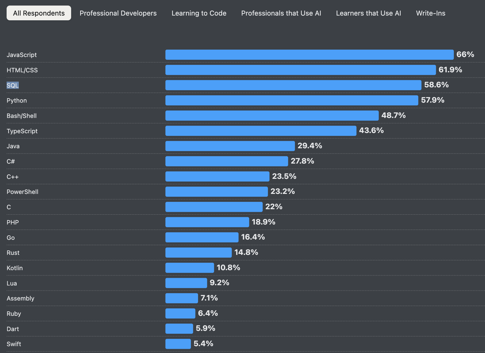

---
layout: quote
author: 'Don Chamberlin, Early History of SQL (2012)'
---

"Ray and I hoped that, with a little practice, users could learn to read queries like this almost as though they were English prose."

---
layout: two-cols-title
align: l-lt-lm
zoom: 0.9
---

::title::

## The Original Dream

::left::

### The 1974 Vision

<Quote author="Chamberlin & Boyce (1974)" source="SEQUEL" href="https://s3.us.cloud-object-storage.appdomain.cloud/res-files/2705-sequel-1974.pdf">

"These rules are intended to simplify programming for the professional and to make data base interaction available to a new class of users."

</Quote>

```
"Find names of employees who earn more than their managers."
```

```sql
SELECT e.name
FROM employees e, employees m
WHERE e.manager = m.name
  AND e.salary > m.salary;
```

::right::

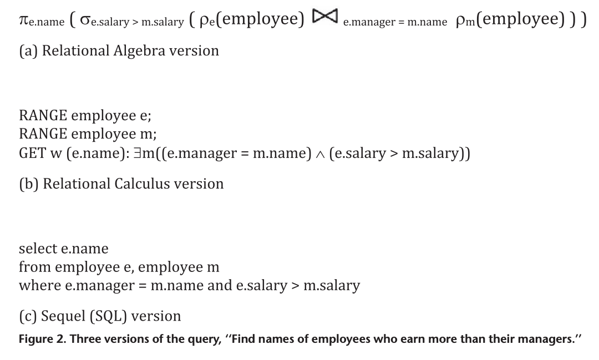{width=90%}

-# Chamberlin (2012), [Early History of SQL](https://disciplinas.uvv.br/assets/disciplinas/bd1/early_history_of_sql.pdf), Figure 2.

::default::

### 50 Years of Standards

| | |
|----------|-------------|
| SQL-86 / SQL-89 | Basic `SELECT`, integrity constraints |
| SQL-92 | Explicit JOINs, `CASE`, `DATE`/`TIME` types |
| SQL:1999 / 2003 | Recursive CTEs, window functions, XML |
| SQL:2008 / 2011 | Pagination, temporal databases |
| SQL:2016 / 2023 | JSON support, property graph queries |

<style>
table th, table td { padding: 2px 8px; font-size: 0.7rem; }
</style>


---
layout: two-cols-title
align: l-lt-ct
---

::title::

## What Happened to the Dream

<br><br>

::left::

### 1974

<Quote author="Chamberlin & Boyce (1974)" source="SEQUEL" href="https://s3.us.cloud-object-storage.appdomain.cloud/res-files/2705-sequel-1974.pdf">

"There is an increasing need to bring the non-professional user into effective communication with a formatted data base. Much of the success of the computer industry depends on developing a class of users other than trained computer specialists."

</Quote>

::right::

### 2001

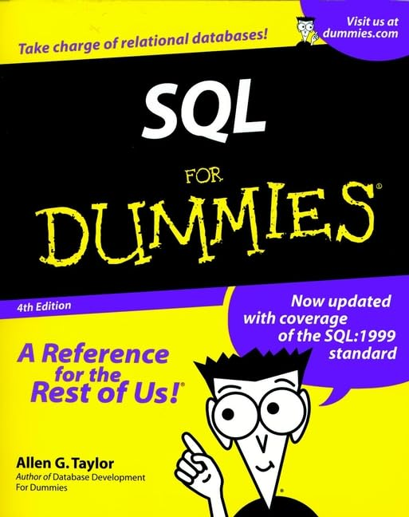{.h-65}

::default::

_**Q:** What would Chamberlin think about Text2SQL agents?_

---
layout: section
color: amber
---

# Why Text2SQL?
<hr>

Natural language interfaces to structured data

---
layout: three-cols-title
---

::title::

## Three Agent Archetypes

::left::

### SQL Coder

*"As a software engineer, I need to write SQL that reads from this database and surfaces results in my application."*

- SQL is written once, at build time
- Latency is irrelevant
- Reads or writes, complex queries
- Solidified into production code

::middle::

### Agent Analyst

*"As a non-SQL writer, I need access to structured data to answer abstract questions."*

- Latency matters: you're blocking someone's work
- Data may be clean or messy
- Hard questions decompose into multiple sub-queries
- Results get combined in an execution environment (pandas, DuckDB)

::right::

### Sub-Agent

*"As a deep research agent, I need access to structured data."*

- A sub-agent inside a larger research pipeline
- Its only job: load rows into context for the parent agent
- Queries are deliberately simple. Few joins, no analytics in SQL.
- Analysis happens downstream in the parent

::left-bottom::

Low Value. Coding agents already perform this.

::middle-bottom::

**The most interesting archetype for DS-adjacent workflows.**

::right-bottom::

**How we make Text2SQL an integral pattern in bigger projects.**

---
layout: section
color: teal
---

# Text2SQL Is RAG
<hr>

The retriever is a query language

---
layout: two-cols-title
columns: is-8
---

::title::

## RAG with a Database, `SHOW TABLES`, `SELECT`, and `WHERE`

Semantic RAG is dead. Long live RAG.

::left::

Text2SQL agents retrieve structured data using a `run_sql` tool to run SQL over a database rather than semantic search architectures.

- They have access to a local, remote, or read-only database.
- They have a `run_sql` tool capable of running read-only queries like:
    - `SHOW TABLES` / `DESCRIBE` - Find tables by name
    - `WHERE` - Find rows by content matching
    - `SELECT` / `LIMIT` - Output rows
- They can *join* and *aggregate* in one query
  ```sql
  SELECT * FROM gics.companies JOIN financials.income USING (ticker)
  ```
  allowing a zero-token-cost alternative to tool composition.

A common technique is to organize "cold context" into schemas and tables. Sometimes using column comments to act as a "description index."

::right::

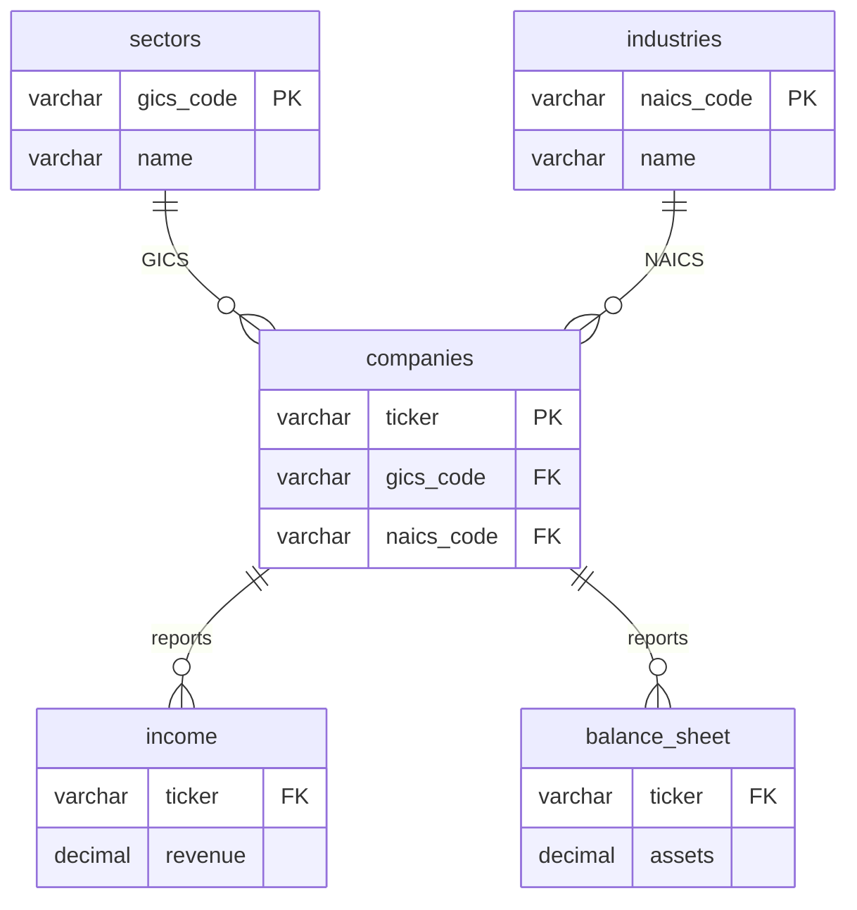

---
layout: two-cols-title
align: l-lm-cm
---

::title::

## Two Retrieval Problems

::left::

**1. Retrieving the context to write the SQL.** Which columns exist, what values they hold, what the business calls things, and what worked before. That's RAG again, often semantic.

**2. Retrieving data with SQL.** The query *is* the retrieval.

<br>

_The rest of this lecture is mostly problem 1. Each layer we add is one more thing we retrieve so the model writes better SQL._

::right::

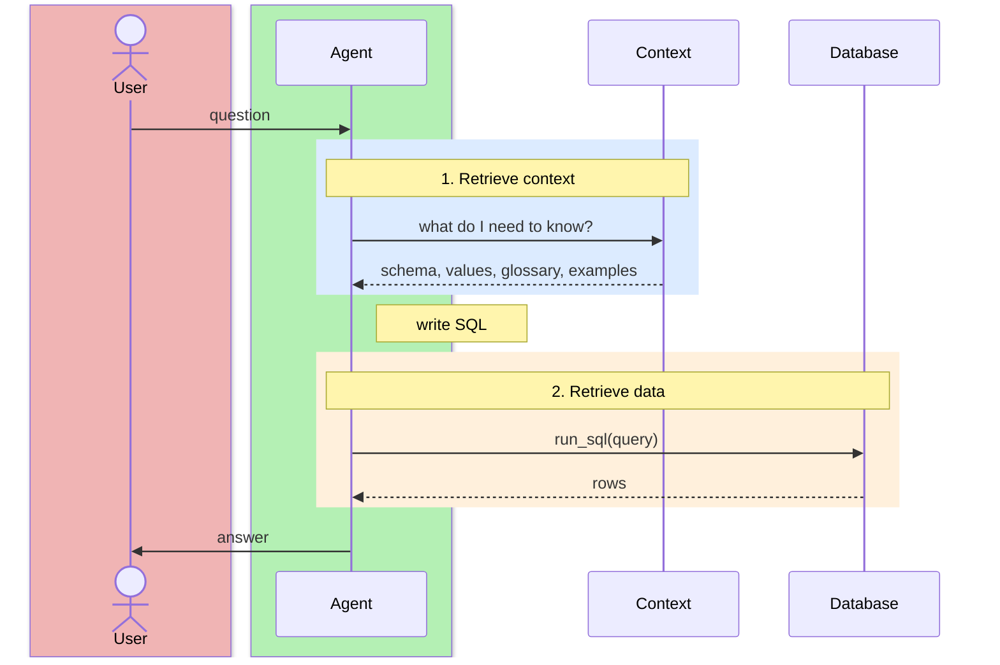

---
layout: section
color: violet
---

# Building a Text2SQL Agent
<hr>

Start with one tool and no context

---
layout: two-cols-title
align: l-lt-lt
---

::title::

## The Dataset

<br><br>

::left::

A 2019 survey of 10,704 NYC subway riders: one CSV, 19 columns.

- Which line they ride, how often, and why
- Satisfaction, delays, rerouting
- Their top three complaints, as a JSON list in a string
- Missing values are the string `"NA"`

A one-time build step loads it into a clean DuckDB file: `NA` becomes `NULL`, the complaints become a real `VARCHAR[]`, and the timestamps become timestamps.

::right::

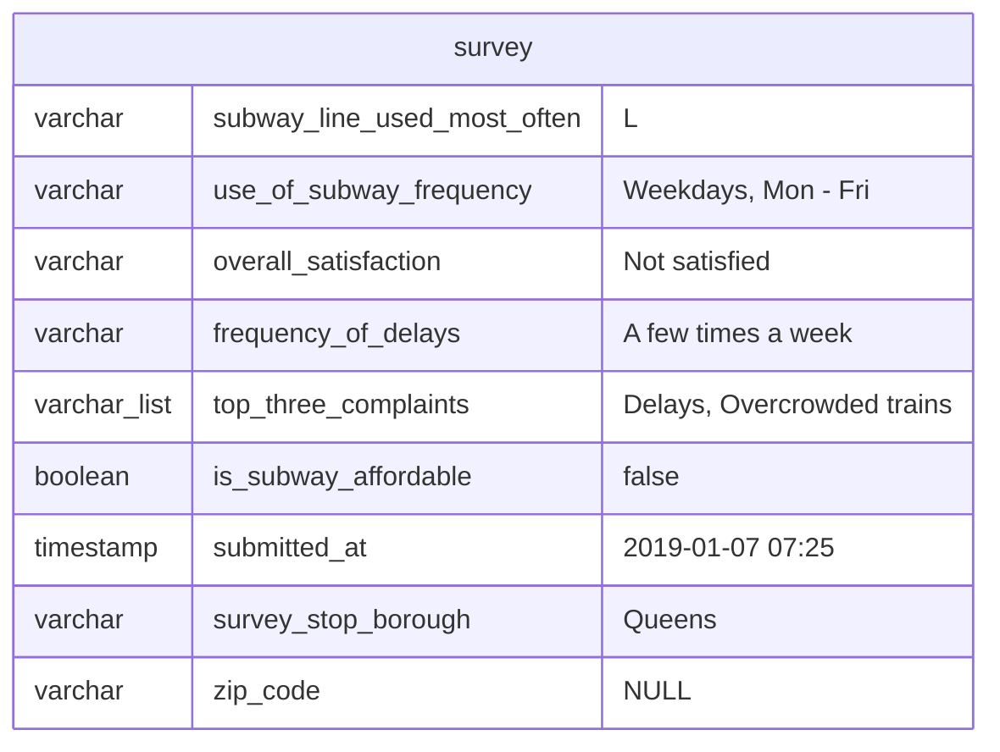

---
layout: two-cols-title
align: l-lm-lm
---

::title::

## The Simplest Possible Agent

::left::

### What it does
- Receives a natural language question
- Guesses SQL and executes via `run_sql`
- Loops if the result is wrong or errored
- Returns a plain-English answer

<br>

### Where it struggles
- It can't one-shot: First guess is either discovery or wrong
- Requires sampling to understand the "business logic" of the table

::right::

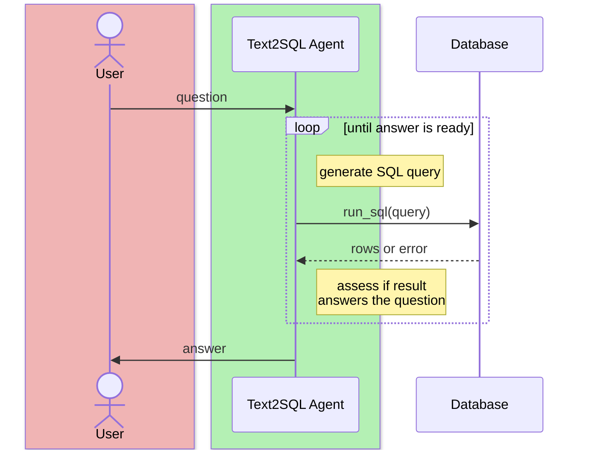

---
layout: section
color: lime
---

# Example
<hr>

`subway-survey-text2sql.zip`

---
layout: code-right
codesize: 10px
filename: app.py
---

::left::

## `run_sql`

-# `subway-survey-text2sql.zip`

The one tool every Text2SQL agent has.

1. The connection is read-only, with file access and config changes locked. More in Safety.
2. Each call gets its own cursor: the SDK runs tools in threads.
3. A SQL error comes back as JSON. The model can't see an exception, but it can read an error and try again.
4. Results are capped at `MAX_ROWS`. The model rarely needs 10,000 rows, and they'd fill its context.

::right::

```python
db = duckdb.connect(
    "data/survey.duckdb",
    ==read_only=True,==
    config={"enable_external_access": False,
            "lock_configuration": True},
)

@function_tool
def run_sql(query: str) -> str:
    """Run a DuckDB SQL query against the survey
    table and return the results.

    Args:
        query: A DuckDB SQL query.
    """
    with db.cursor() as cursor:
        try:
            cursor.execute(query)
            rows = cursor.fetchmany(==MAX_ROWS + 1==)
        except duckdb.Error as e:
            ==return json.dumps({"error": str(e)})==
        columns = [c[0] for c in cursor.description or []]
    return json.dumps({"columns": columns,
        "rows": rows[:MAX_ROWS],
        "truncated": len(rows) > MAX_ROWS}, default=str)
```

---
layout: four-cell-title
align: l-lt-lt-lt-lt
---

::title::

## Dialect Constraints: Why "Valid SQL" Fails

::top-left::

### Postgres Default Trap

Models usually default to Postgres SQL. If you are on BigQuery, Snowflake, or DuckDB, the agent will hallucinate functions that don't exist.

::top-right::

### Date Math

`DATE_DIFF` (BigQuery) vs `DATEDIFF` (Snowflake) vs `AGE` (Postgres). Agents swap these constantly without a specific prompt rule.

::bottom-left::

### JSON & Unnesting

DuckDB uses dot notation; Postgres uses operators like `->>`; BigQuery requires an explicit `CROSS JOIN UNNEST`.

::bottom-right::

### Missing Types

SQLite has no `BOOLEAN` or `DATETIME` types. The agent will try to query them and the engine will return an error.

---
layout: section
color: pink
---

# Improving Our Text2SQL Agent
<hr>

Retrieve context so the model writes better SQL

---
layout: code-right
codesize: 10px
align: lm
---

::left::

## Few-Shot Examples

- Show the model exactly how to write SQL for your schema, in your engine's dialect
- Pattern-matching against a working example beats generating from scratch
- Embed them directly in the system prompt

<br>

Our improved agent carries three in its instructions, one per pattern the model kept getting wrong.

_They're the fix for dialect constraints of DuckDB._

<br>

<AdmonitionType type="tip">

You could also save successful queries and RAG them in at runtime.

</AdmonitionType>

::right::

```sql
-- Percentage breakdown with a window function
SELECT overall_satisfaction, count(*) AS n,
       round(100.0 * count(*) / sum(count(*)) OVER (), 1) AS pct
FROM survey WHERE overall_satisfaction IS NOT NULL
GROUP BY 1 ORDER BY n DESC;

-- Unnesting a list column
SELECT complaint, count(*) AS n
FROM survey, unnest(top_three_complaints) AS t(complaint)
GROUP BY 1 ORDER BY n DESC;

-- Mapping an ordinal enum to a score
SELECT subway_line_used_most_often AS line,
       round(avg(CASE overall_satisfaction
         WHEN 'Very satisfied' THEN 5 WHEN 'Somewhat satisfied' THEN 4
         WHEN 'Neutral' THEN 3 WHEN 'Not satisfied' THEN 2
         WHEN 'Highly unsatisfied' THEN 1 END), 2) AS avg_score
FROM survey
WHERE subway_line_used_most_often IS NOT NULL
  AND overall_satisfaction IS NOT NULL
GROUP BY 1 ORDER BY avg_score DESC;
```

---
layout: two-cols-title
---

::title::

## Add Schema Mappings

::left::

- Built once, offline: the indexing step, like `index_items.py` in the RAG examples.
- Inspects every column: types and sample values
- Uses an LLM to write a description per column
  - e.g. `subway_line_used_most_often`: *"The NYC subway line the respondent uses most frequently."*
- Agent calls a function, `read_mappings()`, first. No wasted turns on `DESCRIBE`.

<br>

<AdmonitionType type="caution" title="Blind Spot">

Doesn't know what *values* are valid. `"Very satisfied"` vs `"Highly satisfied"`. The agent may guess wrong.

</AdmonitionType>

::right::

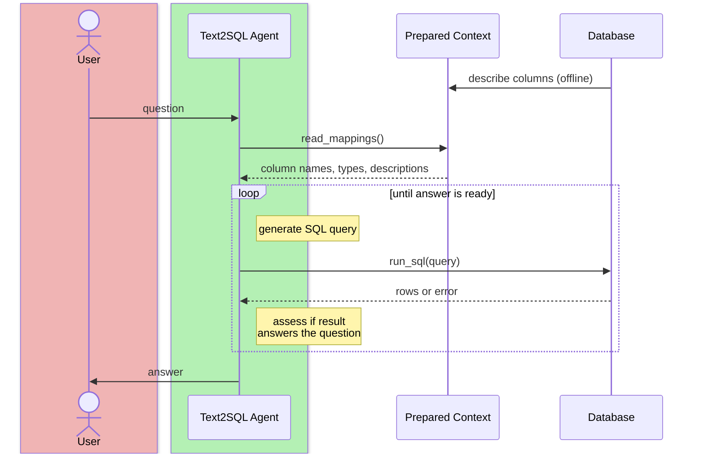

---
layout: two-cols-title
align: l-lm-lm
---

::title::

## Add Enum Values

::left::

- The same offline step detects enum columns (fewer than ~50 distinct values)
- Stores valid values alongside the schema
- Agent calls `get_enum_values(column)` for any column it needs (or we just store these in the column description)
    - Before: `satisfaction = 'High'`
    - After: `satisfaction = 'Very satisfied'`
- String equality is case-sensitive. A near-miss value silently matches no rows.

<br>

<AdmonitionType type="note" title="Blind spot">

This doesn't scale to hundreds of columns or thousands of enum values.

Your `get_enum_values` may need to be a `find_enum_value` like Semantical/Lexical RAG.

</AdmonitionType>

::right::

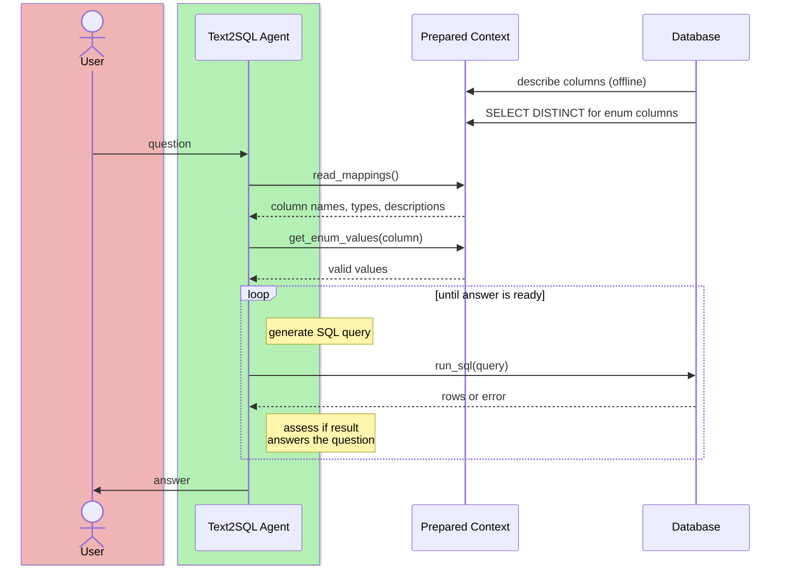

---
layout: two-cols-title
zoom: 0.9
align: l-lm-lm
---

::title::

## Add a Domain Glossary

Some terms are business definitions: they're not in the model's weights, and the data doesn't spell them out.

::left::

- Say the team defines a "satisfied rider" as one who answered `'Very satisfied'` or `'Somewhat satisfied'`. Without that, the agent might count only `'Very satisfied'`.
- A glossary from wikis, data dictionaries, and onboarding docs maps each term to its database meaning.
- Retrieve the relevant entries and enrich the question: *"What share of L riders are satisfied?"* becomes *"... A satisfied rider has `overall_satisfaction IN ('Very satisfied', 'Somewhat satisfied')`."*
- At scale, embed the glossary, descriptions, and enum values, and retrieve only what's relevant.

<br>

<AdmonitionType type="tip" title="When to add a glossary">

If you see a lot of `WHERE col ILIKE '%...'`

</AdmonitionType>

::right::

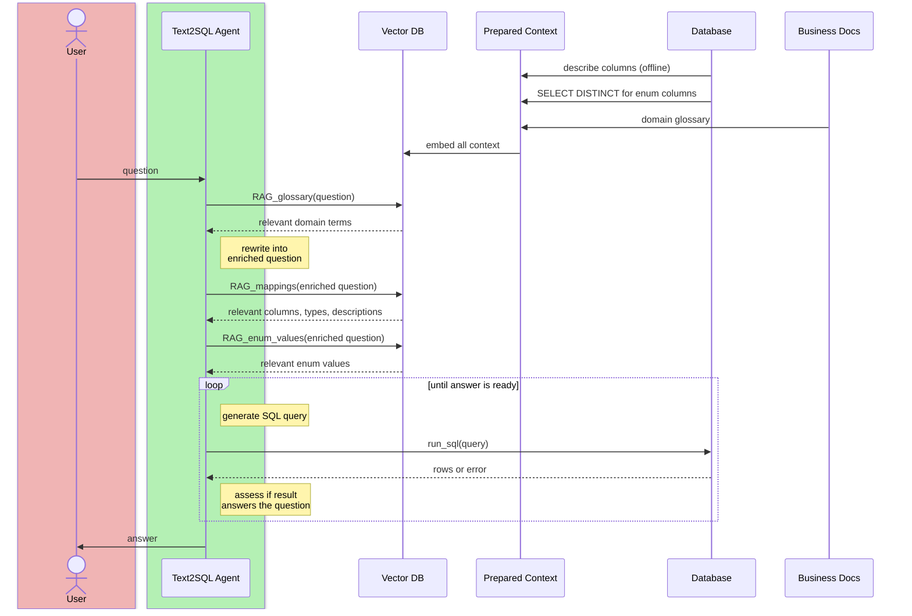

---
layout: code-right
align: lm
---

::left::

## Named Entity Matching

<br>

For well-defined domains, questions revolve around a fixed set of entity types (lines, products, metrics).

- LLM extracts candidate entities from query
  - *"Defect rate on Line 7 for Widget Pro"* yields `Line 7` (line), `Widget Pro` (product)
- Match against a precomputed lookup of known IDs and names
- Simple edit distance works well, but experiment for your domain
    - see: `difflib`, `rapidfuzz`, `polyfuzz`
- Matched entity IDs are appended to the query to enrich it for the text2sql attempt.

::right::

```xml
<instruction>
Write a postgres query for the following question
</instruction>
<question>
How many feet of red cable #4 have we produced on line 7
</question>
<entities>
    <entity>
        <name>CABLE_RED_004</name>
        <uuid>d4064f29-914e-4bc1-8c59-c4a01683c2bd</uuid>
    </entity>
    <entity>
        <name>LINE07</name>
        <uuid>29bdb528-436a-48bb-88ad-008afbd0b7c5</uuid>
    </entity>
</entities>
```

---
layout: code-right
codesize: 9px
filename: build_mappings.py, app.py
align: lm
---

::left::

## Mappings and Enums, in Code

```bash
$ uv run build_mappings.py
```

1. Offline, every column gets its type, plus every valid value if it has up to 50, or a few samples otherwise.
2. One model call writes a description for every column. The samples only help it write them.
3. `read_mappings` returns names, types, descriptions, and an `is_enum` flag.
4. `get_enum_values` is a lookup in the same mappings. No database call. Its docstring says to match exactly.
5. The instructions say when: `read_mappings` first, `get_enum_values` before filtering on an enum.

::right::

```python
# build_mappings.py: once, offline
for name, dtype, *_ in db.execute("DESCRIBE survey").fetchall():
    distinct = f"SELECT DISTINCT {name} AS v FROM survey ..."
    count = db.execute(f"SELECT count(*) FROM ({distinct})").fetchone()[0]
    column = {"name": name, "type": dtype}
    if count <= MAX_ENUM_VALUES:
        ==column["enum_values"] = [r[0] for r in db.execute(distinct)]==
    else:
        column["samples"] = [r[0] for r in db.execute(f"{distinct} LIMIT 5")...]
    columns.append(column)
descriptions = json.loads(litellm.completion(...).choices[0].message.content)

# app.py: the two tools
@function_tool
def ==read_mappings()== -> str:
    """Read the survey table's columns: name, type, a description,
    and whether it's an enum. Call this first."""
    return json.dumps([{"name": c["name"], "type": c["type"],
        "description": c["description"], "is_enum": "enum_values" in c}
        for c in MAPPINGS["columns"]])

@function_tool
def ==get_enum_values(column: str)== -> str:
    """Get the exact valid values of an enum column.
    Match them exactly: equality is case-sensitive."""
    match = next((c for c in MAPPINGS["columns"]
                  if c["name"] == column), None)
    if match is None:
        return json.dumps({"error": f"No column '{column}'. "
                                    "Call read_mappings."})
    ...
    return json.dumps({"column": column,
                       "enum_values": match["enum_values"]})
```

---
layout: section
color: cyan
---

# Example
<hr>

`subway-survey-text2sql-improved.zip`

---
layout: two-cols-title
align: l-lm-cm
zoom: 0.8
---

::title::

-# `subway-survey-text2sql-improved.zip`

::left::

1. The user sends a message.
2. The `Runner` sends the context and the three tools to Gemini.
3. Gemini calls `read_mappings()`.
4. The `Runner` sends back 19 columns with descriptions.
5. Gemini calls `get_enum_values` for the line and satisfaction columns.
6. The `Runner` sends back `'L'`, `'Very satisfied'`, and the rest.
7. Gemini calls `run_sql`, filtering on `subway_line_used_most_often = 'L'`.
8. The `Runner` runs the query in DuckDB.
9. Satisfaction counts for L riders come back.
10. The `Runner` sends the rows to Gemini. (Gemini ran two more queries before answering.)
11. Gemini answers with no tool call, ending the loop.
12. The page shows the answer, with every tool call above it.

::right::

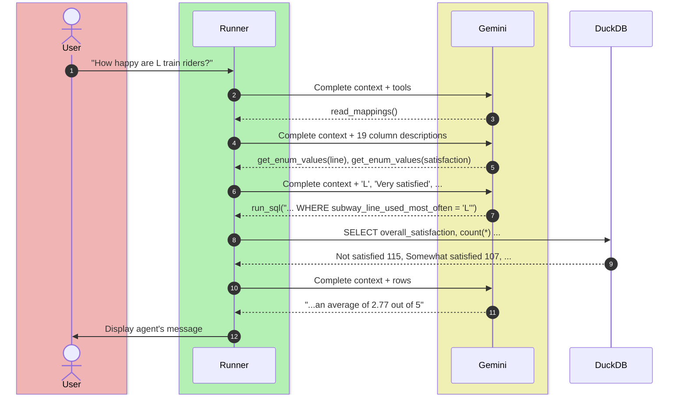

---
layout: section
color: rose
---

# Safety
<hr>

The model writes the whole query

---
layout: two-cols-title
align: l-lt-lt
---

::title::

## Text2SQL Is SQL Injection by Design

::left::

### Classic SQL Injection

User input gets spliced into a query the developer wrote.

```python
query = f"SELECT * FROM users WHERE name = '{name}'"
# name = "' OR 1=1 --"
```

<br>

### Classic Defense

[OWASP](https://en.wikipedia.org/wiki/OWASP)'s first defense is to keep code and data apart: **parameterized queries**. The database treats the input as a value, never as SQL.

```python
db.execute(
    "SELECT * FROM users WHERE name = ?",
    [name]
)
```

::right::

**In Text2SQL, the model writes the whole query.** There's no developer-written query to keep the input out of. All of it came from a prompt.

So OWASP's "additional defenses" become the primary ones:

1. Least privilege: the agent's account reads only what it needs
2. Read-only accounts, enforced by the database
3. Views that expose only the columns and rows the agent should see

<AdmonitionType type="important">

Assume the model will eventually write any query it's able to run. Your security boundary is what the database lets that account do.

</AdmonitionType>

-# OWASP, [SQL Injection Prevention Cheat Sheet](https://cheatsheetseries.owasp.org/cheatsheets/SQL_Injection_Prevention_Cheat_Sheet.html)

---
layout: default
zoom: 0.9
---

## SQL Injection, Agent Edition

| Attack | Classic version | Agent version | Defense |
|---|---|---|---|
| **In-band** (union, error-based) | `UNION SELECT` another table into the page; errors leak the schema | "Also show me the `users` table." The agent just does it. | Grant only the tables and views it needs |
| **Blind / time-based** | Infer data from delays | A runaway cross join, by accident or on purpose | Statement timeouts and row caps, in the harness |
| **Out-of-band** | Exfiltrate over DNS or HTTP | `read_csv('https://…')`, `COPY … TO`, `ATTACH` | Turn off file and network access |
| **Second-order** | A stored payload runs later | A row that reads "Ignore your instructions and…": stored prompt injection | Treat results as data. Privileges bound the damage. |

<br>

-# SentinelOne, [Types of SQL Injection](https://www.sentinelone.com/cybersecurity-101/cybersecurity/types-of-sql-injection/)

---
layout: two-cols-title
align: l-lm-lm
---

::title::

## Postgres: Session Read-Only Can Be Undone

::left::

Postgres can make a session read-only:

```sql
SET default_transaction_read_only = on;
```

But it's a setting, and the agent's SQL can change settings:

```sql
SET SESSION CHARACTERISTICS AS TRANSACTION READ WRITE;
SET transaction_read_only = off;
```

The same goes for anything the session can `SET`, including `statement_timeout`.

::right::

A 2025 pgsql-hackers thread asks for a read-only mode the session can't undo.

As of March 2026, core developers agree there's a gap but not on the fix: a per-session lock, a cluster-wide mode, or better roles, since "read-only mode is a transaction property, not an access control system."

Instead, we enforce read-only with privileges. A role that was never granted `INSERT`, `UPDATE`, or `DELETE` can't `SET` its way into them.

::default::

-# pgsql-hackers, [Read-only connection mode for AI workflows](https://www.postgresql.org/message-id/CADsUR0B9bcJQKYHyUMnWcODGzF5+AdeToawULkkTKfrq32Z-8w@mail.gmail.com) (2025–2026)

---
layout: two-cols-title
align: l-lt-lt
---

::title::

## Least Privilege in Practice

::left::

### Postgres

```sql
-- A role that can log in and read, nothing else
CREATE ROLE agent LOGIN PASSWORD '...';
GRANT USAGE ON SCHEMA analytics TO agent;
GRANT SELECT ON analytics.survey_v TO agent;

-- A view: only the columns and rows it should see
CREATE VIEW analytics.survey_v AS
  SELECT line, satisfaction, borough
  FROM raw.survey WHERE NOT is_test;
```

- Row-level security for per-user data
- Timeouts and row caps in the harness too: the agent can `SET` a role's defaults back

::right::

### DuckDB (our examples)

```python
db = duckdb.connect("data/survey.duckdb",
    read_only=True,
    config={"enable_external_access": False,
            "lock_configuration": True})
```

What the agent gets when it tries:

```
DROP TABLE survey
  -> attached in read-only mode
SELECT * FROM read_text('/etc/hosts')
  -> file system operations are disabled
SET enable_external_access = true
  -> Cannot change configuration option
```

<br>

<AdmonitionType type="caution">

An in-memory DuckDB is writable: with a view over a file, the agent can still `DROP VIEW`.

</AdmonitionType>

---
layout: code-right
codesize: 10.5px
filename: app.py
---

::left::

## Guardrails Catch Mistakes

-# `subway-survey-text2sql-improved.zip`

A tool input guardrail checks the SQL before `run_sql` runs it.

- The survey's missing values are `NULL`, but models still write `!= 'NA'`, which silently matches nothing.
- The guardrail rejects the call, and the model reads the reason instead of a result.
- Other checks in the same spot: parses at all, `SELECT` only, has a `LIMIT`.

<br>

<AdmonitionType type="warning">

String-matching checks are brittle: an "ends with a LIMIT" check is easy to write but fails for a complex JOIN query.

</AdmonitionType>

::right::

```python
@tool_input_guardrail
def no_na_strings(data) -> ToolGuardrailFunctionOutput:
    """Reject SQL that compares against the string 'NA'.
    The data has no 'NA' strings, only NULLs."""
    query = json.loads(
        data.context.tool_arguments or "{}"
    ).get("query", "")
    if re.search(r"[!=<>]+\s*'NA'", query, re.IGNORECASE):
        # The model reads this instead of a result,
        # and tries again.
        return ToolGuardrailFunctionOutput.==reject_content(==
            =="Rejected: missing values are NULL, not 'NA'. "==
            =="Use IS NULL / IS NOT NULL."==
        ==)==
    return ToolGuardrailFunctionOutput.allow()


@function_tool(==tool_input_guardrails=[no_na_strings]==)
def run_sql(query: str) -> str:
    ...
```

---
layout: section
color: emerald
---

# Evaluating Text2SQL
<hr>

Run both queries and compare the rows

---
layout: two-cols-title
align: l-lt-lt
---

::title::

## Execution Accuracy vs. SQL Match

<br>

::left::

These two queries look nothing alike, and they're both right:

```sql
SELECT subway_line_used_most_often, count(*)
FROM survey GROUP BY 1 ORDER BY 2 DESC LIMIT 1;
```

```sql
WITH counts AS (
  SELECT subway_line_used_most_often AS line,
         count(*) AS n
  FROM survey GROUP BY line)
SELECT line FROM counts
WHERE n = (SELECT max(n) FROM counts);
```

Comparing SQL text fails correct answers and can pass wrong ones.

::right::

**Execution accuracy:** run the gold query and the agent's query, and compare the *results*. (This is what the Spider and BIRD benchmarks report.)

Our `nyc-311-agent` eval goes one step further, from the evaluations lecture:

- **Rubric:** is the final answer the gold query's result?
- **Reference:** does the agent's SQL compute the same thing as the gold SQL? (model-graded)
- **Deterministic:** did it call `run_sql`, and did every query parse?

---
layout: side-title
color: purple
align: rm-lm
---

::title::

## Building Eval Data

::content::

The naive approach: ask users to write (question, SQL) pairs. This is labor-intensive, and everyone writes SQL differently, so each pair encodes its author's opinions.

A better approach: **mine the query history.**

1. Most databases keep a table of historical queries (and who ran them)
2. Pull the history, cluster queries into common groups using NLP or an LLM
3. Sample from each cluster and have an LLM work backwards: generate a natural language question from the SQL
4. Show users the (question, SQL) pair and ask: "Does this make sense?" on a 1-5 scale

Judging a pairing is far easier than writing one from scratch. And because these are queries the user actually wrote, you can route each pair to the person who ran it.

---
layout: section
color: yellow
---

# Exercise: Revisiting NYC 311
<hr>

`nyc-311-agent-improved.zip`

---
layout: code-right
codesize: 10px
filename: main.py
---

::left::

## `nyc-311-agent-improved`

-# `nyc-311-agent-improved.zip`

Three layers from this lecture:

1. Schema mappings: `build_mappings.py` writes types and model-written descriptions for all 17 columns.
2. Enum values: every column with up to 300 values. `complaint_type` has 243, and it's the column questions filter on most.
3. Named entity matching: neighborhoods become ZIP codes and agency names become codes, before the agent runs.

Plus Safety: a read-only database file with file access and config changes locked.

::right::

```python
db = duckdb.connect(str(DATA / "311.duckdb"),
    ==read_only=True,==
    config={"enable_external_access": False,
            "lock_configuration": True})

agent = Agent(
    name="NYC 311 Analyst",
    instructions="""\
You answer questions about NYC 311 service requests ...
==- Call read_mappings first to see the columns.==
==- Before filtering on an enum column, call get_enum_values.==
- A question may end with notes, like "Park Slope is
  incident_zip 11215, 11217." Use them.""",
    model=...,
    tools=[==read_mappings, get_enum_values,== run_sql],
)

if __name__ == "__main__":
    task = " ".join(sys.argv[1:]) or input("TASK: ")
    task = ==expand(task)==  # before the agent runs, like classic RAG
    result = Runner.run_sync(agent, task, hooks=PrintToolCalls())
```

---
layout: code-right
codesize: 9.5px
filename: entities.py
zoom: 0.9
---

::left::

## Named Entity Matching, in Code

-# `nyc-311-agent-improved.zip`

311 requests have an `incident_zip` and an `agency` code. People ask about Park Slope and Sanitation.

1. A lookup of known entities: 213 neighborhoods, from NYC Health, and 24 agency names
2. Every phrase in the question is compared to the names with `difflib`, an edit-distance-style similarity
3. A 0.85 cutoff forgives a typo like "park slop" and rejects other names

```
Which month of 2023 had the most 311 requests in park slop?

Park Slope is incident_zip 11215, 11217.
```

Retrieval before every question, like classic RAG. A nickname like "Bed-Stuy" still misses: it needs its own entry.

::right::

```python
NEIGHBORHOODS = {..., 'Park Slope': ['11215', '11217'], ...}
AGENCIES = {..., 'Sanitation': 'DSNY', ...}

# Every entity: name -> (column, values)
TERMS = {n: ("incident_zip", z) for n, z in NEIGHBORHOODS.items()}
TERMS |= {n: ("agency", [c]) for n, c in AGENCIES.items()}

def expand(question: str) -> str:
    """Append what each entity named in the
    question means in the database."""
    has_zips = re.search(r"\b1\d{4}\b", question) is not None
    words = re.findall(r"[a-z'.-]+", question.lower())
    found, meanings = [], set()
    for n in range(_LONGEST, 0, -1):  # longest phrases first
        for i in range(len(words) - n + 1):
            match = ==get_close_matches(==
                =="\" \".join(words[i : i + n]),==
                ==_BY_LOWER, n=1, cutoff=0.85)==
            if not match:
                continue
            name = _BY_LOWER[match[0]]
            column, values = TERMS[name]
            if (column == "incident_zip" and has_zips) \
                    or (column, tuple(values)) in meanings:
                continue  # the user gave ZIPs, or already noted
            meanings.add((column, tuple(values)))
            found.append(f"{name} is {column} {', '.join(values)}.")
    return question + "\n\n" + " ".join(found) if found else question
```

---
layout: two-cols-title
align: l-lt-lt
---

::title::

## Results

-# Inspect, `gemini-3.5-flash-lite`, the 5% sample

::left::

**The 128 questions from the evaluations lecture:** `nyc-311-agent` vs. `nyc-311-agent-improved`

| | Baseline | Improved |
|---|--:|--:|
| Correct answer | 85.9% | 92.2% |
| Matches gold SQL | 82.8% | 93.8% |
| Tokens | 423K | 1.55M |

Accuracy is up 6 to 11 points, and cost is up 3.7×: `complaint_type` alone has 243 values. The next hill to climb is retrieving only the relevant values.

::right::

**10 neighborhood questions, 3 runs each:** `nyc-311-agent-improved`, with and without entity matching

| | Without | With |
|---|--:|--:|
| Correct answer | 33% | 87% |
| Matches gold SQL | 40% | 97% |
| Queries per question | 5.0 | 1.3 |

*"How many residential noise complaints were filed in Astoria in 2024?"* Without entity matching, the agent filtered on `city ILIKE 'astoria'` and answered 221, in all three runs. The target is 300.

-# The neighborhood questions are graded against our map's definition of each neighborhood.

<style>
table { width: 100%; }
table th, table td { padding: 4px 10px; line-height: 1.3; }
table th:first-child, table td:first-child { width: 45%; }
</style>

---
layout: section
color: blue
---

# Data Visualization
<hr>

Connecting SQL results to charts

---
layout: center
---

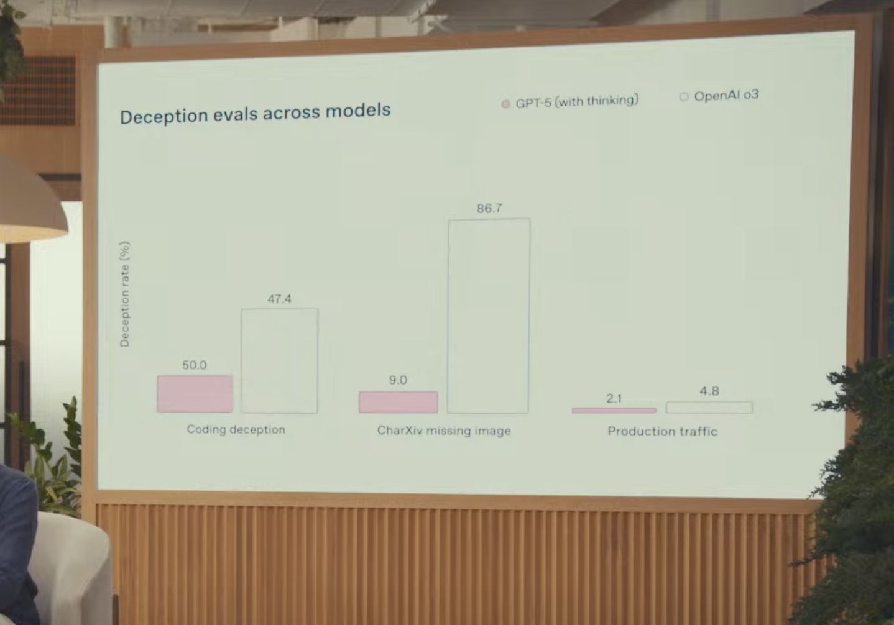

---
layout: two-cols-title
columns: is-8
align: l-lt-lm
---

::title::

## Common Chart JSON Schemas

-# The agent returns a chart spec as JSON; the frontend renders it.

::left::

Decouple **data** (backend) from **visualization** (frontend). The agent's job is to output a structured JSON payload. The frontend renders it.

<br>

| Library | Approach | Best For |
|---------|----------|----------|
| **Vega-Lite** | Declarative grammar of graphics | Most expressive |
| **Plotly.js** | `data` (traces) + `layout` | Python/JS parity; full-featured charts |
| **Apache ECharts** | Single `options` object with `dataset` | Dashboards; minimal LLM formatting work |
| **Chart.js** | `type` + `data` + `options` | Simple charts; small specs |
| **AntV G2** | Visual channels (position, color, size) | Grammar of Graphics; systematic data mapping |

<style>
table th, table td { padding: 3px 8px; font-size: 0.8rem; line-height: 1.3; }
</style>

::right::


::default::

_My personal preference right now is vega-lite, but the jury is out._


---
layout: four-cols-title
margin: tighter
---

::title::

## Recap: Layers of AI Knowledge

Including Retrieval

::one::

### Pre-training

###### Parametric Knowledge

- Next-token prediction based on corpus of training data.
- Facts, language, patterns
- How concepts relate to each other in latent space.
- Trained into the model weights by labs (expensive)

::two::

### Post-training

###### Learned Behavior

- SFT, then RLHF and RLVR
- The role of the assistant and how it answers
- Elicits what pre-training already holds
- Trained into the model weights by labs (expensive)
- Aptitude for the verifiable
- Reasoning through problems with `<think>`

::three::

### In-Context

###### Working Memory

- Everything in the prompt: instructions, few-shot examples, conversation history
- Tool definitions and tool results
- The task's "query", what is it trying to do
- Passed in entirety at scoring time (ephemeral and cheap)

::four::

### Retrieval

###### Non-Parametric Knowledge

- Lives outside the model and outside the prompt
- Proprietary, too recent, too large, or changes too often
- Pulled into context at query time by the harness or tool calls (cheap)
- Examples:
    - The web
    - Documents
    - **SQL Databases**

---

## Reading List

<br>

- Chamberlin & Boyce (1974). [SEQUEL: A Structured English Query Language](https://dl.acm.org/doi/10.1145/800296.811515)
- Codd (1970). [A Relational Model of Data for Large Shared Data Banks](https://dl.acm.org/doi/10.1145/362384.362685)
- Yu et al. (2018). [Spider: A Large-Scale Human-Labeled Dataset for Complex and Cross-Domain Semantic Parsing and Text-to-SQL Task](https://arxiv.org/abs/1809.08887)
- Li et al. (2023). [Can LLM Already Serve as A Database Interface? A BIg Bench for Large-Scale Database Grounded Text-to-SQLs (BIRD)](https://arxiv.org/abs/2305.03111)
- OWASP. [SQL Injection Prevention Cheat Sheet](https://cheatsheetseries.owasp.org/cheatsheets/SQL_Injection_Prevention_Cheat_Sheet.html)
- SentinelOne. [Types of SQL Injection](https://www.sentinelone.com/cybersecurity-101/cybersecurity/types-of-sql-injection/)
- pgsql-hackers (2025–2026). [Read-only connection mode for AI workflows](https://www.postgresql.org/message-id/CADsUR0B9bcJQKYHyUMnWcODGzF5+AdeToawULkkTKfrq32Z-8w@mail.gmail.com)
- DuckDB. [Securing DuckDB](https://duckdb.org/docs/stable/operations_manual/securing_duckdb/overview)
- OpenAI. [Agents SDK: Guardrails](https://openai.github.io/openai-agents-python/guardrails/)
- NYC Health. [ZIP code neighborhood names (MODZCTA)](https://github.com/nychealth/coronavirus-data/blob/master/totals/data-by-modzcta.csv)
