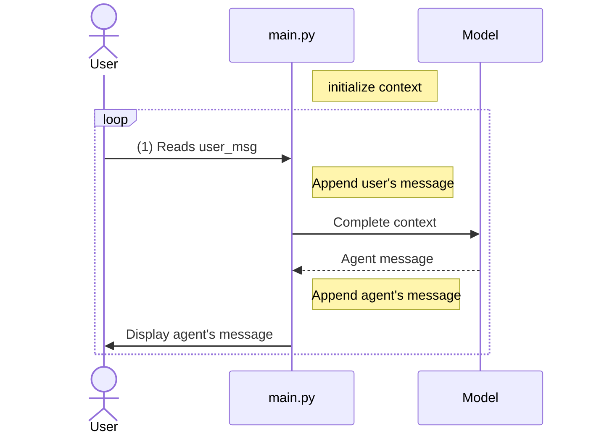
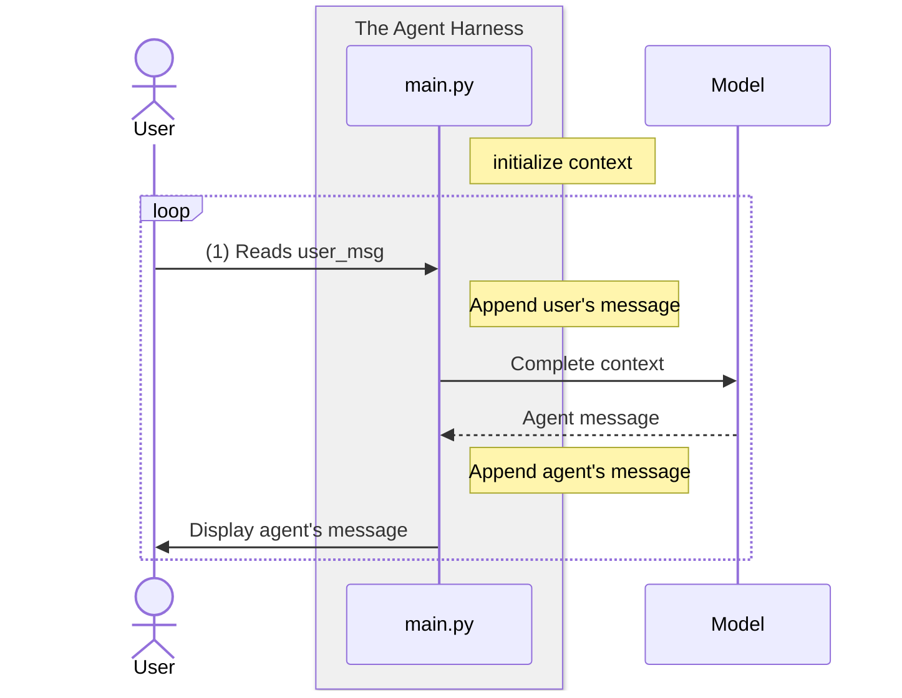
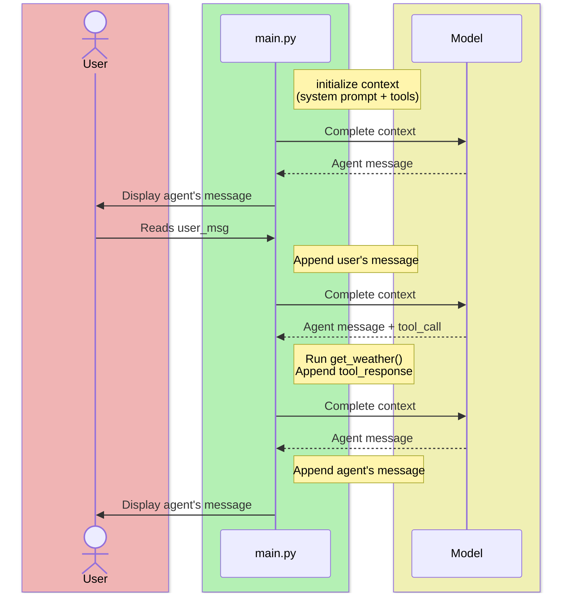

# Harnesses and Tool Calling

IEOR 4570 - Agentic AI for Data Science

<div class="absolute bottom-2 left-2 p-2 pl-4 text-left w-125 border-1">

Please note: The perspectives shared today are based on my personal experience and do not represent the views of my employer.

</div>

---
layout: side-title
align: rm-lm
---

::title::

## Learning Objectives

::content::

1. Implement a tool calling loop
2. Define an "Agent Harness"
3. Employ the best practices of tool calling

---
layout: section
color: neutral-light
---

# Recap
<hr>

The narrative we're telling the LLM

---
layout: code-right
---

::left::

## The Simplest Chatbot

-# `qwen-chat.zip`

### Session Start

1. We choose a model (hosted locally on Ollama) and a system prompt.
2. We initialize the session's context (`messages`) with the system prompt assigning it the `"role"` of `"system"`.

### In a Loop

3. In a loop, we read the user's message and append that to our session's context.
4. We generate the agent's response by passing messages to LiteLLM's `completion` API.
5. We append the agent's response to the `messages` and print it.

::right::

```python
import litellm

MODEL = "ollama_chat/qwen2.5:1.5b"
SYSTEM_PROMPT = "You are a helpful assistant."

# Initialize context with the system prompt
messages = [{"role": "system", "content": SYSTEM_PROMPT}]

while True:
    user_msg = input("USER: ")

    # Append user's message to the context
    messages += [{"role": "user", "content": user_msg}]

    # Generate response passing the full conversation history
    reply = litellm.completion(
        model=MODEL,
        messages=messages,
        max_tokens=50,
    ).choices[0].message.content

    # Append assistant's reply to the context
    messages += [{"role": "assistant", "content": reply}]

    print(f"ASSISTANT: {reply}\n")
```

---
transition: fade
layout: center
---



---
layout: center
---



---
layout: quote
---

**Harness:** the software surrounding the model that allows it to interact with the environment.

---
layout: section
---

## The Simulacrum does something

---
layout: two-cols-title
transition: fade
class: code-bg
---

::title::

## The screenplay

::left::

```

A CONVERSATION BETWEEN HELPFUL BOB AND HELPLESS SAM.

    BOB
  How can I help you today?

    SAM
  Is it nice enough to go for a walk?

    BOB
  I have no way of telling you that, sorry.
```

::right::

<div v-click>

```xml
<system>
You are a helpful assistant, helping a user.</s>

<assistant>
How can I help you today?</s>

<user>
Is it nice enough to go for a walk?</s>

<assistant> 
I have no way of telling you that, sorry.</s>
```

</div>

---
layout: two-cols-title
transition: fade
class: code-bg
---

::title::

## The screenplay + action lines

::left::

```

A CONVERSATION BETWEEN HELPFUL BOB AND HELPLESS SAM.

    BOB
  How can I help you today?

    SAM
  Is it nice enough to go for a walk?

    BOB
  ==Let me check!==

==Bob opens a window to check the weather.==
==It's 80 degrees and sunny.==

    ==BOB==
  ==It is a perfect day to go for a walk.==
```

::right::

<div v-click>

```xml
<system>
You are a helpful assistant, helping a user.</s>

<assistant>
How can I help you today?</s>

<user>
Is it nice enough to go for a walk?</s>

<assistant> 
==Let me check!</s>==

==<tool_call>{"name": "get_weather"}</tool_call></s>==
==<tool_response>{"temp": 80, "weather": "sunny"}</s>==

==<assistant>==
==It is a perfect day to go for a walk.</s>==
```

</div>

---
layout: quote
---

**Tool:** a function that's part of the harness that lets the model interact with the environment and see results.

---
layout: two-cols-title
class: code-bg
---

::title::

## The screenplay + action lines + set notes

::left::

```

A CONVERSATION BETWEEN HELPFUL BOB AND HELPLESS SAM.

==SET NOTES:==
==- There is a window that can be opened.==
  ==It will show the temperature and conditions.==
==- There is a phonebook that can be referenced.==
  ==It contains contact information.==

    BOB
  How can I help you today?

    SAM
  Is it nice enough to go for a walk?

    BOB
  Let me check!

Bob opens a window to check the weather.
It's 80 degrees and sunny.

    BOB
  It is a perfect day to go for a walk.
```

::right::

```xml
<system>
You are a helpful assistant, helping a user.

==Available tools:==
=={"name": "get_weather", "description": "Check weather"}==
=={"name": "lookup", "description": "Look up contacts", ...}==
 =="parameters": {"type": "object", "properties": ...}}==
 =={"name": {"type": "string"}}}}</s>==

<assistant>
How can I help you today?</s>

<user>
Is it nice enough to go for a walk?</s>

<assistant> 
Let me check!</s>

<tool_call>{"name": "get_weather"}</tool_call></s>
<tool_response>{"temp": 80, "weather": "sunny"}</s>

<assistant>
It is a perfect day to go for a walk.</s>
```

---
layout: image
image: images/agent-loop-diagram.png
backgroundSize: contain
---

---
layout: two-cols-title
align: l-cm-cm
---

::title::


::left::



::right::

{width="100%"}

---
layout: code-right
align: lm
codesize: 12px
---

::left::

## Tool definition anatomy

- **`type`:** Always `"function"`
- **`name`:** Identifier the model outputs in tool calls; short, descriptive, snake_case
- **`description`:** Most important field; what the model reads to decide when to use a tool
- **`parameters`:** Standard JSON Schema. _(Where constrained decoding comes in.)_
- **`required`:** Fields the model must always provide (omit when function has defaults)
- **Field `description`:** Guides value selection. Second most-important field.

::right::

```json
{
    "type": "function",
    "function": {
        "name": "get_weather",
        "description": 
          "Get current weather for a location",
        "parameters": {
            "type": "object",
            "properties": {
                "location": {
                  "type": "string",
                  "description": "City name (e.g. 'NYC')"
                }
            },
            "required": ["location"],
        },
    },
}
```

---
layout: two-cols-title
class: code-bg
---

::title::

## Tool definition in code

::left::

Tools are _described_ in JSON but _definied_ in code.


```json
{
    "type": "function",
    "function": {
        "name": "get_weather",
        "description": 
          "Get current weather for a location",
        "parameters": {
            "type": "object",
            "properties": {
                "location": {
                  "type": "string",
                  "description": "City name"
                }
            },
            "required": ["location"],
        },
    },
}
```

-# A decorator usually does the translation.<br>Try writing one by hand!

::right::

```python
import json, requests

GEOCODE = "https://geocoding-api.open-meteo.com/v1/search"
FORECAST = "https://api.open-meteo.com/v1/forecast"

def get_weather(location: str):
    """Get current weather for a location.

    Args:
      location: City name (e.g. "NYC")
    """
    place = requests.get(
        GEOCODE, params={"name": location, "count": 1},
    ).json()["results"][0]
    now = requests.get(FORECAST, params={
        "latitude": place["latitude"],
        "longitude": place["longitude"],
        "current": "temperature_2m,relative_humidity_2m",
    }).json()["current"]
    return json.dumps({
        "temp": now["temperature_2m"],
        "humidity": now["relative_humidity_2m"],
    })
```

---
layout: section
---

# Example
<hr>

`qwen-tool-calling.zip`

---
layout: code-right
transition: fade
---

::left::

## Revisit: The Chatbot

-# `qwen-chat.zip`

::right::

```python
import litellm

MODEL = "ollama_chat/qwen2.5:1.5b"
SYSTEM_PROMPT = "You are a helpful assistant."

# Initialize context with the system prompt
messages = [{"role": "system", "content": SYSTEM_PROMPT}]

while True:
    user_msg = input("USER: ")

    # Append user's message to the context
    messages += [{"role": "user", "content": user_msg}]

    # Generate response passing the full conversation history
    reply = litellm.completion(
        model=MODEL,
        messages=messages,
        max_tokens=50,
    ).choices[0].message.content

    # Append assistant's reply to the context
    messages += [{"role": "assistant", "content": reply}]

    print(f"ASSISTANT: {reply}\n")
```


---
layout: code-right
codesize: 8.5px
---

::left::

## The Chatbot w/ a Tool

-# `qwen-tool-calling.zip`

1. `main.py` holds `get_weather` and the JSON that describes it.
2. We pass `tools=TOOLS` on every completion.
3. The reply may hold `tool_calls` instead of an answer. We append it either way.
4. **The harness runs the tool**, not the model, and appends the result as `"role": "tool"`.
5. We complete again. A reply with no tool calls ends the inner loop, or `MAX_TOOL_ROUNDS` does.

<AdmonitionType type="note" title="There are two nested loops!">

The first is our familiar taking turns with the user. Our new loop resolves tools, appends results, and calls the model again until no tool calls come back.

</AdmonitionType>

::right::

```python
import json, litellm
# get_weather, ==TOOLS, and run_tool== are defined above

MODEL = "ollama_chat/qwen2.5:7b"
SYSTEM_PROMPT = "... ==call get_weather== first, then answer."
MAX_TOOL_ROUNDS = 5

messages = [{"role": "system", "content": SYSTEM_PROMPT}]

while True:
    user_msg = input("USER: ")
    messages += [{"role": "user", "content": user_msg}]

    # Keep completing until the model stops asking for tools
    ==for _ in range(MAX_TOOL_ROUNDS):==
        reply = litellm.completion(
            model=MODEL, messages=messages, ==tools=TOOLS,==
        ).choices[0].message

        # Append assistant's reply: text, tool calls, or both
        messages += [reply.model_dump()]
        ==if not reply.tool_calls:==
            break

        # The harness, not the model, runs each tool
        for call in reply.tool_calls:
            name = call.function.name
            args = json.loads(call.function.arguments)
            result = ==run_tool(name, args)==
            print(f"TOOL: {name}({args}) -> {result}")
            messages += [{=="role": "tool",== "content": result,
                          "tool_call_id": call.id}]
    else:
        print("ASSISTANT: Sorry, I hit my tool-call limit.\n")
        continue

    print(f"ASSISTANT: {reply.content}\n")
```

---
layout: section
color: sky
---

# Example
<hr>

`gemini-web-tool-calling.zip`

---
layout: code-right
filename: app.py
codesize: 9.5px
---

::left::

## On the Web + Gemini

-# `gemini-web-tool-calling.zip`

The same harness, behind the `/chat` endpoint from `qwen-web-chat`.

1. The model string now points LiteLLM at Gemini.
2. One turn of the outer loop is now one `/chat` request.
3. The inner loop is now a function, `run_agent()`.

<br>
<br>

<AdmonitionType type="caution" title="Access to Gemini">

To call Gemini you need a GCP project with billing and the Agent Platform API (formerly Vertex AI) enabled. Run `gcloud auth application-default login`. Gemini 3 models only live in the `global` location; any other region returns a 404.

</AdmonitionType>

::right::

```python
MAX_TOOL_ROUNDS = 5

==def run_agent(messages):==
    tool_calls = []
    for _ in range(MAX_TOOL_ROUNDS):
        reply = litellm.completion(
            ==model="vertex_ai/gemini-3.5-flash-lite",==
            ==vertex_location="global",==
            messages=messages, tools=TOOLS,
        ).choices[0].message
        messages += [reply.model_dump()]

        if not reply.tool_calls:
            ==return reply.content, tool_calls==

        for call in reply.tool_calls:
            name = call.function.name
            args = json.loads(call.function.arguments)
            result = run_tool(name, args)
            ==tool_calls += [{"name": name, "args": args,==
                            =="result": result}]==
            messages += [{"role": "tool", "content": result,
                          "tool_call_id": call.id}]
    return "Sorry, I hit my tool-call limit.", tool_calls

@app.post("/chat", response_model=ChatResponse)
def chat(request: ChatRequest):
    ...  # get or create the session, append the user turn

    response, tool_calls = ==run_agent(sessions[session_id])==
    return ChatResponse(response=response,
        session_id=session_id, ==tool_calls=tool_calls==)
```

---
layout: section
color: neutral-light
---

# Best practices

---
layout: code-right
align: lm
codesize: 12px
---

::left::

## Describe everything explicitly

- Describe the purpose of each function and parameter (with format)
- Use the system prompt to say when (and when not) to call each function
- Include examples and edge cases to fix recurring failures

<br>

<AdmonitionType type="tip" title="Tools are prompts">

Tool naming, structure, arguments, and descriptions are all, in effect, prompts. Our takeaways from In-Context learning, such as few-shot examples, structure, and eliciting exploration, apply here.

</AdmonitionType>

::right::

```python
# Bad:
"description": "Gets the weather"

# Good
"description":
  "Get current weather conditions "
  "and temperature for a given city",

...

"parameters": {
    "properties": {
        "location": {
            "type": "string",

            # Bad: 
            "description": "location",

            # Good:
            "description":
              "City name, e.g. 'San Francisco'",
        }
    },
}
```

---
layout: code-right
class: code-bg
align: lm
---

::left::

## Design intuitive interfaces

- Principle of least surprise
- Use enums and object structure to make invalid states unrepresentable
- Pass the intern test: could someone use this function given only what the model sees?

<br>

```python
# Bad: free-text invites hallucination
"priority": {"type": "string"}

# Good: enum constrains choices
"priority": {
    "type": "string",
    "enum": ["low", "medium", "high"],
}
```

::right::

```python
# Bad: two bools allow contradictory state
def toggle_light(on: bool, off: bool):
    if on:
        requests.post(
           f"{base_url}/home", json={"lights": {"on": 1}}
        )
    if off:
        requests.post(
           f"{base_url}/home", json={"lights": {"on": 0}}
        )

# Good: enum makes invalid states impossible
from enum import Enum

class LightState(Enum):
    OFF = 0
    ON = 1

def set_light(state: LightState):
    if state == LightState.ON:
        requests.post(
           f"{base_url}/home", json={"lights": {"on": 1}}
        )
    if state == LightState.OFF:
        requests.post(
           f"{base_url}/home", json={"lights": {"on": 0}}
        )
```


---
layout: code-right
class: code-bg
align: lm
---

::left::

## Offload work from the model

- Don't make it fill arguments you already know, pass them via meta state
- Combine tools always called in sequence into one
- Don't create tools that are too similar

<br>

<AdmonitionType type="tip" title="Looking forward">

We'll talk about "agent state" later, but for web-server chatbots, there's a lot we can borrow from classic `request.session` and `request.context` (not to be confused with "context" in the LLM sense).

It turns out that old patterns for well designed APIs like request context and middleware make well designed tool APIs for agents!

</AdmonitionType>


::right::

```python
# Bad: model must pass order_id it already retrieved
def submit_refund(order_id: str):
    ...

# Good: agent code already has the order_id
def submit_refund():
    order_id = get_order_by_session(request.session_id)
    refund(order_id)  # filled by code
```

```python
# Bad: two calls always made together
def get_lat_long(city: str):
    """Get the lat and long for a city."""
    ...

def get_weather(lat: float, lon: float):
    """Get the weather for a lat and long."""
    ...

# Good: one call does both
def get_weather(location: str):
    """Get the weather for a city."""
    lat, lon = _get_lat_long(location)
    ...
```

---
layout: code-right 
align: lm
---

::left::

## Error handling

- Consider the **information exposure** in your errors. Don't include stack-traces or nondescript errors.
- Return errors in JSON.
- Error messages are prompt-engineering. Guide the agent to use the error message as new information.

<br>

### Common errors
- Invalid Argument
- Authentication
- Missing
- External Errors

::right::

```python
def get_weather(location: str):
    """Get current weather for a location.

    Args:
      location: City name (e.g. "NYC")
    """
    try:
        ...
        requests.get(...)
        ...
    
    # In practice, you would wrap all or most of the tools
    # with a decorator or server middleware
    except HTTPError as e:
        status = e.response.status_code
        if status == 400:
            return {"error": "Invalid request."}
        elif status == 401:
            return {"error": "Unauthorized request."}
        elif status == 404:
            return {"error": f"City '{location}' was not found."}
        elif status == 500:
            err = e.response.text
            return {"error": f"Something unexpected went wrong: {err}"}
```

---
layout: section
color: neutral-light
---

## Some example tools

---
layout: code-right
align: lm
---

::left::

## API calls

Give the model access to live data: stock prices, exchange rates, sports scores, etc.

- Wrap any REST API as a tool
- Return a focused JSON subset<br>(not the entire response)
- Rate-limit or cache where appropriate

::right::

```python
import requests, json

def get_stock_price(symbol: str) -> str:
    """Get the current price for a stock
    ticker symbol, e.g. 'AAPL'."""
    resp = requests.get(
        "https://api.example.com/quote",
        params={"symbol": symbol},
    ).json()
    return json.dumps({
        "symbol": symbol,
        "price": resp["latestPrice"],
        "change_pct": resp["changePercent"],
    })
```

<br>

```python
from cachetools import cached, TTLCache

ttl_cache_5m = TTLCache(maxsize=10, ttl=300)

@cached(ttl_cache_5m)
def get_stock_price(symbol: str) -> str:
  ...
```


---
layout: code-right
align: lm
---

::left::

## Web search

Let the model find information it wasn't trained on such as current events.

- Return titles + summaries to start.
- Limit to top ~5 results to keep context short
- Combine with a "read page" tool for deeper dives

::right::

```python
import os, requests, json

SERP_KEY = os.environ["SERP_API_KEY"]

def web_search(query: str) -> str:
    """Search the web and return the top 5
    results with title, snippet, and URL."""
    resp = requests.get(
        "https://serpapi.com/search",
        params={"q": query, "api_key": SERP_KEY},
    ).json()
    results = [
        {"title": r["title"],
         "snippet": r["snippet"],
         "url": r["link"]}
        for r in resp["organic_results"][:5]
    ]
    return json.dumps(results)
```

---
layout: code-right
align: lm
---

::left::

## Send a notification

Tools aren't just for reading, they can take *actions* in the real world.

- Sends a macOS system notification via `osascript`
- Same pattern works for email, Slack, SMS
- Guard with confirmation prompts for destructive actions

::right::

```python
import subprocess, json

def send_notification(message: str) -> str:
    """Send a macOS desktop notification
    with the given message."""
    subprocess.run([
        "osascript", "-e",
        'display notification '
        f'"{message}" '
        'with title "Agent"',
    ])
    return json.dumps({
        "status": "sent",
        "message": message
    })
```

---
layout: code-right
align: lm
---

::left::

## Read/write a file

A file gives the agent persistent memory across turns.

- Write observations to a scratch file
- Read them back in future turns

<br>

<AdmonitionType type="tip" title="Looking forward">

We'll dig into this more deeply in our Memory lesson.

</AdmonitionType>

::right::

```python
import json

MEMORY_FILE = "memory.txt"

def save_memory(note: str) -> str:
    """Append a note to the agent's memory
    file for later reference."""
    with open(MEMORY_FILE, "a") as f:
        f.write(note + "\n")
    return json.dumps({"status": "saved"})

def read_memory() -> str:
    """Read all saved notes from the agent's
    memory file."""
    try:
        text = open(MEMORY_FILE).read()
    except FileNotFoundError:
        text = ""
    return json.dumps({"notes": text})
```


---
layout: two-cols-title
class: code-bg
---

::title::

## Constrained response types

::left::

OpenAI, Gemini, and Anthropic support JSON-schema-based constrained decoding.

```python
from pydantic import BaseModel

class Weather(BaseModel):
    temp: float
    weather: str

resp = gemini_client.models.generate_content(
    model="gemini-3-flash-preview",
    contents=prompt,
    config={
        "tools": [get_weather],
        "response_mime_type": "application/json",
        "response_json_schema": \
          Weather.model_json_schema(),
    },
)
```

::right::

OpenAI, additionally, supports constrained decoding via a grammar: a regex, or a Lark CFG.

```python
grammar = (
  r"^(?P<month>January|February|March|April|May|June|July|August|September|October|November|December)"
  r"\s+(?P<day>\d{1,2})(?:st|nd|rd|th)?"
  r"\s+(?P<year>\d{4})\s+at\s+(?P<hour>0?[1-9]|1[0-2])"
  r"(?P<ampm>AM|PM)$"
)

resp = openai_client.responses.create(
    model="gpt-5",
    input="Use the timestamp tool to save a timestamp for August 7th 2025 at 10AM.",
    tools=[
        {
            "type": "custom",
            "name": "timestamp",
            "description": "Saves a timestamp as date + time in 12-hr AM/PM format.",
            "format": {
                "type": "grammar",
                "syntax": "regex",
                "definition": grammar,
            }}])
```

---

## Reading List

<br>

- OpenAI. [Function calling](https://developers.openai.com/api/docs/guides/function-calling)
- OpenAI. [Structured outputs](https://developers.openai.com/api/docs/guides/structured-outputs)
- Anthropic (2025). [Writing effective tools for agents](https://www.anthropic.com/engineering/writing-tools-for-agents).
- Anthropic (2024). [Building effective agents](https://www.anthropic.com/engineering/building-effective-agents).
- LiteLLM. [Function calling](https://docs.litellm.ai/docs/completion/function_call)
- [Open-Meteo API](https://open-meteo.com/en/docs)
