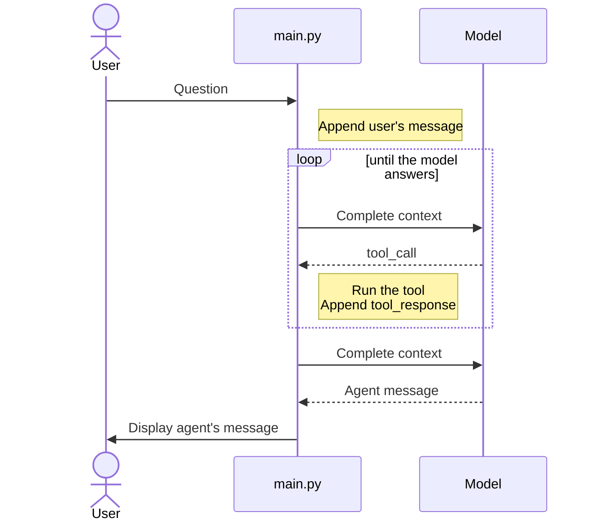
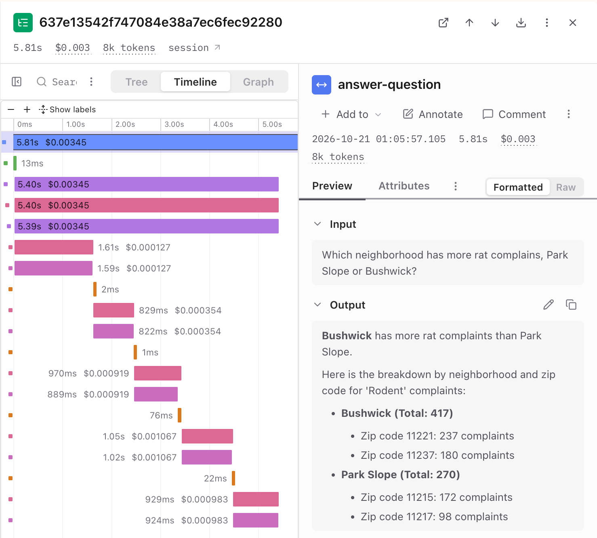
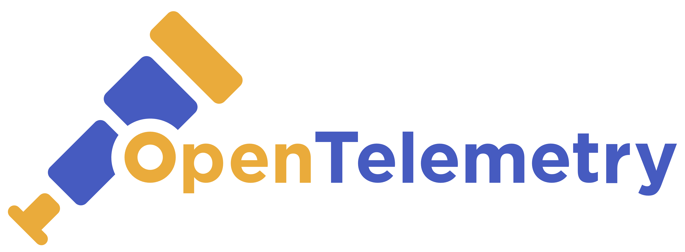
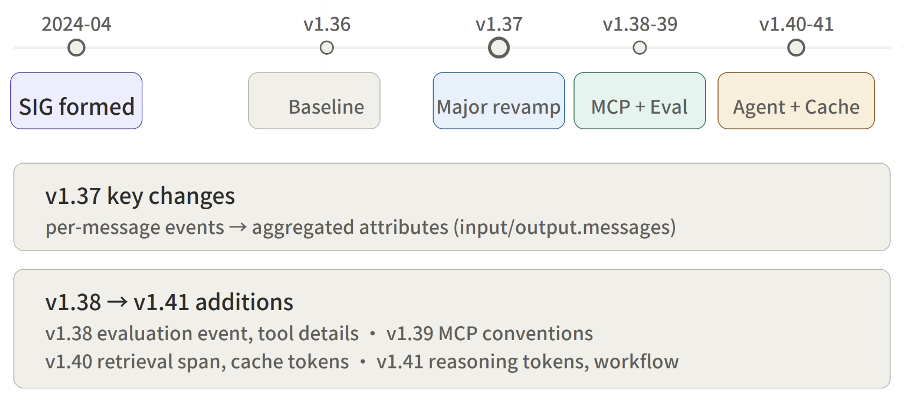
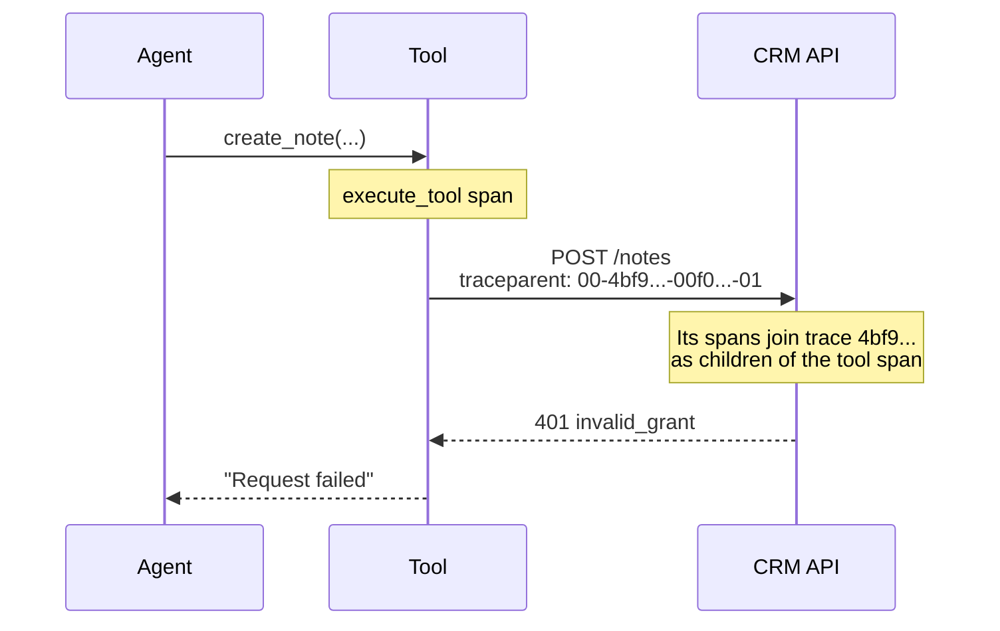
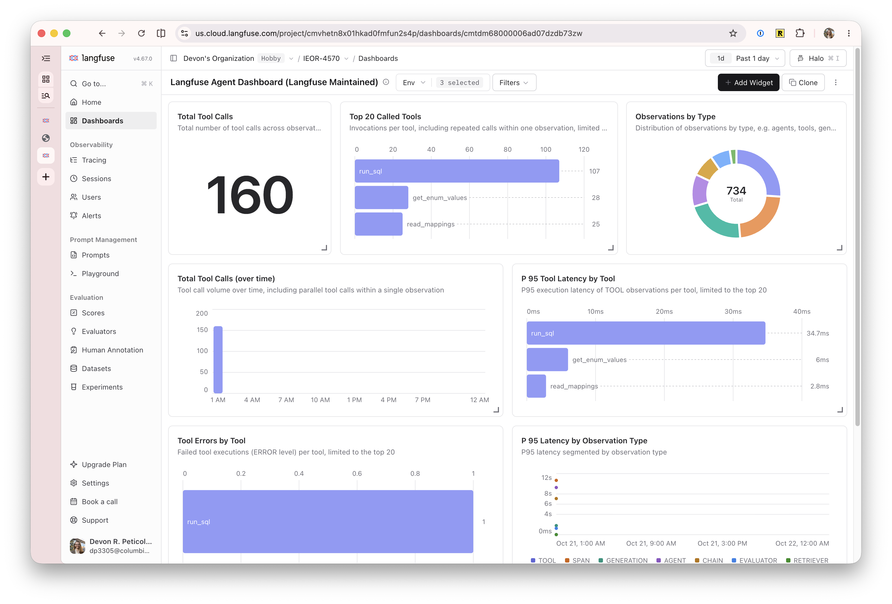

# Tracing and Monitoring

IEOR 4570 - Agentic AI for Data Science

<div class="absolute bottom-2 left-2 p-2 pl-4 text-left w-125 border-1">

Please note: The perspectives shared today are based on my personal experience and do not represent the views of my employer.

</div>

---
layout: side-title
color: sky
align: rm-lm
---

::title::

## Learning Objectives

::content::

1. Explain traces, spans, and attributes, and how an agent run becomes a trace
2. Read an agent's trace to find where a run went wrong
3. Compare OpenTelemetry's GenAI conventions with OpenInference
4. Instrument an agent and send its traces to Langfuse

---
layout: two-cols-title
columns: is-6
align: l-cm-lm
---

::title::

## The problems we're trying to solve?

::left::



::right::

- **P1:** The model is non-determinsitic about it's decisions. Two inputs to the same agent with the same outputs may get to their solution differently.

- **P2:** When improving the agent, we need some understanding of it's misconceptions and actions so we can improve the prompt/tools/RAG.

- **P3:** When something goes wrong, we need to know where and how we got there.

---
layout: section
color: violet
---

# Traces and Spans

---
layout: two-cols-title
columns: is-6
align: l-lt-lt
zoom: 0.85
margin: tight
---

::left::

## A Trace Is a Tree of Spans


Traces are a tool to give us the big picture of what happens when a request is made to an application.

Trace
: One logical operation (like a button click) followed across all the components and services it touches.

Span
: One unit of work inside the trace. Each hop creates its own span and records the span that called it (its parent).


<svg viewBox="0 0 400 76" width="100%" fill="currentColor" style="font: 11px monospace">
  <text style="font: 11px monospace" x="0" y="16">checkout</text>
  <rect x="100" y="6" width="290" height="13" rx="3" fill="#60a5fa"/>
  <text style="font: 11px monospace" x="10" y="42">charge_card</text>
  <rect x="112" y="32" width="168" height="13" rx="3" fill="#a78bfa"/>
  <text style="font: 11px monospace" x="10" y="68">reserve_stock</text>
  <rect x="286" y="58" width="96" height="13" rx="3" fill="#fbbf24"/>
</svg>

<br>

```python
from opentelemetry import trace

tracer = trace.get_tracer("shop")

with tracer.start_as_current_span("checkout") as span:
    span.set_attribute("cart.items", len(cart))
    with tracer.start_as_current_span("charge_card") as charge:
        charge.set_attribute("payment.amount", 38.50)
        charge_card(cart)
    with tracer.start_as_current_span("reserve_stock"):
        reserve_stock(cart)
```


::right::

### Traceparent Header

Header defining the trace and it's relationship to it's parent.

ver.
: (00) The format version.

trace-id
: (32 hex-chars) Identifies the whole trace.

parent-id
: (16 hex-chars) The caller' span ID.

flags
: (2 hex-chars) A bit-field of flags.

### Span Data

Each service records its own spans and exports them to a collector, which stitches them into a trace by ID.


trace-id / parent-id
: From the `traceparent` header.

span-id
: (16 hex-chars) This span's own ID.

name
: What the work was (e.g. `GET /users`).

start / end
: Timestamps from the local clock.

attributes
: Optional key/values describing the work.


```yaml
name:           charge_card
trace_id:       4bf92f3577b34da6a3ce929d0e0e4736
span_id:        00f067aa0ba902b7
parent_id:   00f067aa0ba902b7
start_time:     12:00:01.020
end_time:       12:00:01.250
attributes:     {payment.amount: 38.5}
```

---
layout: two-cols
columns: is-5
align: lm-lm
---

::left::

## An Agent Run as Spans

<br>

- The logical operation of the trace is single task of the agent.
- Each (inner) turn, generation, and tool call are a span
- Turns nest generation and tool call(s).
- Attributes for generation are token input, output, reasoning tokens, and cost.
- Attributes for tool calls are input and output.
- All spans track time.

::right::

{width="100%"}

---
layout: two-cols-title
columns: is-8
align: l-lt-lt
zoom: 0.85
---

::title::

## Reading an Agent Trace

-# "What neighborhood has the most rat complaints?"

::left::

<svg viewBox="0 0 600 263" width="100%" fill="currentColor" style="font: 10px monospace">
  <line x1="205.0" y1="12" x2="205.0" y2="263" stroke="currentColor" stroke-opacity="0.12"/>
  <text style="font: 10px monospace" x="199" y="8" fill-opacity="0.6">0s</text>
  <line x1="258.0" y1="12" x2="258.0" y2="263" stroke="currentColor" stroke-opacity="0.12"/>
  <text style="font: 10px monospace" x="252" y="8" fill-opacity="0.6">1s</text>
  <line x1="311.0" y1="12" x2="311.0" y2="263" stroke="currentColor" stroke-opacity="0.12"/>
  <text style="font: 10px monospace" x="305" y="8" fill-opacity="0.6">2s</text>
  <line x1="364.0" y1="12" x2="364.0" y2="263" stroke="currentColor" stroke-opacity="0.12"/>
  <text style="font: 10px monospace" x="358" y="8" fill-opacity="0.6">3s</text>
  <line x1="417.0" y1="12" x2="417.0" y2="263" stroke="currentColor" stroke-opacity="0.12"/>
  <text style="font: 10px monospace" x="411" y="8" fill-opacity="0.6">4s</text>
  <line x1="470.0" y1="12" x2="470.0" y2="263" stroke="currentColor" stroke-opacity="0.12"/>
  <text style="font: 10px monospace" x="464" y="8" fill-opacity="0.6">5s</text>
  <line x1="523.0" y1="12" x2="523.0" y2="263" stroke="currentColor" stroke-opacity="0.12"/>
  <text style="font: 10px monospace" x="517" y="8" fill-opacity="0.6">6s</text>
  <line x1="576.0" y1="12" x2="576.0" y2="263" stroke="currentColor" stroke-opacity="0.12"/>
  <text style="font: 10px monospace" x="570" y="8" fill-opacity="0.6">7s</text>
  <text style="font: 10px monospace" x="0" y="22">answer-question</text>
  <rect x="205.0" y="13" width="390.0" height="11" rx="2" fill="#60a5fa"/>
  <text style="font: 10px monospace" x="0" y="41">  expand-entities</text>
  <rect x="205.0" y="32" width="1.5" height="11" rx="2" fill="#34d399"/>
  <text style="font: 10px monospace" x="0" y="60">  NYC 311 Analyst</text>
  <rect x="206.1" y="51" width="388.2" height="11" rx="2" fill="#a78bfa"/>
  <text style="font: 10px monospace" x="0" y="79">   1 read_mappings</text>
  <rect x="206.2" y="70" width="30.5" height="11" rx="2" fill="#f9a8d4"/>
  <rect x="236.9" y="70" width="1.5" height="11" rx="2" fill="#fb923c"/>
  <text style="font: 10px monospace" x="0" y="98">   2 get_enum_values</text>
  <rect x="237.1" y="89" width="43.4" height="11" rx="2" fill="#f9a8d4"/>
  <rect x="280.6" y="89" width="1.5" height="11" rx="2" fill="#fb923c"/>
  <text style="font: 10px monospace" x="0" y="117">   3 run_sql ILIKE '%rat%'</text>
  <rect x="281.2" y="108" width="39.6" height="11" rx="2" fill="#f9a8d4"/>
  <rect x="321.4" y="108" width="4.6" height="11" rx="2" fill="#fb923c"/>
  <text style="font: 10px monospace" x="0" y="136">   4 run_sql descriptors</text>
  <rect x="326.2" y="127" width="30.8" height="11" rx="2" fill="#f9a8d4"/>
  <rect x="357.3" y="127" width="2.8" height="11" rx="2" fill="#fb923c"/>
  <text style="font: 10px monospace" x="0" y="155">   5 run_sql descriptor ILIKE</text>
  <rect x="360.2" y="146" width="37.3" height="11" rx="2" fill="#f9a8d4"/>
  <rect x="397.7" y="146" width="8.4" height="11" rx="2" fill="#fb923c"/>
  <text style="font: 10px monospace" x="0" y="174" fill="#dc2626">   6 run_sql neighborhood</text>
  <rect x="406.3" y="165" width="38.7" height="11" rx="2" fill="#f9a8d4"/>
  <rect x="445.2" y="165" width="5.7" height="11" rx="2" fill="#ef4444"/>
  <text style="font: 10px monospace" x="0" y="193">   7 run_sql rats by borough</text>
  <rect x="451.1" y="184" width="33.3" height="11" rx="2" fill="#f9a8d4"/>
  <rect x="484.6" y="184" width="1.5" height="11" rx="2" fill="#fb923c"/>
  <text style="font: 10px monospace" x="0" y="212">   8 run_sql complaint types</text>
  <rect x="486.3" y="203" width="35.8" height="11" rx="2" fill="#f9a8d4"/>
  <rect x="522.3" y="203" width="1.5" height="11" rx="2" fill="#fb923c"/>
  <text style="font: 10px monospace" x="0" y="231">   9 run_sql descriptors</text>
  <rect x="523.3" y="222" width="35.9" height="11" rx="2" fill="#f9a8d4"/>
  <rect x="559.4" y="222" width="1.5" height="11" rx="2" fill="#fb923c"/>
  <text style="font: 10px monospace" x="0" y="250">  10 run_sql by borough</text>
  <rect x="560.9" y="241" width="32.5" height="11" rx="2" fill="#f9a8d4"/>
  <rect x="593.6" y="241" width="1.5" height="11" rx="2" fill="#fb923c"/>
  <text style="font: 10px monospace" x="591" y="26" text-anchor="end" fill="#1e3a8a">MaxTurnsExceeded</text>
</svg>

::right::

1. Turn 3's query, `complaint_type ILIKE '%rat%'`, matches one type: "Special Operations."
2. Turns 4 and 5 find rats under `descriptor`. Turn 6 queries a `neighborhood` column that doesn't exist.
3. Turns 7 to 10 fall back to `borough` and repeat queries until the SDK stops the run at 10 turns with `MaxTurnsExceeded`.

The table records ZIP codes. The neighborhood map in `entities.py` only runs when a question names a neighborhood, and the eval suite never asked a question like this one.


---
layout: section
color: teal
---

# OpenTelemetry

---
layout: two-cols-title
columns: is-6
align: l-lt-lm
zoom: 0.85
margin: tight
---

::left::

{width="85%"}

An open-source, vendor-neutral observability framework under the Cloud Native Computing Foundation (CNCF).

- A specification for all components.
- A standard protocol to define the shape of telemetry data.
- Semantic conventions that define a standard naming scheme for common telemetry data types.
- Language SDKs that implement the specification, APIs, and export of telemetry data.
- Tools such as OTEL Collector, OTEL Operator, etc.

_The GenAI SIG started in April 2024. It was formed under OpenTelemetry’s Semantic Conventions SIG to bring LLM client tracing (model, token usage, latency) to OTel semantic conventions. It's since expanded to include agent orchestration, MCP tool calling, content capture, and quality evaluation._

::right::

### Timeline

2010
: Google publishes [Dapper](https://research.google/pubs/pub36356/), its internal tracing system.

2012
: Twitter open-sources Zipkin, modeled on Dapper.

2016
: OpenTracing, a vendor-neutral tracing API, joins the CNCF.

2018
: Google releases OpenCensus, an API and implementation for traces and metrics.

2019
: OpenTracing and OpenCensus merge into OpenTelemetry.

2020
: W3C Trace Context (`traceparent`) becomes a web standard.

2021
: Tracing spec 1.0. Metrics and logs follow by 2023.

2024
: ==The GenAI SIG ships the first `gen_ai.*` conventions.==

2026
: OTel graduates from the CNCF, second to Kubernetes in contributor activity.

{width="80%" .mx-auto}

---
layout: two-cols-title
columns: is-6
align: l-lt-lt
zoom: 0.9
---

::title::

## Where the Conventions Stand

-# October 2026

<br>

There are multiple competing standards on top of OTEL, two in the lead.

<br>

::left::

### OTel GenAI

- Development stability: names can still change. Stabilization started in September 2026 with five spans, including `invoke_agent` and `execute_tool`.
- Moved in June 2026 to its own repo, `semantic-conventions-genai`.
- Microsoft and Traceloop lead the SIG. Google, Splunk, Honeycomb, and Pydantic approve changes.
- Google ADK, Strands, Pydantic AI, Microsoft Agent Framework, and the Vercel AI SDK emit it natively.

::right::

### OpenInference

- More span "kinds": `CHAIN`, `RERANKER`, `GUARDRAIL`, `EVALUATOR`, and `PROMPT`, plus cost and session attributes.
- Instrumentors for most frameworks, including the OpenAI Agents SDK, which traces in its own format.
- Since May 2026, its instrumentors can also write `gen_ai.*` attributes (via `OPENINFERENCE_ENABLE_GENAI_SEMCONV` environment variable).

::default::

Langfuse, Phoenix, Datadog, and LangSmith read both.

---
zoom: 0.68
---

## Two Names for the Same Span

Both are attribute names on OTel spans: OpenInference from Arize (2023), OTel GenAI from OTel's GenAI SIG (2024)

| | OpenInference<br/>`openinference.span.kind` | OTel GenAI<br/>`gen_ai.operation.name` |
|-|-|-|
| Agent run | `AGENT` | `invoke_agent` |
| Model call | `LLM` | `chat` |
| Tool call | `TOOL` | `execute_tool` |
| Retrieval | `RETRIEVER` | `retrieval` |
| Workflow step | `CHAIN` | `invoke_workflow` |
| Guardrail | `GUARDRAIL` | open issue |
| Reranking | `RERANKER` | open issue |
| Evaluation | `EVALUATOR` | `gen_ai.evaluation.result` event |
| Planning, memory | | `plan`, `create_memory`, ... |
| Conversation | `session.id` | `gen_ai.conversation.id` |
| Cost | `llm.cost.*` | open issue |

---
layout: code-right
codesize: 11px
align: lm
---

::left::

## Instrumenting Our Agent

-# `nyc-311-agent-langfuse.zip`

1. OpenInference turns the Agents SDK's own traces into OTel spans.
2. `get_client()` starts an OTel tracer that exports to Langfuse over OTLP.
3. `answer()` opens the root span, so the trace's input and output are the question and the answer.
4. `@observe` adds a span of our own for the entity lookup.
5. `propagate_attributes` puts the session ID and prompt version on every span that starts inside it.

::right::

```python
==OpenAIAgentsInstrumentor().instrument()==
==langfuse = get_client()==


@observe(name="expand-entities", as_type="retriever")
def expand(question: str) -> str:
    return entities.expand(question)


async def answer(question, session=None):
    prompt = langfuse.get_prompt(PROMPT)
    with (
        propagate_attributes(session_id=session.session_id,
                             prompt=prompt),
        langfuse.start_as_current_observation(
            name="answer-question", input=question) as span,
    ):
        task = expand(question)
        result = await Runner.run(agent, task, session=session)
        span.update(output=result.final_output)
```

---
layout: two-cols-title
columns: is-6
align: l-cm-lm
---

::title::

## Past the Tool Boundary

::left::



::right::

- `traceparent` carries the trace ID and the sender's span ID: `00-<trace-id>-<parent-id>-<flags>`. HTTP instrumentation adds it to outgoing requests and reads it on incoming ones.
- Reality can be messy:
    - Retries can show up as repeated tool calls.
    - 429 w/ backoff will look like a slow generation.
    - For our simple SQL agents, DuckDB is in-process so tool spans lack children.
    - It's easy to break integrations (Langfuse) w/ native FastAPI tracing.

::default::

-# https://nango.dev/blog/opentelemetry-ai-agent-observability/

---
layout: section
color: amber
---

# Langfuse

---
layout: two-cols-title
columns: is-5
align: l-lm-lm
zoom: 0.85
---

::title::

## Langfuse

langfuse.com

<br>

Langfuse is an open-source AI engineering platform built to help teams debug, analyze, and iterate on their AI agent applications.

::left::

- Built on top of OpenTelemetry.
- Traces include all LLM and non-LLM calls, including retrieval, embedding, API calls.
- Support for tracking multi-turn conversations as sessions and user tracking
- Integrates with most agent frameworks and LiteLLM (proxy).
- Supports Offline and Online Evals (mostly), prompt management, and cost tracking.

<br>

### Using it

You can self-host but it's kind of a nightmare (to the extent that it feels dark-pattern-y).

::default::

_They also offer a ==free Cloud tier== (which is what I'm showing you)._

::right::



---
layout: two-cols-title
columns: is-5
align: l-lt-lt
zoom: 0.85
---

::title::

## Langfuse and the Alternatives

::left::

### Strengths

- Open source (MIT, except enterprise features) and self-hostable, with an OTLP endpoint that reads OpenInference and `gen_ai.*`.
- Traces, prompts, datasets, experiments, and online evals in one place.
- Free Cloud tier: 50,000 units a month, 30 days of data.

<br>

### Weaknesses

- Self-hosting needs Postgres, ClickHouse, Redis, and blob storage.
- Evals/Experiments feel anchored in classic RAG-only and dialogue agents, not tool calling or multi-agent agents.

<br>

<AdmonitionType type="warning" title="Jury's Still Out">

Bought by ClickHouse in 2026.

</AdmonitionType>

::right::

Arize Phoenix and AX
: Phoenix is open source and built on OpenInference. Dynatrace bought Arize in 2026.

Braintrust
: Evals first, proprietary, expensive as all hell

LangSmith
: From LangChain. Proprietary; self-hosting is enterprise-only.

Pydantic Logfire
: OTel-native, open SDKs, closed backend

MLflow Tracing
: Open source, from Databricks

Datadog
: Good for teams already on Datadog


Most independent vendors in this space were bought in 2025 and 2026: Langfuse by ClickHouse, Arize by Dynatrace, Traceloop by ServiceNow, Weights & Biases by CoreWeave, Helicone by Mintlify.

_This is the strongest reason to stick to open standards, like OTel, over platform-specific SDKs. This is a similar argument to using LiteLLM._

---
layout: section
color: lime
---

# Example
<hr>

`nyc-311-agent-langfuse.zip`

---

## Reading List

<br>

- Sigelman et al. (2010). [Dapper, a Large-Scale Distributed Systems Tracing Infrastructure](https://research.google/pubs/pub36356/)
- Grafana. [What is a trace?](https://grafana.com/docs/learning-hub/intro-to-tracing/02-tracing-basics/04-what-is-a-trace/) and [What is a span?](https://grafana.com/docs/learning-hub/intro-to-tracing/02-tracing-basics/05-what-is-a-span/)
- Coding Crash Courses (2026). [Distributed Tracing for AI Agents with OpenTelemetry](https://www.youtube.com/watch?v=-Tt88AZY-9M)
- W3C (2020). [Trace Context](https://www.w3.org/TR/trace-context/)
- OpenTelemetry. [Context Propagation](https://opentelemetry.io/docs/concepts/context-propagation/)
- OpenTelemetry. [Semantic Conventions for Generative AI](https://github.com/open-telemetry/semantic-conventions-genai)
- OpenTelemetry (2025). [AI Agent Observability: Evolving Standards and Best Practices](https://opentelemetry.io/blog/2025/ai-agent-observability/)
- Integration Plumbers (2026). [Inside the OpenTelemetry GenAI SIG](https://www.integrationplumbers.io/resources/inside-the-opentelemetry-genai-sig)
- Arize. [OpenInference Specification](https://github.com/Arize-ai/openinference/tree/main/spec)
- Nango (2026). [OpenTelemetry for AI Agent Observability](https://nango.dev/blog/opentelemetry-ai-agent-observability/)
- Langfuse (2026). [What Is OTEL, and Why Does Langfuse Speak It?](https://www.youtube.com/watch?v=joRiZICf_LM)
- Langfuse. [Get Started with Tracing](https://langfuse.com/docs/observability/get-started), [Observability Data Model](https://langfuse.com/docs/observability/data-model), and [Token and Cost Tracking](https://langfuse.com/docs/observability/features/token-and-cost-tracking)
- Langfuse (2026). [AI Is Eating the AI Engineering Loop](https://langfuse.com/blog/2026-06-09-ai-is-eating-ai-engineering)
